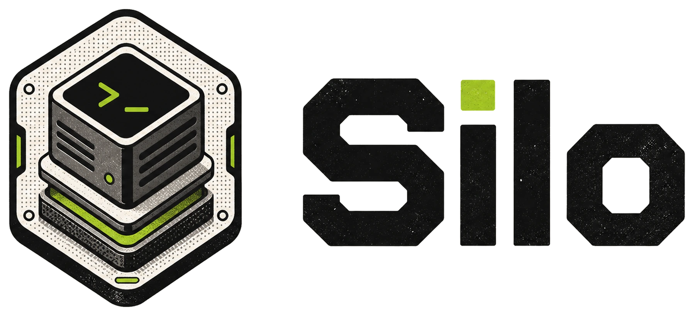

<p align="center">
  
</p>

Silo is a local microVM sandbox runtime where machines are created from OCI images.

The short version:

1. OCI image in.
2. Runtime config from policy.
3. Small, isolated VM out.

## Core Principles

- **Image first**: OS images are built from OCI images.
- **API first**: `libvm` is the core runtime interface.
- **Policy first**: networking, kernel access, and userspace access are driven by policy.

Only network policies are implemented today. Kernel and userspace policies are the direction.

The optional system appliance is managed by the Silo daemon, `silo daemon run`,
which `silo daemon up` registers with the native service manager; ordinary CLI
commands never run the daemon loop. Direct CLI VM operations continue to use
libvm in process.

`silo --version` (or `silo -V`) prints the product version without opening a runtime.

Enable the optional tailnet lobby with `silo daemon up --tailscale`. The lobby
runs inside silod; its pure-Go `tsgate` child handles Tailscale enrollment and
transport. Connect with `ssh -t silo` to manage owned VMs. See the
[operator guide](docs/lobby/operator.md),
[user command reference](docs/lobby/user.md) and
[tailnet policy](docs/lobby/tailnet-policy.md).

Each running VM is supervised by one `silo-vmm` process, Silo's virtual machine
monitor (VMM). It manages VM configuration, execution, and lifecycle across
virtualization backends.
With the default krun backend, libkrun runs in a private worker: the same
`silo-vmm` executable started with argv[0] `krun`. There is no standalone
krun runtime binary. Runtime packages ship it as `bin/silo-vmm` (or
`Contents/Helpers/silo-vmm` in `Silo.app`). See the
[silo-vmm architecture and qualification notes](docs/architecture/silo-vmm.md).

## Breaking storage reset

The ADR 0014/0021 storage release requires reinstalling Silo and wiping all
state from earlier installations. There is no upgrade migration, legacy cache
import, or compatibility reader. Silo refuses incompatible state with a
reinstall/reset diagnostic; it does not automatically delete it.

OCI creation on libkrun now defaults to `linux-erofs-overlay-v1`: shared,
immutable per-layer payload packs and merged EROFS metadata (`fsmeta`), with a
fresh private ext4 upper per machine. The image cache uses content-addressed
streams and a SQLite catalog, not mutable JSON metadata. There is no
`--root-profile` selector or template `root_profile` field. The development flat
profile has been removed, not migrated; obsolete profiles are rejected.

```sh
silo create ubuntu:24.04 --name overlay-dev --disk-size 4gib
silo run ubuntu:24.04 -- uname -a
```

`--disk-size` selects exact upper backing capacity (64 MiB through 1 TiB,
4096-byte aligned), not usable payload bytes. Filesystem metadata and an explicitly
reported unusable short-group tail reduce usable capacity. A small growth can
increase backing length without adding usable space. Resize requires a stopped
machine; the next boot replays and grows the upper in the guest.
The profile requires Linux 6.6 or newer on libkrun; overlay compatibility is a kernel-config property verified by the kernel track's build-time gate, not per boot, and the profile is
never silently substituted for raw. VZ rejects direct OCI and layered sources;
use explicit `silo image convert REF --disk-format raw` and then create from the
returned managed raw image. Imported disks remain opaque raw roots.
Snapshots and VM artifacts retain the exact fsmeta/pack graph, including
layer order and repetition, plus the upper and boot closure. Exact OCI
regeneration is only a digest-gated fallback, not a portability requirement.

The published-builder namespace gate matched all 35,904 independent umoci rows
through actual readonly EROFS mounts. Linux x86_64 stable 7.2.2 and
longterm 6.18.48 production roots passed boot, lifecycle and flatten gates.
Phase 24 recorded all five live operations and passing Btrfs/ext4 budgets on
Linux KVM x86_64. The [performance tracker](docs/architecture/live-operation-performance.md)
retains those historical measurements and their evidence paths. Current
admission uses backend availability and host/machine checks, not exact-build
qualification; foreign runtime evidence remains pending owner Phase 25.

`/tmp` remains persistent and disk-backed by default. With the overlay profile,
`--tmpfs-size 64mib` explicitly selects a memory-charged, nonpersistent `/tmp`;
its capacity is separate from the upper. On a stopped overlay machine,
`silo set overlay-dev tmpfs-size=off` restores disk-backed `/tmp` at next boot
without deleting previously hidden disk contents; `tmpfs-size=64mib` selects it
again. Templates support the same choices:

```yaml
version: "1"
image: ubuntu:24.04
disk_size: 4gib
tmpfs_size: 64mib
```

See [ADR 0014](docs/adr/0014-layered-oci-image-storage.md) for the storage model.

### Export a stopped root disk

```sh
# Opaque raw root: preserve exact virtual disk bytes.
silo storage export raw-dev /outside/silo-home/root.raw --disk-format raw
# Layered root: explicitly produce a new whole-disk ext4 filesystem.
silo storage export overlay-dev /outside/silo-home/flattened.raw \
  --disk-format raw --flatten-filesystem --format json
```

The machine must already be stopped; export never stops or repairs it. Only the
root is exported, not attached data disks or shares. The destination parent must
exist outside Silo's state root, and neither `DEST` nor `DEST.json` may exist.
The disk and its JSON sidecar are published without overwriting either.
`--format json` prints the same report, including geometry, boot requirements and
export kind. Its `path` and `metadataPath` are arrays of raw Unix pathname bytes,
not JSON strings, so non-UTF-8 paths remain lossless.

Opaque export preserves deleted-data remnants and dirty journals exactly.
Layered flattening instead requires strictly supported, clean on-disk ext4 and
OverlayFS index state, irrespective of the recorded stop outcome. Dirty uppers
return a typed recovery-required error; unsupported or inconsistent state is
rejected, not approximated. No host journal replay or implicit recovery occurs.
Flattening preserves the visible namespace and hardlinks, removes OverlayFS
controls and creates a new filesystem UUID/identity. It is not sanitization or
an exact snapshot. Export currently requires Linux direct boot; EFI and macOS
roots are rejected. No EFI layout or provider bootloader is synthesized.

## Live operations with stock images

On supported libkrun hosts, stock systemd, busybox and OpenRC images support
pause/resume, hibernate/wake, snapshots with memory, restore and live fork without an `init=` override.
The image init remains PID 1 inside a contained cgroup namespace; Silo sessions
use a separate workload cgroup. `silo info` reports boot mode `contained-init`.

```sh
silo create ghcr.io/vandycknick/archlinux:latest --name dev --memory 1gib
silo start dev
silo pause dev
silo resume dev
silo hibernate dev
silo start dev
silo snapshot create dev --memory --name dev-saved
silo restore dev-saved --name restored
silo fork dev --live --name child
```

### Hibernate and wake

`silo hibernate NAME` saves a persistent VM's memory and execution state, then
releases its host processes. `silo start`, `exec`, `shell` (including serial
attach), `cp`, guest file operations and opening a forward wake the same VM.
Listing machines or forwards, `info` and `logs` never wake it. A command that
wakes the VM prints nothing extra when the wake takes under half a second;
past that it shows a spinner with the current step on a terminal, cleared
before the command's own output. Command output, JSON and copied bytes are
never touched.

Existing shell, exec, forward and network connections end at hibernate. Reconnect
after wake. `silo stop NAME` wakes and shuts down cleanly; if wake is impossible,
it discards the saved state and warns. `silo stop NAME --force` discards without
waking, losing anything held only in memory. The next start cold boots.

Hibernate requires a cooperating guest agent with same-machine activation
support. Older machines need new boot assets: stop them, run
`silo set NAME boot-assets=packaged`, then start them before hibernating.
Use `silo info NAME` for the hibernation time, saved-state size and incremental
or full memory-write statistics.

Lifecycle commands show a spinner on a terminal, then a result with the name,
short ID and elapsed time. Live fork reports every child, any child failures,
and whether the source resumed or was left paused. Noninteractive output has
the same final results without spinner control codes. Restore and live fork
wait for the configured guest agent before reporting success.
Successful forks omit the operation banner; failures, cancellations and explicit
`fork --operation UUID` observations include the operation ID. Source outcomes
use the machine name. Exact-byte copying caveats are documented in command help.

Use `--format json` for scripts, including operation observation and cancellation:

```sh
silo snapshot create dev --memory --name saved --format json | jq .snapshot.id
silo fork dev --live --name scripted-child --format json | jq .children
silo fork --operation UUID --format json
silo fork --operation UUID --cancel --format json
silo restore saved --name scripted-restore --format json | jq .id
```

Snapshot JSON keeps its full capture result; snapshot creation without memory
returns snapshot metadata directly. Restore and stopped fork JSON return an
object with `id` and `name`, not a bare machine ID.

Before a restored or forked child runs image services, Silo reseeds the kernel
RNG, reapplies networking, replaces an existing non-empty `/etc/machine-id` with
the child's Silo machine ID (32 lowercase hex), and atomically replaces
`/run/silo/generation` with its run ID. Missing or empty machine-id files stay
unchanged. The generation file is not written at cold boot or into the source.
Other guest identities and userspace RNG caches are not automatically reset.

An image can react after thaw using its init's file watch. For systemd, install
these two files in the guest and run
`systemctl daemon-reload && systemctl enable --now silo-generation.path`:

```ini
# /etc/systemd/system/silo-generation.path
[Unit]
Description=Watch Silo restore and fork activation
[Path]
PathChanged=/run/silo/generation
Unit=silo-generation.service
[Install]
WantedBy=multi-user.target
```

```ini
# /etc/systemd/system/silo-generation.service
[Unit]
Description=Refresh cached guest identity after Silo activation
[Service]
Type=oneshot
ExecStart=/usr/bin/systemctl try-restart systemd-journald.service systemd-networkd.service
```

Adapt the service list to the image and restart applications with cached
identity or userspace randomness as needed. The file-watch event runs after
thaw. Do not call `systemctl` from a Silo activation hook: hooks run before
thaw with the image init frozen, so that call blocks until the hook deadline.
Activation replaces image-managed network configuration once; network managers
can resume DHCP afterwards.

Containment checks refuse escaped tasks with `guest-containment-escaped` and
leave the source running. They detect accidents and naive escapes, not
malicious guest root. Guest root's `kill -9 -1` can kill the agent; host
`silo stop` still recovers the VM. With image-owned PID 1, ordinary stop attempts
a bounded guest filesystem sync before the host force stop; a timeout is not
proof of persistence or orderly image-service shutdown.
See [ADR 0021](docs/adr/0021-live-snapshots-and-forks.md).

Snapshots with memory and live forks prefer incremental capture when a valid baseline exists;
`--capture-policy full` remains an explicit override. Restore, fork and capture
do not reserve host RAM; disk, descriptor and fork-count admission still apply.
First owned reflink RAM publication trusts producer identities without readback.
Cold durable restore and export authenticate RAM; warm restore can reuse an
unchanged-inode verification receipt, and local forks trust owned producer RAM.
See ADR 0021 for these distinct corruption-detection boundaries.

## Stopped handoff

`silo handoff` coordinates two already-running, same-user daemons selected by
their Home, config and run-root paths. The CLI currently connects through local
Unix sockets; it does not provision a cloud host or establish remote transport.
It transfers verified missing objects and chunks rather than uploading a lower
already present on the destination.

Review the plan before approving its exact digest. Use one stable operation UUID
for the entire transfer and any recovery:

```sh
operation="$(uuidgen)"
destination=(--destination-home /srv/silo/cloud/state
             --destination-config /srv/silo/cloud/config/silo
             --destination-run-root /run/user/1000/silo-cloud)
silo handoff plan dev --mode relocate --operation "$operation" "${destination[@]}"
# Set approved_digest to the digest of the reviewed plan.
silo handoff transfer dev --mode relocate --operation "$operation" \
  --approve-plan "${approved_digest:?set the reviewed plan digest}" "${destination[@]}"
silo handoff status "$operation" "${destination[@]}"
```

The source uses the ordinary `SILO_HOME`, `XDG_CONFIG_HOME` and `SILO_RUN_ROOT`
selection; `--destination-config` names the destination's Silo config directory
(`$XDG_CONFIG_HOME/silo`), not its parent. `relocate` preserves the machine ID,
advances its ownership epoch and
fences the prior owner. `--mode fork --name child` gives the destination a fresh
machine ID. Both modes require a stopped cut; `--stop-running` explicitly permits
stopping the source. Neither mode starts a guest or generalizes guest identities.
Changed stopped bytes or a replacement source run require a new approved plan.

The default preserves the exact boot bundle. `--boot-bundle sha256:…` approves
one complete destination bundle, including any required architecture/translation
change, rather than choosing new assets silently. External resources require
explicit destination mappings.

After interruption, use `silo handoff recover "$operation" "${destination[@]}"`.
`handoff abort` obtains a durable destination decision before releasing the
source reservation. An unknown or unreachable destination is not an abort.
Terminal receipts survive payload cleanup and daemon restarts.

Plan, transfer, status, recover and abort print key/value text by default.
Add `--format json` to the subcommand for its full machine-readable document.

## Development tests

Run `make test` inside `nix develop` for the host-supported Rust suites and netd
tests. Rust tests use cargo-nextest with process isolation and a single workspace
pass; integration tests share a prebuilt mock `silo-vmm`. `make test-unit` runs
Rust unit tests only, while `make test-integration` runs Rust integration tests
and netd tests. Both Rust unit commands also test rprobe without default features.
The test runner warms netd's Go build cache before starting parallel Rust tests,
so real-process fixtures do not spend their test timeout compiling cold dependencies.

With `CI=true`, nextest uses the `ci` profile and writes JUnit results under
`target/nextest/ci/junit.xml` (under `CARGO_TARGET_DIR` when overridden).
Real-VM qualification is separate; see the [smoke suite](smoke/README.md).

For manual testing, give each build its own `SILO_HOME` on a disk-backed
directory, never `/tmp`: on most Linux hosts `/tmp` is tmpfs, so image streams
and multi-GiB guest disks would sit in RAM and reflink copies would not apply.

```bash
make build PROFILE=release
mkdir -p ~/sm && export SILO_HOME=$(mktemp -d ~/sm/silo.XXXXXX)
target/release/silo create alpine:3.21 --name dev
```

Sockets and locks still go to the short runtime directory (`/tmp/silo-$UID`),
which holds no disk bytes. Stop every VM before deleting a scratch home.

## CLI

Tracing diagnostics go to stderr, separately from command results on stdout.
The CLI defaults to warnings and errors, including calls into libvm. Use `-v`
for debug diagnostics (including the machine start timeline) without SQL
statements, `-vv` to additionally log SQL statements, or `-vvv` (and higher) for
trace diagnostics. All verbose levels show full error chains. A valid, nonempty
`RUST_LOG` filter overrides verbosity, for example
`RUST_LOG=warn,libvm::runtime::start_timeline=debug silo start archy`.
Missing, empty or invalid filters fall back to the verbosity/default policy.
Registry client diagnostics on `oci_client::client` are capped at info even with
`RUST_LOG=trace`, because debug logs can contain bearer tokens. Only an explicit
`RUST_LOG` directive naming `oci_client::client` bypasses this cap. Do not enable
that target's debug or trace logs when capturing or sharing diagnostics.
Tracing temporarily clears and redraws active spinners and pull progress so
diagnostics cannot split their lines. `silo daemon run` uses the same policy;
native service managers retain their existing stderr capture. Monitor and
guest-agent logs keep their info default and their owned trace/serial sinks.
Rust entrypoints that use tracing install it through `utils::logging`;
libraries only emit events and never replace the process subscriber.

Build the CLI locally:

```bash
nix develop
make build
```

The Linux development shell includes `pkg-config` and `virglrenderer` for
compile-checking libkrun's optional GPU code. Compilation does not require a
physical GPU; accelerated GPU runtime verification requires a suitable device
and driver. This does not enable GPU snapshots with memory.

On Apple Silicon macOS, this also downloads and verifies the prebuilt Rosetta
probe, so no Linux builder is needed for normal development. Use
`RPROBE_PATH=/absolute/path/to/rprobe` to override it with a locally built probe.
See the
[probe guide](guest/rprobe/README.md#development-builds-and-publication).

Run a temporary workload from an image:

```bash
silo run ubuntu:24.04 -- uname -a
```

`create` and `run` take images only. An operand resolves in this order: an exact
local image name, then each `search_registries` expansion already stored
locally (`alpine:3.21` becomes `docker.io/library/alpine:3.21`), then a pull
following `--pull always|missing|never` (default `missing`), then a unique image
id prefix (`sha256:HEX`, at least 3 hex characters). Local names cannot contain
`:` or `/`, so `hello:v2`, `nixos/nix` and `ghcr.io/...` are always registry
references, and a local name shadows a registry short name. `disk:PATH` selects
a local disk image. A snapshot name or snapshot artifact is refused with a hint
to use `silo restore`. Without `--name`, `run` creates a generated
ephemeral machine and removes it after the workload finishes.

Registry access and TLS trust live under `images` in `config.yaml`:

```yaml
images:
  default: deny
  search_registries: ["registry.example:5443", docker.io]
  rules:
    - {prefix: "registry.example:5443/team", action: allow}
    - {prefix: docker.io/library, action: allow}
  registries:
    "registry.example:5443":
      ca: certs/registry-ca.pem
```

`rules` decide which references may contact a registry at all: the longest
matching prefix wins and `default` applies otherwise. `registries` selects extra
TLS roots by the registry named in an image reference. `ca` points to a PEM
file holding one or more certificates; a relative path resolves against the
directory of the `config.yaml` that was read. System roots stay trusted and TLS
hostname verification stays on. The selected roots apply to every request made
on behalf of that registry, including blob redirects and token services on
other hosts. They are not installed globally, and a pull that names another
registry does not inherit them. A CA entry never grants access; `rules` still
decide that.

Keys are `host[:port]`, compared in lowercase. `host` and `host:443` are the
same key, and `index.docker.io` is `docker.io`. There are no wildcards, and a
key that appears twice is an error. A `ca` file that is missing, unreadable,
empty or not valid PEM fails the configuration load with the registry key and
the resolved path; Silo never falls back to system roots alone. The bundle is
read once per configuration load. Its digest is part of the daemon's
configuration identity, so replacing a CA file counts as a configuration change
and takes effect when the daemon restarts.

A `disk:PATH` source is a quiesced regular raw or qcow2 file (never a symlink),
booted directly with the host-native Linux platform, the whole disk as root and
the packaged boot assets pinned at creation. The plan shows these assumptions.
`create --dry-run` and `run --dry-run` print key/value plans by default;
add `--format json` before piping a plan into JSON tools.
Select a partitioned root or another userspace explicitly:

```bash
silo create disk:./cloud.qcow2 --root gpt:01234567-89ab-cdef-0123-456789abcdef
silo create disk:./cloud.raw --root auto --platform linux/amd64 --rosetta
silo create ubuntu:24.04 --platform linux/arm64 --rosetta=false
```

`--root` accepts `whole-disk`, `auto` (GPT discoverable partitions for the
declared platform), `gpt:GUID` or `mbr:1..4`; a partition is never guessed.
`--rosetta` requests Rosetta, `--rosetta=false` explicitly disables it, and
omitting it leaves no intent. An amd64 userspace on an arm64 host requires
Rosetta, so it conflicts with `--rosetta=false`.

Import a reusable disk image, or flatten one selected OCI manifest into a
raw image (required before an OCI root can run on VZ):

```bash
silo image import ./cloud.qcow2 --platform linux/amd64 --root auto --boot linux-direct --name cloud
silo image convert ubuntu:24.04 --disk-format raw --platform linux/arm64 --name ubuntu-raw
silo create cloud --name web
silo image inspect cloud
silo image list
silo image rm cloud      # removes the name; the image goes with its last name
silo image rm sha256:HEX # removes the image and all its names
silo image prune         # removes unnamed images no machine uses
```

`silo image list` and `silo snapshot list` print tables, omitting unavailable
optional columns. Inspect commands group human-labelled key/value details, with
readable creation times and comma-separated names. Image import, convert, pull
and push also print key/value results by default. Add `--format json` to any of these commands (including
`image inspect-remote` and `snapshot inspect`) to select the full JSON document:

```sh
silo image list --format json | jq .
silo snapshot list --format json | jq .
silo image inspect cloud --format json | jq .
```

`silo snapshot verify NAME` (or an id) rereads and authenticates
every RAM, state and disk byte of a local snapshot, ignoring trust receipts. It
can take as long as reading the whole snapshot. Success reports the snapshot
identity, stream count and verified bytes. `--format json` returns `snapshot`,
`streams` and `bytes`; verification failures return an `error` object with the
role, member or chunk, expected and actual identities, and recovery `guidance`,
and still exit nonzero. Do not restore a failed snapshot; restore from another
snapshot or re-create it.

Images and snapshots share one storage pool but have separate names, so an
image `hello` and a snapshot `hello` can coexist. `silo snapshot create VM
[--name N]` captures the disks of a stopped VM; add `--memory` on a running VM
to capture RAM as well. A running VM without `--memory` is refused (stop it
first), and `--memory` on a stopped VM is refused. `silo snapshot list` shows
NAME(S), ID, MEMORY, SOURCE and CREATED. `silo snapshot rm` follows the same
name and id semantics as `silo image rm`.

`silo restore REF [--name N] [--pull]` is the only way to turn a snapshot into a
VM; it resolves like `create`, with the snapshot kind expected. A snapshot
preserves its complete captured configuration; only `--name` applies. A
snapshot without memory restores stopped; a snapshot with memory requires
compatible live-restore admission rather than falling back to a cold boot.
For explicit storage-only recovery, use
`silo restore <SNAPSHOT> --without-memory --name <CHILD>`. This creates a stopped
machine with private disks and the captured boot assets; RAM is discarded and
the disks may need journal recovery on boot. Its stop outcome is unknown; an
explicit `silo start <CHILD>` cold-boots it.

The krun backend is required for snapshots, forks, restores and hibernation.

Transfer a complete stored image through an OCI VM artifact:

```bash
silo image push cloud registry.example/team/cloud:v1
silo image inspect-remote registry.example/team/cloud:v1
silo image pull registry.example/team/cloud:v1
silo create registry.example/team/cloud:v1 --name web-copy
```

Pulling adds the reference as the image name. Ordinary OCI creation does not
implicitly acquire VM artifacts. `image pull` refuses a snapshot artifact (use
`silo restore REF`), and `image push` refuses snapshots. Snapshot push is not
available until it has mandatory encryption and a design for secrets held in
memory; `silo restore REF` can still pull a snapshot artifact.
Publication uses independent zstd chunks by default; `--raw` changes the transfer
encoding, not the canonical image identity. Pull stores the complete closure
without starting it. The artifact format is specified in
[VM artifact format](docs/architecture/vm-artifact.md).

A machine never changes kernel or initramfs on its own. `silo info` shows the
pinned bundle and a newer locally admitted packaged bundle when one exists;
replace it explicitly on a stopped machine:

```bash
silo set dev boot-assets=packaged
silo set dev boot-assets=files boot-kernel=/abs/vmlinux boot-initramfs=/abs/initramfs boot-agent=none
```

Detached mode runs the workload in the background. It does not make the VM
independent of that workload: the VM still stops when the workload exits.

```bash
silo run --detach ubuntu:24.04 -- sleep 300
silo run --detach --name worker ubuntu:24.04 -- sleep 300
silo logs worker --stream exec --follow
```

The first detached machine is removed after `sleep` exits. The named machine is
stopped but retained for later inspection. If no command follows `--`, `run`
uses the image's resolved default workload; an interactive shell may exit
immediately when detached because it has no attached terminal or input. See the
[run lifecycle guide](docs/run-lifecycle.md) for the complete behavior matrix.

Create a persistent VM, then start it when you need an idle development
environment:

```bash
silo create ghcr.io/vandycknick/archlinux:latest --name dev
silo start dev
silo shell dev
```

`create` always leaves the VM stopped. `start` and `restart` boot a persistent
VM without starting an application workload. Image process settings are retained
with the machine and provide the default command for `silo exec dev` when no
command follows `--`.

`start` normally waits for guest readiness. Use `silo start --no-wait dev` to
return once the VM is running, for example before attaching to a rescue console.
On a stopped VM, repeat `silo set dev kernel-arg=ARG` to append direct-boot kernel
arguments; `silo set dev kernel-args=` clears user arguments. Kernel arguments
cannot be mixed with other settings in the same `set` command.

Boot failures print diagnostics, sync filesystems and power off by default,
including raw and layered roots. To inspect a failure interactively:

```bash
silo set dev kernel-arg=silo.rescue=on-failure
silo start --no-wait dev
silo shell --attach serial dev
```

`silo.rescue=always` opens the same shell before successful handoff as well as
on failure. Leaving the shell powers off. See the
[boot diagnostics guide](docs/run-lifecycle.md#boot-diagnostics-and-rescue)
for argument restrictions and failure reporting.

Copy regular files to and from a running VM:

```bash
silo cp ./patch.diff dev:/root/patch.diff
silo cp dev:/root/shot.png ./shot.png
```

Use `-` for stdin/stdout. Uploads accept `--mode OCTAL`, numeric
`--owner UID[:GID]`, `--parents` (`-p`), and best-effort (not atomic)
`--no-clobber` (`-n`). Guest paths must be absolute; prefix local paths
containing `:` with `./` or `/`. Downloads replace the local target atomically.
Use `--format json` for a transfer summary, except when downloading to stdout
(`-`), where stdout carries only file bytes. Human summaries go to stderr.

## Templates

Templates are reusable machine defaults stored below the Silo configuration
directory. They are strict version-1 YAML documents: `version` must be the
string `"1"`, and unknown fields are rejected. A template may provide an image;
a positional image on `create` or `run` takes precedence.

```yaml
version: "1"
description: Development defaults
image: ubuntu:24.04
resources:
  cpus: 4
  memory: 4gb
disk_size: 40gb
network:
  kind: private
labels:
  team: runtime
```

Create and validate one with:

```bash
silo template create dev ubuntu:24.04
silo template edit dev
silo template validate dev
silo run --template dev -- cargo test
```

Inspect and manage machines:

```bash
silo ls
silo info dev
silo system info
silo stop dev
silo rm dev
```

## Persistent Docker Service

Silo can run an optional per-user Docker Engine in a persistent system VM. Its
engine data survives daemon and appliance replacement, while the host uses the
dedicated `silo` Docker context and `~/.silo/run/docker.sock` endpoint. This is
separate from ordinary Silo VMs and does not require or replace a host Docker
Engine.

The appliance receives every available cgroup controller, including `cpuset`
when offered. Agent readiness can precede image-init readiness: before starting
Docker, appliance activation waits up to 30 seconds for systemd to report
`running` or `degraded`, not merely to answer an early property query.

See the [system daemon operator guide](docs/system-daemon.md) for setup,
security implications, lifecycle, upgrades, recovery, and deliberate v1
limitations.

## Rust library

Use `libvm` when you want to create and manage machines directly from Rust. See
the [libvm guide](runtime/libvm/README.md) for lifecycle and process details.

```rust
use libvm::{LibVmError, Memory, Runtime};

#[tokio::main(flavor = "current_thread")]
async fn main() -> Result<(), LibVmError> {
    let runtime = Runtime::from_env().await?;

    let machine = runtime
        .machine()
        .image("ghcr.io/vandycknick/archlinux:latest")
        .name("devbox")
        .cpus(6)
        .memory(Memory::gibibytes(16))
        .network(|network| network.private())
        .create()
        .await?;

    machine.start().await?;

    Ok(())
}
```

## Docs

- [Packaging](PACKAGING.md)
- [Hybrid vsock](docs/hybrid-vsock.md)
- [Terminology](docs/terminology.md)
- [Guest agent](guest/agent/README.md)
- [System daemon](docs/system-daemon.md)
- [Layered OCI storage (ADR 0014)](docs/adr/0014-layered-oci-image-storage.md)
- [Live snapshots and forks (ADR 0021)](docs/adr/0021-live-snapshots-and-forks.md)
- [Live-operation performance tracker](docs/architecture/live-operation-performance.md)
- [Run lifecycle](docs/run-lifecycle.md)
