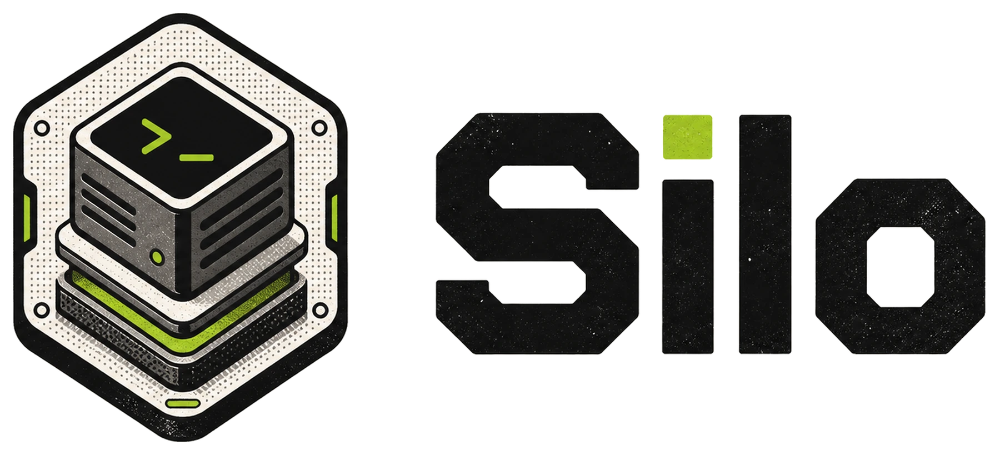

<p align="center">
  
</p>

Silo is a local microVM sandbox runtime where machines are created from OCI images.

The short version:

1. OCI image in.
2. Runtime config from policy.
3. Small, isolated VM out.

## Core Principles

- **Image first**: OS images are built from OCI images.
- **API first**: `libvm` is the core runtime interface.
- **Policy first**: networking, kernel access, and userspace access are driven by policy.

Only network policies are implemented today. Kernel and userspace policies are the direction.

The optional system appliance is managed by the Silo daemon, `silo daemon run`,
which `silo daemon up` registers with the native service manager; ordinary CLI
commands never run the daemon loop. Direct CLI VM operations continue to use
libvm in process.

Each running VM is supervised by one `silo-vmm` process, Silo's virtual machine
monitor (VMM). It manages VM configuration, execution, and lifecycle across
virtualization backends.
With the default krun backend, libkrun runs in a private worker: the same
`silo-vmm` executable started with argv[0] `krun`. There is no standalone
krun runtime binary. Runtime packages ship it as `bin/silo-vmm` (or
`Contents/Helpers/silo-vmm` in `Silo.app`). See the
[silo-vmm architecture and qualification notes](docs/architecture/silo-vmm.md).

## Breaking storage reset

The ADR 0014/0021 storage release requires reinstalling Silo and wiping all
state from earlier installations. There is no upgrade migration, legacy cache
import, or compatibility reader. Silo refuses incompatible state with a
reinstall/reset diagnostic; it does not automatically delete it.

OCI creation on libkrun now defaults to `linux-erofs-overlay-v1`: shared,
immutable per-layer payload packs and merged EROFS metadata (`fsmeta`), with a
fresh private ext4 upper per machine. The image cache uses content-addressed
streams and a SQLite catalog, not mutable JSON metadata. There is no
`--root-profile` selector or template `root_profile` field. The development flat
profile has been removed, not migrated; obsolete profiles are rejected.

```sh
silo create ubuntu:24.04 --name overlay-dev --disk-size 4gib
silo run ubuntu:24.04 -- uname -a
```

`--disk-size` selects exact upper backing capacity (64 MiB through 1 TiB,
4096-byte aligned), not usable payload bytes. Filesystem metadata and an explicitly
reported unusable short-group tail reduce usable capacity. A small growth can
increase backing length without adding usable space. Resize requires a stopped
machine; the next boot replays and grows the upper in the guest.
The profile requires an exactly admitted kernel/init tuple on libkrun and is
never silently substituted for raw. VZ rejects direct OCI and layered sources;
use explicit `silo image convert REF --disk-format raw` and then create from the
returned managed raw image. Imported disks remain opaque raw roots.
Stopped snapshots and VM artifacts retain the exact fsmeta/pack graph, including
layer order and repetition, plus the upper and boot closure. Exact OCI
regeneration is only a digest-gated fallback, not a portability requirement.

The published-builder namespace gate matched all 35,904 independent umoci rows
through actual readonly EROFS mounts. Exact Linux x86_64 stable 7.2.2 and
longterm 6.18.48 production-root tuples passed boot, lifecycle and flatten gates.
The mandatory Phase 24 performance sweep remains outstanding; public live
execution lanes remain unqualified.

`/tmp` remains persistent and disk-backed by default. With the overlay profile,
`--tmpfs-size 64mib` explicitly selects a memory-charged, nonpersistent `/tmp`;
its capacity is separate from the upper. On a stopped overlay machine,
`silo set overlay-dev tmpfs-size=off` restores disk-backed `/tmp` at next boot
without deleting previously hidden disk contents; `tmpfs-size=64mib` selects it
again. Templates support the same choices:

```yaml
version: "1"
image: ubuntu:24.04
disk_size: 4gib
tmpfs_size: 64mib
```

See [ADR 0014](docs/adr/0014-layered-oci-image-storage.md) for the storage model.

### Export a stopped root disk

```sh
# Opaque raw root: preserve exact virtual disk bytes.
silo storage export raw-dev /outside/silo-home/root.raw --disk-format raw
# Layered root: explicitly produce a new whole-disk ext4 filesystem.
silo storage export overlay-dev /outside/silo-home/flattened.raw \
  --disk-format raw --flatten-filesystem --format json
```

The machine must already be stopped; export never stops or repairs it. Only the
root is exported, not attached data disks or shares. The destination parent must
exist outside Silo's state root, and neither `DEST` nor `DEST.json` may exist.
The disk and its JSON sidecar are published without overwriting either.
`--format json` prints the same report, including geometry, boot requirements and
export kind. Its `path` and `metadataPath` are arrays of raw Unix pathname bytes,
not JSON strings, so non-UTF-8 paths remain lossless.

Opaque export preserves deleted-data remnants and dirty journals exactly.
Layered flattening instead requires strictly supported, clean on-disk ext4 and
OverlayFS index state, irrespective of the recorded stop outcome. Dirty uppers
return a typed recovery-required error; unsupported or inconsistent state is
rejected, not approximated. No host journal replay or implicit recovery occurs.
Flattening preserves the visible namespace and hardlinks, removes OverlayFS
controls and creates a new filesystem UUID/identity. It is not sanitization or
an exact checkpoint. Export currently requires Linux direct boot; EFI and macOS
roots are rejected. No EFI layout or provider bootloader is synthesized.

## Stopped handoff

`silo handoff` coordinates two already-running, same-user daemons selected by
their Home, config and run-root paths. The CLI currently connects through local
Unix sockets; it does not provision a cloud host or establish remote transport.
It transfers verified missing objects and chunks rather than uploading a lower
already present on the destination.

Review the plan before approving its exact digest. Use one stable operation UUID
for the entire transfer and any recovery:

```sh
operation="$(uuidgen)"
destination=(--destination-home /srv/silo/cloud/state
             --destination-config /srv/silo/cloud/config/silo
             --destination-run-root /run/user/1000/silo-cloud)
silo handoff plan dev --mode relocate --operation "$operation" "${destination[@]}"
# Set approved_digest to the digest of the reviewed plan.
silo handoff transfer dev --mode relocate --operation "$operation" \
  --approve-plan "${approved_digest:?set the reviewed plan digest}" "${destination[@]}"
silo handoff status "$operation" "${destination[@]}"
```

The source uses the ordinary `SILO_HOME`, `XDG_CONFIG_HOME` and `SILO_RUN_ROOT`
selection; `--destination-config` names the destination's Silo config directory
(`$XDG_CONFIG_HOME/silo`), not its parent. `relocate` preserves the machine ID,
advances its ownership epoch and
fences the prior owner. `--mode fork --name child` gives the destination a fresh
machine ID. Both modes require a stopped cut; `--stop-running` explicitly permits
stopping the source. Neither mode starts a guest or generalizes guest identities.
Changed stopped bytes or a replacement source run require a new approved plan.

The default preserves the exact boot bundle. `--boot-bundle sha256:…` approves
one complete destination bundle, including any required architecture/translation
change, rather than choosing new assets silently. External resources require
explicit destination mappings.

After interruption, use `silo handoff recover "$operation" "${destination[@]}"`.
`handoff abort` obtains a durable destination decision before releasing the
source reservation. An unknown or unreachable destination is not an abort.
Terminal receipts survive payload cleanup and daemon restarts.

## Development tests

Run `make test` inside `nix develop` for the host-supported Rust suites and netd
tests. Rust tests use cargo-nextest with process isolation and a single workspace
pass; integration tests share a prebuilt mock `silo-vmm`. `make test-unit` runs
Rust unit tests only, while `make test-integration` runs Rust integration tests
and netd tests. Both Rust unit commands also test rprobe without default features.
The test runner warms netd's Go build cache before starting parallel Rust tests,
so real-process fixtures do not spend their test timeout compiling cold dependencies.

With `CI=true`, nextest uses the `ci` profile and writes JUnit results under
`target/nextest/ci/junit.xml` (under `CARGO_TARGET_DIR` when overridden).
Real-VM qualification is separate; see the [smoke suite](smoke/README.md).

Taild admission tests run on Linux and macOS. Their successful fixture-registry
pull subtests run only on Linux: macOS registry verification uses the keychain,
not the fixture's `SSL_CERT_FILE`. Pre-pull rejection checks still run on both.

## CLI

Build the CLI locally:

```bash
nix develop
make build
```

The Linux development shell includes `pkg-config` and `virglrenderer` for
compile-checking libkrun's optional GPU code. Compilation does not require a
physical GPU; accelerated GPU runtime verification requires a suitable device
and driver. This does not enable GPU live snapshots.

On Apple Silicon macOS, this also downloads and verifies the prebuilt Rosetta
probe, so no Linux builder is needed for normal development. Use
`RPROBE_PATH=/absolute/path/to/rprobe` to override it with a locally built probe,
or `RPROBE_REFRESH=1` to refresh the cached registry reference. See the
[probe guide](guest/rprobe/README.md#development-builds-and-publication).

Run a temporary workload from an image:

```bash
silo run ubuntu:24.04 -- uname -a
```

Image operands are parsed in this order: `image:NAME` or `image:sha256:HEX`
managed images and snapshots, then local disk images written as `disk:PATH`,
then OCI registry references. Without `--name`, `run` creates a generated
ephemeral machine and removes it after the workload finishes.

A `disk:PATH` source is a quiesced regular raw or qcow2 file (never a symlink),
booted directly with the host-native Linux platform, the whole disk as root and
the packaged boot assets pinned at creation. The plan shows these assumptions.
Select a partitioned root or another userspace explicitly:

```bash
silo create disk:./cloud.qcow2 --root gpt:01234567-89ab-cdef-0123-456789abcdef
silo create disk:./cloud.raw --root auto --platform linux/amd64 --rosetta
silo create ubuntu:24.04 --platform linux/arm64 --rosetta=false
```

`--root` accepts `whole-disk`, `auto` (GPT discoverable partitions for the
declared platform), `gpt:GUID` or `mbr:1..4`; a partition is never guessed.
`--rosetta` requests Rosetta, `--rosetta=false` explicitly disables it, and
omitting it leaves no intent. An amd64 userspace on an arm64 host requires
Rosetta, so it conflicts with `--rosetta=false`.

Import a reusable disk image, or flatten one selected OCI manifest into a
raw image (required before an OCI root can run on VZ):

```bash
silo image import ./cloud.qcow2 --platform linux/amd64 --root auto --boot linux-direct --name cloud
silo image convert ubuntu:24.04 --disk-format raw --platform linux/arm64 --name ubuntu-raw
silo create image:cloud --name web
silo image inspect image:cloud
silo image list
silo image remove image:cloud     # removes the alias only
silo image release image:sha256:HEX  # releases explicit retention only
```

Aliases share one `image:` namespace with snapshots. A snapshot source preserves
its complete captured configuration; only `--name` applies. Stopped checkpoints
restore stopped; live execution checkpoints require compatible live-restore
admission rather than falling back to a cold boot.
For explicit storage-only recovery of a live checkpoint, use
`silo recover-disks image:<CHECKPOINT> --name <CHILD>`. This creates a stopped
machine with private disks and the captured boot assets, not resumed execution.
Its stop outcome is unknown; an explicit `silo start <CHILD>` cold-boots it.

Transfer a complete managed image through an OCI VM artifact:

```bash
silo image push image:cloud registry.example/team/cloud:v1
silo image inspect-remote registry.example/team/cloud:v1
silo image pull registry.example/team/cloud:v1 --approve-digest sha256:HEX --name received
silo create image:received --name web-copy
```

Use the immutable index digest reported by inspection for `--approve-digest`.
Approval authorizes those exact bytes, not the publisher's identity.
`--require-signature` fails closed until a signature verifier is integrated.
Ordinary OCI creation does not implicitly acquire VM artifacts.
Publication uses independent zstd chunks by default; `--raw` changes the transfer
encoding, not the canonical image identity. Checkpoint publication additionally
requires `--acknowledge-checkpoint`: disks and RAM can contain secrets and
deleted-data remnants. Pull retains the complete closure without starting it.

A machine never changes kernel or initramfs on its own. `silo info` shows the
pinned bundle and a newer locally admitted packaged bundle when one exists;
replace it explicitly on a stopped machine:

```bash
silo set dev boot-assets=packaged
silo set dev boot-assets=files boot-kernel=/abs/vmlinux boot-initramfs=/abs/initramfs boot-agent=none
```

Detached mode runs the workload in the background. It does not make the VM
independent of that workload: the VM still stops when the workload exits.

```bash
silo run --detach ubuntu:24.04 -- sleep 300
silo run --detach --name worker ubuntu:24.04 -- sleep 300
silo logs worker --stream exec --follow
```

The first detached machine is removed after `sleep` exits. The named machine is
stopped but retained for later inspection. If no command follows `--`, `run`
uses the image's resolved default workload; an interactive shell may exit
immediately when detached because it has no attached terminal or input. See the
[run lifecycle guide](docs/run-lifecycle.md) for the complete behavior matrix.

Create a persistent VM, then start it when you need an idle development
environment:

```bash
silo create ghcr.io/vandycknick/archlinux:latest --name dev
silo start dev
silo shell dev
```

`create` always leaves the VM stopped. `start` and `restart` boot a persistent
VM without starting an application workload. Image process settings are retained
with the machine and provide the default command for `silo exec dev` when no
command follows `--`.

Copy regular files to and from a running VM:

```bash
silo cp ./patch.diff dev:/root/patch.diff
silo cp dev:/root/shot.png ./shot.png
```

Use `-` for stdin/stdout. Uploads accept `--mode OCTAL`, numeric
`--owner UID[:GID]`, `--parents` (`-p`), and best-effort (not atomic)
`--no-clobber` (`-n`). Guest paths must be absolute; prefix local paths
containing `:` with `./` or `/`. Downloads replace the local target atomically.
Use `--format json` for a transfer summary, except when downloading to stdout
(`-`), where stdout carries only file bytes. Human summaries go to stderr.

## Templates

Templates are reusable machine defaults stored below the Silo configuration
directory. They are strict version-1 YAML documents: `version` must be the
string `"1"`, and unknown fields are rejected. A template may provide an image;
a positional image on `create` or `run` takes precedence.

```yaml
version: "1"
description: Development defaults
image: ubuntu:24.04
resources:
  cpus: 4
  memory: 4gb
disk_size: 40gb
network:
  kind: private
labels:
  team: runtime
```

Create and validate one with:

```bash
silo template create dev ubuntu:24.04
silo template edit dev
silo template validate dev
silo run --template dev -- cargo test
```

Inspect and manage machines:

```bash
silo ls
silo info dev
silo system info
silo stop dev
silo rm dev
```

## Persistent Docker Service

Silo can run an optional per-user Docker Engine in a persistent system VM. Its
engine data survives daemon and appliance replacement, while the host uses the
dedicated `silo` Docker context and `~/.silo/run/docker.sock` endpoint. This is
separate from ordinary Silo VMs and does not require or replace a host Docker
Engine.

See the [system daemon operator guide](docs/system-daemon.md) for setup,
security implications, lifecycle, upgrades, recovery, and deliberate v1
limitations.

## SDK

Use `libvm` when you want to create and manage machines directly from Rust. See
the [libvm guide](runtime/libvm/README.md), [Node SDK guide](sdk/node/README.md), and
[Go SDK guide](sdk/go/README.md) for lifecycle and process details. The Go SDK includes an
explicit, digest-verified installer for the exact matching runtime archive.

```rust
use libvm::{LibVmError, Memory, Runtime};

#[tokio::main(flavor = "current_thread")]
async fn main() -> Result<(), LibVmError> {
    let runtime = Runtime::from_env().await?;

    let machine = runtime
        .machine()
        .image("ghcr.io/vandycknick/archlinux:latest")
        .name("devbox")
        .cpus(6)
        .memory(Memory::gibibytes(16))
        .network(|network| network.private())
        .create()
        .await?;

    machine.start().await?;

    Ok(())
}
```

## Docs

- [Packaging](PACKAGING.md)
- [Hybrid vsock](docs/hybrid-vsock.md)
- [Terminology](docs/terminology.md)
- [Guest agent](guest/agent/README.md)
- [System daemon](docs/system-daemon.md)
