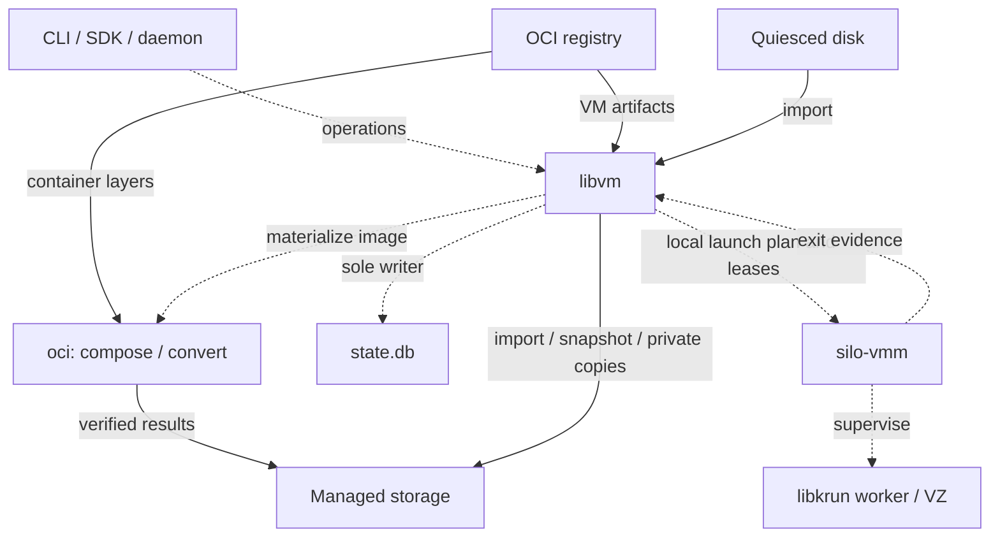
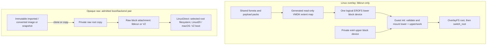
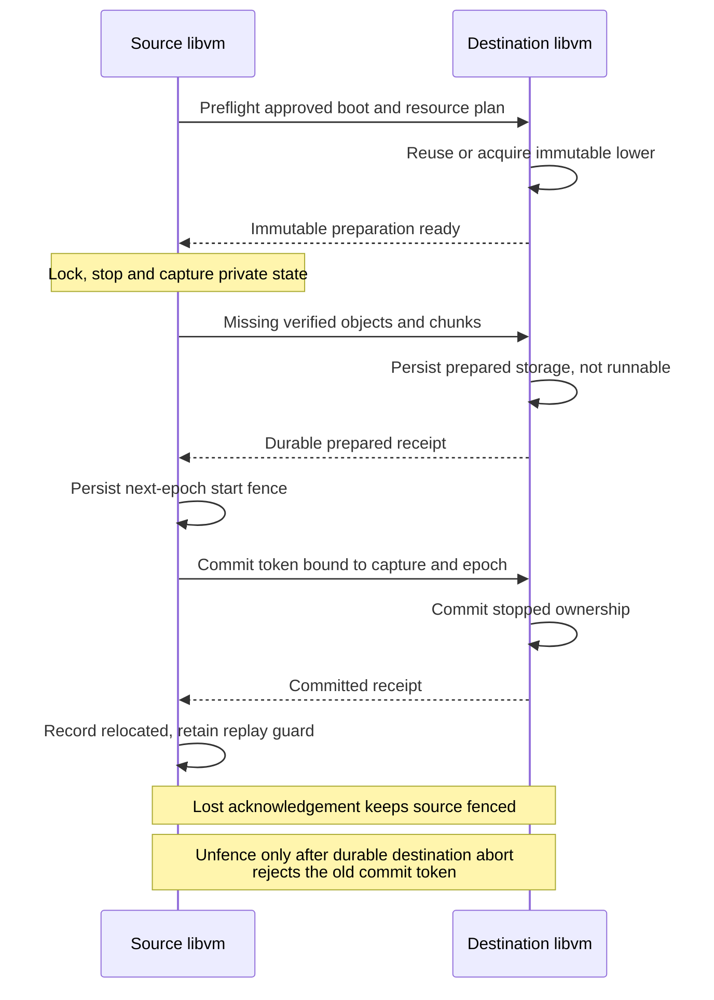

# 14. Layered OCI roots and portable VM storage

Date: 2026-08-20

Updated: 2026-11-07

## Status

Accepted

This ADR specifies the target architecture, not functionality already delivered.
The implementation stages and conformance gates below control when each storage
profile becomes available. The decision is self-contained.

The 2026-11-01 owner decision makes implementation of this ADR and
[ADR 0021](0021-live-snapshots-and-forks.md) a **hard breaking release**.
Every user must reinstall and wipe all existing Silo state. There is no
upgrade migration, backfill, legacy reader, compatibility bridge or automatic
state conversion. The initial schema and all callers are replaced directly;
incompatible state is refused with a reinstall/wipe diagnostic, never deleted
automatically. This supersedes the former existing-machine preservation and
additive-migration requirements throughout the implementation plan.

Phase 22 cuts current OCI creation over to `linux-erofs-overlay-v1` on
libkrun and removes the development flat profile and root-profile selector.
Linux x86_64 production-root boot and lifecycle gates passed
on stable 7.2.2 and longterm 6.18.48, including kernel-mutated flatten export and
raw re-import. Public live lanes remain unqualified; performance qualification
is deferred to the mandatory Phase 24 sweep. The independent published-builder
oracle exception is recorded under [Filesystem and Linux gates](#filesystem-and-linux-gates);
it does not waive runtime, cross-host or performance gates.

The 2026-09-26 revision follows the change that made libkrun the default
backend on Linux and macOS. It confines layered OCI roots to libkrun, limits
Virtualization.framework (VZ) to raw disks, removes the VZ lower adapter, the
ASIF native stack and the storage helper VM, and aligns the on-disk layout with
[ADR 0017](0017-single-host-state-root.md) and the monitor boundary with [ADR 0018](0018-silo-vmm-contract.md).

The 2026-10-18 revision resolves the review findings against the current
code: stream identity is a chunk map rather than a whole-file digest, layer
payloads are plain packs rather than EROFS filesystems, the upper profile
enables directory indexing, ingest resolves symlink parents inside the merged
namespace, `silo image convert` is normative, boot assets are pinned per
machine with an explicit update, the database is the only mutable record, and
a root's userspace platform is separate from its kernel architecture so that
amd64 images run under Rosetta on Apple silicon and move natively to x86_64.

The 2026-10-19 revision adds architecture views and an illustrative typed API,
and tightens composition, flattening, boot portability and ownership contracts.
It keeps one selected overlay profile and rejects unsupported operations rather
than adding host journal replay or another storage service.

The 2026-10-25 revision accepts the decision after an independent review of
the layered lower against upstream EROFS and libkrun, the Kata Containers and
containerd/nerdbox implementations of the same fsmeta-plus-flat-VMDK topology,
and a third-party runtime's implementation and issue history. It adds the corrected
VMDK reader as a dependency prerequisite, makes descriptor admission and
resource budgets explicit, adds catalog-lock, lease-inheritance, discard-length,
`/tmp` and ingest-scaling rules, corrects the development flat lower to one
backing file, restates the payload-pack rationale, records the owner's
acceptance budgets and ownership, and adds two alternatives.

The same revision adds the storage side of [ADR 0021](0021-live-snapshots-and-forks.md)'s live execution
checkpoints: sealed raw captures at a pause boundary, RAM as a logical stream
with a layout record, `captureKind` on snapshots, a capture outcome distinct
from the stop outcome, execution media types, RAM mapping leases as GC roots
and the explicit statement that live capture adds no disk encoding.

## The Problem

Silo currently materializes an OCI image as a complete ext4 filesystem, then
clones or copies that filesystem into each machine's `rootfs.img`. APFS
`clonefile(2)` and Linux reflink make some local copies inexpensive, but do not
provide explicit reuse of OCI layers across different images. On a filesystem
without CoW, creation and cloning copy the entire machine root.

Local-disk creation already bypasses OCI ingestion, but its recorded source
identity is derived from a canonical pathname rather than the disk contents.
That cannot identify an immutable disk on another host.

Users need three related capabilities:

1. Create Linux VMs from OCI images, retaining shared image content once and
   keeping each VM's writes separate.
2. Fork a stopped VM locally or restart its state on a cloud host without
   uploading unchanged image content that the destination can acquire itself.
3. Import, run and share raw VM disks, including conventional Linux cloud disks
   and future macOS installations, without pretending that their filesystems
   are OCI changesets.

These capabilities require more than a disk format. Silo must define ownership,
immutable identities, reproducible conversion, boot requirements, snapshot
consistency, registry publication and deletion. A remote VM cannot depend on a
path on the original laptop, a mutable registry tag or an unavailable historical
formatter. A macOS VM also needs persistent platform state beyond its main disk.

libkrun is now the default backend on both Linux and macOS; VZ is an explicit
macOS selection. The earlier draft of this ADR carried a second, VZ-specific
representation of every OCI lower so that both backends could boot the same
layered root. That duplication is no longer justified by the default path. The
design must therefore make the layered root a libkrun feature that behaves
identically on both host platforms, give VZ one storage contract that is the
same for Linux and macOS guests, preserve Silo's daemonless lifecycle, and avoid
a new always-running local block service. It must distinguish storage
portability from live migration, guest architecture compatibility and
cloud-provider image import requirements.

## Decision

Silo adopts **one managed image and snapshot model, with two root families and
one stored disk encoding**:

- **Linux overlay roots (libkrun only):** deterministic per-layer payload packs
  and a merged metadata-only EROFS filesystem (`fsmeta`), with one private raw
  ext4 upper per machine. libkrun presents the lower through a generated VMDK
  flat-extent descriptor on Linux and macOS alike. No other backend presents
  a layered root.
- **Execution checkpoints ([ADR 0021](0021-live-snapshots-and-forks.md)):** a live capture of a running libkrun
  machine binds this storage model to captured RAM and device state. Its
  writable storage is represented by immutable raw captures sealed at the
  capture's pause boundary and by private raw restore copies; its memory is
  a logical stream under the same chunk-map identity. Live capture introduces
  no new disk encoding.
- **Opaque raw roots (libkrun and VZ):** imported, converted or installed disks
  whose filesystems Silo does not interpret at runtime. The only stored and
  transferred representation is a private raw disk. A whole-disk Linux root, a
  partitioned Linux cloud disk and a macOS installation are boot profiles over
  this one family, not separate storage encodings.

The backend matrix is closed:

| Backend | Linux overlay root (OCI) | Opaque raw root, Linux | Opaque raw root, macOS |
| ------- | ------------------------ | ---------------------- | ---------------------- |
| libkrun | Yes                      | Yes                    | No                     |
| VZ      | No                       | Yes                    | Yes                    |

Creating a machine from an OCI container image on a VZ runtime fails with a
typed error. The supported route onto VZ is an explicit conversion of the OCI
image into an opaque raw root (the flattener Silo already owns), which then
boots on either backend. True layered boot exists only on libkrun.

Both families use the same content-addressed artifact store, image references,
stopped-snapshot contract, chunked transfer machinery and OCI VM-artifact
format. An OCI container image is an input to Linux filesystem composition. An
OCI Silo VM artifact is a distribution envelope for machine storage and boot
metadata; it is also how a raw disk, including a macOS disk, is shared through
a registry. The two are distinguished by the resolved index's OCI artifact type
and its descriptors' media types, never by guessing from a tag name.

Silo owns a bounded, deterministic Rust EROFS encoder and changeset composer.
The initial profile uses uncompressed, block-addressable file payloads. It does
not depend on a host mount, host tar extraction, `mkfs.erofs` executable or
runtime content service. Upstream EROFS tools and real Linux mounts are
independent conformance oracles, not runtime dependencies.

Reproduction is an optimization with a strict verification gate: a destination
may regenerate OCI-derived lower artifacts only when their complete digests match
the recorded artifacts. Exact stored artifacts remain the recovery and
publication boundary. Raw disks and installed macOS state are **transfer-only**,
not claimed to be reproducible from installation provenance.

No storage operation in this ADR runs a helper VM. Hashing, chunking, sparse
copying, import decoding, flattening and export run on the host in Rust. Journal
recovery and filesystem growth run inside the workload guest at its next boot.
Apple's DiskImageKit and ASIF are not used; a later ADR may add ASIF as an
additional opaque encoding on VZ without changing the raw contract here.

### Core invariants

1. Published immutable bytes never change in place. References and derivation
   records point to content digests, not mutable tags or caller-owned paths.
2. One running machine owns every writable root, data disk and platform-state
   attachment. Writable hardlink sharing between machines is prohibited.
3. A Linux upper remains bound to its exact lower and OverlayFS profile. Neither
   host platform nor reacquisition changes that binding.
4. An opaque disk's identity is its virtual byte stream and block geometry. A
   container encoding accepted at import (qcow2) is decoded once; Silo never
   persists, forks, snapshots or transfers a non-raw container.
5. A root family records the backend capability it requires. Creation and start
   both check it; a machine never boots on a backend that cannot present its
   persisted root.
6. A storage-only snapshot captures stopped storage before journal replay or
   repair, crash-consistent unless stronger shutdown evidence is available.
   An [ADR 0021](0021-live-snapshots-and-forks.md) execution checkpoint instead captures storage at one
   acknowledged vCPU, device and host-writer quiescent boundary and binds it
   to matching execution and RAM state. Neither implies application
   consistency or sanitization.
7. A portable VM artifact contains a complete, registry-retained closure. It
   never relies solely on an original OCI registry continuing to serve layers.
8. Direct handoff may send only missing artifacts or chunks. Publication to a
   standalone registry reference must retain the complete closure there, even
   when direct handoff could have regenerated part of it.
9. Local clone operations may rely on a qualified kernel clone contract without
   hashing an entire disk. Immutable publication and network transfer verify
   cryptographic identities before making a result usable.
10. Starts use the persisted root representation. Conversion, guest
    generalization, boot-profile changes and transfer are explicit operations.
11. Storage compatibility is necessary but not sufficient for boot. Silo checks
    userspace platform, kernel architecture, translation, boot assets, backend
    capabilities and external resources
    before publishing a runnable destination.
12. Failure never silently selects another lower, disables required indexing,
    modifies an import source or resumes both ends of a relocation.

### Scope and relationship to existing decisions

This ADR extends [ADR 0013](0013-image-first-machine-lifecycle.md)'s image-first interface. Bare references still select
OCI, `disk:PATH` still means copy-in, and creation still returns a stopped
machine. It adds managed image references, storage snapshots, raw and cloud-disk
import, conversion and publication. It does not change the distinction between
`create`, `start` and `run`.

[ADR 0002](0002-image-management.md) proposed a normalized local image store and was abandoned. This ADR
occupies that scope with a content-addressed object pool and typed records; no
part of [ADR 0002](0002-image-management.md) remains a requirement.

[ADR 0017](0017-single-host-state-root.md) fixes one Silo home (`SILO_HOME`, default `~/.silo`) for all persistent
state. This ADR places the object pool, records, machine storage and operation
journals under that home. It does not reintroduce a separately located image
root, and it does not share one object pool between homes.

[ADR 0018](0018-silo-vmm-contract.md) fixes the boundary between libvm and `silo-vmm`: the monitor receives
its data directory and `config.json` and never opens the database. This ADR
keeps that boundary. libvm generates every launch input, including the VMDK
descriptor and bootstrap record, before launching the monitor; `silo-vmm` and
its libkrun worker attach what `config.json` names and resolve nothing else.
Storage stop outcomes are reconciled from the monitor's exit record. [ADR 0009](0009-per-launch-guest-agent-initramfs-overlay.md)'s
per-launch, non-accumulating initramfs construction remains in effect. [ADR 0012](0012-cross-platform-runtime-and-sdk-packaging.md)
governs runtime packaging and boot-asset discovery; storage profiles add
capability and content-identity requirements, not a separate runtime
installation mechanism.

[ADR 0015](0015-hybrid-vsock-host-surface.md) governs the monitor's vsock transport and public hybrid socket surface.
This ADR introduces neither endpoint plugins nor persistent per-disk services.
Runtime socket paths and live connections are regenerated, not checkpointed or
treated as portable machine identity.

The remote target is a compatible Silo runtime on a provisioned host. Cloud
account provisioning, scheduling, live migration and provider-specific VM-image
import APIs are outside this decision. Raw export is provided, but Silo does not
label an arbitrary filesystem image as bootable by every cloud provider.

## Terminology

| Term                | Meaning                                                                                                                              |
| ------------------- | ------------------------------------------------------------------------------------------------------------------------------------ |
| OCI blob digest     | Digest of a manifest's layer transport bytes, compressed or uncompressed.                                                            |
| `diff_id`           | Digest of the complete uncompressed OCI layer tar stream, not an abstract directory tree.                                            |
| Recipe ID           | Digest of canonical inputs, policies and encoder ABI used to derive an artifact.                                                     |
| Object digest       | SHA-256 of a complete byte object's bytes, unchanged by whole-object or chunked transport.                                           |
| Stream ID           | Typed hash of a logical stream's chunk map: length plus per-8 MiB entries of `zero` or the chunk's SHA-256.                           |
| Layer record        | Recipe plus exact payload-pack stream ID and changeset-index identity.                                                                |
| Fsmeta              | EROFS metadata describing the merged namespace and referencing layer payload blocks.                                                 |
| Flattened EROFS     | The Linux 6.4+ EROFS mode that reads a multi-device image from one block device, locating each extra device at its `mapped_blkaddr`. |
| Lower identity      | Exact fsmeta, ordered payload objects, mapped extents, geometry and overlay profile.                                                  |
| Upper               | A private raw ext4 image containing OverlayFS `upper/` and `work/`.                                                                   |
| Opaque raw root     | A private raw disk whose filesystem Silo does not interpret at runtime.                                                              |
| Cloud disk          | A partitioned Linux disk image as distributed by a distribution, imported as an opaque raw root with a partition root selector.       |
| Image               | An immutable creation source with storage, platform and boot requirements.                                                           |
| Alias               | A mutable local name in the `image:` namespace, resolved to one immutable image or snapshot at creation.                             |
| Snapshot            | An immutable capture of one machine's included storage and configuration: `stopped-storage` from a stopped machine, or `live-execution` with RAM and device state at a pause boundary ([ADR 0021](0021-live-snapshots-and-forks.md)). |
| Fork                | A new machine with initially identical included disk bytes and new host lifecycle identity; a running-machine fork also continues the source's execution ([ADR 0021](0021-live-snapshots-and-forks.md)). |
| Relocation          | Ownership transfer of the same stopped machine to another Silo runtime.                                                             |
| Portable encoding   | Complete logical disk streams plus exact immutable filesystem objects; the only artifact encoding in this ADR.                       |
| Backend requirement | The backend capability a persisted root needs: `krun-overlay` for Linux overlay roots, `raw-block` for opaque raw roots.             |
| Generalized image   | A separately prepared image whose guest identities or secrets were intentionally changed.                                            |

## User-Facing Contract

### Sources and defaults

Creation accepts these explicit source kinds:

| Input                                                | Interpretation                                                                   |
| ---------------------------------------------------- | -------------------------------------------------------------------------------- |
| `ubuntu:24.04` or a digest-pinned registry reference | OCI container image or Silo VM artifact, selected by the resolved artifact type. |
| `image:NAME`                                         | Managed local alias resolving to one image or snapshot.                          |
| `image:sha256:HEX`                                   | Managed immutable image or snapshot identity.                                    |
| `disk:PATH`                                          | Quiesced local raw or qcow2 disk, decoded to raw and copied into Silo ownership. |
| A typed macOS restore-image request                  | Installation through Apple's supported restore flow on VZ, not OCI ingestion.    |

Snapshots are creation sources. Snapshot names and image names share the `image:`
alias namespace, and an alias resolves to exactly one record. `image:sha256:HEX`
names an image or snapshot record by its typed ID; the two record kinds are
stored separately and one typed ID cannot denote both. V1 has no separate
`snapshot:` source kind.

OCI container images create `linux-erofs-overlay-v1` roots by default, and
only on a libkrun runtime. There is no `--root-profile` selector or template
`root_profile` field. The development `linux-flat-overlay-v1` profile has been
removed without migration or compatibility shims; obsolete profiles receive
typed rejection. Artifact presence does not choose a root mode. Imported disks
create opaque raw roots, even when their contents happen to be ext4. A VZ
runtime requires explicit OCI-to-raw conversion, not an automatic fallback.

Every opaque disk is stored as `raw-private-v1`. There is no storage selector
flag: the encoding is fixed, and a fork inherits its source's family. A qcow2
input is accepted only at `disk:PATH` and `image import`, is decoded on the host
into the raw stream it describes, and is never retained. Native VMDK inputs are
rejected with a conversion diagnostic; the only VMDK Silo opens is the
descriptor it generates for a libkrun lower. Adding a new import decoder
requires a separate validated profile, not format autodetection at VMM open
time.

V1 does not accept writable in-place root imports. A caller needing control of an
external file can attach it as an explicitly external data disk, subject to the
snapshot and transfer policies below.

### Backend selection and admission

The runtime's effective backend is libkrun unless the runtime or daemon
configuration selects VZ explicitly. Backend selection is a runtime property
today, not a per-machine property; a future per-machine backend picker must
apply the same admission rules.

Creation records the backend requirement of the selected root family on the
machine and validates it against the effective backend before any storage is
materialized. Start validates it again against the backend it is about to
request in the `silo-vmm` start request. Both checks fail with a typed error
naming the persisted root family, its requirement and the effective backend.

- An OCI container image or a Linux overlay image/snapshot on a VZ runtime is
  rejected at creation. The diagnostic names the explicit conversion that
  produces an opaque raw root from the same image.
- A Linux overlay machine whose runtime is later switched to VZ is rejected at
  start. Silo never flattens a lower implicitly to make the start succeed.
- An opaque raw root starts on either backend, subject to its boot profile:
  Linux direct-kernel profiles on both; `LinuxEfi` and `MacOS` on VZ only.

### Explicit OCI-to-raw conversion

The OCI-to-ext4 flattener is retained as an explicit conversion, not as an
implicit creation path. Given a resolved OCI container
image, it writes the merged namespace into a fresh ext4 filesystem through
`disk-image`, publishes the result as an immutable opaque raw image with a
whole-disk `LinuxDirect` boot profile and records the source manifest digest as
provenance. The result is an ordinary raw image: it boots on libkrun and VZ, is
forkable, snapshottable and publishable, and shares nothing with other images.

The flattener is not deterministic and its output is transfer-only. So that
repeated conversion does not accumulate images, the database records each
result under the conversion key `(source manifest digest, platform, flattener
ABI)`; a second conversion with the same key reuses the retained image, and the
key is dropped when that image is garbage collected. Conversion now consumes
the same authenticated changesets, exact EROFS composition and held payload
packs as layered creation. The old tar applier and flat OCI cache are retired;
one namespace semantics remains.

The Silo daemon (`silo daemon run`) uses this conversion for its system
appliance on a VZ backend, because the appliance image is an OCI reference. On
libkrun the appliance uses the layered root. User-invoked conversion
(`silo image convert`) is normative and ships in the same stage as the VZ
rejection, so no release rejects an OCI reference on VZ without offering the
conversion that makes it bootable there.

### Representative workflow

The following commands specify the intended command families and semantics;
flags that overlap existing CLI options must use their established spellings.
They are not claims that these operations exist today.

```sh
# OCI container image on libkrun: shared lower and private ext4 upper.
silo create ubuntu:24.04 --name dev
silo start dev
silo stop dev
silo fork dev --name experiment

# Explicit reusable raw import. No writes reach ./rootfs.raw.
silo image import disk:./rootfs.raw --name ubuntu-base \
  --arch arm64 --boot linux-direct
silo create image:ubuntu-base --name raw-dev

# Cloud disk: qcow2 decoded to raw, root partition recorded at import.
silo image import disk:./noble-server-cloudimg-arm64.img --name noble-cloud \
  --arch arm64 --boot linux-direct --root-partition auto
silo create image:noble-cloud --name cloud-dev

# Immutable stopped checkpoint, then portable OCI publication.
silo snapshot create dev --name checkpoint
silo image push image:checkpoint ghcr.io/acme/dev-checkpoint:v1

# Run on the destination Silo host, without interpreting disk chunks as tar.
silo create ghcr.io/acme/dev-checkpoint@sha256:HEX --name cloud-dev

# amd64 userspace on an Apple-silicon Mac: arm64 Silo kernel, Rosetta translation.
# The same machine boots natively after relocation to an x86_64 Linux host.
silo create --platform linux/amd64 ubuntu:24.04 --name amd-dev

# VZ runtime: an OCI reference is rejected; convert first, then create.
silo image convert ubuntu:24.04 --disk-format raw --name ubuntu-raw
silo create image:ubuntu-raw --name vz-dev
```

`image import` creates an immutable image and optional alias, not a running VM.
`disk:PATH` in `create` performs the same ingest without a permanent alias.
`image push` consumes an immutable image/snapshot, not a live machine path. A
convenience publish action may stop and snapshot a machine first, but must
display and obtain consent for that lifecycle transition. Snapshot and fork do
not stop a running source implicitly.

An alias names exactly one record. Creating an alias that already exists fails
unless the caller passes `--replace`; replacement changes future resolutions
only. The remaining command families are `image ls`, `image inspect`,
`image rm` (removes an alias or an unreferenced record), `image pull` (acquires
a registry image or VM artifact without creating a machine), `image prune`,
`snapshot ls`/`rm`, and `disk create`/`attach`/`detach` for managed data
disks. Their names are non-normative; the operations are.

For an overlay machine the requested root size is the upper's capacity, not
the size of a whole root; the CLI help states this because today's size option
sizes a complete `rootfs.img`.

`image push` has one encoding, portable. Ordinary registry creation allocates a
new machine, never restores host identity merely because the artifact contains
checkpoint provenance.

Inspection displays source identity, root family, backend requirement, guest
architecture, boot profile, logical capacity, host allocated bytes, shared lower
bytes, snapshot dependencies and portability blockers. Copy/convert/transfer
progress distinguishes bytes scanned, bytes written and bytes sent. A sparse
200 GiB disk with 8 GiB allocated is not displayed as an 8 GiB virtual disk.

## Architecture And Illustrative API

### Host control and data flow

`libvm` owns acquisition policy, durable storage and machine lifecycle. The
monitor receives a resolved local launch, not an image reference to fetch.
Solid arrows below carry bytes; dotted arrows carry control or metadata.



The destination uses the same catalog/storage boundary and may acquire exact
objects independently from trusted sources. Transfer does not start a VM.
Neither backend nor monitor owns registry policy or writes the state database.

### Runtime root storage paths

These are alternative root families, not layers of one universal disk format.
The overlay path shares immutable OCI-derived bytes across machines; every writable
attachment on either path remains privately owned.



The VMDK is a launch-only mapping of exact local extents, not a retained disk
image or a remote block service. Guest init performs overlay assembly; the host
does not mount the root. The development ext4 lower has been retired; current
layered roots always use EROFS. Raw storage alone does not imply a boot method;
firmware and macOS auxiliary state remain separate private platform files as
specified below.

### Illustrative typed API

The following language-neutral signatures illustrate the semantic boundary,
**not a shipped SDK, RPC schema or implementation plan**. Names and bindings are
illustrative; the stopped-state, ownership, verification and boot-selection
semantics are normative. `Result<T>` is success or a typed failure, never an
unverified partial success. IDs below are distinct opaque types, not paths.

```text
AcquireSource = Registry(OciReference, Platform) | ManagedAlias(ImageAlias)
              | Image(ImageId) | Snapshot(SnapshotId)
AcquiredSource = Container(ContainerImageId)
               | Image(ImageId) | Snapshot(SnapshotId)
CreateSource = Acquired(AcquiredSource) | MacRestore(LocalRestoreRequest)
StoredSource = Image(ImageId) | Snapshot(SnapshotId)
BootSelection = ExactRecorded | AdmittedDestination(BootBundleId)
HandoffMode = Fork | Relocate

StoppedMachine = { runtime: RuntimeId, machine: MachineId }
RunningMachine = { runtime: RuntimeId, machine: MachineId, generation: RunId }
PublishedArtifact = { reference: DigestPinnedOciReference, source: StoredSource }
AdmittedHandoffPlan = {
  source: StoppedOrRunningMachineRef, destination: RuntimeId,
  mode: HandoffMode, boot: ResolvedBootSelection,
  mappings: ExternalResourceMappings, admission: AdmissionId
}
OperationReceipt = {
  operation: OperationId, source: RuntimeId, destination: RuntimeId,
  machine: MachineId, capture: CaptureId, nextEpoch: OwnershipEpoch,
  state: Prepared | Committed | Aborted
}
HandoffResult = Forked(StoppedMachine)
              | Relocated(StoppedMachine, OperationReceipt)

acquire(source: AcquireSource, access: AcquisitionPolicy)
  -> Result<AcquiredSource>
importDisk(source: LocalDiskHandle, spec: DiskImportSpec)
  -> Result<ImageId>
convert(source: ContainerImageId, target: RawConversionSpec)
  -> Result<ImageId>
create(source: CreateSource, spec: MachineCreateSpec, boot: BootSelection)
  -> Result<StoppedMachine>
start(machine: MachineId)
  -> Result<RunningMachine>
stop(machine: MachineId)
  -> Result<StoppedMachine>
updateBootAssets(machine: MachineId, bundle: BootBundleId)
  -> Result<StoppedMachine>
fork(source: MachineId, spec: MachineForkSpec)
  -> Result<StoppedMachine>
snapshot(source: MachineId, selection: SnapshotSelection)
  -> Result<SnapshotId>
publish(source: StoredSource, target: RegistryTarget, access: AcquisitionPolicy)
  -> Result<PublishedArtifact>
exportRaw(source: MachineId, selection: ExactOpaqueDisk | FlattenOverlay,
          output: LocalOutputHandle)
  -> Result<DiskExport>
preflight(source: MachineId, destination: RuntimeId, mode: HandoffMode,
          boot: BootSelection, mappings: ExternalResourceMappings)
  -> Result<AdmittedHandoffPlan>
handoff(plan: AdmittedHandoffPlan, access: AcquisitionPolicy)
  -> Result<HandoffResult>
```

- Acquisition resolves aliases/tags to typed immutable identities and verifies
  the required local closure. A container source remains distinguishable from a
  VM artifact; only the former enters OCI namespace composition or explicit raw
  conversion. Import records the required architecture, boot profile and root
  selector in `DiskImportSpec`; it never lends caller-owned writable bytes to a
  machine.
- `LocalDiskHandle` and `LocalRestoreRequest` are local capabilities. CLI
  `disk:PATH` is opened locally and imported before creation. Across a runtime
  boundary, sources use opaque IDs and verified object/chunk descriptors, never
  host-path strings interpreted on the destination.
- Artifact creation and handoff must explicitly choose `ExactRecorded` or an
  exact, caller-approved `AdmittedDestination` bundle. Exact selection preserves
  the recorded boot closure and fails if incompatible. Destination selection
  records the admitted replacement in the new machine or relocation commit; it
  is not permission to pick whatever kernel ships at the next start. For a new
  container source, select its initial admitted bundle; restore requests follow
  Apple's platform contract. Destination selection cannot rewrite EFI/macOS
  identity or firmware state outside the platform rules.
- Creation and local fork return new stopped identities. The storage-only
  `fork` and `snapshot` operations reject a running source rather than
  stopping it implicitly; their typed IDs are not proof of quiescence, so
  `libvm` establishes the locked stopped boundary. Capturing or forking a
  running machine is [ADR 0021](0021-live-snapshots-and-forks.md)'s `capture` operation, which establishes the
  pause boundary instead. Snapshot selection includes managed writable disks
  by default. Publication consumes immutable records and makes the entire
  closure registry-reachable.
- `start` revalidates local ownership, backend and pinned boot compatibility,
  then starts an idle VM under [ADR 0013](0013-image-first-machine-lifecycle.md). It performs no registry resolution,
  network acquisition, implicit conversion or persisted-workload execution.
- Preflight may inspect a running source but cannot authorize a stale capture.
  Handoff revalidates admission, obtains the stopped capture and follows the
  detailed transfer/ownership protocol below. Relocation succeeds only with a
  committed receipt bound to the exact operation, runtimes, machine, capture and
  ownership epoch; prepared storage is not startable. Interrupted operations
  expose their operation identity and last durable receipt for recovery, not a
  fictitious stopped-machine success. No handoff path starts either endpoint.

## Storage And Boot Model

The durable model separates source, storage, boot and lifecycle identity. These
are closed, versioned variants, not arbitrary strings interpreted by `silo-vmm`:

```text
MachineRoot
  LinuxOverlay                      requires krun-overlay
    lower: ErofsComposition
    upper: private ext4 path, UUID, capacity, ext4 profile
    overlay profile
  OpaqueRaw                         requires raw-block
    geometry
    layout: WholeDisk | Partitioned { table: Gpt | Mbr }
    private raw path

BootProfile
  LinuxDirect
    userspace platform (OCI platform of the root), kernel architecture,
    boot bundle (kernel, base initramfs, optional agent, ABI), command-line policy
    translation: none | rosetta      (required when the two architectures differ)
    root selector: managed overlay | whole disk | partition identity
  LinuxEfi                          VZ only
    guest architecture, firmware family, private variable store
  MacOS                             VZ only
    hardware model, machine identifier, private auxiliary storage
    host/restore compatibility requirements
```

A valid combination is explicit. Linux overlay roots require `LinuxDirect` with
Silo's root bootstrap and the `krun-overlay` backend requirement. Linux direct
and EFI may use opaque raw roots. macOS requires an opaque raw root, Apple
silicon and VZ; libkrun is never a macOS guest fallback. An EFI variable store
is not macOS auxiliary storage.

Machines are created against the new semantic model in a fresh state root.
Opaque raw roots use `root.raw` and an explicit boot profile. Machines from
before this release are unsupported: users reinstall and wipe their state;
no legacy root variant, classification backfill or `rootfs.img` fallback exists.

Creation resolves Linux kernel, base initramfs and injected agent assets by exact
content digest, copies packaged assets into the object pool, and records their
runtime/profile requirements; a runtime upgrade that removes a packaged kernel
therefore cannot strand a machine. User-supplied boot files are copied into
managed immutable ownership rather than left as portable references to
arbitrary host paths. A checkpoint retains those exact assets.

These assets form one boot bundle: kernel, base initramfs/trusted `/init`,
optional injected agent, kernel architecture and bootstrap/profile ABI. The
bundle is a small immutable record referencing existing objects, not another
package format. Admission validates the assets together; replacing a kernel
alone is not a cross-architecture boot update.

Boot bundles are pinned per machine. Replacing one is an explicit stopped
operation (`silo machine update --boot-assets`, name non-normative) that validates
the entire replacement against the persisted root and overlay profile, commits
all asset references together, and takes effect at the next start. A runtime
upgrade never changes the bundle implicitly; `start` and `inspect` report an
available newer admitted bundle so security updates are visible.

Creation from a VM artifact defaults to its exact bundle. If that bundle cannot
run on the destination, creation fails with a proposed admitted replacement;
the caller must explicitly select that replacement before publishing the stopped
machine. The artifact and source checkpoint remain unchanged. Acquisition of
replacement assets belongs to creation/preparation, never to normal `start`.

Normal `start` performs no registry resolution or network acquisition. It resolves
already-owned objects and regenerates the launch-only files below. A missing
canonical object produces an acquisition-required error; explicit image
acquisition or transfer must complete before start can succeed.

### Raw is not a boot method

Raw disk validation establishes a regular file and virtual block stream, not
whether it contains a bootable operating system. `image import` records a required
architecture and boot profile. It may offer detected partition/filesystem facts,
but must not infer architecture solely from the host or file extension.

For compatibility, the existing `disk:PATH` shorthand without explicit boot
metadata means the current host-architecture, direct-kernel whole-disk Linux
profile. Planning reports that assumption. A partitioned disk must supply or
auto-detect a partition identity as described below, or select an admitted EFI
profile. Reusable imports require explicit boot metadata unless it comes from a
verified Silo artifact. Unsupported combinations fail before machine
publication.

`LinuxEfi` is a decided extension of this storage model, but is enabled only
when VZ implements and qualifies it. VZ uses `VZEFIBootLoader` and a private
`VZEFIVariableStore`. libkrun has no firmware boot path, so an EFI machine is
VZ-only and its move to a libkrun runtime fails compatibility checking unless
explicitly converted to a direct-kernel profile. Disk-content portability alone
never authorizes discarding firmware state.

### Foreign userspace platforms

A Linux root's userspace platform and its kernel architecture are separate
records. The userspace platform is the OCI platform the lower was composed for
(or the platform declared at raw import) and is part of lower identity. The
kernel architecture is a property of the pinned boot assets and always equals
the host architecture, because neither backend emulates a CPU. When the two
differ, the boot profile records `translation: rosetta`; Silo never runs a
CPU emulator such as `qemu-user`, and a profile whose architectures differ
without an admitted translation fails at creation.

Rosetta is the only admitted translation. It is a host capability of macOS on
Apple silicon, already provided to both backends (VZ Rosetta directory share;
libkrun Rosetta virtio-fs device with digest verification) and already
selected per machine through `hardware.rosetta`. The two settings answer
different questions and are not a second knob for the same thing:

- `--platform` states what the root's userspace is. On a host of a different
  architecture it makes translation a boot requirement: PID 1 itself is
  foreign, so creation fails with a typed error, naming the installation
  step, when the host cannot supply Rosetta. The translation is derived from
  the platform/kernel pair, never set directly, and `--platform linux/amd64`
  with `--rosetta=false` is rejected.
- `--rosetta` (`hardware.rosetta`) remains the optional capability for a
  native `linux/arm64` machine that also wants to execute amd64 binaries, for
  example amd64 containers inside an arm64 guest. Boot never depends on it.

`--platform linux/amd64` on `create` or `image import` selects the amd64
manifest or declares an amd64 disk; it derives required translation without
setting the optional `hardware.rosetta` intent. The effective launch request
enables Rosetta when required by the platform/kernel pair or explicitly requested
for native arm64 userspace. Explicit disable conflicts with required translation.
On a destination without Rosetta, required translation fails admission; an
explicit optional request also fails until the caller clears it in the prepared
destination configuration. Defaults do not become portable user intent.
`inspect` displays `platform: linux/amd64 (translated: rosetta)`.

Translation registration is owned by the trusted `/init`, driven by the root
bootstrap record and performed before `switch_root` with the `F` flag so the
interpreter is bound at registration. With an image-owned PID 1 the first exec
after `switch_root` is already foreign, so the agent has no Rosetta
configuration or registration path.

Portability follows from the split: a `linux/amd64` machine built on a Mac
carries an amd64 lower and an amd64-written upper. On an x86_64 Linux host the
same storage boots natively; preflight proposes the destination's admitted
x86_64 boot bundle for the same persistence profile. The caller approves that
bundle in the handoff plan, and all asset references and derived translation
are replaced atomically at commit. The reverse direction selects an arm64
bundle and requires Rosetta. An arm64 machine moved to an x86_64 host fails
preflight, because there is no translation for it.

Accepted limitations: translated processes report `x86_64` from `uname -m`
while `/proc/cpuinfo`, kernel modules and anything depending on the x86 kernel
ABI remain arm64; an amd64 cloud disk works only through its partition root
under Silo's kernel; Rosetta requires a 4 KiB-page guest kernel, which Silo's
configurations already use; performance is Apple's, not Silo's, to promise.

### Cloud disks

A cloud disk is a partitioned Linux disk as published by a distribution: a GPT
or MBR table, usually an EFI system partition and one root filesystem partition,
frequently delivered as qcow2. Silo does not run its bootloader or its kernel.
It boots the disk with the admitted Silo kernel and initramfs through
`LinuxDirect`, with a partition root selector instead of the whole device.

Import decodes qcow2 to raw on the host using a bounded Rust decoder (the same
`imago` crate libkrun uses for block formats), then treats the result exactly
like a raw import. Only a self-contained qcow2 version 2 or 3 image is
accepted: `crypt_method` must be zero; encrypted images, backing files, external
data files and zstd-compressed clusters are rejected before decoding. Unknown
incompatible features also fail admission, regardless of library defaults.
zlib-compressed clusters are accepted, because distributions publish compressed
cloud images and the decoder inflates one bounded cluster at a time.
The decoded stream, not the qcow2 container, receives the content identity.

The root selector is recorded at import as one of:

- a GPT partition GUID, supplied explicitly or auto-detected as the single
  partition carrying the Discoverable Partitions Specification root type GUID
  for the declared guest architecture;
- an MBR partition number, supplied explicitly.

Auto-detection that finds zero or several candidates fails with the candidate
list; Silo does not pick the largest partition. The guest init reads the
partition table from the attached root device itself, matches the recorded
selector, and mounts that partition as `/` with the filesystem type the record
names. The record names a filesystem the admitted kernel builds in; today that
is ext4. A root on a filesystem the kernel cannot mount fails admission at
import, not at boot.

Accepted limitations of this profile: the image's own kernel, initrd, bootloader
and out-of-tree modules are inert; cloud-init runs only if the image contains it
and a datasource is available, and Silo does not synthesize a seed disk in v1;
resize of the root partition follows the opaque resize rules below and is not
automatic. The admitted kernel builds in GPT and MBR partition scanning and
vfat with its NLS tables from stage 3, because a stock cloud image's `fstab`
mounts its EFI system partition and a failed mount unit otherwise degrades the
guest's boot.

### Managed data disks and external resources

Managed writable data disks use the opaque raw model and participate in the
same lifecycle lock and stopped consistency boundary as the root. A normal VM
snapshot includes all managed writable disks and all mutable boot/platform files.
Read-only managed disks are immutable dependencies. Disk roles and order are
preserved, but host paths and guest-discovery hints are regenerated.

External writable disks and host directory shares prevent an artifact from being
labelled self-contained. The caller must import a quiesced disk into ownership,
explicitly omit a resource, or supply a destination mapping. Omission is recorded
as a required external resource, not silently interpreted as an empty disk or
directory. Creation may stage an incomplete machine for inspection; start is
blocked until required mappings are satisfied. Snapshots do not copy arbitrary
host directory trees or registry credentials.

## Identity And Persistence

### Canonical records

V1 accepts SHA-256 identities only. Digests are `sha256:` followed by 64 lowercase
hex characters. Unsupported OCI algorithms fail at resolution. Fsmeta, index
pages, boot assets, serialized records and transport blobs are byte objects,
identified by SHA-256 of their complete bytes. Raw disks, uppers and payload
packs are logical streams identified by the chunk map below. Chunked transport
of a byte object does not change its identity: receipt verifies its byte digest
as well as the transport map. Identity kind never depends on transfer choices.

Silo identity records use RFC 8785 JSON Canonicalization Scheme, with schema and
kind fields, no duplicate keys, no floats, and integers restricted to the exact
JSON safe-integer range. V1 storage limits fit that range. Raw names, symlink
targets and xattr values in filesystem records are unpadded base64url-encoded
byte strings. They are not Unicode-normalized. Display labels and descriptions
are UTF-8 and do not substitute for filesystem names.

For a record of kind `K`, its ID is:

```text
sha256(UTF-8("silo:" + K + ":v1\n") || JCS(record))
```

`record` contains no self-ID. Recipe records contain only inputs and policy/ABI
versions, never output digests. Output records contain recipe IDs and output
object digests. OCI manifests/indexes are hashed as their exact published JSON
bytes, per OCI, without Silo's prefix. Wire metadata uses JCS for Silo-generated
output, but OCI input verification always hashes the original response bytes.

A typed record ID and the object digest of its serialized JSON are distinct.
Object-pool paths and OCI descriptors always use the latter, the unprefixed hash
of actual bytes. Records name both where needed; validators recompute the typed
ID after verifying the serialized object. A recipe ID is never used as though
it were the digest of an EROFS file.

The changeset ABI uses distinct `LayerRecipeId` and `LayerResultId` types.
`ContentDigest` denotes an ordinary byte-object or OCI `diff_id` digest.
The OCI-owned `StreamIdentity` is a separate wire type for an already computed
stream ID: it validates canonical spelling but has no byte-hashing constructor
or implicit conversion from `ContentDigest`. libvm computes and authenticates
pack IDs with the existing stream-map implementation, then explicitly crosses
that wire boundary. Parsing an ID alone does not authenticate its stream map.

### Stream identity

A logical stream's identity is the typed ID of its decoded chunk map, kind
`stream`. The canonical identity input is distinct from its paged transport map:

```text
stream record = { schema: 1, kind: "stream", length, chunkSize: 8388608,
                  chunks: [ "zero" | "sha256:HEX", ... ] }
stream ID     = sha256("silo:stream:v1\n" || JCS(stream record))
```

Chunk `n` covers bytes `[n * chunkSize, min((n + 1) * chunkSize, length))`. An
entry is `zero` when every byte of the range is zero, whether the host file
holds a hole or allocated zeros; otherwise it is the SHA-256 of the decoded
bytes. For an uncompressed transport chunk that digest is also its OCI blob
digest, so one hash per chunk serves identity, dedup and transfer.

Extent discovery can avoid reading known holes; unsupported or conservative
extent reporting falls back to reading bytes, never assuming zeros. Each
nonzero 8 MiB chunk is hashed in full, including zero regions within it.
Physical bytes read, logical bytes hashed and bytes sent are separate costs:
one allocated block per chunk can require hashing the entire virtual length.
A receiver verifies stream identity from the canonical decoded map and every
chunk, without a second whole-file pass. A raw stream's whole-file SHA-256 is
optional export metadata, not its identity.

The concatenated lower's chunk boundaries need not align with pack boundaries.
Its stream map therefore may require scanning shared payloads again; pack hashes
alone cannot derive shifted chunk hashes. V1 accepts and measures this cost
rather than introducing another hashing scheme.

A captured RAM image is a logical stream under the same identity: 8 MiB
decoded chunks over the packed sparse image, `zero` only for an entirely zero
chunk. Its layout record, identified separately, maps stream offsets to
guest-physical regions; equal bytes at different guest addresses are different
memory. An incremental checkpoint publishes a complete resolved chunk map that
reuses unchanged chunk objects; its parent is lineage, not a replay
dependency. A changed page rehashes its whole 8 MiB chunk. That amplification
is accepted; the dirty-tracking granule is the hypervisor's, not the chunk.

### Identity layers

| Record             | Identity inputs                                                                                                             |
| ------------------ | --------------------------------------------------------------------------------------------------------------------------- |
| Layer recipe       | Verified `diff_id`, changeset ABI, pack profile.                                                                           |
| Layer result       | Recipe ID, pack stream ID and length, changeset index root.                                                                 |
| Composition recipe | Ordered layer results, target platform, namespace/metadata policy, fsmeta ABI, overlay profile.                             |
| Lower result       | Composition recipe, fsmeta digest/UUID, ordered extents and mapped addresses, total length, stream ID of the logical lower. |
| Raw image          | Stream ID, length and sector geometry, with separate boot metadata (including any partition selector).                      |
| RAM image          | Stream ID and length of the packed sparse RAM image, plus the identity of its layout record (guest-physical regions, topology, page granule). |
| VM snapshot        | `captureKind`; root, included disks, platform files, boot requirements, configuration and external-resource declarations; for `stopped-storage` the stop outcome; for `live-execution` the RAM image, layout, execution and device-state object identities and the compatibility profile. The capture evidence record (`vm.capture.json`) is provenance and is referenced by digest, not an identity input. |

Image and snapshot IDs include boot/configuration semantics; identical raw disk
bytes may be used by distinct image records. Provenance records original tags,
source URLs, source config/manifest digests, qcow2 container digests and import
facts separately from layer recipe identity. Different compressed encodings of
the same `diff_id` reuse one layer result. Provenance may accumulate without
mutating that result.

Local paths, pause-token values and source run IDs are provenance and
evidence, never content identity. A sealed disk capture carries exactly the
stream identity, length and geometry a stopped snapshot of the same bytes
would; the capture kind does not salt disk identities.

### Records and the database

The database (`state.db`) is the only mutable record. It holds machines,
images, snapshots, layer and composition results, aliases, provenance, the
conversion cache, operations, leases' logical owners and the reachability
graph. Typed records exist on disk only as content-addressed objects in the
pool, serialized with JCS, when they are published or transferred; such an
object is immutable and the database row that references it is authoritative
for local meaning. No mutable JSON lives under `images/`.

SQLite protects `state.db` with POSIX advisory locks, and the kernel drops
every lock a process holds on a file when any descriptor for that file is
closed. While a connection is open, no code path opens or closes `state.db`,
its WAL or its shared-memory file outside SQLite: not for identity checks,
not for inode comparison, not for backup. Platform-specific identity
inspection uses a lock-preserving mechanism (`O_PATH` on Linux, a path-based
`stat` on macOS) and is qualified per host. A write acknowledged to a caller
is durable in the database; the lifecycle gates include a long-lived parent
with concurrent child writers on both hosts.

For a machine the database stores ID, configuration, root kind, backend
requirement, relative private paths, lower IDs, geometry, upper UUID/profile,
boot/platform record, source provenance, lifecycle generation and terminal stop
outcome. New paths are relative to the machine directory; cache objects are
referenced by ID. `config.json`, the VMDK descriptor, root bootstrap and
composite initramfs are regenerated from this state for each launch.

The storage stop outcome is `clean`, `forced` or `unknown`. It is committed with
the terminal lifecycle transition after the monitor's `vm.exit.json` ([ADR 0018](0018-silo-vmm-contract.md))
is reconciled. `clean` requires monitor outcome `clean` and [ADR 0018](0018-silo-vmm-contract.md)
`storageShutdown` version 1 for this generation, with `guestProtocolCompleted`,
`hostFlushCompleted` and `attachmentsClosed` all true. Historical monitor `clean`
alone does not prove these facts. A monitor outcome of `forced` or `error` records
`forced`; missing or insufficient evidence records `unknown` once liveness is
ruled out. Both are crash-consistent sources, not evidence for clean flattening.

An execution checkpoint records a separate **capture outcome**, not a fourth
stop outcome. `captureOutcome: coherent` ([ADR 0021](0021-live-snapshots-and-forks.md)'s `vm.capture.json`)
certifies that disk, RAM and device state were taken at one quiescent
boundary; it does not certify clean unmounted filesystems or closed
attachments, so it never qualifies as storage-clean. A live source's terminal
stop outcome is unaffected by captures taken during its run. A machine
created from a checkpoint's disks alone boots with recovery evidence
`unknown`.

`ownershipEpoch` and an optional relocation operation/fence are persisted with
machine lifecycle state. Start checks them as well as VMM generation. Local
clone/fork identity allocation never rewrites copied filesystem UUIDs.

## On-Disk Layout And Ownership

Everything below lives under the Silo home of [ADR 0017](0017-single-host-state-root.md). One immutable object
pool stores exact bytes across all image families. Human meaning comes from
typed records, not filename suffixes:

```text
~/.silo/                                    (SILO_HOME)
  state.db                                  # all records, aliases, reachability
  images/
    objects/sha256/<object-hex>             # fsmeta, pages, assets, encoded chunks
    streams/sha256/<stream-hex>             # verified immutable contiguous streams
    source-blobs/sha256/<transport-hex>     # verified OCI input, evictable
    transport/sha256/<blob-hex>             # redundant encoded chunks, evictable
    locks/publication/<key>.lock
    locks/leases/<key>.lease
    locks/roots.lock
    tmp/<operation-id>/
  machines/<machine-id>/
    config.json                             # generated launch contract (VmSpec)
    lower.vmdk                              # generated per launch, overlay roots
    upper.ext4                              # Linux overlay roots only
    root.raw                                # opaque raw roots
    disks/<disk-id>.raw
    platform/hardware-model.bin
    platform/machine-identifier.bin
    platform/auxiliary-storage
    platform/efi-variables
    storage/<storage-generation>/           # replacement private files
    initramfs                               # generated, never snapshot identity
  operations/<operation-id>/                # durable staging/recovery records
```

`objects/` uses byte digests; `streams/` uses typed stream IDs and contains the
decoded regular files needed for pack extents or raw-image cloning. Acquisition
materializes and verifies required streams before a machine is runnable.
The database records whether retained bytes are a full stream, encoded chunks,
or both. GC may remove a redundant form only while another complete verified
form remains reachable; it never evicts a stream required by a machine's
launch closure. This is local file materialization, not a runtime block service.

The pre-release image cache is discarded by the user's required full state
wipe, not by a migration or conversion routine. No old cache entry is adopted
as an image record, and no obsolete mutable JSON cache producer remains.

Only files required by the selected variants exist. The displayed root/platform
filenames describe initial creation; later transactional replacements use unique
paths under `storage/<storage-generation>/` and the database selects the current
relative paths. Storage generation is distinct from VMM run generation.
Opaque roots use `root.raw`. Platform files are not interchangeable names
for one NVRAM format. No `rootfs.json` is a second authoritative machine record.

`lower.vmdk` and `initramfs` are launch-only files. libvm regenerates both from
the database record before every start and `silo-vmm` reads them from the data
directory it is given. Neither participates in snapshot identity, fork copies or
transfer. Because the descriptor is regenerated per launch from the current home
path, moving `SILO_HOME` changes descriptor text, not machine identity, and no
path-context cache is needed.

Object-pool files are immutable, owner-controlled and read-only to guests.
Private machine files are mode `0600`; managed directories are `0700`. User
input cannot select an object-pool path for a writable output. Silo-generated
records are bounded and atomically replaced, never appended in place as partial
JSON.

Absolute paths occur only in local provenance, generated launch plans and the
generated VMDK descriptor. A machine's dependency on object-pool content is a
database relationship, not a file in the pool: the database is the reachability
authority for garbage collection, and one home owns exactly one database and
one pool.

## OCI Materialization

### Acquisition and verification

The `oci` subsystem resolves one platform-specific manifest and configuration,
verifies their descriptors, and checks layer/`diff_id` counts. Supported Linux
layer inputs are uncompressed tar, gzip tar and zstd tar. Unknown filesystem
layer types and non-Linux container platforms fail with typed errors.

Each input blob is verified against its descriptor length and digest. The entire
decoded stream is hashed, including tar padding/trailing bytes, before accepting
its `diff_id`. Early tar end markers do not stop digest verification. Decoder
errors, trailing invalid compression frames and expanded-size violations fail
publication. Valid layer results can be reused by recipe ID without redownloading
another compressed encoding of their verified `diff_id`.

The changeset acquisition profile decodes every gzip member and every zstd
frame, with zstd window log at most 23 (8 MiB). A private decoded spool permits
full-stream verification independently of tar interpretation. After tar end,
remaining decoded bytes still count toward the expanded bound and `diff_id`,
but cannot introduce another namespace operation. Malformed later members,
trailers or frames fail even when tar interpretation has already ended.

The decoder never extracts into the host filesystem. It streams bodies into
bounded staging storage and constructs a representation-neutral changeset. Host
umask, ownership APIs, filesystem enumeration and symlink resolution do not
participate. Successful individual layers remain reusable if composition fails.
Source blobs are retained for seven days after last use by default, subject to
quota and explicit prune, and never deleted under an active lease. They are not
required retention roots once exact layer artifacts have been published.

### Lossless changesets and payload packs

A reusable layer is **a payload pack plus a mandatory changeset index**. The
pack is not a filesystem: it is the concatenation of the layer's regular-file
bodies, each starting on a 4096-byte boundary in tar ordinal order, zero padded
to the next boundary, with no header or trailer. Its only runtime role is to be
a block range that fsmeta chunk indexes address, so it carries nothing fsmeta
does not need. A pack is a logical stream with a stream identity; holes may be
sparse in the host file but expose zero bytes.

The pack's benefit is specific: the layer carries one representation of its
namespace, the lossless index, instead of an index plus a per-layer filesystem
whose metadata the merged fsmeta would duplicate and never mount. Packs do not
uniquely enable layer reuse (a per-layer EROFS keyed by `diff_id` reuses just
as well), and they do not shrink fsmeta: the chunk index costs 8 bytes per
4096-byte chunk whichever container holds the bodies. What a pack gives up is
standalone mountability; a pack is validated through its authenticated index
and body map, and the composed image is validated with upstream tooling that
already understands external blob devices (`fsck.erofs --device=`) and with
real kernel mounts. Net space or time savings over per-layer EROFS plus the
same index are not claimed.

The index records normalized paths, tar entry ordinals, explicit versus synthetic
parent directories, file types and metadata, whiteout operations, hardlink target
paths, sparse source ranges, and each body's pack offset and length. Large
indexes use immutable pages, each with at most 4096 entries and at most 4 MiB;
the index root names page digests in order. Pages and roots are retained and
transferred with the layer. Deleting the source tar cannot discard composition
semantics.

Only entries carrying regular-file bodies occupy pack space. Hardlink entries
allocate no duplicate body. Empty files and all-zero 4096-byte ranges of a
sparse body allocate no blocks; fsmeta maps them as `EROFS_NULL_ADDR` chunks.
Original regular bodies remain reusable regardless of which lower tree supplies
a cross-layer hardlink target.

### Changeset byte ABI

The v1 changeset byte ABI is schema `1`, `changesetAbi="silo-changeset-v1"`
and `packProfile="silo-payload-pack-v1"`. All generated records use the
closed-schema JCS rules above, with no trailing newline. The exact record
fields below are mandatory; unknown fields, duplicate JSON keys, noncanonical
spellings, unsupported kinds/versions and unsafe integers are rejected.
Byte strings use unpadded base64url, including paths, unresolved targets and
xattr names/values. Object digests are unprefixed SHA-256 of complete bytes.

The identity records contain these fields:

```text
recipe = { changesetAbi, diffId, kind: "layer-recipe", packProfile, schema: 1 }
result = { indexRoot, kind: "layer-result", packLength, packStream,
           recipe, schema: 1 }
```

`recipe.diffId` is the verified complete decoded-stream digest; the recipe
contains no transport digest, parent, host path or time. `result.recipe`
names its typed recipe ID; `packStream` names the logical stream ID, never
whole-file SHA-256; `indexRoot` names the byte digest of the index root.
The ID domain kinds are exactly `layer-recipe` and `layer-result`, respectively.
The serialized recipe/result objects also have their own ordinary byte digests.

The index objects have these closed forms:

```text
root       = { changesetAbi, entries, kind: "changeset-index", packLength,
               packProfile, pages: [descriptor, ...], schema: 1 }
entry page = { entries: [entry, ...], kind: "changeset-entry-page", schema: 1 }
sparse page = { kind: "changeset-sparse-page",
                ranges: [{length, offset}, ...], schema: 1 }
page list  = { kind: "changeset-page-list", pages: [descriptor, ...], schema: 1 }
descriptor = { count, digest, length }
```

`descriptor.length` is the complete object byte length. `count` is the recursive
number of leaf entries or sparse ranges, not the immediate child count.
Each entry or sparse page is greedily split before the first record that would
exceed 4096 records or 4,194,304 encoded bytes, **including its envelope and
commas**. An empty layer has zero entry pages. Sparse ranges always use sparse
pages; an empty range map has no sparse descriptors. Arrays preserve operation,
range and descriptor order.

Both `root.pages` and a regular body's `sparse` list may name leaf pages or
page-list nodes. Each node has 2 through 4096 children and at most 4 MiB including
its envelope. Build each entry-page sequence and each body's sparse-page
sequence independently: append descriptors at level zero, greedily buffering
at each level until the next descriptor would exceed that node's entry/byte
bound. Emit the existing buffer as a node and carry its descriptor to the next
level by the same rule. On completion, concatenate remaining buffers from the
highest level (oldest ranges) to the lowest (newest ranges). While more than
256 descriptors remain, greedily group that ordered list at the node bounds,
emit groups of two or more, and pass a final singleton through unchanged.
Repeat until at most 256 remain. Tighter public limits apply throughout and
must not be silently raised when they make a branching index unrepresentable.

The root is bounded at 65,536 bytes. At safe-integer widths a descriptor is
less than 160 bytes, so its bounded top list fits without restricting a valid
layer to 256 leaf pages. A regular entry likewise has a bounded top sparse
list rather than embedding an arbitrarily large map. Readers bound descriptor
traversal to 53 edges from a top descriptor, check active-digest cycles, byte
lengths, leaf counts, fanout and checked subtree sums, and authenticate every
referenced object. This bounds malformed unbalanced trees; canonical trees
are determined by the carrying/partition rule, not by accepting arbitrary
binary shapes. Regenerating the canonical root rejects alternative partitions.

Every entry contains `kind`, `metadata`, `ordinal`, `path` and `presence`.
`ordinal` is the zero-based effective filesystem-operation order, including
root and whiteouts but excluding PAX/GNU control records and sparse extension
blocks. The kinds are `root-directory`, `directory`, `regular`, `symlink`,
`hardlink`, `character-device`, `block-device`, `fifo`, `socket`, `whiteout`
and `opaque`. Only `root-directory` uses the empty path. Whiteout/opaque entries
retain their normalized original marker path, not a filesystem inode.

`metadata` contains `gid`, `mode`, `mtimeNanos`, `mtimeSeconds`, `uid` and
`xattrs`. Xattrs are `{name,value}` arrays sorted uniquely by raw name bytes.
`presence` contains the booleans `aclAccess`, `aclDefault`, `gid`, `mode`,
`mtime`, `uid` and `xattrs`. A regular entry adds
`body:{length,packOffset,sparse:[descriptor,...]}`; links add `target`;
devices add `deviceMajor` and `deviceMinor`. Other kinds add no fields.
Paths and hardlink targets are normalized but unresolved. Synthetic-parent
intent follows the fixed namespace policy; realized parents, inodes, body
occurrences and final link counts belong to composition, never layer identity.

Body lengths/offsets and root pack length validate before continuation reads.
Regular extents must exactly follow the aligned running pack cursor, including
empty bodies; gaps, overlaps, unaligned offsets and unreferenced suffixes fail.
Ranges are validated incrementally before allocation: ordered nonoverlapping
nonempty ranges fit the logical body, with one optional zero-length EOF
sentinel retained as source provenance. Their derived count cannot exceed
logical body length plus one. This is not a 4096-range, 4 MiB-map or
one-million-range format cap. Source extensions are bounded by decoded framing;
large valid maps use continuation trees and explicit host-resource admission.

Phase 2 exposes real ingest, publication, source-free reuse and composition
through `oci::changeset` and `libvm::storage::LayerStore`. It does not implement
EROFS or switch the default root away from the fresh flat path. Exact fixture
artifacts, independent identity construction and named qualification commands
are described in the [changeset conformance guide](../../runtime/oci/testdata/changesets/README.md).

### Namespace semantics

Stored changeset paths are relative byte sequences. Source admission first
rejects NUL and any `..` component. The effective source entry path **exactly
`/`** is admitted only for a directory and canonicalized to the explicit root,
preserving its metadata and operation ordinal. All other absolute entry paths
are rejected before removing `.` and empty separator components; `//`, `/./`
and absolute child paths are not alternate root spellings. Empty non-root names
and duplicate normalized entry paths fail. Root `.` is also an explicit
directory entry, so `.` and `/` in one layer collide as duplicate root entries.
The exception applies after effective PAX path/type selection, not to the shared
canonical path normalizer or hardlink targets. Non-directory `/` and all absolute
hardlink targets still fail. Non-UTF-8 Linux names are preserved through
byte-safe encoding. Symlink targets are preserved as guest data and never
traversed by the host filesystem.

An entry whose parent path crosses a symlink is placed where the guest kernel
would place it: the composer resolves each parent component inside the merged
namespace as it stands at that entry, following symlinks with `/` bound to the
merged root, absolute targets rebased onto that root, and `..` at the root
staying at the root. This is the rule container runtimes apply, so a usrmerged
base with `bin -> usr/bin` and a later layer naming `bin/NAME` compose to
`usr/bin/NAME`. Resolution is bounded (40 symlink hops, 256 components); a
dangling or looping parent fails composition against that lower namespace.
The final entry component is never resolved, so a symlink can itself be replaced.
Relative hardlink targets use the same resolution. Sparse maps must have ordered
non-overlapping ranges within the declared file size; unspecified ranges are
zeros. The invalid whiteout name `.wh.` is rejected.

The composer applies layers bottom-to-top using these rules:

1. Collect a layer's whiteouts and apply them to the pre-layer namespace only.
   `.wh.NAME` deletes the named lower entry; `.wh..wh..opq` removes lower children.
   Markers must be empty regular entries, and deletion targets must be valid
   non-`.`/`..` basenames. Same-layer additions survive regardless of whiteout
   order in the tar.
2. Apply all non-whiteout entries in tar ordinal order, synthesizing missing
   parents as specified below. Directory on directory replaces attributes while
   retaining unremoved children; other replacements unlink the old path before
   creating the new object.
3. A hardlink binds to the target inode present at its ordinal, before replacing
   its destination path. Later replacement of the target name does not retarget
   existing links. Chains whose targets already exist and cross-layer links are
   supported; forward references, missing targets, self-links and directory
   hardlinks fail. Link-header uid/gid, mode and mtime are advisory and do not
   overwrite target metadata. Explicit ACL/xattr values must agree with the
   target or fail. There is no final-namespace hardlink-resolution pass.
   Presence is checked by assertion category: supplied non-ACL xattrs require
   `xattrs`; access/default ACL values and their respective presence bits must
   agree in both directions. Textual ACL presence does not require generic
   xattr presence. Genuinely omitted attributes do not clear target values, and
   ACL permissions are not compared to an advisory link-header mode.
4. Synthetic parents retain prior directory metadata when a directory exists.
   New synthetic directories use `0:0`, `0755`, time zero and no xattrs. An
   explicit directory entry overrides those defaults. A missing root uses the
   same defaults.
5. Emit final link counts and path provenance. No OCI whiteout names or
   intermediate change instructions appear in fsmeta.

These are versioned Silo ingest semantics. In particular, supporting cross-layer
hardlinks must not make the layer artifact parent-dependent. Ambiguous or
unsupported archives fail rather than silently degrading to a different tree.
The independent namespace oracle includes container-runtime extraction fixtures
for supported forms, not only Silo's own reader.

V1 preserves file type, bytes, length, hardlink groups, symlink targets, uid/gid,
mode including setuid/setgid, device numbers, FIFO/socket inodes, POSIX ACLs and
mtime to nanosecond precision. It does not preserve atime/ctime or promise
identical `SEEK_HOLE`/allocated-block reporting across filesystems. Sparse ranges
read as zeros; preserving host physical hole topology is not identity.

The source profile admits ustar/GNU fixed headers, GNU long names/links,
incrementally framed local/global PAX, old GNU sparse and PAX sparse
0.0/0.1/1.0. Effective global/local keyword overrides and deletions retain
their exact source spellings until resolution; aliases for one canonical
xattr name must agree after that resolution. A global deletion removes only
its exact spelling, not another alias. Required-field deletion cannot become
a silent default. Unknown security-bearing metadata, inode flags and sparse
versions fail rather than being dropped.

The recognized star xstar/xustar fixed-header variant uses a 131-byte prefix at
`[345,476)`, then 12-byte source atime and ctime fields at `[476,488)` and
`[488,500)`. Recognition uses the documented `tar\0` trailer at byte 508 or the
documented signatureless discriminator: prefix byte 130 is NUL, both time fields
start with an octal digit and both end with a space. Numeric time fields and
name framing still validate; source atime/ctime are not preserved inode facts.
They must not be misread as the tail of a 155-byte pathname prefix.
Outside this recognized variant, the ordinary 155-byte USTAR prefix remains
strict. `SCHILY.archtype` alone does not select a layout, and arbitrary padding
is not ignored to guess one. The pinned
[`star.5` fixed-header definition](https://codeberg.org/schilytools/schilytools/src/commit/e835e64f0d84a614b3c8d619ac646060ea6922a5/star/star.5)
records both the byte layout and recognition rules.

Recognized redundant Unix source type bits (`S_IFIFO`, `S_IFCHR`, `S_IFDIR`,
`S_IFBLK`, `S_IFREG`, `S_IFLNK`, `S_IFSOCK`) may accompany permission, set-ID
and sticky bits. An absent source type code is also valid. Determinate source
types must agree with their tar typeflag; unknown upper bits, unrecognized
codes and conflicts fail. Canonical `Metadata.mode` retains only `07777`;
type is represented separately. Hardlink-header source type and permissions
remain advisory for the bound target. A socket requires local PAX
`SCHILY.filetype=socket` on a constrained zero-body regular member, without a
link target, sparse map or conflicting type; that source may carry regular or
socket type bits. Mode bits alone or an invented typeflag do not enable sockets.

Numeric ownership and timestamps never use host name lookup or floating point.
Numeric SCHILY source device/inode/link-count facts are validated provenance,
not inode identities or preserved topology. Textual owner names and atime/ctime
are likewise outside preserved content. Apart from the exact-directory `/`
source spelling above, absolute **entry** paths remain rejected, even for a
published producer archive. This is distinct from admitted absolute symlink
targets, which are guest data resolved at the merged root. No producer-specific
path-stripping waiver or absolute hardlink-target exception is implied by
qualification; `/nix/` and other absolute child paths remain invalid.

Exactly five additional SCHILY keywords are admitted as **global PAX
archive-only provenance**, outside preserved inode/index metadata:
`SCHILY.release` (producer version/platform), `SCHILY.archtype` (archive-format
name), `SCHILY.volhdr.dumpdate` (backup start), `SCHILY.volhdr.volno`
(volume ordinal) and `SCHILY.volhdr.blocksize` (tape I/O block size in 512-byte
units). Their PAX framing is validated and values are streamed past without
an extension-sized allocation. All original bytes still participate in
transport verification and the complete decoded `diff_id`.

This is an exact global-only allowlist, not a `SCHILY.*` or
`SCHILY.volhdr.*` wildcard. Local occurrences and unknown archive-key suffixes
remain unsupported; filesystem/security metadata retain their independent
strict admission rules. Ignoring archive provenance does not enable tape
continuations, multi-volume replay or a new inode encoding. The pinned
star source documents their global scope and archive meanings in
[`star.5`](https://codeberg.org/schilytools/schilytools/src/commit/e835e64f0d84a614b3c8d619ac646060ea6922a5/star/star.5);
its [`xheader.c`](https://codeberg.org/schilytools/schilytools/src/commit/e835e64f0d84a614b3c8d619ac646060ea6922a5/star/xheader.c)
separates producer/format and volume-header handling from inode attributes.

Supported xattrs are `user.*`, non-reserved `trusted.*`,
`system.posix_acl_access`, `system.posix_acl_default`, `security.capability`,
`security.selinux`, `security.SMACK64`, `security.SMACK64EXEC`,
`security.SMACK64TRANSMUTE` and `security.SMACK64MMAP`. Values are preserved,
subject to profile validation. Unknown namespaces/security attributes fail;
Silo does not silently drop IMA/EVM metadata it cannot promise to preserve.

Source attributes beginning `trusted.overlay.` or `user.overlay.`, and literal
character device `0:0`, are rejected as reserved overlay control encodings.
OCI whiteout filenames remain supported operations. Silo's kernel-generated
private upper may contain those encodings; this restriction concerns untrusted
container-image lower content, not valid copied uppers.

SCHILY xattr suffixes are raw admitted name bytes, not universally percent
decoded. A literal percent does not itself introduce an escape. A `%HH`
sequence that could encode a byte outside printable `33..=126`, percent or
equals is rejected as an unsupported ambiguous producer dialect, not guessed
from incidental producer headers. Other admitted suffix bytes remain raw.
LIBARCHIVE names use strict, single-pass two-hex-digit percent decoding;
literal plus does not become space. Equal effective representations coalesce;
conflicting values fail. Textual numeric POSIX ACLs normalize to the selected
Linux binary ACL representation, with access-mode consistency for ordinary
inodes, structural validation for default ACLs, and advisory-mode handling for
hardlinks. Linux capability revisions 1, 2 and 3 validate their exact lengths,
flags and numeric root ID; capability bits above 40 fail for this Linux profile.
Values are not trimmed or silently weakened.

SMACK labels are exact nonterminated 1 through 255 byte printable-ASCII
sequences, excluding slash, quotes and backslash and disallowing a leading
minus. NUL suffixes are rejected, never trimmed. EXEC/MMAP labels also reject
`*` and `@`; TRANSMUTE requires a directory and exactly `TRUE`. SELinux context
bytes remain policy-opaque under their admitted representation. Host inability
to set a label, capability or special inode is external qualification evidence,
not permission for ingest to erase it.

### EROFS encoder decision and determinism

The `silo-erofs-v1` encoder is a Silo-maintained pure Rust subset of the published
EROFS format. It implements writing, bounded structural reading and external-data
validation, not a general filesystem repair tool. The choice keeps the byte ABI,
raw-name handling and changeset semantics inside one controlled pipeline. The
availability of `erofs-utils` on macOS is acknowledged; host tooling is rejected
as the production byte authority, not incorrectly described as unavailable. The
implementation may build on a maintained Rust EROFS writer (composefs-rs) for
superblock, inode, directory and xattr encoding if it can be pinned to the
fixed profile below; the chunk-index and device-table emission, the byte ABI
and the golden fixtures are Silo's either way.

Fsmeta is the only EROFS output. It uses 4096-byte blocks, extended inodes,
4096-byte chunk-indexed regular files with external device IDs, no inline
tails, no compression or fragments, and zero padding. It enables the
`SB_CHKSUM` and `MTIME` compatible features and the `CHUNKED_FILE` and
`DEVICE_TABLE` incompatible features. Other on-disk features are rejected
unless explicitly part of a newer profile. Directories, symlinks, special files
and xattrs are carried by fsmeta. No file-content dedup across different
`diff_id` values is promised in v1; sharing is per verified layer recipe.

Emission follows these rules:

- Directory entries use unsigned byte-order sorting; inode assignment is a
  depth-first traversal of that sorted tree. A hardlink group's first path
  allocates the inode; subsequent paths reference it.
- Xattrs use byte-order name sorting and one fixed packing policy. Inode and
  data allocation never depends on hash-map iteration or task completion order.
- Device-table order is OCI layer occurrence order. A repeated layer object may
  appear at multiple logical ranges while retaining one physical cache object.
  Each occurrence retains one device slot. A zero-length pack contributes no
  VMDK extent and no file chunk may address its slot; nonempty packs contribute
  extents split at the descriptor limit. Device slots are not deduplicated.
- Reserved fields and all alignment/trailing padding are zero. Superblock build
  time is zero. Source mtimes remain unchanged within the supported range.
- The fsmeta UUID is the first 16 bytes of
  `SHA256("silo-erofs-uuid-v1\n" || composition_recipe_id)`, with UUID version 8
  and RFC 9562 variant bits set.
- Host paths, locale, clock, randomness, endianness, page size, thread count and
  host filesystem features never affect output.
- Encoder, dependency or bug-fix changes that alter any output bytes require a
  new encoder ABI. Golden byte fixtures are versioned with that ABI.

The first implementation fixes remaining binary packing choices in its ABI's
encoder and golden fixtures before publication is enabled. That is implementation
of this chosen profile, not permission to vary output under one recipe. Silo
retains decoders for published profiles it continues to admit. It can retire old
encoders while retaining exact-artifact loading; it never loads an old encoder
from untrusted artifact content. Published VM artifacts do not require old
encoder executables to remain available.

### Fsmeta and logical lower

The composition recipe names ordered layer results, their index roots, platform,
namespace ABI, fsmeta ABI and overlay profile. The result commits to:

```text
logical lower = [padded fsmeta][padded layer occurrence 0]...[occurrence N]
```

Fsmeta's device table gives each layer occurrence an ID starting at one, its
local block count and `mapped_blkaddr` equal to the fsmeta block count plus all
preceding occurrence lengths. Each device tag is the 64-byte lowercase hex
stream ID of the pack. Device zero is reserved for primary/unified addressing;
external file chunks explicitly name their supplying occurrence and pack block.
An extra device is only a block range to the kernel; it is not required to be a
filesystem.

The writer sizes metadata before finalizing cumulative addresses. Every extent
begins at a 4096-byte boundary. The lower result records the fsmeta UUID/digest,
ordered pack stream IDs, byte/block ranges, total size and the stream ID of the
exact logical concatenation. No VMDK text or host path participates in lower
identity.

Fsmeta size is proportional to regular-file data: each 4096-byte chunk costs an
8-byte chunk index, about 0.2% of payload bytes, in addition to directory,
symlink and xattr metadata. A 1 TiB lower can therefore carry about 2 GiB of
fsmeta that is generated, hashed and transferred in full. V1 fixes 4096-byte
chunks because the mapping then never depends on body placement or file size.
A larger fixed chunk size is a possible later fsmeta ABI, not a v1 variation.
Fsmeta is bounded at 4 GiB and counts toward the logical-lower bound.

Validation walks every regular-file chunk and verifies device existence,
address arithmetic, owning payload map, file bounds and final padding. Merely
pointing somewhere inside a layer file is insufficient: a chunk must name the
expected body data, not an unrelated inode or payload. All index pages, device
slots and composition extents must agree before publication or receipt succeeds.

### Retired development-stage flat lower

The development `linux-flat-overlay-v1` profile used one exact ext4 base and
the same private upper to exercise two-device guest assembly, VMDK descriptor
generation, block serials, upper formatting, effective-profile checks, fork,
resize and orderly shutdown before the EROFS encoder landed. Its one backing
file used generated `FLAT` records under the same 2 GiB record limit as the
EROFS lower and was mounted `ro,noload` by the guest. Stage 2 qualification
included a base larger than 2 GiB to test splitting before packs existed.

During that development phase opaque raw was the default and flat overlay was
an explicit creation selection. Phase 22 removes that profile and its selector,
not migrates them. Old flat roots and bootstrap/profile variants are rejected;
there is no second long-lived lower format or compatibility reader.

### Current attachment contract

The disk contract is VM spec `0.2.0` only. Every attachment carries a mandatory
semantic role (`root`, `root-lower`, `root-upper`, `data`), explicit `raw` or
`vmdk` format, positive exact virtual `length`, 512-byte `logicalSectorSize`,
validated `blockId`, access mode and path. Old versions and missing disk fields
reject; there is no ordered-disk reader, extension sniffing or format fallback.
`DiskRole` and `DiskGeometry` are defined once in `vm-spec`, also used directly
by the durable semantic storage model. External-resource discovery filters
the `data` role rather than skipping the first attachment. A persisted layered
lower names its exact composition identity, geometry and EROFS UUID, not a
descriptor pathname or a source tag to resolve again at start.


## Linux Root Runtime

### Upper creation and persistence profile

Silo formats each new upper through the ext4 module of `disk-image`, with its
final random filesystem UUID, requested capacity and root-owned `upper/` and
`work/` directories on the same filesystem. New OCI machines default to a 4 GiB
upper; explicit capacities must be at least 64 MiB, within the v1 maximum, and
aligned to 4096 bytes. These defaults do not change capacity when restoring a
snapshot. V1 does not use templates or rekey a copied superblock. Formatting
sparse empty uppers avoids a second UUID/checksum mutation path. Local forks copy
the entire existing upper, including its UUID and work index; they never share
it writable.

Capacity is an exact requested **backing-file length**, not a promise that every
byte belongs to the ext4 span or is usable application space. All admitted
4096-byte-aligned capacities from 64 MiB through 1 TiB remain admitted, with no
round-up or silently narrower alignment. Distinct quantities are:

- backing bytes: exact private-file and advertised block-device length;
- filesystem bytes: actual ext4 superblock block count multiplied by 4096;
- unusable tail bytes: backing bytes minus filesystem bytes, outside ext4;
- usable bytes: mounted `statvfs.f_blocks * statvfs.f_frsize`;
- filesystem overhead bytes: filesystem bytes minus usable bytes.

One core-only shared geometry module predicts excluded short final-group tails
for fresh formatting and the qualified online-resize path. Init compares the
actual post-replay/post-resize span with that prediction and rejects unexplained
undergrowth; ioctl success alone is insufficient. A small backing increase can
add no filesystem or usable bytes. Tail and overhead are separate deductions,
neither is workload usage nor host physical allocation.


The formatter reserves group-descriptor blocks for growth to the v1 maximum
of 1 TiB regardless of the formatted size, so boot-time online growth never
depends on the kernel's `META_BG` conversion. Today's reservation of 32 times
the descriptor blocks is replaced by that fixed policy.

`silo-upper-ext4-v1` uses 4096-byte blocks, 256-byte inodes with extended times,
an internal journal, directory entry types, xattrs, POSIX ACLs and security labels.
Its on-disk feature set is fixed, independent of future formatter defaults:

- compatible: `HAS_JOURNAL`, `EXT_ATTR`, `RESIZE_INODE`, `DIR_INDEX`;
- incompatible: `FILETYPE`, `EXTENTS`, `FLEX_BG`;
- read-only compatible: `LARGE_FILE`, `HUGE_FILE`, `SPARSE_SUPER`, `EXTRA_ISIZE`,
  `GDT_CSUM`, `DIR_NLINK`.

`DIR_INDEX` and `DIR_NLINK` are superblock flags the current formatter does
not set; this profile adds them. The kernel builds an htree when a directory
outgrows one block, so the formatter writes no index structures, only the
flags, the half-MD4 default hash and a hash seed derived from the filesystem
UUID. Without them, directory lookup in an upper is linear and `mkdir` fails
with `EMLINK` at 64,998 subdirectories, a limit that package caches and
`node_modules` trees reach in practice.

Runtime journal state such as `RECOVER` is validated separately from the fixed
format profile. Encryption, casefolding, MMP and unlisted format features are
rejected. Formatter fixtures fix the remaining geometry/journal parameters.
The xattr limits below leave room for OverlayFS origin/index metadata and must
pass copy-up tests into this upper; an input accepted only by EROFS is insufficient.

The initial overlay profile is explicit:

```text
index=on,metacopy=off,redirect_dir=nofollow,xino=on,nfs_export=off,uuid=null
```

`index=on` preserves indexed lower hardlink relationships across copy-up.
`metacopy=off` avoids deferred lower data dependencies beyond normal copy-up.
`redirect_dir=nofollow` prohibits persistent lower directory redirects; renaming
a lower directory may return `EXDEV`. `uuid=null` disables an overlay-generated
filesystem UUID without disabling underlying origin UUID checks. `userxattr`,
volatile mode and arbitrary caller-supplied root mount options are prohibited.
The profile does not use the newer `fsync=` mount option. `xino=on` is valid
because both layers keep inode numbers within 32 bits: ext4 inode numbers are
32-bit, and EROFS inode numbers derive from the 32-byte-slot index into
fsmeta, which the 4 GiB fsmeta bound keeps below 2^27.

All new managed Linux overlay profiles require Linux 6.6 or newer, checked
from the held kernel's version header before machine or storage effects.
Flattened EROFS requires Linux 6.4; the selected `uuid=null` OverlayFS option
requires Linux 6.6, establishing the profile floor. The maintained `stable`
(7.2) and `longterm` (6.18) tracks satisfy it; `longterm5` (5.15) remains
opaque-raw-only. Overlay compatibility is a kernel-config property verified by
the kernel track's gate at build time, not by per-boot artifact qualification.

The kernel must build in EROFS external-device/chunk support, xattrs, ACLs,
security labels and export handles, plus ext4/JBD2, OverlayFS, GPT and MBR
partition scanning and virtio block. The kernel track's build-time gate verifies
these configuration requirements; launch does not hash kernel, initramfs or
monitor bytes or consult an artifact admission list.
Boot-asset upgrades do not silently change an existing machine's persistence
profile.

### Lower attachment

The lower is attached only by libkrun:

| Role        | libkrun attachment                                      |
| ----------- | ------------------------------------------------------- |
| Linux lower | Read-only generated VMDK flat descriptor (one backing file, split as required, for the development flat lower) |
| Linux upper | Read-write raw ext4                                     |

The libkrun engine in `silo-vmm` must select the typed `Vmdk` disk format for
the lower and `Raw` for everything else. Upstream format support alone does not
admit a format as a Silo launch input: `Qcow2` is available in the same enum
and is deliberately not a launch format, because a persisted qcow2 machine could
not move to VZ and would need a second identity model.

libvm generates `machines/<id>/lower.vmdk` before each start with
`twoGbMaxExtentFlat`, `CID=fffffffe`, `parentCID=ffffffff` and ordered
`RW <sectors> FLAT "<path>" <file-sector-offset>` records. Each record spans at
most 4,194,304 512-byte sectors; larger files split into consecutive ranges
with nonzero file-sector offsets. The descriptor is opened read-only, so `RW`
is descriptor syntax, not guest write permission. The worker must also open
every referenced extent read-only.

The reader behind libkrun's `Vmdk` format is the `imago` crate. It accepts
`FLAT`, `ZERO` and `NOACCESS` records, ignores some non-key lines, and is
opened by the pinned fork with a permissive implicit-open gate. That parser is
not Silo's admission policy. Silo emits only the generated `FLAT` grammar above
and admits only descriptors it generated for the exact resolved closure;
rejection of anything else happens in libvm before the descriptor reaches the
worker, never by relying on the backend to refuse it.

The qualified libkrun dependency closure must resolve `imago` 0.2.6 or a
separately qualified successor that contains both the `FLAT` sector-to-byte
offset conversion (`219eb600`) and the half-open extent-boundary lookup fix.
`imago` 0.2.5 and earlier interpret a record's file-sector offset as a byte
offset, so every split record after the first reads unrelated bytes; those
versions must not be admitted for managed lowers. The dependency pin is owned
by the embedded libkrun documentation; every pin change reruns the
extent-boundary, read-only and discard gates on both host platforms.

Only generated descriptors are accepted. Validation checks the exact ordered
closure, offsets, lengths, regular-file type, ownership and read-only role.
Paths outside the resolved object pool, symlink escapes, quotes, backslashes,
control bytes and invalid path encoding are rejected before descriptor
generation. V1 home paths must be valid UTF-8 because the descriptor is text;
OCI guest names need not be. Ordinary interior spaces in a managed home path
are permitted and tested. Unsupported descriptor types, backing parents and
implicit additional dependencies are forbidden. The lease handoff to
`silo-vmm` must preserve the validated file set; a cooperative cache
publication cannot replace it concurrently.

A serialized descriptor must not exceed 2,097,152 bytes, the reader's text
limit. Preflight computes the record count from the resolved closure (every
layer occurrence and the fsmeta, each contributing one record per started
2 GiB of file length) and the serialized size from the actual home path, and
rejects before any extent is opened. The open-file budget counts one backing
open per `FLAT` record, including repeated occurrences of the same pack and
every split slice, in addition to the descriptor, the upper, other disks,
the runtime and the lease descriptors; closure leases do not reduce these
opens.

### Discovery and early boot

Managed lower and upper are first and second; user disks follow. libkrun
exposes the ASCII identifiers `silo-root-lower` and `silo-root-upper` as Linux
virtio-block serials through the block identity the worker already passes for
every disk. Silo validates non-empty, unique identifiers of at most 20 bytes
before the API can reject or truncate them.

The allowed identity bytes are printable ASCII without whitespace, controls or
NUL. IDs are unique across the entire attachment list. Lower is strictly VMDK,
read-only and `silo-root-lower`; upper is strictly raw, writable and
`silo-root-upper`. Opaque roots retain their separate explicit boot family.
The same combination validation runs at public spec and private worker
boundaries. At most 16 total attachments (including both overlay roots) fit the
bounded other-attachment allowance in the 256-descriptor reserve; arbitrary
extra data disks are not assumed to fit.


Guest init reads `/sys/block/<name>/serial` directly, without udev's
`/dev/disk/by-id`. Attachment order remains deterministic, but device names or
positions are not substitutes for the expected identity. A backend that cannot
expose these serials fails managed-overlay admission; the conformance gate
covers guest-visible behavior, not just acceptance of a host API argument.

Every Silo direct boot, raw or overlay, appends `silo/rootfs.json`, mode
`0600`, at most 64 KiB, to the base initramfs independently of agent injection.
It carries schema/root kind, device discovery method, expected attachment
identities and geometry, root selector, filesystem, expected UUIDs, profiles
and the effective Rosetta mode. It contains no arbitrary mount flags or host
paths. A Silo direct boot requires an admitted Silo `/init`; an arbitrary
custom initramfs cannot bypass this contract, and a missing or invalid
bootstrap fails closed before any image code runs.
Non-root kernel arguments remain configurable. `root=`, `rootfstype=` and
`rootflags=` are reserved for every root kind, and so is `rdinit=`: Linux
executes `rdinit=` instead of `/init`, so honoring it would skip the bootstrap,
root checks and translation setup entirely. Planning, configuration updates
and launch reject them, and init refuses to boot when any is present, as it
does for a duplicate `init=` or `silo.rootfs=`. `init=` remains the image
handoff input. Both sides read the joined command line with Linux `next_arg`
tokenization and `isspace` (including VT and byte 0xA0), so double-quoted
spellings such as `"rdinit=/x"` or `rdinit="/x"` are recognized exactly as the
kernel recognizes them; NUL bytes are refused. The overlay kernel command line
additionally requires the explicit `silo.rootfs=linux-erofs-overlay-v1` marker
as a consistency guard,
and a raw root forbids it. Init enforces uid/gid 0, mode 0600 on
bootstrap/observation and mode 0700 on maintenance parents.

An opaque raw root is selected only by its bootstrap, never by `root=`,
device order, a global PARTUUID search or filesystem auto-detection. Init finds
exactly one whole block device whose serial is exactly `silo-root`, checks its
length, 512-byte logical sectors and access against the bootstrap, and feeds
that same held descriptor to the shared `disk-partition` parser in guest-boot
mode plus the Linux direct-table policy. The selector must agree with the
table: `whole-disk` requires no table; `gpt-partition` resolves the unique
partition GUID within that disk's own GPT; `mbr-partition` resolves the
original one-based primary slot 1 through 4. A selected partition is the
kernel child enumerated under that parent's sysfs directory whose partition
number, start and size match the parsed table, with its own block-special and
ioctl geometry checked. Init mounts it as the recorded `ext4` and verifies the
mounted device before handoff. Identical identities on other attachments are
irrelevant; a duplicate root serial, a corrupt or unsupported table, or any
disagreement fails closed.

The shared current bootstrap/retained-observation codec lives in internal
`specs/rootfs-spec`. It is `no_std`, core-only and allocation-free, with one
bounded fixed-schema JSON implementation for host and init, no external JSON
parser and no host-path fields. Bootstrap has `schemaVersion: 2` only, a
mandatory top-level `rosetta` of `disabled`, `optional` or `required`, and a
closed `root`. An `opaque-raw-v1` root carries `discovery`
(`virtio-block-serial`), `device` (`serial` `silo-root`, `lengthBytes` of the
effective launch attachment, `logicalSectorSize` 512, `readOnly`), `selector`
(`{"kind":"whole-disk"}`, `{"kind":"gpt-partition","guid":…}` with a nonzero
canonical lowercase GUID in RFC 4122 byte order, or
`{"kind":"mbr-partition","number":1..4}`) and `filesystem` `ext4`. A
`linux-erofs-overlay-v1` root records exactly two serial/length/sector/access
expectations, an EROFS lower UUID and an ext4 upper UUID, fixed upper/overlay
profiles, the qualified rendering ABI and an explicit disk-backed or sized-tmpfs
temporary directory policy. The old flat profile is not accepted. Archive
ownership is uid/gid 0 and mode 0600. Duplicate,
unknown and missing members, members of the other root kind, other schema
versions, malformed or overflowing integers/UUIDs, nil GUIDs, invalid slots or
geometry, bytes over 64 KiB and trailing content reject. There is no schema-1
reader. Managed bootstrap failure never falls back to raw, `/dev/vda` or an
automatic writable rescue shell.

An enabled Rosetta mode makes init mount the reserved `rosetta` virtio-fs share
read-only, nosuid and nodev (never noexec) at `/run/silo/rosetta`, admit
`/run/silo/rosetta/rosetta` as an executable regular file on that share, and
register the fixed `OCF` x86-64 ELF handler in one write before either
`switch_root` branch, with or without an injected agent. It requires the exact
kernel readback; a disabled global binfmt_misc, or a conflicting or disabled
handler, fails the boot. No agent setting registers or repairs it.

For overlay roots, init retains the corresponding bounded root-only observation
(its own `schemaVersion: 1`, independent of the bootstrap schema) at
`/run/silo/rootfs/observation.json`, preserving resolved block-special major/minor,
expected identities, actual upper filesystem span and tail, requested/effective
fixed profile, and temporary-directory selection. This feeds existing lifecycle
and metrics paths; it is not content authentication, kernel qualification or a
Phase 5 shutdown certificate. Independent JSON fixtures and a separate host JSON
parser check encoder output, not merely a self-round-trip.


Early `/init` performs one common assembly algorithm for overlay roots:

1. Mount devtmpfs, procfs, sysfs and tmpfs `/run`.
2. Resolve and validate both devices, rejecting missing, duplicate, swapped,
   wrong-sized or wrong-role attachments.
3. Mount the lower read-only at `/run/silo/rootfs/lower` and the upper ext4 at
   `/run/silo/rootfs/upperfs`, allowing normal upper journal recovery.
4. Verify `upper/` and `work/`, then mount OverlayFS at `/mnt/root`.
5. Verify the **effective** persistence profile and writable state. Linux can
   silently downgrade indexing after `mount()` succeeds. Read mount information
   using the qualified kernel's rendering/default rules and built-in module
   parameters. An omitted default-valued option requires qualified evidence of
   the required value. For Silo's distinct lower and upper ext4 filesystems,
   `xino=on` must appear explicitly in mount information: `xino_auto=Y` supplies
   AUTO, not ON, and cannot justify omission. Unknown rendering, absent evidence
   or a weakened effective value fails closed.
6. Move `/run`, including underlying mounts, into the final root; perform the
   existing agent handoff and `switch_root`.
7. Apply essential and user mounts in normalized parent-before-child order, then
   start image init or the configured managed workload.

User mounts cannot replace `/`, `/run/silo` or its ancestors/descendants needed
for root maintenance. Duplicate targets, `..` and file-mount ancestors are
rejected before applying any user mount.

Absent an explicit user or boot-profile mount, `/tmp` stays on the disk-backed
root so that the requested root capacity is the capacity the workload sees. A
tmpfs on `/tmp` is a selected mount, never an implicit default; when selected,
its separate capacity, memory charging and non-persistence are reported by the
agent next to upper capacity, and it can be removed by configuration.

Origin UUID/file-handle checks are not cryptographic disk verification. Host
artifact verification establishes byte identity; effective indexing and guest
checks establish mount compatibility. A bit-changed lower retaining its UUID is
still corrupt even if OverlayFS would mount it.

### Capacity and shutdown

Requested root size means exact upper backing capacity. Actual ext4 span,
excluded unusable tail, filesystem overhead and statvfs usable capacity are
reported separately as defined above. Shared lower logical bytes are additional
cache storage, not a measurement of host physical allocation. Copy-up
can exhaust an upper even when the changed path already exists. The agent reports
upper capacity/utilization, and host diagnostics distinguish guest `ENOSPC` from
host backing-store exhaustion. Large-file copy-up and accumulated upper growth
are accepted costs, not hidden by a claim of constant-size forks.

libkrun advertises virtio-blk discard and write-zeroes. The worker maps both
to hole punching on the private file where the host filesystem supports it and
to explicit zero writes otherwise; either way the range reads as zeros. Discard
and write-zeroes preserve the file's logical length and advertised capacity,
including ranges that end at the end of the file; an implementation that
shortens the file is a defect, not a reclamation strategy, and the gate
reopens and boots the disk after middle, tail and whole-device operations on
both hosts. A chunk-map entry becomes `zero` only when the whole 8 MiB chunk
reads as zero. Guest `fstrim` can therefore reduce host space and the nonzero
chunks a snapshot retains; explicit zero writes guarantee reads and capacity,
not physical reclamation. VZ behaviour follows the framework and is reported,
not promised.

Resize targets the upper filesystem, not OverlayFS `/`. A managed capacity
change requires the stopped boundary. libvm extends the private file to the new
capacity in a replacement storage generation and records the new capacity; it
does not modify ext4 metadata. At the next boot the guest init mounts the upper,
lets the kernel replay its journal, and grows the filesystem online with the
same `EXT4_IOC_RESIZE_FS` mechanism the agent uses for whole-disk roots today,
before the overlay is assembled. This one mechanism serves clean and dirty
uppers and needs no host-side ext4 grower or helper VM. Shrinking and hot-resizing an active attachment are not
supported. No operation resizes immutable layers.

Orderly PID 1 shutdown stops writers, synchronizes overlay and upper with error
reporting, remounts the overlay read-only, unmounts underlying mounts when possible
or remounts the reachable upper read-only, synchronizes again and powers off.
Both backends request this protocol before bounded forced termination and wait
for block flush/handle closure. Image-owned PID 1 without the admitted handshake
cannot produce the stronger `clean` result. Forced/unknown outcomes remain valid
crash-consistent sources and are copied before any repair.

V1 has no offline patching of an upper. Changing a machine's root contents is a
guest operation; a machine that must not run to be changed is forked, changed by
a guest boot, stopped and snapshotted. This removes the only remaining reason
for a host-controlled Linux helper VM.

## Opaque Raw Disks

### Import and private ownership

Import requires a quiesced regular source file. It rejects block-device paths,
symlinks at the final source component, unsupported container-format magic,
zero length, misalignment and sizes outside the chosen geometry/profile.
Geometry is 512-byte logical sectors and a positive aligned length; a 4096-byte
sector profile is a later addition, because neither backend exposes a sector
size today and relabelling a 4Kn image as 512-byte sectors is wrong. A qcow2 source
is decoded as described under cloud disks; the geometry and identity belong to
the decoded stream.

`libvm` resolves the source once, holds its descriptor, copies/clones or decodes
into staging, verifies the staged stream identity, synchronizes and publishes it
as an immutable object. A source pathname hash is provenance only. The caller
must stop external writers; advisory locks and before/after metadata checks
detect some violations, but cannot make a concurrently written foreign disk a
consistent snapshot. Silo-managed sources use lifecycle locks instead of
trusting that assertion.

A new raw machine receives a private clone or sparse copy of the base. The
source file, published image and siblings remain unchanged. Copying an installed
filesystem tree into a new filesystem is not equivalent to raw import; partition
tables, boot records, unused bytes and journals are retained.

The copy preference is `clonefile`, reflink, sparse extent/zero-skipping copy,
then ordinary copy. Failures caused by unsupported clone operations permit
fallback; permission errors, I/O errors and corruption do not become silent
successful fallback. Partial destination files are removed before changing copy
strategy. Extent discovery is an optimization; unreadable extents are errors,
not holes. Path-based clone APIs must operate on the same source file identity
as the held descriptor; replacement detected before/after cloning aborts import.
Successful copies expose the exact original length and bytes.

Opaque resize uses the same stopped, private-generation replacement protocol and
only expands virtual capacity. It does not hot-resize an active attachment or
automatically resize GPT, partitions, LVM, APFS or an unknown filesystem. For a
whole-disk ext4 root the guest agent's existing online growth applies at the
next boot; for a partitioned root Silo reports that guest partition/filesystem
expansion is still required. Shrinking is not supported. Raw content is never
sent to the ext4 formatter merely because it is a VM root.

### Export and flattening

`silo storage export VM DEST --disk-format raw [--flatten-filesystem] [--format json]`
exports only an already-stopped machine's root. It never stops the source
implicitly, and attached data disks and shares are not exported. Current export
requires Linux direct boot; EFI and macOS roots receive typed unsupported
rejection. This is narrower than the full opaque-root storage model.

For opaque roots it copies exact virtual disk bytes, including partition tables,
unused/deleted data and dirty journals, without filesystem interpretation.
`--disk-format` is mandatory because `--format` selects CLI report presentation,
not disk encoding. There is no implicit sanitization.

The existing destination parent must be outside the runtime state root. Neither
`DEST` nor `DEST.json` may exist, including dangling symlinks; publication never
overwrites either. The JSON sidecar records `geometry`, `boot`, export `kind`,
`path` and `metadataPath`. The two path fields are raw Unix pathname byte arrays,
not strings, preserving non-UTF-8 paths. `--format json` prints the same report.
The export kind distinguishes `opaque-exact` from `flattened-filesystem`; the
latter records the fresh filesystem UUID.

For a Linux overlay root, `storage export --disk-format=raw` requires explicit
`--flatten-filesystem` and a stopped upper whose on-disk filesystem state needs
no journal recovery. Dirty or unsupported recovery state returns a typed
recovery-required error before export. A recorded `clean` stop is not a
substitute for that check. The user can explicitly fork, boot the fork to recover,
and shut it down cleanly before exporting it. Silo does not replay JBD2 on the
host, boot a helper VM, or repair the source implicitly. Exact dirty checkpoints
remain supported.

libvm authenticates the exact retained fsmeta/pack graph and reconstructs the
lower namespace from retained indexes and packs, then strictly audits and reads
the upper with `disk-image`. The flattener implements only the admitted
overlay profile: visible upper entries, whiteouts and opaque markers, plus
`work/index` and `trusted.overlay.origin` associations validated against the
exact lower. An indexed copied-up inode supplies every surviving lower alias,
including names absent from `upper/`; deleted aliases stay deleted. Output
preserves visible hardlink groups and excludes OverlayFS control metadata.
Unknown or inconsistent index state fails rather than producing an approximate
tree. Unsupported ext4 layouts and corrupt state are rejected, never silently
repaired. Host reading of kernel-mutated ext4 layouts and this index
reconstruction remain subject to the runtime flattening gate.

The output is a fresh ext4 filesystem with a new image identity, not an exact
snapshot of upper bytes or OverlayFS inode numbers. It remains a direct-kernel
root filesystem; Silo does not add EFI partitions or a cloud-provider bootloader.
Exact Silo checkpoints retain lower plus upper rather than flattening.

## macOS Platform Storage

A macOS machine stores the installed main disk as a private raw file,
serialized `VZMacHardwareModel`, serialized `VZMacMachineIdentifier`, and
private `VZMacAuxiliaryStorage`. Restore image URL/digest and hardware
compatibility are provenance, not substitutes for installed bytes. Installation
uses `VZMacOSRestoreImage`, a supported hardware model,
`VZMacPlatformConfiguration` and `VZMacOSBootLoader`. An IPSW is not a raw root
and is not converted into OCI layers.

The installer writes into a private, sparse raw staging disk and private
auxiliary storage. After successful installation and terminal stop, Silo
publishes that disk as an immutable raw image and creates the machine's private
clone or copy of it. An interrupted installation remains an operation with
private state, not a complete reusable image. The macOS disk therefore uses the
same import, fork, snapshot, chunking and publication rules as every other
opaque raw root; sharing a macOS installation through a registry is a portable
Silo VM artifact whose raw stream is chunked like any other disk.

The disk and auxiliary storage are stopped and captured together. Relocation
restores the original machine identifier, hardware model and auxiliary bytes.
Fork preserves hardware model, allocates a new machine identifier, and copies
auxiliary storage into a distinct private file. The disk remains byte-identical
at the fork boundary. Only guest releases for which this fork sequence passes
Apple-platform conformance are admitted; failure disables fork for that profile,
not an undocumented identifier rewrite or shared auxiliary file.

Apple's Secure-Enclave-derived iCloud identity can change when moving between
host Macs, and reauthentication can be required. Silo cannot preserve an identity
that Apple regenerates from host hardware. Keychain, activation and application
licensing may have their own portability constraints.

macOS boot and transfer require Apple-supported hardware, OS versions and
applicable software licenses. The image catalog does not grant redistribution
rights. Silo does not publicly republish Apple restore images or installed
macOS templates automatically. User-requested publication of macOS state requires
an explicit rights acknowledgement; public distribution remains subject to the
applicable license. No fixed universal VM-count entitlement is encoded here.

## Stopped Fork And Snapshot Contract

### Consistency boundary

This section governs storage-only operations on a machine with no live
generation. Before fork, snapshot, publication preparation, conversion or
relocation, `libvm` must:

1. Hold the source lifecycle lock exclusively and all included managed data-disk
   ownership locks in sorted ID order.
2. Establish that no VMM generation or offline writer can mutate the selected
   storage. Monitor process exit and attachment/I/O-handle closure are
   required; stale PID absence alone is insufficient.
3. Reconcile the terminal stop outcome from `vm.exit.json`, using `unknown`
   for an unproven crash.
4. Resolve and lease the complete immutable closure; validate private file type,
   logical length and the selected filesystem metadata.
5. Synchronize the stopped private host files, surfacing errors before copying.

Dirty journals do not disqualify exact snapshots. Silo never repairs a source
as preparation. Parent and child may replay independently on next boot.
Application consistency is no stronger than the recorded stop outcome and any
explicit application quiescence the user performed.

### Live capture boundary

An execution checkpoint of a running machine follows [ADR 0021](0021-live-snapshots-and-forks.md) instead of the
stopped procedure above. For storage, that means: the monitor proves every
vCPU parked, every device and host-memory writer drained and every writable
block backend flushed at one pause token; it then creates one immutable
private raw capture of every included writable attachment, using the
qualified clone and copy hierarchy, and synchronizes it before any source
write is admitted. Read-only attachments (the lower, boot assets, platform
files) are recorded by identity. A clone or copy failure on any attachment
fails the capture; no partial multi-disk cut is published.

A sealed capture is a copy of the paused view, never the source's file
relabelled read-only while its backend still writes it. After capture the
source's original files and every child's restore copies are distinct
writable files; writable hardlinks remain prohibited. No journal replay,
repair, flattening or filesystem check may occur between the cut and the
execution restore that loads its matching RAM; a sealed disk whose matching
RAM is not loaded is attached only through the explicit disk-only recovery
operation, with recovery evidence `unknown`.

On hosts with a qualified clone contract the seal is a clone; elsewhere it is
a full copy of the allocated bytes taken while the machine is paused, and the
pause lasts as long as that copy. [ADR 0021](0021-live-snapshots-and-forks.md) states the budgets that measure
this cost and the single condition under which qcow2 upper generations would
be reconsidered.

### Local fork

Fork stages a new machine directory and private state using the qualified copy
hierarchy. Linux overlay forks copy the entire upper. Raw forks copy the raw
root. All included writable data and platform files receive distinct private
copies. The source storage files and representation do not change.
Clonefile/reflink paths may rely on their qualified kernel clone contract.
Streaming copy paths compute the source stream identity and verify the
destination's chunks, length and profile. Silo rejects a launch plan that attaches duplicate
writable root identities or the same private file to more than one writable
role.

The new machine receives a new Silo ID, name, VMM generation, private runtime
socket namespace, MAC addresses and host network attachments. Vsock CIDs are
local to a transport instance, not globally allocated machine identities; the
fork creates fresh endpoint and connection state rather than preserving it.
It inherits process configuration, guest settings and backend requirement, but
not ephemeral execution sessions or external secret credentials. Required
external mappings must be supplied explicitly. macOS machine-identifier handling
follows its platform contract above.

Disk UUIDs, partition GUIDs, guest `/etc/machine-id`, SSH keys and guest network
files are not rewritten by an exact storage fork. Host-generated launch network
configuration may differ by new machine identity. A fork is not automatically a
safe public template or an application-level clustered identity migration.

Storage files are synchronized, atomically published and their parent directory
synchronized before the database publishes the child's root and configuration
in one transaction. Failure removes only child-owned staging and cannot cause
source data loss.

A running-machine fork ([ADR 0021](0021-live-snapshots-and-forks.md)) captures once and restores each child from
that exact execution checkpoint. Every child receives distinct private
writable raw copies of the sealed captures; unchanged RAM may be shared
between children through private mappings of one immutable RAM file. The
source's storage remains private to it and resumes after the seal under the
operation's policy. The clone, copy and identity-verification rules of this
section apply equally to sealed captures and child copies.

### Snapshots and generalization

A snapshot copies private state to immutable objects or chunked stream records,
records configuration, exact dependencies and either the stop outcome or the
capture evidence, and creates a persistent local retention root. Its
`captureKind` is `stopped-storage` or `live-execution`. A `live-execution`
snapshot includes all managed writable disks as sealed captures, the RAM image
and layout, the execution and device-state objects, the exact boot, agent and
configuration provenance, the compatibility profile and the external-resource
declarations. Both kinds include all managed writable data disks by default.
Snapshot creation of a storage stream reads every allocated byte of the
included private file to compute its stream identity; it is not the same cost
contract as a local clonefile fork. A RAM stream may instead reuse the chunk
identities of a verified baseline for chunks that dirty tracking proves
unchanged ([ADR 0021](0021-live-snapshots-and-forks.md)); without valid tracking coverage it is read in full.

Snapshots have purpose `checkpoint` or `generalized-image`. A checkpoint contains
exact selected storage bytes and includes a warning about credentials, journals
and deleted-data remnants. A generalized image is created from a separate private
fork where explicitly chosen guest preparation runs, followed by a new stopped
snapshot. V1 supplies no universal automatic sanitizer. The resulting bytes and
identity differ from the source checkpoint; preparation never mutates the source.

Checkpoint images can create new machines. Preserving the original host machine
identity is reserved for the relocation protocol, not a normal registry pull or
`create`. Snapshot names are aliases; snapshots themselves are immutable.

## OCI VM Artifact And Chunked Distribution

### One artifact, complete registry reachability

Silo uses OCI 1.1 image manifests and an OCI image index, not a custom registry
API. The top-level index has
`artifactType=application/vnd.silo.vm.v1` and identifies exactly one VM image
encoding. It is not a multi-architecture container selection list. Silo inspects
this type before applying ordinary OCI platform resolution.

The artifact has a bounded two-level graph:

```text
OCI index (Silo VM artifact)
  metadata manifest
    config: VM storage/boot/configuration record (bounded roots, not all chunks)
    layers: one OCI empty JSON descriptor
  payload manifest 0
    config: empty OCI JSON descriptor
    layers: up to 4096 unique record pages or encoded data chunks
  payload manifest 1
    ...
```

The metadata manifest is first and has artifact type
`application/vnd.silo.vm.metadata.v1`; remaining manifests have type
`application/vnd.silo.vm.payloads.v1`. Empty descriptors use OCI's defined
`application/vnd.oci.empty.v1+json` two-byte `{}` blob. The metadata descriptor
carries the guest platform (`os` is `linux` or `darwin`, `architecture` per
OCI); payload descriptors are platform-neutral. Stream
maps, changeset/recipe records and platform/boot payloads belong in the payload
groups as well as disk chunks, so metadata itself cannot overflow one child.

Unique payload descriptors are sorted by digest and partitioned greedily into
children at the first 4096-entry or 4 MiB serialized-manifest limit. Children are
ordered by their first payload digest. All referenced child manifests and blobs
are pushed to the same repository before the final index/tag.

This structure keeps large raw disks from producing one unbounded manifest while
preserving OCI-visible GC edges. A digest mentioned only inside custom JSON is
not sufficient registry reachability. Validators require every serialized record
page and every encoded chunk to have a real descriptor in the graph. A decoded
lower object reconstructed from chunks need not also exist as one registry
blob, but its complete stream map and all encoded chunks must be retained.
Repeated disk chunks reference the same blob. `subject`/referrers may carry
signatures but do not replace dependency edges.

V1 media types are:

| Purpose              | Media type                                                                |
| -------------------- | ------------------------------------------------------------------------- |
| Top-level envelope   | `application/vnd.oci.image.index.v1+json` with Silo artifact type         |
| Child manifest       | `application/vnd.oci.image.manifest.v1+json` with the child artifact type |
| VM config            | `application/vnd.silo.vm.config.v1+json`                                  |
| Record/map page      | `application/vnd.silo.vm.record.v1+json`                                  |
| Raw transport chunk  | `application/vnd.silo.vm.chunk.v1`                                        |
| Zstd transport chunk | `application/vnd.silo.vm.chunk.v1+zstd`                                   |
| Execution envelope   | `application/vnd.silo.vm.execution.v1` (opaque native VM and vCPU state)  |
| Device state         | `application/vnd.silo.vm.device-state.v1` (device and transport inventory) |

Silo does not publish disk chunks under OCI tar-layer media types or manufacture
container `rootfs.diff_ids` for them. Registries that reject the required OCI
index/artifact graph are unsupported with a typed compatibility diagnostic;
Silo does not silently substitute Tart's legacy stub-container-config approach.
The artifact serves the same purpose as Tart's chunked disk layers for sharing
a raw (including macOS) disk, with typed media types and a retained dependency
graph instead of a container-shaped manifest.

### Logical streams and chunks

Portable disk, upper and large immutable-object transfer uses `silo-chunks-v1`,
the transport form of the stream identity above: fixed 8 MiB ranges from
stream offset zero, with one shorter final range. Each stream record carries
its exact logical length, geometry where applicable, and ordered chunk-map page
digests. A map page contains at most 4096 consecutive entries. Offset is
derived from chunk number; arbitrary overlapping offsets are not accepted. An
empty stream has zero entries.

An entry is either `zero` or a data range. Both name decoded length; data also
names the decoded SHA-256 and an encoded OCI blob descriptor. Zero entries send
no payload and explicitly mean zeros, not inherited destination content. Final
length must equal the stream length, with no gaps, duplicate chunk numbers or
implicit tail. To verify a stream ID, reconstruct the canonical identity record:
retain length and chunk size, project each entry to `zero` or its decoded digest,
and exclude encoded descriptors, geometry and page boundaries. Page digests
are transport metadata, never a substitute for the stream ID.

Senders emit either raw bytes or one independent zstd frame per chunk. The
initial encoder uses zstd level 3, no dictionary, explicit content size, checksum
and one compression worker. It selects zstd only when the result is smaller than
the raw chunk. Decoder window is bounded to 8 MiB and decoded length to the
entry length. An encoder version change can change transport-blob digests without
changing the decoded stream identity; the receiver verifies both identities.
Existing encoded blobs are reused rather than repeatedly recompressed when an
exact transfer representation is already retained.

Receivers verify descriptor size/digest, decompression completion, decoded digest
and chunk placement; a stream whose every chunk verified against its map has
verified its identity. Zero chunks are written as sparse holes
or explicit zeros into a new zero-initialized destination, never left over an
unverified previous backing file. Resume verifies existing chunks before skipping
them. Completion requires file synchronization and atomic publication.

Transport chunking deduplicates unchanged ranges of raw disks and accumulated
uppers across snapshots, including content not aligned with OCI layer boundaries.
It does not itself create a runtime backing store or make raw forks cheap on
non-CoW filesystems. No all-disk changed-block tracking is claimed: a snapshot
may need to scan the full stream to discover the few chunks it sends.

### Portable encoding

A portable Linux overlay artifact carries exact fsmeta, layer packs, changeset
indexes, lower result, full upper stream and boot/configuration closure. It does
not carry the VMDK descriptor. A portable opaque artifact carries complete raw
virtual streams and required platform files. A portable execution checkpoint
([ADR 0021](0021-live-snapshots-and-forks.md)) additionally carries the complete RAM stream and its chunks, the
RAM layout record, the execution and device-state objects and the exact boot,
agent and configuration closure of the captured kernel, so that a storage-only
reader rejects it rather than booting its disks. RAM chunks use the same chunk
media types as disks; there is no separate RAM byte encoding. Its platform
metadata describes the executing kernel, not merely the OCI userspace
architecture. A v1 artifact fixes exactly one representation for each
included disk, so ownership inside one artifact is never ambiguous.

Source OCI manifest/configuration bytes, layer descriptors and digest-pinned
repository locators are included as optional reconstruction provenance in an
otherwise complete artifact. They do not authorize registry credential forwarding
or arbitrary external fetches. Full publication retains exact derived objects,
so source OCI registry deletion or a retired encoder cannot strand the image.

### Config and trust

The VM config contains schema, image purpose, `captureKind`, root family,
backend requirement, stream and object records, included disk roles, guest
platform, exact boot asset references, minimum capabilities, compatible
profile IDs, process settings, mutable platform file roles and
external-resource declarations. For a `live-execution` checkpoint it also
names the required execution schema and compatibility profile, so a reader
that cannot restore execution reports that rather than silently booting.
Display names and source-machine IDs are provenance, not instructions to
overwrite destination identity.

Host paths, executable host commands, registry passwords, runtime socket paths,
live vsock connections, host MAC allocations and active sessions are excluded.
Platform/boot payloads are written to role-selected private paths, never
artifact-supplied arbitrary paths.
A receiving runtime applies its own network/security policy before start.

TLS and OCI authorization protect transport. Digest verification establishes
integrity, not publisher trust. Resolution reports the immutable index digest;
imported code is not booted during inspection. A trust policy may require a
verified signature on that index digest. V1 supports user-approved digest-pinned
imports without signatures and never presents them as authenticated publishers.
Signing provider integration and encryption/key management are separate security
features, not properties implied by content addressing.

## Local-To-Cloud Handoff

### Acquisition without uploading the lower

A handoff transfers to a provisioned destination Silo runtime that can run the
machine's userspace platform, natively or through an admitted translation, with
a compatible boot/backend profile. The kernel architecture is the destination
host's: when it differs from the source, preflight proposes the destination's
complete admitted boot bundle for the same profile. Caller-approved bundle
replacement and derived translation are part of the commit, not implicit start
behavior. A Linux overlay machine requires a libkrun destination; an opaque
raw machine requires a destination whose backend admits its boot profile. It
is a stopped restart, not transfer of RAM, open sockets or virtual-device
execution state.

Execution-state transfer is a separately admitted [ADR 0021](0021-live-snapshots-and-forks.md) mode, never an
automatic upgrade of the stopped handoff. It cannot replace the captured
kernel or boot bundle, and it must keep the source paused and fenced from the
capture through ownership commit or durable destination abort; it never uses
fork auto-resume.

The control flow is transport-independent and implemented by `libvm` on both
ends, through an authenticated remote session or an artifact carried over an
existing channel. A permanent storage daemon is not required. The control
messages are bounded plans/status; payloads use the exact descriptors and chunk
records defined above, not arbitrary remote filesystem paths.

1. **Preflight:** destination reports admitted guest, kernel/boot, storage,
   encoder and backend profiles, capacity and required external mappings. The
   caller chooses fork or relocation. An unsatisfiable userspace platform, backend
   requirement, macOS hardware, firmware state or required mappings fail before
   freezing/uploading mutable state. Network access needed for acquisition is
   authorized separately.
2. **Prepare immutable lower:** while the source may still run, destination
   reuses exact cached objects; fetches exact objects from configured trusted
   artifact sources; or, when it implements the recorded recipe, pulls
   digest-pinned OCI inputs and regenerates missing layer/index/fsmeta objects.
   Regenerated results must match every expected object and lower digest.
3. **Fallback:** unsupported/failed/mismatched regeneration is discarded. Request
   exact missing objects from the source's pinned closure. If those cannot be
   supplied, fail. Never substitute a newly formatted but different lower.
4. **Freeze and capture:** source reaches the stopped boundary and captures the
   configuration and private mutable state. All included disks/platform files
   refer to that one capture, not different run generations.
5. **Transfer difference:** destination requests missing chunk/object identities.
   With a complete lower, an OCI root sends only missing upper chunks plus
   metadata/platform/data-disk differences. An opaque root sends missing raw
   stream chunks. The source reads and chunks its stopped files directly on the
   host.
6. **Verify and stage:** destination checks all bytes and the boot/resource plan,
   publishes storage and its database dependencies, then returns a durable
   prepared operation receipt. No incomplete or unowned target can start.
7. **Commit:** fork publishes a new stopped machine. Relocation follows the
   ownership protocol below. An explicit start occurs only after commit.

The source retains its exact closure through completion or explicit abort.
Reconstruction avoids the user's lower upload when registry/cache locality makes
it useful, but is not promised to be faster than fetching prebuilt EROFS. All
networked acquisition completes before normal VM launch; v1 has no lazy remote
root I/O service. A later independent registry publication still uploads/retains
the complete closure in that registry.

The same protocol moves a machine back from the cloud host to the laptop: the
roles swap, the lower is again reused or regenerated locally, and only the upper
chunks that changed on the cloud host travel.

### Relocation ownership and recovery

A relocation has an operation ID, source/destination runtime IDs, machine ID,
capture ID and next ownership epoch. Source and destination persist operation
state; all requests are idempotent for that tuple. A receipt from another capture
or destination is rejected. An existing destination machine ID is accepted only
for the matching staged operation or a fenced `relocated` prior-owner record
whose recorded successor is the returning source runtime at its recorded epoch.
The return must advance that epoch; it cannot overwrite a runnable machine or
an unrelated record. V1 supports direct return to that prior owner, not arbitrary
ownership-history reconciliation. Terminal commit/abort decisions remain durable
replay guards even after a return; old tokens cannot authorize a new start.
Commit atomically replaces the prior-owner record's storage references and epoch,
while pre-commit failure leaves it fenced. A normal registry create never uses
this exception.



After receiving a durable prepared receipt, the source writes and synchronizes a
start fence for the next epoch **before** issuing the commit token. The destination
commits that token once and acknowledges ownership. The source then records
relocated state and may release storage under normal retention policy. Network
failure after fencing keeps the source fenced; it does not automatically restart
because an acknowledgement was lost.

Recovery queries the destination operation. A committed destination remains the
owner. To return ownership when no commit occurred, the destination must durably
abort the operation and reject its future commit token before the source removes
the fence. If status cannot be established, the source stays fenced and requires
explicit recovery. This conservative protocol is not distributed consensus and
does not protect against an administrator bypassing Silo and manually launching
copied files. It does prevent both compliant runtimes from automatically
resuming the same relocated machine after a lost response.

Fork never transfers source ownership. Destination network identities are new;
source remains stopped unless explicitly started. Registry `create` always uses
fork semantics. A user intending relocation must use this ownership flow rather
than deleting the source opportunistically after a push.

## Publication, Leases And Garbage Collection

### Publication and crash recovery

Immutable publication stages under a unique operation directory on the final
filesystem, validates and hashes output, synchronizes files, publishes through
atomic no-replace rename, then synchronizes parent directories. A recipe/result
record becomes visible only after every dependency is durable. An existing
object at the same digest must validate; corruption is quarantined under
coordination, never repaired in place while readers may use it.

Operations have durable IDs and phases in `operations/`. Machine storage is
published before the database transaction references it. When replacing existing
mutable state, offline resize and conversion publish a new private
storage-generation path; they must not overwrite the path selected by the old
database record. One database transaction swaps all affected disk/platform paths
and metadata. Old generations remain until commit and are removed afterward.
Thus a crash before commit still selects complete old storage, and a crash after
commit selects complete new storage even if cleanup did not run.

Recovery removes uncommitted machine-owned generations/staging and retains
committed storage. Ordinary guest writes remain in the active private generation
and rely on guest filesystem recovery, not this offline replacement transaction.
Image/snapshot objects without a committed retention root become GC candidates.
A crash cannot expose a partially written identity as complete.

Per-reference, source-blob, recipe and composition publication locks use stable
lock files. Lock paths are never deleted by normal cleanup. Concurrent producers
of one recipe converge on one byte-identical result; a second different result
is a determinism error, not last-writer-wins cache replacement.

For reusable changesets, publication writes the complete pack, canonical index
objects and recipe/result objects before one insert-or-verify catalog
transaction registers the result and its exact object dependencies. Duplicate
ordered layer occurrences are separate facts, keyed by owner and position;
deduplicating a reusable result must not sort or collapse those occurrences.
A different result for one recipe fails rather than replacing immutable facts.

Encoding, copying and hashing run outside SQL transactions and root
coordination. Between independent object publications, new complete bytes may
still be unreachable and eligible for recovery. Before catalog registration,
the publisher acquires shared roots and rechecks the pack and **every** object
against the fingerprints established by authenticated publication. Concurrent
recovery removing an uncommitted member causes a fail-closed publication,
never a reachable partial layer. Validation failure publishes nothing; a crash
or catalog failure can leave only complete, unreachable recovery candidates.

Writable catalog access is an explicit capability, separate from roots and
operation leases. Store ownership and detached mutating workers retain it in
addition to SQLite's native connection ownership. Closing a SQL pool or
cancelling an awaiting task cannot release that capability while its worker
still has filesystem mutations or cleanup to perform. Publication passes
plain facts to async SQL work while retaining filesystem-bearing staged values
on a blocking worker. Roots cover final registration; catalog access and
staging leases survive through actual cleanup. Durability/removal and
substantial composition work do not run on the async executor.

Source-free load uses non-creating pool access and authenticates recipe/result
records, the full pack stream, all index objects and the complete dependency
set. Missing structure is not recreated by verification. Page I/O/corruption,
semantic rejection and worker failures retain their concrete error causes.

### Leases and coordination

A lease is a shared `flock` on an operation's stable lease file, held through an
open file description. One operation record pins its transitive closure in the
database; it does not open one lease descriptor per chunk. Duplicated/inherited
descriptors extend the lifetime, not a TTL or one initiating PID. An operation
consuming an already retained closure adds dependencies to its retained
operation before using them and keeps them pinned until the final
image/machine record commits. New changeset outputs follow the fail-closed
unreachable-publication protocol above until their result is registered.

Launch passes a bounded closure-lifetime descriptor set to `silo-vmm` through
[ADR 0018](0018-silo-vmm-contract.md)'s planned `_VM_STORAGE_LEASES` contract alongside `vm.lock`. Holders keep
it alive through terminal backend attachment closure, including worker survival
after monitor failure. Other descriptors are close-on-exec. The handoff never
clears close-on-exec on a descriptor in the multithreaded parent; inheritance
is scoped to the one spawn that owns it, so a concurrent unrelated spawn, the
exit runner or any later child inherits none of the storage lease descriptors.
libvm releases its launch descriptors only after startup succeeds or failure
cleanup completes.

A short root-coordination lock serializes closure registration, root replacement
and GC deletion. Readers register an operation retention root and acquire its
lease before releasing coordination, then perform slow reads/builds outside it.
GC computes transitive reachability from all committed roots, including operation
records. A completed or abandoned operation is removed only after its final
state is reconciled and an exclusive lease can be acquired non-blockingly;
otherwise it remains a root. Process death alone never drops its dependencies.
GC deletes only unreachable objects under coordination. No GC step waits for a
lease while holding coordination, and no per-chunk lifetime lock is required.

An operation's staging lease does not by itself make newly produced byte
objects reachable. The uncommitted changeset-publication interval described
above may lose those new objects to recovery and must detect that loss before
registration; this is not permission to release pins on an already consumed
retained closure.

Object recovery uses bounded discovery batches and reverse digest reachability
lookups. Before deleting an otherwise unreferenced object, it applies the same
persisted external-resource protection as stream/staging recovery, including
machine disks, boot assets and containing directory mounts. Exclusive roots,
SQL deletion authorization and the writable catalog capability remain live
through actual removal and durability work, even if the caller is cancelled.
A protected object defers its current batch and stops the remaining startup
recovery pass; subsequent stream cleanup is skipped. Earlier independent
batches may already have completed. Startup reports this known-safe external
dependency as deferred cleanup; explicit prune reports the dependency to its
caller. Corruption and unsafe ownership/permissions remain errors, not
instructions to sanitize or wipe user state.

Machine operations lock machine/disk IDs in sorted order; image publication locks
are ordered by typed key. Root coordination is not held during downloads, copying
or VM execution. GC never takes machine lifecycle locks. These rules prevent
GC waiting on a reader that is itself waiting to publish a new root.

Because one home owns one database and one pool, there are no cross-store pins,
store IDs or orphan-pin reconciliation. Sharing a pool between homes is not
supported; a second home is a second complete installation.

### Retention policy

GC roots are explicitly retained images, managed aliases, machine dependencies,
immutable local snapshots, operation records, and the children and sealed
captures of an in-flight or completed live capture. User-requested
`image import` and `image pull` retain their result even without an alias
until `image rm` releases that retention. `create disk:PATH` uses ephemeral
ingest instead. An overlay machine depends on its lower closure and boot
assets. An opaque raw machine holds a complete private copy and depends only
on its boot assets; its source image is provenance, not a dependency. A
machine restored from an execution checkpoint depends on the immutable RAM
file it maps for as long as any mapping or worker holds it, even after the
source machine and every snapshot alias are gone; that dependency is a
content lease held through the mapping's open descriptor, not a PID or TTL.
A retained child never depends on its source's machine directory remaining
present. Removing aliases and explicit retention permits GC once no other
root references the image. GC walks changeset pages, lower extents, stream
maps, RAM layouts and platform assets. GC may remove a flat RAM
materialization only when no mapping lease needs it and its reachable chunks
retain reconstruction. Snapshot deletion never deletes objects still used by
machines or other snapshots.

Compressed source blobs have a seven-day last-use default. Transport encodings
have a thirty-day last-use default and may be pruned sooner under explicit cache
pressure outside leases. Canonical objects remain while reachable. Snapshot
chunk data retained in place of a full raw copy must remain reconstructable.
Encoded chunks that are the sole retained form of reachable bytes live in
`objects/` and are reachable through their stream record; `transport/` holds
only redundant, regenerable encodings. Evicting an encoding must never delete
the last retained form of a snapshot's decoded bytes.

Local exported self-contained archives need no retention root once successfully
written; retained local snapshot records do. Registry deletion and registry GC
are separate from local cache pruning.

## Resource Limits And Validation

V1 bounds are deliberately finite. They are compatibility limits, not claims
that all machines fitting them have sufficient available memory or disk:

| Boundary                                              | V1 bound                                                                                                |
| ----------------------------------------------------- | ------------------------------------------------------------------------------------------------------- |
| Layers in one OCI composition                         | 1024 occurrences                                                                                        |
| Changeset entries per layer / final namespace         | 1,000,000 / 4,000,000                                                                                   |
| Guest path bytes / component bytes / depth            | 4096 / 255 / 256                                                                                        |
| uid/gid                                               | Unsigned 32-bit excluding the all-ones sentinel                                                         |
| mtime seconds / fractional precision                  | 0 through 15032385535 inclusive (ext4 extended-time upper bound) / nanoseconds, excess digits truncated |
| Xattrs per inode                                      | 64, with encoded total at most 3072 bytes including name/header/alignment overhead                      |
| One OCI regular file / expanded layer / logical lower | 128 GiB / 1 TiB / 1 TiB                                                                                 |
| Fsmeta object                                         | 4 GiB, counted within the logical-lower bound                                                           |
| Subdirectories per upper directory                    | ext4 limit with `DIR_NLINK` (unbounded after htree conversion)                                           |
| Names in one composed non-directory hardlink group    | 64,999, reserving one ext4 link for the OverlayFS index                                                  |
| One opaque/upper virtual disk                         | 1 TiB, 512-byte logical sectors                                                                         |
| qcow2 import                                          | Version 2 or 3, unencrypted, no backing/external data file, zlib clusters allowed, 1 TiB virtual size      |
| Partitions scanned for a root selector                | 128 GPT entries or 4 MBR primary entries                                                                |
| Included root and data virtual disks per snapshot     | 16, additionally bounded by backend limits                                                              |
| Total logical streams per VM artifact                 | 4 TiB aggregate; reject oversized closure before publication                                            |
| Metadata/map/index page                               | 4 MiB, at most 4096 entries                                                                             |
| Root bootstrap                                        | 64 KiB                                                                                                  |
| OCI child manifest / top index                        | 4 MiB each; at most 4096 payload descriptors per child                                                  |
| OCI artifact graph                                    | Two levels, one metadata child plus at most 4096 payload children                                       |
| Transfer chunk / zstd decoder window                  | 8 MiB                                                                                                   |
| Generated VMDK descriptor / `FLAT` records                | 2,097,152 bytes / derived from the closure, at most 1536 records at the layer and lower bounds          |

Special-file device numbers must fit the guest kernel's Linux encoding. ACLs and
capability structures are validated for the selected Linux profile. Unknown
inode/layout flags, integer overflow, invalid hardlink graphs and resource-limit
violations are typed errors, not skipped entries. Every on-disk EROFS address
must fit its field as well as Silo's smaller bounds. Metadata page splitting is
deterministic at the first applicable entry/byte limit.

The v1 xattr admission charge is representation-neutral: zero for no attrs;
otherwise `4 + sum(align4(16 + full_raw_name_length + 1) +
align4(value_length))`, bounded at 3072 bytes and 64 attrs per inode.
It is a conservative admission profile, not a claim about actual ext4 or
EROFS encoded storage length. One authoritative helper computes that charge.
Applicable OCI bounds have one authoritative definition reused by libvm;
public customization can only tighten them. Host-memory/disk preflight and
fallible metadata allocation report required/available resources separately
from hard-format limit violations. A declared extension size is never an
instruction to allocate an extension-sized buffer.

Ingest reservations also account for actual 4096-aligned logical pack growth
and its publication copy while the decoded spool exists. Twice the expanded
tar size is a minimum reservation, not a proof that many tiny or sparse bodies'
aligned packs fit. Allocation or write failure after preflight still fails
the operation and leaves no publishable staged result.

The host flattener must read layouts produced by the admitted guest kernel, not
only fresh formatter output, including deeper extent trees, indexed directories
and external xattrs. Until qualified it fails closed on unsupported layouts.
Flattening also checks the merged tree against output ext4 limits before writing;
guest-created files beyond those limits produce an explicit unsupported-export
error without restricting exact snapshots or corrupting the source.

Metadata parsers have bounded recursion, counts and allocations; large body data
is spooled/streamed. Tar and compression decoders use bounded output windows
that do not depend on an entry's declared size, so a multi-gigabyte
incompressible entry costs linear time and constant memory; the admission
benchmarks include geometrically growing single incompressible gzip entries and
reject superlinear time or allocation growth. Space planning counts decoded
staging, immutable publication and private copies, not only compressed download
size. Preflight also checks the closure's required open-file/lease budget
against host limits before partially opening a large VMDK closure. Backing
allocation can still fail after preflight; failures are surfaced and
uncommitted outputs are removed. V1 does not promise automatic disk overcommit
management or guest-free-space reclamation.

### Support envelope

The bounds above are format limits. The supported envelope is what Silo
commits to run on a described host; outside it, admission still succeeds when
preflight passes, but the behaviour is best effort:

| Host class                    | Logical lower | Layer occurrences | Expanded layer |
| ----------------------------- | ------------- | ----------------- | -------------- |
| Default (8 GiB RAM, laptop)   | 256 GiB       | 256               | 64 GiB         |
| Large (16 GiB RAM or more)    | 1 TiB         | 1024              | 1 TiB          |

Each operation reserves what it needs, and the reservations are derived from
the design rather than chosen:

| Operation   | Reservation and derivation                                                                                                                                                                                                                         |
| ----------- | --------------------------------------------------------------------------------------------------------------------------------------------------------------------------------------------------------------------------------------------- |
| Ingest      | Free pool space of twice the largest expanded layer: the decoded staging spool and the published pack can coexist until the layer result commits.                                                                                                  |
| Composition | Free memory of twice the fsmeta size plus 512 MiB: the writer holds the sized metadata and its index pages before placing them, never body data; the allowance covers parser and page buffers. Free pool space of the fsmeta size.               |
| Start       | `RLIMIT_NOFILE` of at least the `FLAT` record count plus 256 for the descriptor, upper, data disks, runtime and leases; no composition memory, because prepared objects are attached, not rebuilt.                                                |

libvm raises its open-file soft limit to the hard limit at start and reports
both bounds in the preflight error when a closure does not fit. These numbers
are the initial envelope; the scale gate exercises the envelope edge (256 and
1024 occurrences, 256 GiB and 1 TiB lowers, 64 GiB and 1 TiB expanded layers,
and a 4,000,000-entry final namespace) and records fsmeta bytes, peak
resident memory, staging bytes and descriptor count. A release may widen the
envelope with those measurements and may never narrow it silently.

The raised process-wide soft limit is not restored after start, avoiding races
between concurrent starts. Admission precedes every lower backing open,
including content-hash verification. Unique objects are authenticated once after
preflight while ordered/repeated FLAT records remain distinct for descriptor and
FD accounting. Semantic machine storage roots protect retained lower streams
from GC; generated descriptor files are never reachability authorities.


### Acceptance budgets

The benchmarks in the conformance section measure against these budgets. They
are initial product targets for admitting the layered profile as the default,
not format requirements; a budget is revised only with a recorded measurement.

| Operation                                                        | Budget                                                                                                                      |
| ---------------------------------------------------------------- | --------------------------------------------------------------------------------------------------------------------------- |
| Cold prepare of an OCI image (pull, decode, pack, index, fsmeta) | At most 1.5 times the time to download and decompress the same layers; never more than linear in expanded bytes             |
| Warm create of a stopped machine from a prepared lower           | At most 2 seconds, dominated by upper formatting                                                                             |
| Start to guest `/` mounted (layered versus opaque raw, same image)| Within 20 percent of the raw root                                                                                            |
| Copy-up of a lower file on first write                           | Whole-file cost at the host's sequential copy rate; reported, never hidden                                                   |
| Stopped fork                                                     | Sub-second with host CoW; bounded by upper allocated bytes at sequential copy rate without                                   |
| Lower-wide rescan on shifted chunk boundaries                    | Linear in retained nonzero bytes; measured and reported per composition                                                      |
| Handoff and publication                                          | Encoded payload bytes sent equal the encoded bytes of missing chunks; metadata and protocol bytes at most the larger of 1 percent of that or 1 MiB |

Measurements are taken on the three reference hosts named in the qualification
matrix (one Linux x86_64 with ext4 without reflinks and one with XFS reflinks,
one Apple-silicon macOS with APFS), with cold cache (dropped page cache,
empty pool) and warm cache (second run) recorded separately, as the median of
five runs with the minimum and maximum reported. The matrix records each
reference host's CPU model, memory, storage device and filesystem, and the
registry endpoint and link used for pull and handoff measurements; a budget
measured on a different host is reported with that host, not compared to the
budget. The reference corpus is fixed
by digest and versioned with the conformance fixtures: `alpine`, `debian` and
`ubuntu` bases; `python:3.12` and `node:22`; one image above 100 layers; one
image with a single expanded layer above 10 GiB; one image carrying hardlink
groups, file capabilities, ACLs and security labels; and one amd64-only image
run under translation on arm64. A budget passes when the median meets it.

### Ownership of qualification

| Surface                                                         | Owner                                                                                                               |
| --------------------------------------------------------------- | ------------------------------------------------------------------------------------------------------------------- |
| Changeset/pack/index/fsmeta encoders, byte ABIs, golden corpus  | Qualification is accounted for by the libvm storage owner; the `oci` subsystem implements the encoders. A byte change is an ABI bump with a new golden set |
| libkrun and `imago` pins, VMDK attach path, discard semantics   | `silo-vmm` owner, through the root `Cargo.toml` pins; every pin change reruns the backend gates                     |
| Kernel tracks: EROFS, OverlayFS and ext4 feature compatibility | Kernel resources owner; the track's build-time gate verifies the profile's kernel configuration, while boot checks only the Linux 6.6 floor |
| Release compatibility evidence | Release owner; records backend revisions, kernel tracks and reference hosts exercised by release gates, never a per-boot artifact allowlist |

The matrix records release evidence. Overlay boots do not consult it or require
an artifact-specific record; custom kernels meeting the version floor are accepted.

## Security And Failure Semantics

OCI bytes, imported disks and received uppers are untrusted. Verification precedes
publication, and boot is an explicit action. The host validates bounded metadata,
decodes qcow2 containers and reads ext4 uppers through Silo's own bounded
parsers, and does not mount guest filesystems on the host or turn image paths
into host commands. The qcow2 decoder and partition-table reader are host attack
surface and therefore run under the strict input limits above.

The immutable cache is private to a trusted OS user. Leases coordinate Silo
processes, not malicious same-UID writers. Ordinary cache hits validate type,
length, recorded identity and bounded structure; received, regenerated,
export-bound, suspicious and explicitly scrubbed objects receive complete hash
verification. Protection against arbitrary same-user tampering requires a stronger
host trust boundary, not a claim that `chmod` or OverlayFS origin checks are
cryptographic enforcement.

Exact checkpoints include journals, free-space bytes and potentially deleted
secrets. EROFS lower packs can contain bodies hidden by later whiteouts, readable
to guest root through the underlying block device. Whiteouts and file deletion
are not sanitization. Publication requires explicit acknowledgement for checkpoint
state, displays destination/ref/purpose, and must not log guest file contents,
credentials or auxiliary-storage bytes. Public visibility is never assumed to
be private because a registry accepted credentials.

Required errors identify the failing boundary and stable identity:

- source descriptor or `diff_id`, expected/actual digest and layer index;
- recipe, index page, payload map or fsmeta chunk validation failure;
- unsupported storage/boot/kernel/architecture profile;
- backend requirement of the persisted root versus the effective backend;
- raw geometry, qcow2 feature or image-format mismatch and import source;
- partition selector detection result and candidate list;
- requested/effective OverlayFS profile and failing guest device role;
- guest upper capacity versus host disk exhaustion;
- source liveness, copy strategy and fork/snapshot publication phase;
- missing external mapping, artifact graph edge or corrupt transport chunk;
- regeneration mismatch followed by exact-transfer fallback or terminal failure;
- relocation operation, epoch and prepared/fenced/committed recovery state.

Missing dependencies are acquisition failures, not permission to mount a
replacement lower. Failed forks leave no published child. Failed snapshots leave
no complete snapshot root. Failed conversions leave the old representation.
Failed relocations after fencing leave a diagnosable non-startable source until
ownership is resolved. Guest root failures enter the initramfs diagnostic/rescue
path and never boot an unrelated flat disk.

## Responsibilities And Subsystem Boundaries

The boundaries below assign behavior to crates and subsystems, not individual
source files or private helpers. Directory links locate those components; their
internal source layout is not part of the storage contract.

| Component                                                                               | Responsibility                                                                                                                                                                                                       |
| --------------------------------------------------------------------------------------- | -------------------------------------------------------------------------------------------------------------------------------------------------------------------------------------------------------------------- |
| [OCI subsystem (`oci`)](../../runtime/oci/)                                             | OCI resolution/verification, bounded changeset ingest, deterministic payload packs, fsmeta and namespace validation, and the retained namespace-to-ext4 flattener; the implementation of the encoders whose qualification the libvm storage owner accounts for. Raw-disk source identity and machine lifecycle remain outside this subsystem. |
| [Disk-image library (`disk-image`)](../../common/disk-image/), ext4 module              | Fresh private upper formatting with the `silo-upper-ext4-v1` profile (directory index, nlink and reserved-GDT policy), host-side ext4 reading for flatten export and flattener output; no OCI acquisition policy. |
| [Machine runtime (`libvm`)](../../runtime/libvm/), image catalog and storage operations | Common object store and records, raw and qcow2 import, partition-selector detection, snapshots, chunk maps, OCI VM-artifact publication/acquisition, VMDK descriptor generation, reachability and GC.                |
| [Machine runtime (`libvm`)](../../runtime/libvm/), lifecycle and persistence            | Semantic root/boot records, backend requirement checks, ownership, stop reconciliation from `vm.exit.json`, local forks, conversion and relocation transactions.                                                     |
| [VM specification (`vm-spec`)](../../specs/vm-spec/)                                    | Closed launch-time disk formats/roles, geometry, block identities and discovery hints; resolved paths, not registry policy.                                                                                          |
| [VM monitor (`silo-vmm`)](../../virt/vmm/), supervisor                                  | Per-VM supervision under [ADR 0018](0018-silo-vmm-contract.md), lease ownership through terminal stop, backend dispatch and durable exit evidence. No image acquisition or storage conversion.                                                     |
| [VM monitor (`silo-vmm`)](../../virt/vmm/), libkrun worker                              | Raw/VMDK mapping to the typed libkrun disk API, read-only extents, guest-visible block identities, deterministic root order and flush semantics.                                                                     |
| [VZ integration (`vz`)](../../virt/vz/)                                                 | Raw disk attachments, Linux direct/EFI and macOS platform construction. Never receives a VMDK descriptor.                                                                                                             |
| [Guest init](../../guest/init/)                                                         | Trusted bootstrap, device validation, effective profile verification, boot-time upper growth, overlay assembly, partition-selector resolution, Rosetta binfmt registration before `switch_root`, and retained maintenance mounts. |
| [Guest agent](../../guest/agent/)                                                       | Upper-aware capacity status and orderly shutdown.                                                                                                                                                                    |
| Packaged runtime and [guest kernels](../../resources/kernels/)                          | Co-versioned boot assets, built-in filesystem and partition features and published capability matrix.                                                                                                                |
| [CLI](../../app/cli/) including the daemon (`silo daemon run`, `app/cli/lib/daemon/`), and [SDKs](../../sdk/) | Typed source/operation selection, progress and diagnostics through libvm, not duplicate filesystem policy. The daemon selects the flattened raw root for a VZ appliance. |

The fresh initial database schema defines root/boot/storage variants, backend
requirements, included disk ownership, snapshot/image references, stop outcomes
and operation/fence records. There is no old-state upgrade migration or
backfill. Code callers use the new model directly, without compatibility bridges.

Machine creation in `libvm` selects materialization and root discovery from the
persisted profile instead of unconditionally cloning a full root and selecting
the first block device. Its raw-image ingest replaces pathname-derived source
identity with verified content identity; raw ownership remains in `libvm`, not
`oci`. The VM specification, monitor disk models and backend integrations carry
typed formats, roles, geometry and block identities without discarding them.

The versioned vm-spec uses the new typed disk contract without old ordered raw-disk decoding. Generated
launch paths and bootstrap records are tied to a machine generation. Unsupported
spec/profile combinations fail before readiness. Package artifacts expose
admitted root ABIs; a mutable tag or unchecked custom boot path is not a
compatibility certificate.

## Compatibility And Implementation Stages

The architecture is decided here; the stages are delivery gates, not unresolved
alternatives. New features remain opt-in until their relevant tests pass.

1. **Semantic model and artifact store:** introduce tagged records, raw content
   identity, backend requirements, disk/boot roles, stop outcomes and operation
   recovery under the [ADR 0017](0017-single-host-state-root.md) home. Initialize
   the clean-slate schema and build the independent OCI namespace oracle.
2. **Flat lower and local fork (libkrun, development only):** fresh ext4 uppers
   with the `DIR_INDEX`/`DIR_NLINK` profile, two-disk guest assembly against
   the flattener's ext4 base (including one larger than 2 GiB) through a
   generated split VMDK descriptor, the `imago` 0.2.6 reader prerequisite and
   extent-boundary oracle, block serials, effective-profile checks, boot-time
   upper growth, sparse copy, versioned shutdown evidence, closure-lifetime
   lease handoff, stream identities and exact stopped forks on Linux and macOS
   hosts. Do not wait for EROFS to exercise these lifecycle invariants.
3. **Raw import, cloud disks and portable distribution:** managed raw and qcow2
   import, partition selectors and init resolution, GPT/MBR and vfat in the
   admitted kernel, explicit OCI-to-raw conversion (`silo image convert`, the
   conversion cache, and the VZ rejection that depends on it), complete boot-bundle
   pinning and the explicit update operation, `--platform` with Rosetta
   translation and init-owned binfmt registration, complete VM closure, chunked OCI
   artifact graphs, publication/receive/resume, destination preflight and
   handoff in both directions.
4. **Deterministic layered OCI:** enable and qualify EROFS with chunked files,
   device tables, xattrs, ACLs, security labels and export handles in the
   build-gated kernel tracks; payload/index encoder, fsmeta, VMDK descriptor
   identity, cross-host golden digests, exact regeneration fallback and the
   compatibility corpus gate. Flatten export is separately admitted only after
   clean-state checks, kernel-mutated ext4 reading and indexed-overlay namespace
   equivalence pass; no host journal replay is added. Make layered OCI the default
   on libkrun only after its applicable boot/lifecycle gates pass, then retire
   the flat lower.
5. **macOS on VZ:** installer/restore flow into a raw disk, platform
   persistence, fork and relocation, license/host checks and guest-version
   admission. Disk storage implementation does not by itself claim macOS guest
   support.

This implementation is a hard cutover, not an upgrade of existing state.
Every user reinstalls and wipes all prior state; development fixtures may
also be recreated between phases. No preservation reader, state migration,
in-place conversion or compatibility shim is required or provided.
Current-format artifact portability, exact-object reconstruction, crash
recovery and explicit refusal of unsupported profiles remain required;
they do not authorize silently reinterpreting bytes or resurrecting old-state
compatibility paths.

Stages ship independently. The local layered lower (stages 1, 2 and 4) can
reach default status on libkrun before publication, handoff and relocation
(stage 3) have passed their gates, and stage 3 can land for opaque roots
before stage 4. What may not ship early is the claim: an image is published,
a machine is relocated and a root is flattened only when the corresponding
gate has passed, and an operation whose gate is pending is rejected with the
typed unsupported error rather than offered best effort.

## Conformance Requirements

Conformance distinguishes byte identity, namespace equivalence and runtime
compatibility. They are not substitutes for each other:

| Check                  | Must match                                                                                          | Not required to match                                           |
| ---------------------- | --------------------------------------------------------------------------------------------------- | --------------------------------------------------------------- |
| OCI namespace          | Supported paths/types/metadata, contents, links and whiteout results                                | Host allocation, ext4 versus EROFS inode placement, atime/ctime |
| EROFS determinism      | Complete pack/index/fsmeta bytes for one recipe ABI                                                 | Provenance display records or host paths                        |
| Linux lower identity   | Stream ID of the logical lower, fsmeta UUID, length and mapped chunks                               | Descriptor text/path or raw host allocation                     |
| Exact stopped storage  | All included virtual disk bytes and required platform files, with explicit fork identity exceptions | RAM, device execution state, host physical extents              |
| qcow2 import           | Every virtual byte and geometry of the decoded stream                                               | Container encoding, cluster layout, resulting artifact ID       |
| Transfer               | Exact declared object/stream identities and complete closure                                        | Which objects were reused, regenerated or transmitted           |

The implementation must pass real unit/image tests and actual guest/VMM tests;
mocked mount or VMM behavior does not qualify a profile.

### Filesystem and Linux gates

- Fixtures cover empty and repeated layers, reverse-ordered opaque whiteouts,
  same-layer additions, type replacement, implicit parents, hardlink chains and
  cross-layer links, dangling/cyclic links, symlinks, sparse bodies, raw names,
  uid/gid bounds, mtimes, ACLs, capabilities, labels and special files.
- Apply `b -> a` before replacing an existing `a` and compare with containerd:
  `b` must retain the original inode/content. Also test target deletion and
  already-resolved chains; forward hardlinks fail explicitly.
- Unsupported/reserved metadata, path traversal, dangling or looping symlink
  parents, duplicate paths and every resource bound fail without published
  partial layers.
- A compatibility corpus of published usrmerged base images and derived images
  from Docker, Buildah, kaniko, apko, Nix and Bazel builders is ingested, and
  each composed namespace is compared with a container runtime's extraction of
  the same image, including entries placed through symlink parents. Layered
  OCI does not become the default while a corpus image differs.
  The owner explicitly approved privileged **umoci v0.6.0** as the independent
  published-builder positive-control oracle in place of containerd v2.4.2
  `archive.Apply`. The original containerd differential reports remain unchanged,
  including root-metadata differences, and the original absolute-path Nix
  specimen remains a negative control. The additional provenance-reviewed
  Nix-built Cardano tracer supplies the Nix positive. The retained
  `.tmp/plan/evidence/phase-22/umoci-corpus-comparisons.json` records Docker
  5,793, Buildah 15,584, Bazel 1,745, apko 1,375, Kaniko 502 and Nix tracer
  10,905 rows: **35,904 rows, zero differences and zero observer problems**.
  Only descriptor mediaTypes in the Kaniko/Nix OCI envelopes were adapted for
  umoci; config/layer bytes, digests, order and repetition were unchanged.
  A separate actual readonly EROFS traversal on longterm 6.18.48 matched all
  35,904 rows with no excluded fields or observer problems:
  `.tmp/plan/evidence/phase-22/erofs-corpus-20261108T000726/summary.json`.
  Exact logical fsmeta/pack placement, device read-only state, source-byte
  preservation and complete namespace comparisons are retained there.
  These are functional results, not performance or cross-host qualification.
  The [conformance guide](../../runtime/oci/testdata/changesets/README.md#observed-admission-and-phase-22-default-gates)
  records the pinned tools, observers and remaining gates.
- Descriptor digest and full-stream `diff_id` corruption fail independently.
  Tar end markers cannot bypass hashing of trailing decoded bytes.
- Double builds, Linux/macOS and x86_64/arm64 host lanes targeting the same guest,
  and varied thread schedules produce byte-identical golden artifacts. Byte
  changes require an explicit ABI bump. Upstream EROFS tooling and kernel mounts
  independently validate output semantics and structures.
- Phase 2 extraction reports retain equality, semantic/policy differences,
  rejection and unavailable environment evidence separately. Pinned provenance
  for all six builders is not proof that all six archives are admitted or that
  their namespaces match. Root/default-directory differences are not normalized
  away. The [conformance guide](../../runtime/oci/testdata/changesets/README.md)
  defines separate synthetic, producer-original and published-corpus lanes.
  The approved oracle exception above does not turn the original differential
  results into passes or waive any other default-admission gate.
- Composition corruption tests include undeclared devices, overflow, out-of-range
  addresses and references into another payload or metadata region.
- VMDK descriptor tests cover empty files, repeated objects, 2 GiB splits, extent
  boundaries, a moved `SILO_HOME`, non-UTF-8 home paths, ordinary interior
  spaces, and rejection of quotes, newlines, backslashes, `ZERO`/`NOACCESS`
  records, parents and symlink escapes before descriptor generation. Actual
  libkrun mounts on Linux and macOS agree with an independent linear reader for
  the same lower: sentinel sectors before, at and after every split boundary
  and reads straddling a join return the expected bytes, and a guest write to
  the lower fails. The same fixture run against a reader that treats record
  offsets as bytes must fail, so the gate demonstrably detects that class.
- Resource preflight rejects a closure whose serialized descriptor exceeds the
  text limit or whose `FLAT` record count exceeds the available open-file
  budget, before any extent is opened; a lowered `RLIMIT_NOFILE` produces the
  typed error naming both bounds.
- Metadata-only and repeated-empty packs retain device slots but emit no
  zero-sector VMDK extents; both libkrun host lanes boot their composed lower.
- libkrun exposes the planned block serials to the guest. Missing, duplicate,
  swapped or truncated identities fail discovery; attachment order cannot mask
  an identity mismatch.
- Copy-up hardlinks, effective `index=on`, directory-rename behavior and reserved
  xattr rejection are tested. A successful kernel mount that downgrades required
  options is rejected before `switch_root`.
- Flatten a clean guest-mutated overlay after modifying only one name of a lower
  hardlink group; untouched aliases must expose the modified inode. Cover
  deleted aliases, opaque directories, fragmented/deep extents, indexed
  directories and external xattrs. Compare against the mounted guest namespace.
  Dirty journals and unsupported index/layout state fail before output publication;
  exact snapshots of the same dirty source still succeed without modification.
- Stop/restart on Linux and macOS hosts preserves one exact upper and lower.
  Overlay kernels below Linux 6.6 fail before effects; kernel configuration is
  verified by the track's build-time gate rather than a per-boot artifact record.
- Writes, boot-time growth of clean and dirty uppers, graceful shutdown, forced
  stop and journal recovery change only private state. Upper and host `ENOSPC`
  are distinguishable. Dirty sources are copied before replay and parent/child
  recovery is independent.
- Discard and write-zeroes over the middle, the tail and the whole device of a
  scratch data disk leave the file's logical length and the guest's advertised
  capacity unchanged on both hosts after close and reopen, and bytes outside
  the ranges are intact. On the upper, `fstrim` over free ranges followed by
  close, reopen and boot leaves the filesystem mountable and its contents
  intact. A chunk map marks `zero` only whole-zero chunks.
- The default root keeps `/tmp` disk-backed; a selected tmpfs reports its own
  capacity and non-persistence and can be removed by configuration.
- Ingest benchmarks include an expanded layer above 10 GiB and geometrically
  growing single incompressible gzip entries; time and allocation grow linearly.

### Backend, opaque and platform gates

- A VZ runtime rejects OCI container images, Linux overlay images and Linux
  overlay snapshots at creation with the typed backend-requirement error, and
  rejects an existing Linux overlay machine at start. The flattened raw
  conversion of the same image boots on VZ and on libkrun.
- The daemon provisions a VZ system appliance from the flattened raw root and a
  libkrun appliance from the layered root; upgrades follow the same rule.
- Raw imports preserve complete bytes, length and geometry; changing contents at
  one path yields a new identity. Inputs are never modified. Known unsupported
  formats and incompatible boot layouts fail before publication.
- qcow2 imports decode to the same stream as a reference decoder for version 2
  and 3 images with sparse, zero, allocated and zlib-compressed clusters;
  encrypted images (including nonzero `crypt_method`), backing files, external
  data files and zstd-compressed clusters are rejected before decoding output.
- Partition selectors are auto-detected on GPT disks with exactly one
  Discoverable-Partitions root entry per architecture, rejected with a candidate
  list otherwise, and resolved by the guest init on both backends; a whole-disk
  ext4 root and a partitioned root boot from the same kernel and initramfs.
- Each copy strategy preserves sparse logical bytes and sibling independence.
  Clone fallback, short reads/writes, flush errors and crash boundaries are tested.
- EFI variable stores and macOS disk/auxiliary/hardware/machine identifiers are
  captured together. macOS fork and relocation are qualified per supported guest
  release, including an independent private auxiliary file and host-version
  rejection. iCloud reauthentication is documented, not tested as identity
  preservation Silo cannot control.

### Distribution, lifecycle and operational gates

- Registry tests use actual admitted registries, including nested index retention,
  custom media types, shared blobs, tag replacement, graph limits and GC after
  source tags are deleted. Publication never relies on JSON-only dependency edges.
- Portable layered snapshots retain the exact composition recipe/result,
  fsmeta, ordered layer recipe/result/index closure and payload-pack streams,
  including repeated occurrences, alongside the private upper and boot closure.
  They boot after source OCI blobs and source local caches are unavailable and
  old encoders are disabled, using retained exact artifacts. OCI regeneration
  is a digest-gated acquisition fallback only, never the portability boundary.
- A published raw-disk artifact (Linux and macOS) round-trips through push and
  pull to the identical virtual stream on a different host.
- Remote preparation with only OCI access reproduces pack/index/fsmeta digests;
  a perturbed regeneration requests exact bytes and never reaches guest mount.
- Chunk tests cover all-zero disks, final short chunks, repeated chunks, corrupt
  encoded/decoded digests, decompression limits, interrupted resume and complete
  stream verification. Warm destination tests assert no lower upload and count
  actual missing upper/data bytes in both handoff directions.
- Raw and zstd encodings and different map pagination produce the same stream
  identity. Reconstructed pack files are verified before descriptor generation;
  changed decoded bytes fail even when the encoded descriptor is valid.
- Storage-only snapshot and fork reject live generations and concurrent
  writers; live capture is admitted only through [ADR 0021](0021-live-snapshots-and-forks.md)'s pause boundary.
  Failure injection at every copy, sync, rename and database boundary leaves
  the old state usable or a recoverable operation, never a published
  incomplete child.
- Missing or incomplete current-generation storage evidence maps to `unknown`
  once liveness is ruled out. Failed guest shutdown, host flush or handle closure
  cannot certify a clean snapshot. No legacy monitor-record decoder is required.
  Cross-architecture create/handoff uses a complete approved boot bundle and
  recomputes required translation without inheriting implicit Rosetta intent.
- GC tests cover active launches, concurrent publication, snapshot deletion,
  unaliased retained images and transport eviction against retained sole copies.
  Large chunked streams use bounded lease descriptors; abandoned operation
  recovery never releases a closure still held by a worker. A long-lived
  parent with concurrent child writers on Linux and macOS retains every
  acknowledged database row and valid WAL/shared-memory ownership; identity
  inspection of `state.db` never cancels a held lock. Concurrent unrelated
  spawns and the exit runner inherit no storage lease descriptor, and a stopped
  machine's disks are reusable while unrelated workers survive.
- Every exposed acquisition route for the same stopped artifact (direct archive
  restore and install-then-create, registry pull and local import) produces
  the same captured configuration, verified storage and external-resource
  declarations, or rejects before staging.
- Relocation tests lose every request/response around preparation, fencing and
  commit. Idempotent recovery never authorizes two automatic starts. External
  mappings and architecture/backend/firmware incompatibilities fail preflight.
  Repeat laptop-to-cloud-to-laptop-to-cloud with increasing epochs, delayed old
  tokens and retained prior-owner records; unrelated ID collisions still fail.
- Benchmarks report warm/cold creation, peak staging space, large-file copy-up,
  long-lived upper growth, raw fork, snapshot scan time and local-to-cloud
  bytes/time. Unmeasured savings are not advertised as latency guarantees.

## Consequences

### Benefits

- OCI layer bytes are shared across image manifests without requiring host CoW,
  and the same VMDK descriptor path serves Linux and macOS hosts.
- Linux OCI machines retain a private ext4 upper rather than a full mutable base.
- A prepared cloud host can reconstruct or fetch its lower independently and
  receive only missing private state from the user's machine, in either
  direction.
- Raw disks have explicit ownership, content identity and boot metadata rather
  than being an exception represented by a path string, and cloud images enter
  through the same path with one extra decoder.
- VZ has one storage contract, raw, for Linux and macOS guests. Its integration
  needs no descriptor parsing, adapter cache or block-identity plumbing.
- Portable OCI VM artifacts work for Linux overlays, opaque Linux disks and
  macOS bundles without abusing container tar-layer semantics, and double as
  the way to share a raw disk through a registry.
- No helper VM, no DiskImageKit dependency and no macOS-version gating exist in
  the storage path; every host-side operation is bounded Rust.
- Snapshot, fork, conversion, publication and relocation share one consistency,
  integrity and GC model while retaining distinct identity semantics.

### Tradeoffs and accepted limitations

- Silo owns security-sensitive EROFS/changeset code and its long-lived byte ABI,
  plus a bounded qcow2 decoder and partition-table reader.
- VZ users cannot boot an OCI image directly. They convert it to a raw root
  first and lose layer sharing between images on that backend.
- Linux forks copy accumulated upper state on non-CoW filesystems. Whole-file
  copy-up can make a small guest write expensive. Raw forks may still copy a
  complete disk there; OCI transport dedup is not local block CoW.
- Opaque raw roots on VZ have no block-level branching. ASIF could provide it
  and is deliberately deferred to keep one encoding.
- All required data is acquired before boot. Lazy fetching and a universal
  writable block CAS are not introduced by this ADR.
- Checkpoints are not sanitized images, application-consistent live snapshots
  or universal cloud-provider boot images. macOS has hardware, licensing and
  externally regenerated identity constraints.
- A cloud disk runs Silo's kernel, not its own; its bootloader, kernel and
  modules are inert, and no cloud-init seed is synthesized.
- Finite profile limits intentionally reject some valid but unsupported OCI
  metadata and large images. Errors are explicit instead of silent omission.
- Ingest rejects forward hardlinks, nonempty/non-regular whiteout markers and
  dangling or looping symlink parents, rather than guessing at extraction.
- Flatten export requires clean, supported ext4/index state and a representable
  output namespace. Dirty or larger guest-mutated roots remain exactly
  checkpointable; they are not silently repaired or approximated for export.
- Boot bundles are pinned per machine; updates reach an existing machine only
  through an explicit update or approved handoff plan. `start` and `inspect`
  report available updates without applying them.
- Fsmeta grows with lower data at about 0.2% of payload bytes and is generated,
  hashed and transferred in full.
- Upper growth takes effect at the next boot, not at the stopped operation.
- Long-term compatibility depends on exact-artifact retention and admitted
  readers; provenance cannot reconstruct arbitrary installed machine state.

## Alternatives Considered

### Materialize the EROFS lower as a concatenated raw file for VZ

The previous revision of this ADR kept layered OCI roots on both backends by
generating, for VZ, a raw file containing the exact logical lower. That gave
one root family everywhere at the cost of a second adapter cache, duplicated
lower bytes per composition, a path-context descriptor cache, cross-adapter
conformance gates and VZ block-identity plumbing. With libkrun the default on
both host platforms, VZ is an explicit choice, and the adapter would exist only
to give that choice a feature it does not need for its remaining purposes (raw
Linux disks and macOS). Removing it is the largest simplification in this
revision; the explicit OCI-to-raw conversion covers the VZ use case.

### Flat immutable root plus upper and chunked transport as the permanent design

This would deliver stopped forks and portable handoff with less filesystem code.
It is adopted as a development milestone only. It is not the target because it
loses local per-layer reuse across OCI images, a stated requirement. Chunking
complete filesystem images does not reliably recover file/layer identity after
different inode/block allocation.

### Native qcow2 attachment on libkrun as a persisted profile

libkrun's typed disk API accepts qcow2 directly, so a cloud image could be
attached without decoding. That would make the qcow2 container the persisted
representation: forks would copy containers, snapshots would need a decoder
anyway to chunk virtual bytes, and the machine could never move to VZ. Decoding
once at import with the same library keeps one stored encoding and one identity
model for every opaque disk.

The VZ objection concerns opaque roots. For libkrun-only overlay uppers, a
raw base with qcow2 head generations would make live-capture sealing and
fan-out cheap on every host filesystem, and at least one runtime ships that.
Silo still chooses raw clone and copy for uppers: it avoids a second
persistent backing-chain model with its own head-rotation journaling,
compaction, decoder and crash recovery, at the accepted cost of copying the
accumulated upper during a live capture on hosts without native clone
support. [ADR 0021](0021-live-snapshots-and-forks.md)'s budgets name the measurement that would reopen this
choice; another product's adoption of qcow2 does not.

### ASIF and DiskImageKit for VZ opaque block CoW

ASIF overlays would give VZ raw roots cheap branching and native macOS disk
images. They require macOS 27 or later for stacking, a host framework in the
storage path, native-versus-portable encoding policy, a helper for flattening
and stack-depth management. None of that is needed to boot, fork, snapshot or
share a raw disk, and it would have made the VZ contract differ from libkrun's
again. ASIF remains a possible additional opaque encoding for a later ADR.

### A trusted storage helper VM

The previous revision used a disposable Linux VM for ASIF block export, overlay
patching, dirty-upper growth and flatten export. With ASIF gone, patching
removed from v1, growth moved to the workload guest's existing boot-time resize
and flatten performed by Silo's host-side ext4 and changeset readers, no
operation remains that needs a guest kernel on the host's behalf. Removing the
helper also removes a second packaged kernel/initramfs and a private transport.

### A universal content-addressed block engine for every VM

A block snapshot map and private writable overlay could unify Linux and APFS,
reduce large-file copy-up and support cheap checkpoints without host CoW. It
would require Silo to own write ordering, flush/FUA, discard/zero semantics,
crash recovery, block-service lifetime and adapters on every backend. OverlayBD's
standard device path is Linux-specific; QCOW2 is not directly consumable by Silo's
VZ file attachment. Those costs are not required for OCI-layer reuse. This ADR
uses portable raw streams at the boundary instead. QCOW2-backed runtime storage
remains a possible new opaque profile, not an unimplemented requirement of v1.

### Nydus/RAFS or composefs as the canonical OCI content system

Nydus supplies maintained conversion, chunk reuse and remote-loading mechanisms,
including raw block export for relevant profiles. Composefs separates EROFS
metadata from content files and can share beyond OCI layer boundaries. Both are
credible choices for a runtime centered on a content service.

They are not selected here because the target is a bounded, offline,
block-addressable, reproducible payload ABI with two root devices and no runtime
content service. Nydus's lazy and fscache modes need `nydusd`; its daemonless
`nydus-image export --block` mode produces a composed raw image rather than
shared per-layer devices, so it would give back local layer reuse. Composefs
requires a guest-accessible object store and different redirect/metacopy mount
semantics, not the selected indexed upper profile. Silo accepts encoder
ownership rather than implicitly adopting those additional runtime contracts.

### One OverlayFS lower mount/device per OCI layer

This avoids fsmeta but makes layer count part of device limits and early-boot
mount complexity. It also requires exact OCI-control translation into kernel
lower semantics. The chosen fsmeta resolves the namespace once and presents one
immutable lower regardless of layer count.

### One virtio-blk device per layer with a native EROFS `device=` mount

EROFS can consume external blobs as separate block devices through the
`device=` mount option, which removes the VMDK descriptor for small
compositions without removing fsmeta. It is rejected as a production path:
either the layer count becomes a device-count cap (libkrun's virtio-mmio
transport has a small IRQ budget, the reason upstream added VMDK support), or
Silo keeps a second attachment, discovery and qualification path next to the
descriptor. It remains useful as an independent oracle in conformance tests.

### GPT partitions inside the VMDK

containerd/nerdbox packages many independently mounted EROFS layers as GPT
partitions inside one VMDK when its unmerged mount list is deep. Silo's
namespace is already merged into one fsmeta, and body-only packs are not
mountable filesystems, so partitioning would add partition and multi-mount
semantics for nothing.

### Rely exclusively on deterministic reconstruction

This minimizes distribution of derived bytes when recipes remain available, but
cannot recover retired encoders, deleted registry blobs or installed raw/macOS
state. Exact digest-gated regeneration is adopted for acquisition; exclusive
recipe dependence is rejected for durable machine portability.

## What This Does Not Decide

This ADR does not decide live execution capture, restore, activation or
execution compatibility; [ADR 0021](0021-live-snapshots-and-forks.md) owns those, and this ADR owns the storage
identity, publication and retention of their checkpoints. It does not
introduce a cloud scheduler, provider billing/provisioning APIs, CPU emulation
(Rosetta is a translation of user processes under Silo's own kernel, and no
emulator is ever launched), public macOS redistribution rights, a universal
guest sanitizer, encryption key management or a particular signing service.
It does not require a permanent remote manager daemon or choose its
protobuf/service API. The stopped handoff messages, ownership states and
payload semantics are fixed here; their RPC bindings must preserve these
contracts.

It does not decide a cloud-init seed-disk role, ASIF as an additional VZ
encoding, a per-machine backend picker, or EFI boot qualification on VZ; each
requires its own ADR or an update to this one.

Those boundaries do not defer raw ownership, the VZ raw-only rule, the
libkrun-only overlay rule, snapshot closure, image publication, reconstruction
policy or relocation safety. Those decisions are part of this ADR.

## Related Decisions And Runtime Documentation

- [ADR 0002: image management, abandoned and replaced in scope by this ADR](0002-image-management.md)
- [ADR 0004: daemonless architecture](0004-daemonless-architecture.md)
- [ADR 0009: per-launch initramfs](0009-per-launch-guest-agent-initramfs-overlay.md)
- [ADR 0012: runtime and SDK packaging](0012-cross-platform-runtime-and-sdk-packaging.md)
- [ADR 0013: image-first lifecycle](0013-image-first-machine-lifecycle.md)
- [ADR 0015: hybrid vsock host surface](0015-hybrid-vsock-host-surface.md)
- [ADR 0017: single host state root](0017-single-host-state-root.md)
- [ADR 0018: silo-vmm contract](0018-silo-vmm-contract.md)
- [ADR 0021: live snapshots and forks of running machines](0021-live-snapshots-and-forks.md)
- [Kernel resources](../../resources/kernels/): maintained kernel tracks, capability configuration and artifact publication.
- [System daemon](../system-daemon.md): appliance backend selection.

## External References

Primary sources below establish format/API capabilities, not proof that Silo's
implementation has passed its gates. Versioned source links identify reviewed
subsystem snapshots, not Silo's current dependency pins or private source-file
layout. The runtime documentation above owns the maintained pins.

- [OCI 1.1.1 layer changesets](https://github.com/opencontainers/image-spec/blob/v1.1.1/layer.md)
- [OCI 1.1.1 configuration and DiffIDs](https://github.com/opencontainers/image-spec/blob/v1.1.1/config.md)
- [OCI 1.1.1 manifests and artifact guidance](https://github.com/opencontainers/image-spec/blob/v1.1.1/manifest.md)
- [OCI 1.1.1 image indexes](https://github.com/opencontainers/image-spec/blob/v1.1.1/image-index.md)
- [OCI 1.1.1 distribution](https://github.com/opencontainers/distribution-spec/blob/v1.1.1/spec.md)
- [RFC 8785: JSON canonicalization](https://www.rfc-editor.org/rfc/rfc8785.html)
- [RFC 9562: UUIDs, including version 8](https://www.rfc-editor.org/rfc/rfc9562.html)
- [EROFS native merging](https://erofs.docs.kernel.org/en/latest/merging.html)
- [EROFS core format](https://erofs.docs.kernel.org/en/latest/ondisk/core_ondisk.html)
- [EROFS chunk/device format](https://erofs.docs.kernel.org/en/latest/ondisk/chunked_format.html)
- [EROFS tooling and macOS installation](https://erofs.docs.kernel.org/en/latest/install.html)
- [Linux 6.6 EROFS subsystem: mapping and export handles](https://github.com/torvalds/linux/tree/v6.6/fs/erofs)
- [OverlayFS semantics](https://docs.kernel.org/filesystems/overlayfs.html)
- [Linux 6.6 OverlayFS subsystem: fallback, options and rendering](https://github.com/torvalds/linux/tree/v6.6/fs/overlayfs)
- [libkrun v2 block subsystem: typed disk formats and guest-visible identities](https://github.com/vandycknick/libkrun/tree/11dbc7863a6ca6176939d48147e67f03d34eeda0/src/devices/src/virtio/block)
- [libkrun PR #474: read-only FLAT/ZERO VMDK for EROFS layer merging](https://github.com/libkrun/libkrun/pull/474)
- [imago: raw, qcow2 and flat-extent VMDK access in Rust](https://crates.io/crates/imago)
- [imago 0.2.6: FLAT extent offset converted from sectors to bytes](https://github.com/XanClic/imago/commit/219eb600241c34cf8aefc3af7ac2d35f1525288c)
- [Kata Containers: EROFS snapshotter with fsmeta and flat VMDK](https://github.com/kata-containers/kata-containers/blob/main/docs/how-to/how-to-use-erofs-snapshotter-with-kata.md)
- [containerd/nerdbox: EROFS device lists as a flat VMDK on libkrun](https://github.com/containerd/nerdbox/pull/60)
- [erofs-utils: `mkfs.erofs --blobdev` external blob devices](https://github.com/erofs/erofs-utils/blob/v1.9.1/man/mkfs.erofs.1)
- [erofs-utils: `fsck.erofs --device` external device lists](https://github.com/erofs/erofs-utils/blob/v1.9.1/man/fsck.erofs.1)
- [SQLite: POSIX advisory locks cancelled by a separate close](https://www.sqlite.org/howtocorrupt.html#_posix_advisory_locks_canceled_by_a_separate_thread_doing_close_)
- [QCOW2 format](https://www.qemu.org/docs/master/interop/qcow2.html)
- [Discoverable Partitions Specification](https://uapi-group.org/specifications/specs/discoverable_partitions_specification/)
- [Reference materialization implementation of fsmeta plus flat VMDK](https://github.com/superradcompany/microsandbox/blob/main/crates/image/MATERIALIZATION.md)
- [Tart OCI subsystem: chunked disk transport](https://github.com/openai/tart/tree/1b4813f2106ea9f23603cfd9bdd08b357a9e70a4/Sources/tart/OCI)
- [Apple EFI boot](https://developer.apple.com/documentation/virtualization/vzefibootloader)
- [Apple macOS platform configuration](https://developer.apple.com/documentation/virtualization/vzmacplatformconfiguration)
- [Apple macOS auxiliary storage](https://developer.apple.com/documentation/virtualization/vzmacauxiliarystorage)
- [Apple macOS restore images](https://developer.apple.com/documentation/virtualization/vzmacosrestoreimage)
- [Apple VM iCloud identity behavior](https://developer.apple.com/documentation/virtualization/using-icloud-with-macos-virtual-machines)
- [Apple software license agreements](https://www.apple.com/legal/sla/)
- [Apple DiskImageKit (deferred, not used)](https://developer.apple.com/documentation/diskimagekit)
- [Nydus tooling and block export](https://github.com/dragonflyoss/nydus/blob/master/docs/nydus-image.md)
- [Composefs Rust implementation](https://github.com/containers/composefs-rs)
- [OverlayBD](https://github.com/containerd/overlaybd)
