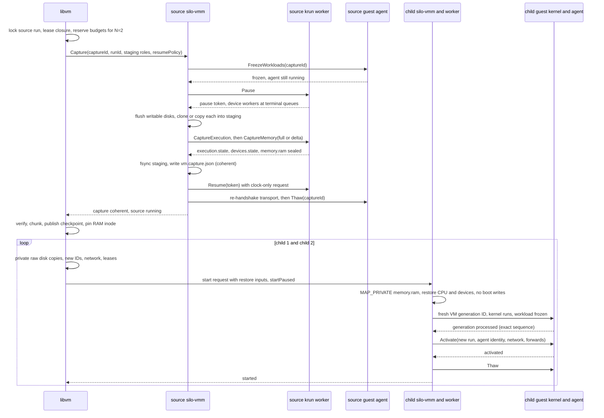

# 21. Live snapshots and forks of running machines

Date: 2026-10-25

Updated: 2026-11-09

## Status

Accepted

This ADR specifies the target architecture, not functionality already
delivered. The implementation stages and conformance gates below control when
each capability becomes available. It depends on
[ADR 0014](0014-layered-oci-image-storage.md) for storage identity,
publication and retention and extends
[ADR 0018](0018-silo-vmm-contract.md) with the live-command and restore
contract.

The owner decision of 2026-11-01 makes the combined implementation of this
ADR and ADR 0014 a **hard breaking release**. Every user must reinstall and
wipe all existing Silo state. No upgrade migrations, backfills, old-state
readers or compatibility bridges are provided. Initial schemas and callers
cut over directly; incompatible state is refused with a reinstall/wipe
diagnostic rather than automatically deleted. Current-format checkpoint
validation, crash recovery and portability refusal remain mandatory.

Phase 22 replaces the development flat lower with ADR 0014's default
`linux-erofs-overlay-v1` OCI root on libkrun. Stopped layered snapshots retain
the exact fsmeta and ordered, occurrence-preserving pack/metadata graph; OCI
regeneration is only a digest-gated fallback, not a requirement for portable
restore. There are no old-profile readers or root-profile selectors.

The owner-approved privileged umoci v0.6.0 published-builder namespace gate
also matched actual readonly EROFS traversals without excluded fields.
Production-root boot/lifecycle and kernel-mutated flatten gates passed on
Linux x86_64 with stable 7.2.2 and longterm 6.18.48. Phase 24 separately records
Linux KVM x86_64 runtime evidence, including the mandatory btrfs and ext4
budget sweep. Original
containerd differential evidence and the absolute-path Nix negative remain
intact; see [ADR 0014's gate exception](0014-layered-oci-image-storage.md#filesystem-and-linux-gates).

The 2026-11-09 Phase 24 revision accepts the chunk-list stream identity,
the explicit record step after the cut, structural trust of local monitor
receipts, `constructed` → `durable` children with joined durability barriers,
the non-CoW copy and capture/incremental disk-sealing allowances, reflink
seeding of incremental RAM, and a Linux 6.6 kernel floor instead of exact
boot-tuple qualification. Measured budgets and retained failures are recorded
in the [performance tracker](../architecture/live-operation-performance.md),
backed by `.tmp/plan/evidence/phase-24/`.

The owner decision of 2026-11-10 removes build-specific live admission and
exact-build checkpoint compatibility. Any pinned libkrun reference supplies its
native live operations subject to the existing host and machine checks.
Checkpoints record the live state format schema and guest architecture; restore
refuses those mismatches, not a different build.

## The Problem

[ADR 0014](0014-layered-oci-image-storage.md) gives Silo snapshots and forks of **stopped** machines: a machine's
private storage is captured at the stopped boundary, identified by content, and
restored by booting a new machine. That contract cannot express the operations
users now need:

1. Checkpoint a **running** machine, including its memory, CPU and device
   state, so that it can later resume where it was instead of booting again.
2. Fork a running machine into N children that continue from the same instant,
   sharing unchanged memory, each with private writes.
3. Pause and resume a machine without creating a snapshot.
4. Publish and transfer such a checkpoint through the same artifact format and
   retention model that [ADR 0014](0014-layered-oci-image-storage.md) defines for storage.

A live checkpoint is a different artifact from a stopped snapshot. Its disk
state is only meaningful together with the memory image captured at the same
instant; its memory image contains the guest's entropy pool, open connections,
cached identities and secrets; and it executes only on a host whose hypervisor,
CPU and software can accept the saved execution state. A design that treats it
as "a snapshot plus a memory file" produces restores that look successful and
are not: a disk newer than its memory, a child that reuses its parent's random
state, a timer that never fires again after restore.

The constraints are Silo's existing ones. libkrun is the default backend on
Linux (KVM) and macOS (HVF); VZ is an explicit macOS selection. There is no
always-running host service ([ADR 0004](0004-daemonless-architecture.md)). `silo-vmm` never opens the database and
is driven through files, descriptors and one Unix socket ([ADR 0018](0018-silo-vmm-contract.md)). Guest
provisioning happens once per cold boot through the per-launch initramfs
([ADR 0009](0009-per-launch-guest-agent-initramfs-overlay.md)) and static network configuration ([ADR 0010](0010-static-guest-network-configuration.md)). Storage is
content-addressed with one stored disk encoding ([ADR 0014](0014-layered-oci-image-storage.md)).

Silo's pinned libkrun exposes no capture or restore surface and its pause is
asynchronous and macOS-only. A third-party runtime has implemented live
capture and fork in its own libkrun fork; that fork has diverged from the
upstream lineage Silo tracks and uses a different native API. The capability
therefore has to be specified against Silo's own boundaries and ported
deliberately onto Silo's fork, not adopted by changing a dependency revision.

## Terminology

| Term | Meaning |
| --- | --- |
| Pause | Every vCPU parked at an instruction boundary, every device worker stopped at a terminal queue position, every host memory writer drained. Reversible; produces no artifact. |
| Pause token | `(machineId, runId, pauseGeneration, owner)` identifying one established pause and who may resume it. A resume names the exact token. |
| Capture | One operation that produces a coherent cut of execution state, RAM and every included writable disk at one pause token. |
| Execution checkpoint | The immutable, verified closure produced by a capture: RAM stream and layout, execution envelope, device state, sealed disks, boot and configuration provenance, compatibility profile. [ADR 0014](0014-layered-oci-image-storage.md) calls this a snapshot with `captureKind: live-execution`. |
| Restore | Construction of a new machine generation whose first guest instruction continues from an execution checkpoint. |
| Fork | One capture of a running source followed by N restores, with the source resumed under its recorded policy. |
| Activation | The barrier between a restored guest's first instruction and the moment its workload runs and its endpoints are reachable: fresh VM generation identity acknowledged, agent rebound, network applied, workload thawed. |
| Baseline | The retained RAM generation a VM's dirty tracking is measured against, enabling incremental capture. |
| Workload freezer | A cgroup freezer subtree containing every guest process except the agent and its control dependencies. |

## Representative Flow

A fork of a running machine into two children, with the source resumed:



The same flow without the loop is a live snapshot. A capture of a
user-paused source carries `resumePolicy: preserve` and leaves it paused. A
user pause alone is `FreezeWorkloads` and `Pause`; its resume is `Resume`
followed by `Thaw`.

## Decision

Silo adds **pause, live snapshot, restore and fork of running machines on the
libkrun backend**, built from five commitments:

- **One quiescent cut.** A capture is valid only when every vCPU, device
  worker, host memory writer and writable block backend has been proven
  stopped at one pause token, and every artifact of the capture is bound to
  that token. `silo-vmm` records the facts it observed; it never infers them
  from an exit status or a returned RPC.
- **Raw disks, sealed by copy.** The writable disks of a captured machine are
  sealed by a qualified clone or copy of their paused view into immutable raw
  files. [ADR 0014](0014-layered-oci-image-storage.md)'s one-encoding rule stands: no qcow2 chain, no block
  service, no Silo-owned CoW container. Children receive private raw copies.
- **One immutable RAM file, privately mapped.** A checkpoint's memory is one
  complete sparse RAM image with a separate layout record. Every restored
  machine maps that file `MAP_PRIVATE` from a read-only descriptor, so
  children share clean pages through the page cache and own only the pages
  they write. Incremental captures chain through complete resolved chunk maps,
  never through a replayed delta chain at restore.
- **Fail-closed activation.** A restored guest does not run its workload or
  expose an endpoint until the kernel has acknowledged a fresh VM generation
  identity, the agent has bound the new run, destination networking is
  applied and the workload freezer is thawed by the monitor. Any missing step
  leaves the child parked or killed, never partially live.
- **Same boundaries.** libvm owns allocation, database records, publication
  and retention. `silo-vmm` owns the pause, the cut and the staged evidence.
  The krun worker owns hypervisor state. The guest agent owns freezing,
  activation and identity rotation inside the guest. No component gains
  database access or a new long-running process.

The capability is admitted per lane: Linux KVM x86_64, Linux KVM arm64 with
GICv3, and macOS HVF arm64 on macOS 15 or later. VZ machines retain
[ADR 0014](0014-layered-oci-image-storage.md)'s stopped snapshots only; every
backend reports what it supports before any live operation starts, and an
unsupported operation is refused up front, never partway (see Backend
Capabilities And Early Rejection). Execution checkpoints restore on the same
host class they were captured on; cross-host execution restore is a
separately admitted profile with its own compatibility contract.

### Core invariants

1. A capture binds execution state, device state, RAM and every included
   writable disk to one pause token. An artifact that cannot prove the
   binding is not a checkpoint.
2. Disks are sealed before memory is captured and before any source write is
   admitted. Nothing replays, repairs or flattens a sealed disk between the
   cut and the restore that loads its matching RAM.
3. A restored machine executes its first guest instruction only after memory,
   execution and device state are installed into a freshly constructed VM.
   The cold-boot path never runs; no initramfs extraction, no agent
   provisioning, no boot payload write reaches restored RAM.
4. A child is a new machine: new machine ID, run ID, monitor, worker,
   sockets, network identities and leases. Nothing host-bound crosses from
   the source: no descriptor, socket path, listener, session, forward, netd
   publication or secret authorization.
5. Guest identity inside the image (hostname, machine-id, boot ID, SSH host
   keys, filesystem UUIDs) is preserved. The kernel is notified of the clone
   through the VM generation protocol and reseeds its entropy pool; userspace
   state is not sanitized. A checkpoint is privileged executable state and is
   treated as such.
6. Source continuation and capture success are separate outcomes. A sealed
   capture survives a source that fails to resume; a source that resumes does
   not validate a capture that failed to seal.
7. No fallback. A failed restore never becomes a cold boot, a failed child
   never becomes an unnamed omission from a fork result, and a storage-only
   recovery from a checkpoint's disks is an explicit, differently named
   operation.
8. A user-paused machine stays paused. Only the operation that acquired a
   pause resumes it.

### Scope and relationship to existing decisions

[ADR 0014](0014-layered-oci-image-storage.md) owns the storage side: the stream identity of RAM and sealed disks,
`captureKind` on snapshots, the artifact media types, GC roots and leases for
RAM files and children, and the rule that live capture adds no disk encoding.
This ADR owns execution: pause, capture, restore, activation, compatibility
and the monitor contract. The two are written to be read together; where this
ADR names a storage rule, [ADR 0014](0014-layered-oci-image-storage.md) is the normative source.

[ADR 0018](0018-silo-vmm-contract.md)'s monitor contract gains a live-command surface on the existing
control socket, a restore object in the start request, a per-capture result
file and nonterminal states. Its terminal `vm.exit.json` and `storageShutdown`
evidence are unchanged.

[ADR 0009](0009-per-launch-guest-agent-initramfs-overlay.md)'s per-launch initramfs and [ADR 0010](0010-static-guest-network-configuration.md)'s static network provisioning
remain the cold-boot contracts. Restore does not rerun them; it applies one
bounded activation message to the agent already in memory. [ADR 0010](0010-static-guest-network-configuration.md)'s "not
continuous reconciliation" rule gains exactly that one exception.

[ADR 0015](0015-hybrid-vsock-host-surface.md) and [ADR 0016](0016-vsock-forwards-and-netd-publications.md) host surfaces are host resources and are never
captured. On restore, libvm reserves network identities with netd, the
destination monitor recreates the hybrid vsock surface and owns forward
policy, host listeners and tokens, the agent registers guest-side listeners,
and netd owns publications, which the guest requests again. Live streams are
dropped.

## Responsibilities

| Component | Owns | Never does |
| --- | --- | --- |
| libvm | Operation records, locks and leases; budgets and admission; the live capability vector and early rejection; staging roles; verification, chunking and publication of checkpoints; child allocation; database reconciliation; N-way fork orchestration. | Touches hypervisor state; reads worker files before the monitor has sealed them; converts an unsupported live operation into another operation. |
| `silo-vmm` (monitor) | Host capability query without a machine; machine `live` vector in status; live commands on `vm.sock`; guest freeze and thaw; worker pause and capture commands; disk flush and clone/copy into named staging; `vm.capture.json`; restore launch of a fresh worker; activation sequencing. | Opens the database; chooses output paths; declares success it did not observe. |
| krun worker | Pause linearization; device quiescence; execution, device and RAM capture and restore through the libkrun capture ABI; dirty tracking and baselines; VM generation device. | Opens files outside its named inputs; resumes without the exact token. |
| Guest init and agent | Workload freezer; `FreezeWorkloads`, `Activate` and `Thaw` RPCs; identity rotation after the VM generation acknowledgement; one-shot network reapplication. | Flushes or repairs filesystems as part of capture; runs the workload before `Thaw`. |
| Guest kernel (Silo build) | The VM generation driver that reseeds the kernel RNG and acknowledges the new identity; cgroup freezer. | Binds the device without acknowledging the exact sequence. |

## Pause

A pause has an **owner**, carried in the token. A pause established by the
public `Pause` command is owned by `user`. A pause established by a capture
is owned by that capture while the capture is in progress; at the seal the
ownership either returns to the capture for its own resume
(`resume-if-acquired`) or transfers to `user` (`preserve`). Outside
`Capturing`, therefore, every `Paused` machine is user-owned and resumable
through the public `Resume`. A token is consumed by the resume that names it;
a later pause issues a new token.

`Pause` is a monitor operation on a `Running` machine for an exact run ID. It
proceeds in order:

1. The monitor fences new execution sessions, filesystem mutations and forward
   registrations.
2. The monitor sends `FreezeWorkloads(operationId)` to the agent. The agent
   freezes the workload cgroup and acknowledges with the set it froze. Every
   pause therefore produces a capture-eligible guest.
3. The monitor issues the worker pause. The worker returns a pause token only
   after every vCPU has stopped at an instruction boundary, every device
   worker has drained to a terminal queue position, every host memory writer
   has been drained and the balloon, console and vsock timers are disarmed.

The machine reports `Paused` only when step 3 has returned a token. If step 2
fails or times out, the monitor thaws what it froze and the machine stays
`Running` with the operation reported as failed; if that thaw also fails, the
machine transitions to `Error`, stays fenced and admits no lifecycle
transition but stop. If step 3 fails, the worker reports the actual state
and the machine stays fenced in `Pausing` with the operation failed. The
only exits from a failed `Pausing` are `CancelOperation` on that pause
operation and stop. Cancel unwinds in reverse order: the worker rolls back
its partial pause (unparks every parked vCPU, reopens device admission,
re-arms the timers it disarmed) and acknowledges; the monitor then sends
`Thaw` over the still-admitted control transport and waits for the thawed
set and readiness; only then it lifts the fences and reports `Running`. A
worker rollback failure or a failed thaw transitions the machine to `Error`,
fenced. A retry is a new `Pause` after a successful cancel. A partially
established pause is never a token.

Pause does not flush or seal disks. The agent's staleness deadlines are
suspended for the duration of a pause; operation deadlines are not.

`Resume` names the token. The worker reopens device admission, applies a
clock-only VM generation request so the guest corrects wall time without
treating itself as a clone, and resumes the vCPUs. The monitor re-handshakes
agent transport and sends `Thaw`; the agent acknowledges with the set it
thawed. After that exact successful acknowledgement, the monitor requests a
new identity-validated status within the fixed readiness deadline. A watch
report received before the acknowledgement (even one emitted by the thaw)
cannot satisfy this post-thaw freshness boundary. The full Ready prerequisites
still apply, and public readiness and admission stay fenced until `Running`.
The machine returns `Running` only when the thaw acknowledgement and readiness
are established. A stale or foreign token, or a `Resume` while a capture is in
progress, is rejected.

If the thaw acknowledgement is lost, the workload may have executed. The
monitor re-issues `FreezeWorkloads`, which is idempotent; on acknowledgement
it issues a new worker pause and reports `Paused` with the new token only
once that pause is established. If the freeze cannot be acknowledged within
its deadline, the machine transitions to `Error`, stays fenced and admits
no lifecycle transition but stop. The monitor never reports `Paused` on an unparked VM and never
reports `Running` on an unacknowledged thaw.

A user-paused machine stays `Paused` across monitor reconnects and manager
restarts. Loss of the manager does not resume it. Stop of a paused machine
finalizes without resuming. The pause token and owner are reported by the
monitor's status API and persisted by libvm with the machine record, so a
client that lost the response recovers them from either.

### Command and state matrix

| State | Admitted commands | Rejected commands |
| --- | --- | --- |
| `Running` | `Pause`, `Capture`, `GetOperation`, `ReleaseCapture`, stop | `Resume`, `CancelOperation` |
| `Pausing` | `GetOperation`, `CancelOperation` (the pause), stop | `Pause`, `Capture`, `Resume`, `ReleaseCapture` |
| `Paused` | `Resume`, `Capture` (borrows the pause; `resumePolicy` must be `preserve`), `GetOperation`, `ReleaseCapture`, stop | `Pause`, `CancelOperation` |
| `Capturing` | `GetOperation`, `CancelOperation` (the capture), stop | `Pause`, `Resume`, `Capture`, `ReleaseCapture` |
| `Restoring`, `Activating` | `GetOperation`, stop | everything else |
| `ActivationFailed` | `GetOperation`, `ReleaseCapture`, stop | everything else; a new restore is the retry |
| `Error` | `GetOperation`, `ReleaseCapture`, stop | everything else |

This table is the single source of admission; the operation table below
repeats none of it.

Stop in `Capturing` cancels an unsealed capture and finalizes; after the seal
it preserves the sealed result and finalizes. Stop in `Paused` finalizes
without resuming.

## Capture

### Admission

Capture is admitted only when every attached device has a capture provider and
the guest profile is one Silo can activate. The initial supported
configuration is a Linux guest with the admitted Silo init and agent, an
overlay or opaque raw root, raw data disks, the managed Unix-datagram network
attachment, native vsock with Silo's mux, console, balloon and RNG. The
following reject capture before anything is frozen, with a typed error naming
the device: virtiofs shares (read-only included), the Rosetta share, TAP or
Unix-stream network attachments, any GPU, input or sound device, nested
virtualization state, confidential-compute memory, and any device without a
provider. Rejection is explicit; no device is detached or degraded to make a
capture possible.

Capture also requires that the machine is not mid-resize, that no other
capture, stop or relocation is in flight for the run, and that libvm has
reserved the staging space, RAM accounting and lease budget for the result.

### Ordering

A capture runs in this order; each step completes before the next begins:

1. **Pause.** The capture establishes a pause it owns (the Pause steps
   above, including the workload freeze), or borrows an existing user pause.
   Because every pause freezes workloads first, a borrowed pause is already
   capture-eligible; a user-paused source is never resumed to prepare it. A
   capture that borrows a user pause must carry `resumePolicy: preserve`.
   The freeze is itself captured: a restored child's workload is frozen until
   the destination thaws it.
2. **Seal disks.** The worker completes outstanding block requests and
   flushes every writable backing file. The monitor then creates one
   immutable raw clone or copy of each included writable disk into the named
   staging role, using [ADR 0014](0014-layered-oci-image-storage.md)'s qualified copy hierarchy, and synchronizes
   it. Read-only attachments (the lower, boot assets) are recorded by
   identity, not copied. A clone or copy failure on any disk fails the whole
   capture; no partial multi-disk cut is ever published.
3. **Capture execution and devices.** The worker serializes transport, queue
   and device-specific state for every device, then the vCPU and VM
   execution envelope (registers, extended state, interrupt controller,
   timers, clocks). Execution capture precedes memory capture because
   interrupt-controller save can write guest RAM.
4. **Capture memory.** Full, or incremental against a valid baseline. The
   worker freezes host writers, harvests dirty coverage, and streams RAM into
   the staging file. A changed-to-zero page is written as an explicit zero,
   never omitted.
5. **Record.** The staged digests are computed while the bytes are written:
   the worker hashes each RAM chunk as it streams it and the monitor hashes
   each disk chunk as it copies it; no staged file is read back to be
   verified. The monitor closes every writer, writes `vm.capture.json` to a
   private `.vm.capture.json.tmp` file in the capture directory, links the
   final name without replacement, then unlinks the temporary name. If the
   monitor dies between link and unlink, libvm settles only that exact
   two-name inode under the operation's publisher lock and checked capture
   lease, before checkpoint publication or local fork-cut retention. Both
   names must be private regular files in the same owned staging directory
   with matching device/inode and exactly two links; any foreign extra link
   is refused without removing names. After settlement the seal, like every
   other control record, must pass ordinary singleton validation. The
   monitor's own bounded settlement retry applies the same exact-pair rule.
   The monitor synchronizes nothing: durability belongs to libvm, at publication
   for a named checkpoint and in each child's background barrier for a fork.
   A capture is **recorded** when `vm.capture.json` with `captureOutcome:
   coherent` and all seven facts true exists; a record with `captureOutcome:
   failed` is written the same way for diagnosis and is not a coherent
   record. The recorded inventory (every staged file named in
   `vm.capture.json`) and the record itself never change afterwards; the
   continuation record of step 6 is the only file added to the directory
   after the record. A host crash before libvm has published (checkpoint) or
   made every child durable (fork) loses that capture and nothing else; the
   source continues or is recovered by its own rules. Elsewhere in this
   document "sealed" means "recorded" in this sense.
6. **Continue the source.** Under `resumePolicy: resume-if-acquired` the
   capture owns the pause: the worker accepts the new baseline and resumes
   the exact token, the monitor re-handshakes the agent and sends `Thaw`.
   Under `preserve` the source stays paused with its workload frozen and
   ownership of the pause transfers to `user`; the monitor issues the
   user-owned token and reports it through status and `GetOperation`. The
   monitor records the continuation in
   `vm.capture-source.json`, written atomically and durably the same way,
   with version, `machineId`, `runId`, `captureId`, the pause token and
   `sourceOutcome`: `resumed`, `preserved` or `resume-failed` with an error.
   A missing record while the run is alive means the continuation is
   unfinished and `GetOperation` is authoritative; a missing record after the
   run has ended means `unknown`. libvm never re-issues a resume because the
   record is absent; it reconciles against the monitor's actual state.

### Evidence

`vm.capture.json` (version 1) carries: schema version, `machineId`, `runId`,
`captureId`, the pause token, the original guest `freezeOperationId` and
`freezeEpoch`, the digest of the machine configuration and
attachment inventory at capture time, the RAM layout and geometry, the exact
inventory of staged output roles with sizes and SHA-256 digests, capture
timestamps, `captureOutcome` (`coherent` or `failed`), an error string or
null, and these booleans: `workloadsFrozen`, `vcpusPaused`, `devicesQuiesced`,
`hostWritersDrained`, `hostFlushCompleted`, `diskCopiesSealed`,
`memoryStateSealed`. Each boolean records a positively observed fact. A false,
missing or malformed field cannot yield `coherent`. The record is versioned by
addition only.

A coherent seal retains the original guest freeze reference for restore after
source deletion. An acquired pause uses the capture ID as `freezeOperationId`;
a borrowed user pause retains its original pause operation ID, not the new
capture ID. Restore authenticates this reference from the seal and does not
depend on the source's request file.

### Incremental capture

The worker tracks dirty pages after a capture is accepted: KVM slot dirty
logging on Linux, second-stage write protection with first-write faults on
HVF, and a separate host-writer bitmap for every VMM and device write on both.
An incremental capture requires the exact retained baseline token (tracker
identity, topology generation, memory generation); anything else forces a full
capture. Harvested dirties survive an abandoned attempt; a failed re-arm
invalidates the baseline and the next capture is full. The default crossover
to a full capture is 60 percent dirty coverage; the operation may lower it.

On CoW lanes, incremental RAM capture seeds a fresh private output by reflink
from the exact retained immutable baseline and overlays only dirty runs,
including explicit changed-to-zero writes. Without reflink support it
rebuilds the complete file from the baseline as before; no baseline copy is
prepared before pause. Both paths produce the same complete RAM bytes and
chunk identity. `CaptureMemoryStats.seedMethod` records `clone` or `rebuild`.

A restored machine seeds its own baseline from the immutable RAM file it was
restored from and arms tracking before any restore-time write, so a
checkpoint-restore-recapture cycle does not rescan unchanged memory. This
applies to durable restores as well as local forks.

## Memory Model

### Backing

A checkpoint's memory is one complete sparse RAM file and one layout record.
The layout lists ordered, disjoint `(guestPhysicalAddress, length,
streamOffset)` regions, the memory topology and the native page granule.
Registered RAM is packed in guest-physical order; holes in the guest physical
map are described by the layout, not stored. Offsets and lengths are aligned
to the admitted native page size, which the worker queries rather than assumes.

Every restored machine opens the RAM file read-only and maps each region
`PROT_READ | PROT_WRITE, MAP_PRIVATE`. Clean pages are shared through the host
page cache between every child mapping the same inode; written pages are
private to the writer. The file is never mapped shared, never handed to a
child as a writable descriptor, and never modified in place. The source keeps
its existing mappings after capture; children share with one another and with
later restores, not with the still-running source.

The worker never forks its own process to clone a VM; a child is always a
fresh hypervisor VM in a fresh process that installs saved state before its
first instruction.

### Identity and chains

RAM is a logical stream under [ADR 0014](0014-layered-oci-image-storage.md)'s `stream` identity: 8 MiB decoded
chunks, `zero` only for an entirely zero chunk. The stream's identity is the
SHA-256 of its ordered chunk-digest list with the stream length, computed
from the chunk map; it is not the SHA-256 of the file's bytes. The all-zero
chunk has one constant digest, so hashing a sparse RAM image costs its data
chunks only, and an incremental capture hashes only the chunks it rewrote.
A published artifact blob additionally records the whole-file SHA-256 of the
bytes it transports, computed at publication, never on the pause path. The
layout record is identified separately and binds the stream to its
guest-physical geometry; identical bytes at different addresses are different
memory.

An incremental checkpoint is published with a complete resolved chunk map that
reuses unchanged chunk objects from its predecessor. The parent is lineage, not
a dependency to replay. Before restore, libvm materializes one complete
immutable RAM file from the map (a reflink of the predecessor plus changed
chunks where the host supports it, a full write otherwise); that file is the
mapping target. A changed page costs a rehash of its 8 MiB identity chunk;
this is accepted hash and transfer amplification, not the dirty-tracking
granule.
The 1 s incremental budget below is measured on the defined fixture: one
contiguous 410 MiB dirty region in a 4 GiB guest, under this unchanged 8 MiB
chunk identity. Scattered dirty placement can legitimately affect every chunk
and require up to a full-RAM rehash, even at the same dirty-page fraction.
`identityBytesHashed` reports the affected identity-byte coverage so this
placement-dependent cost is visible, not hidden by the fixture's target.

Lazy restore through `userfaultfd` is not part of this contract. File-private
mapping already demand-pages local memory. Every byte of a checkpoint is
verified locally before restore; a materialization from chunk storage is not
presented as remote lazy restore.

### Accounting

A capture alone writes RAM to a file and reserves only its bounded capture
scratch memory, never a resident baseline. The baseline is reserved once,
deduplicated by backing inode, when the first restore or fork child that maps
it is admitted. A live fork admits its children with the capture, so its
pending baseline and per-child charges are reserved before freeze and bound
to the sealed RAM inode afterwards.

Private disk construction for both restore and fork reserves the allocated
bytes of each writable disk, not its logical capacity, plus state reserves
and the pinned boot-object copies. A live fork persists each writable
attachment's allocation sample with the capture reservation and reuses it
for every child, replay and boot-inventory refinement. Standalone restore
measures allocation from its held immutable copy sources. Reflinks and sparse
copies preserve disk holes; guest growth before the capture seal can still
fail the operation under the failure semantics below.

Physical memory for a source and N children is approximately the source's
resident set plus the clean baseline pages any child touches once plus every
child's private written pages, plus page tables and VMM overhead. Per-process
RSS double-counts shared pages and is not the accounting unit. libvm admits a
fork against a budget that reserves, per child, a private-write allowance
(default 25 percent of the machine's RAM, configurable per machine) and
reserves the baseline once; the default maximum fan-out of one fork call is
16. Memory overcommit beyond this reservation requires an explicit per-call
flag and is reported as such. Refusal happens before the source is frozen.

Execution restore exposes that per-child allowance as an integer percentage
from 0 through 100 (`RestoreOptions::resources.private_write_allowance`, CLI
`--private-write-percent`, default 25). It rounds the selected fraction upward
to the native RAM granule without truncating fractional bytes. Zero explicitly
reserves no private writes; the baseline and page-table/native-state charge
remain mandatory. `RestoreMemoryPolicy::AllowOvercommit` / CLI
`--memory-overcommit` is an explicit per-restore opt-in, off by default, and
never bypasses disk, descriptor, closure or compatibility admission. Selected
policy is durable intent, validated with its charge throughout reconciliation.

The same-euid cross-home restore ledger publishes only complete records:
private staging, file fsync, atomic rename, then directory fsync. SQL ownership
commits before initial publication or construction-peak reduction. Interrupted
updates therefore retain the complete conservative old charge or the complete
new charge; interrupted initial staging is never an authoritative inventory
entry. Under `admission.lock`, each home first atomically publishes a versioned
`<state-db-device>-<state-db-inode>-home.json` anchor containing its canonical
absolute home path and `state.db` device/inode identity. Opening a home
reconciles its entries from authoritative SQL and refreshes the anchor, including
after relocation. Before summing charges, every admission reclaims abandoned
staging and checks other homes' anchors: a prefix is live only if its anchor
parses with a supported schema and the recorded path's `state.db` still has
exactly the recorded device and inode. Missing or malformed anchors, deleted
homes, and replaced databases release all entries of that prefix at the next
admission by any home of the same user. The ledger directory is synced after
reclamation. An anchor proves only existence, so an invalid anchor does not
retain charges; malformed authoritative charges of a live home still refuse
admission. Live homes' charges remain governed by their SQL journal receipts,
never by PID or lock observations.

### Reclaim

Silo's macOS free-page reclaim patch operates on live mappings. For restored
private mappings it is disabled until its contract is qualified: a discarded
page must read as zero afterwards, never as the baseline's old bytes. The
same requirement applies to balloon-driven discard on both hosts. Disabling an
optimization is never a reason to omit memory from a capture.

**Amendment, 2026-11-10 (Linux/KVM host reclaim).** Linux boot anonymous RAM,
including capture-tracked snapshot sources, reclaims guest-reported free ranges
with `MADV_DONTNEED`. Restored file-private RAM retains lazy private COW sharing
and reclaims by replacing only the reported range with fresh anonymous
read/write memory at the same address (`MAP_FIXED | MAP_PRIVATE |
MAP_ANONYMOUS | MAP_NORESERVE`). File-private RAM never receives
`MADV_DONTNEED`, which could resurrect checkpoint bytes. Both discard paths
mark the range dirty through the host-writer memory domain before changing it;
marking failure prevents discard. Freed ranges read zero, checkpoint RAM files
remain unchanged, and other VMs' mappings are unaffected.

Adjacent reports are coalesced. Anonymous replacement islands are bounded
against the host mapping limit with a fixed VMM reserve. At the bound, or on
`ENOMEM`, acknowledge without discarding and count `mapping_limit_skips`;
never fail the VM or fall back to file-private advice. Status also reports the
current `replaced_islands` count. These counters are process-local and are not
captured balloon device state. Reports are drained and quiesced before a
capture cut. Incremental capture writes discarded dirty pages as explicit zero
overlays; full capture may omit zero pages as holes. Linux tracked and restored
RAM report effective reclaim with reason `none`. The macOS/HVF inhibition and
qualification contract above are unchanged.

## Restore

### Inputs

Before binding shape descriptors, libvm reconstructs any explicitly evicted
flat stream from retained chunks under the consumer's lease. Reconstruction
authenticates the chunks and complete stream identity; a missing or corrupt
chunk fails closed. Reconstructed flats remain re-evictable cache, protected
from eviction while the consumer's operation roots are live.

libvm verifies the checkpoint closure's shape, trust policy and compatibility
profile before allocating anything for a child: every member is present with
its recorded length, role and lineage; already-present stream bytes are not
read in full yet. Byte authentication of the RAM stream and the sealed disks
then runs concurrently
with the construction of the child's private disk copies; a failed
authentication rolls the owned child allocation back and reports the
authentication error, never a construction error. A content object that
libvm itself verified and sealed earlier is reused without re-reading when
its recorded inode, length, mode `0400` and change time still match; a
mismatch re-authenticates. Silent corruption that preserves inode metadata,
including the change time, is outside this local warm-reuse trust boundary;
transport still authenticates every byte. Objects that leave the host
(publication, export, handoff) are always re-read in full. libvm creates the
child's machine
directory, private raw copies of every sealed disk, fresh network reservations
and sockets, the composite initramfs for provenance only, and the leases for
the RAM file, lower and boot assets. It passes the resolved restore inputs to
the monitor in the [ADR 0018](0018-silo-vmm-contract.md) start request: checkpoint ID; the RAM file,
layout, execution and device-state objects as inherited read-only
descriptors; the private disk roles; the compatibility profile; the
activation configuration; and `startPaused: true`.

A restored child's private copies follow the fork rule: hashed as written,
recorded `constructed` when complete, started on that record, and moved to
`durable` by a background synchronization; a child without a durable record
after a runtime restart is deleted by recovery, never started.

Private disk copies are role-selected paths under the child's data directory;
the RAM file, layout, execution and device-state objects are leased content
objects passed as inherited read-only descriptors. An imported artifact never
supplies a path, and the monitor opens no path outside its named inputs.
Missing objects,
an unsupported execution ABI, an incompatible CPU or device profile, or a
required external resource without a destination binding reject before guest
execution. Nothing substitutes: not a current image tag, not a newer kernel,
not a cold boot.

### Construction

The monitor launches a fresh worker. The worker creates a new hypervisor VM
and proceeds in this order, all before the first guest instruction:

1. Installs the private RAM mappings and layout from the inherited
   descriptor.
2. Arms child-local dirty tracking against that baseline, so that every
   write made by the remaining steps is covered by a later incremental
   capture.
3. Restores the VM and vCPU execution envelope.
4. Restores each device's transport and queue state with the destination's
   host resources (new backend handles; the destination MAC as the only
   permitted device-visible override). The network backend and the vsock mux
   are created **fenced**: the network backend drops every frame in both
   directions, and the mux admits only the agent control service, until the
   monitor releases the fence in the activation sequence.

The normal build path, which can begin execution during construction, is not
used for restore. The worker then reports `restorePrepared` to the monitor and
waits.

A construction failure destroys the child's execution attempt and releases its
attachments after the worker is reaped. The checkpoint remains available for a
retry under a new run ID.

### Activation

1. The worker installs a fresh VM generation request: a 128-bit identity from
   the host CSPRNG and a sequence number, delivered through the virtio VM
   generation device.
2. The worker resumes the vCPUs. The kernel and the agent run; the workload
   freezer captured in RAM keeps the workload stopped.
3. The guest driver reseeds the kernel RNG through `add_vmfork_randomness`
   and acknowledges the exact sequence and identity in device config space.
   The worker waits for that acknowledgement with a bounded deadline.
4. The monitor connects to the agent over the recreated vsock transport
   (through the fence's admitted control service) and sends `Activate`: the
   new machine and run identity, the destination network configuration and
   public SSH CA, the guest-side listeners for the machine-scoped forwards
   the monitor will open, and the selected activation hook if any. The agent
   rotates its runtime instance identity, drains inherited sessions, replaces
   the source SSH CA for both native SSH and OpenSSH, applies the network
   configuration to the captured interface (located by its stable index, not
   by its replaced MAC), flushes neighbor caches, registers the named guest
   listeners and runs the hook. It acknowledges with its new identity.
5. The monitor, still fenced, binds every host listener for the
   machine-scoped forwards it authorized and the machine's public endpoints,
   without accepting a connection on any of them. A bind failure is an
   activation failure like any other.
6. The monitor sends `Thaw`. The agent thaws the workload freezer and
   acknowledges with the set it thawed.
7. The monitor releases the network and mux fences, begins accepting on the
   bound listeners, reports `started` on the syncpipe and enters `Running`.
   Fence release is the final step: nothing after it can fail activation,
   and nothing before it lets guest traffic in or out.

Every step fails closed. No acknowledgement, a mismatched run ID, a bind
failure or a failed hook leaves the workload frozen and the fences in place;
the monitor closes any listeners it bound, re-pauses the child, transitions
it to `ActivationFailed` and reports the failure, or kills and reaps it if
pause cannot be re-established. An `ActivationFailed` child admits no
lifecycle transition but stop (inspection and `ReleaseCapture` remain
admitted per the matrix); `Resume` rejects it; the retry is a new restore
under a new run ID. A lost
`Thaw` acknowledgement means the workload may have run while still fenced:
the monitor re-issues `FreezeWorkloads`, which is idempotent, then re-pauses
the worker, closes its listeners and transitions to `ActivationFailed` with
the fences still closed; if the freeze cannot be acknowledged, it kills and
reaps the child. A child never reaches `Running` with its activation
incomplete, and no guest traffic leaves or enters the child before the fence
is released.

Forward ownership follows [ADR 0016](0016-vsock-forwards-and-netd-publications.md): libvm reserves destination identities
with netd, the monitor owns forward policy, host listeners and tokens, and the
agent registers only the guest-side listeners that `Activate` names. netd
publications belong to netd and are requested again by the guest after thaw.

The existing periodic clock synchronization is not the restore barrier. The
worker restores the saved monotonic and boot-time elapsed time, the interrupt
controller and pending timer state in backend order, and applies one common
counter displacement across vCPUs; the agent steps wall time forward to the
host's sampled time during `Activate`. Timer progress after activation is a
conformance gate, not an assumption.

### Native KVM timer precision limitation

Capture and restore preserve the original timer comparator, mask, pending and
in-service state, coherent execution records and common clock relationships.
Silo must not replace the comparator with `now + delay`, synthesize a wake,
duplicate or lose an interrupt, or weaken pause and activation isolation.
These state-preservation requirements do not promise absolute no-early
delivery by the native host's KVM TSC-deadline timer.

**KVM-TSC-DEADLINE-EARLY** tracks the owner-approved exception to that
absolute no-early precision requirement only. The native evidence directory
`target/phase09-evidence/timer-traced-01` in the libkrun production checkout
records 16/16 early source-only deliveries without intervening reconstruction,
with the full exact MSR/IRQ trace. This is evidence of a native host limitation,
not a passing absolute-precision gate or proof that restore gates passed.
No corruption or application failure was observed; possible application impact
is not ruled out.

The [upstream December 2023 discussion](https://lkml.rescloud.iu.edu/2312.2/06707.html)
describes how NTP-adjusted host hrtimers can diverge from guest TSC deadlines.
It is contextual discussion, not a filed matching bug, proof of the exact
cause on this host, or a fixed-version announcement. Review this limitation
on **2026-12-01** and on host kernel updates. There is no supported fixed-version
cutoff, custom host kernel requirement or host tuning prescription.

Qualification must retain the measured early-delivery observations separately
from success, and still require exact comparator/state preservation,
interrupt/EOI counts, clock relationships, source resume, fresh-process restore,
recapture, cleanup and isolation. Every other gate remains mandatory;
this exception alone does not complete Phase 9 or qualify a lane.

The host support policy remains [ADR 0012's host matrix](0012-cross-platform-runtime-and-sdk-packaging.md#supported-targets-and-compatibility):
GNU/Linux amd64 and arm64 with glibc 2.39 or newer. That policy specifies no
numeric Linux host-kernel floor or range. The Linux 6.6 overlay-profile floor
and `stable`, `longterm` and `longterm5` tracks in
[ADR 0014](0014-layered-oci-image-storage.md) concern the **guest** kernel,
not host support. Native capability and exact-profile admission remain required;
this timer exception changes neither kernel builds nor the support matrix.


## Fork

Fork is one capture followed by N restores. libvm performs the capture, pins
the recorded RAM file and disk cut under a recoverable operation root, then
restores each child subject to the admitted resource budgets. A local fork
uses [ADR 0014](0014-layered-oci-image-storage.md)'s qualified clone and copy
identity rules without computing durable chunk identities first; a named
checkpoint is not required, an operation root is. libvm validates the cut's
receipt structurally (run and configuration correlation, roles, lengths,
chunk counts, token binding) and does not re-read the cut before
constructing children; the bytes are authenticated when they are first used
(the RAM stream on restore, each disk as it is copied). The cut is never
published as a checkpoint; it exists only until every child is durable.

Each child's private disk copy is hashed as it is written and compared with
the cut's identity; a mismatch fails that child. The child's construction is
recorded as `constructed`, not yet durable, as soon as its copies are
complete, and the child may start on that record. Its durability barrier
(file and directory synchronization) completes in the background and moves
the record to `durable`; a child that still lacks a durable record after a
runtime restart is deleted by recovery, never started. The fork completes
when every child is `Running` and reports durability separately. A fork cut
is collectable once every child is `durable`.

The result names every child and its outcome and the source's continuation
outcome. Before the capture seals, every child fails together. After it seals,
one child's failure does not roll back running siblings or recapture the
source. Cancelling a fork never deletes a running child's dependency root.

An observed child restore failure retains its original bounded diagnostic and
typed construction or activation phase in the fork journal before failed-start
cleanup may delete the child and its monitor records. Retained generation,
consumer or holder ownership keeps the child `recovery-pending`; positive
retirement resolves it to `failed` with that original evidence, not `abandoned`
or a generic cleanup diagnostic. A lost manager without retained failure
evidence remains uncertain and is never assigned an invented activation cause.

Children inherit the source's configuration, guest settings and backend
requirement. They inherit no session forwards, netd publications, published
ports, external mounts, secret authorizations or open host resources; those
are supplied per child through the activation configuration. A child's
captured-but-stale TCP connections receive errors inside the guest; the
destination netd does not deliver traffic for the source's addresses to the
child.

## Device And Identity Model

| Device (libkrun) | Treatment |
| --- | --- |
| Block (lower, upper, data) | Captured: queues, negotiated features, capacity, read-only flag, serial. Writable bytes sealed per Capture step 2. Recreated: backend handles. |
| Network (Unix datagram to netd) | Captured: queues, features, guest MAC. Recreated: destination datagram socket and netd reservation; destination MAC override permitted. TAP and Unix stream: rejected. |
| Vsock (native, Silo mux) | Captured: queues and transport state. Recreated: mux socket pair, listeners, reserved services. Active streams are reset; the agent and every exec session reconnect. |
| Console | Captured: queues and port state after RX/TX workers join. Recreated: PTY and logs. No output replay. |
| Balloon | Captured: configuration and queues; stats descriptor terminalized. Recreated: host timers. Discard semantics qualified before enabling on restored mappings. |
| RNG | Captured: queues. Recreated: host entropy source. Guest pool is reseeded by the VM generation protocol. |
| VM generation (new virtio device) | Captured: protocol state. A fresh request is installed on every restore; a clock-only request on every resume. |
| Interrupt controller, timers, legacy devices | Captured as part of the execution envelope. An unsupported topology rejects at admission. |
| virtiofs, Rosetta, GPU, input, sound, nested, TEE | Rejected at admission. |

The VM generation transport is an acknowledged virtio protocol (request and
acknowledgement in config space, a config-change interrupt) following an
existing reference implementation for libkrun guests, ported with its GPL
kernel driver into Silo's kernel build under Silo's own device identity.
The virtio device ID is `0x5347` (ASCII `SG`, "Silo generation"); it lies
far above the IDs the virtio specification assigns (1 through 50) and
collides with no registered type, and any further Silo-private virtio device
takes another `0x53xx` ("S") value. Private IDs above 63 are representable
only on the MMIO transport, which is the only transport libkrun uses.
Standard Linux `vmgenid` binds ACPI or device-tree transports that Silo's
kernels do not expose; it is not sufficient. The Silo kernel configuration
enables the virtio VM generation driver built in, `CONFIG_VMGENID`, and the
cgroup freezer, and the conformance gate checks the emitted configuration,
not the fragments.

| Identity | Policy on restore and fork |
| --- | --- |
| Silo machine, run, monitor, worker, sockets | New. |
| Agent instance identity | Rotated by the agent during `Activate`; the captured boot ID is provenance. |
| MAC, IP, routes, DNS | Fresh destination network reservation, applied by the agent during `Activate`. MACs are distinct; numeric IPs may repeat across separate private networks, each with its own netd instance and data socket (ADR 0010). |
| Hostname, machine-id, filesystem UUIDs, partition GUIDs, SSH host keys | Preserved. An explicitly selected activation hook may change what it supports; there is no universal live generalizer. |
| Kernel entropy pool | Reseeded through the VM generation protocol before the workload runs. |
| Userspace RNG state, tokens, nonces, cached credentials | Duplicated. Disclosed in the checkpoint description; not sanitized. |
| TCP connections, vsock streams, exec sessions, forwards, publications | Dropped. Recreated from configuration where configured. |
| Secrets in RAM or on disk | Captured. Destination access to new secrets requires explicit authorization. |

## Backend Capabilities And Early Rejection

Live operations exist only on the libkrun backend, and only on admitted
lanes. A machine whose selected backend is VZ never pauses, captures,
restores or forks under this ADR, and a runtime whose selected backend is VZ
never restores an execution checkpoint. Backend selection is the existing
rule: the runtime's explicit override (`SILO_VIRT_BACKEND`, the system
configuration's recorded backend) or, absent one, the host default (`krun` on
Linux and macOS). The exclusion is reported before operational admission or
mutation, never discovered halfway through an operation.

Every backend reports a **live capability vector**: `pause`, `capture`,
`restore`, `fork` and `incremental`, each `supported` or `unsupported` with
one typed reason. The reasons are closed: `backend-excluded` (VZ, mock
without a scenario grant), `host-os-below-floor` (macOS 14 for HVF),
`hypervisor-unavailable` (no `/dev/kvm`, no
Hypervisor.framework entitlement), `build-excluded` (the live ABI not compiled
in), `not-delivered` (the stage that admits this operation has not shipped in
this release) and, at machine level only, `device-profile-rejected` naming
the device (virtiofs, Rosetta, TAP, GPU, nested, TEE) or the guest profile.

A delivered operation is `supported` when the libkrun backend provides its
native primitive for this lane and the host passes its runtime checks.
The `native` diagnostic reports that primitive independently of host and
machine-profile refusals. Support does not depend on a build allowlist, a
source tree being clean, or a previous local test result. Positive mock
scenarios exercise transport, not native execution.

The informational `buildIdentity` is `v1:silo:<target>:<package-version>`, using
only Silo's Cargo environment. It is useful alongside binary digests in system
information and smoke evidence, but it does not participate in restore admission.
Builds do not inspect source checkouts, Git metadata or source fingerprints.

Capture receipts and checkpoint compatibility profiles carry `liveStateSchema`
and `architecture`. The native capabilities API exports `LIVE_STATE_SCHEMA`
(`silo.live-state/1`); bump that summary whenever any component's state magic or
schema changes. Each encoder owns its magic and schema constant, and its decoder
checks both. Restore compatibility refuses only schema or guest-architecture
mismatches, with typed expected/found diagnostics, never a different build,
compiler, checkout, feature fingerprint or source revision. Existing checks of
captured hashes, topology, device inventories and host resource readiness remain
integrity and execution-safety checks, not producer identity policy.

Machine-less native host queries supply operation and host facts without creating
a VM. Unknown VM/GIC admission remains unknown, and neither API access nor optional
HVF symbol presence bypasses runtime host or effective-profile checks.

The native query's lane is authoritative, including build-feature and unknown
inventory exclusions. Because the current public schema requires an explicit
krun lane, native `Unsupported` produces a typed discovery refusal rather than a
lane reconstructed from backend/architecture or a misleading not-applicable report.

The vector has two sources with distinct scope:

| Source | Scope | How it is obtained |
| --- | --- | --- |
| `silo-vmm capabilities --backend <kind> [--scenario <path>] --json` | Host and selected backend: everything that can be known without a machine | A subprocess with no machine, no sockets and no data directory; the monitor evaluates the native primitive, lane, OS floor, hypervisor access, build features and delivered stages. libvm runs it with the same backend selection and mock scenario it would put in a start request, at runtime open, and caches the result keyed by `silo-vmm` executable identity, host boot, backend kind and scenario digest. |
| Monitor status API, `live` object | Machine: the host vector narrowed by the running machine's attached devices and guest profile | Reported for every run from startup; refreshed when a device is attached. |

libvm exposes the host vector as `Runtime::live_capabilities()` and the
machine vector on `Machine::inspect`. Both are typed values, not strings;
the CLI and `silod` render them and never re-derive support from the backend
name.

**Early rejection.** An explicit read-only observation phase may resolve the
machine and query its exact run status before operation admission. It may
coordinate catalog reads and issue `GetStatus`. Read-only protects logical
database contents and persisted machine/runtime state; ordinary SQLite-native
WAL/SHM coordination is allowed, so unchanged sidecar bytes/existence are not
required. The SQLx observation path retains read-only/query-only/no-create-main
semantics, a shared native catalog guard and its close barrier. It must not
initialize a writable Runtime, invoke application write recovery or migrations,
mutate logical records, or reserve operational resources.
libvm then consumes an opaque immutable observation fenced by machine, run,
monitor and topology identity. Capability validation is the first step of
`pause`, `capture`, `fork` and `restore`, before any **new** operational machine
lock, budget reservation, lease, workspace/child allocation, write transaction
or lifecycle command. Cold invocation is not claimed to perform zero read locks
or status RPCs. Existing Runtime ownership predating the operation is not new
admission. A future supported implementation must revalidate run/topology under
its operational lock; an observation is evidence, not permanent authorization.
An unsupported capability fails with `LiveOperationUnsupported` carrying the
operation, actual backend, lane, reason and typed device/profile subject where
applicable. Discovery/protocol/observation failures are separate typed errors,
not extra semantic unsupported reasons. Persisted machine/runtime state and
logical database contents are unchanged during the operation interval.
The CLI prints one line with the reason and the
supported alternative; for a VZ machine that is `silo stop` followed by the
stopped snapshot of [ADR 0014](0014-layered-oci-image-storage.md). `silod`
returns the same error as a precondition failure with the reason code, and
its status API carries the host vector so a remote client can decide before
it sends the request. `silo system info` and `silo info` print the vector.

**No implicit fallback.** An unsupported live operation is never converted
into a different operation: libvm never stops a machine to snapshot it, never
downgrades a live snapshot request to a stopped snapshot, and never cold
boots in place of a restore. The stopped snapshot and restore of
[ADR 0014](0014-layered-oci-image-storage.md) keep working unchanged on every
backend, VZ included; restoring an execution checkpoint's sealed disks as a
stopped snapshot is the explicit disk-only recovery operation, requested by
name.

**Restore admission.** A checkpoint's compatibility profile names its lane.
libvm compares it with the host vector before allocation; a VZ-selected
runtime, a lane mismatch or a `restore: unsupported` vector rejects with the
same typed error and leaves the artifact untouched.

The mock backend of [ADR 0018](0018-silo-vmm-contract.md) reports the vector
its scenario declares, so libvm, CLI and `silod` rejection paths are tested
without a hypervisor.

## Monitor Contract

### Live commands

Live commands travel over the existing [ADR 0008](0008-vmm-host-and-guest-grpc-api.md) control socket (`vm.sock`),
authenticated by peer UID, as additions to `VmMonitorService`. Bulk data never
crosses gRPC; the worker writes RAM directly into the named staging file.

Every command carries the same envelope: `machineId`, `runId` and
`requestId`. The request ID is chosen by libvm and persisted with the machine
record before the command is sent; repeating a request ID with identical
inputs returns the earlier result, repeating it with different inputs is a
conflict. `Pause` and `Capture` create an **operation** whose ID is the
request ID (`captureId` is the operation ID of a `Capture`). `Resume`,
`GetOperation`, `CancelOperation` and `ReleaseCapture` additionally name the
target `operationId`; they do not create operations and are idempotent. A
command for another run is rejected.

Every operation has one status: `in-progress`, `succeeded` or `failed` with
a typed error. A succeeded `Pause` carries its token and owner; a succeeded
`Capture` carries the capture ID and the fact that `vm.capture.json` is
sealed (`succeeded` and sealed are the same event for a capture). The status
is kept for the life of the run and survives reconnects, so a client that
lost any response reads the same answer from `GetOperation`.

| Operation | Request beyond the envelope | Result |
| --- | --- | --- |
| `Pause` | none | operation receipt; on success the pause token (owner `user`), observed state and capture eligibility |
| `Resume` | target operation (the pause or capture that owns the token), pause token | `Running` after clock, transport and thaw barriers; stale or foreign tokens rejected; rejected while a capture is in progress |
| `Capture` | expected configuration digest, staging roles, policy (`full` or `incremental`), `resumePolicy` (`resume-if-acquired` or `preserve`) | operation receipt; the sealed result is read from `vm.capture.json`, the source outcome from `vm.capture-source.json` |
| `GetOperation` | target operation | the operation status and result above, the pause token and owner if any, and the actual machine state |
| `CancelOperation` | target operation | a pause while the machine is `Pausing` (in progress or failed): worker rollback, thaw, fences lifted, `Running` or `Error`; a capture before the seal: abandoned, staging removed, source continued under its `resumePolicy`; any other finished operation: no effect, its status returned |
| `ReleaseCapture` | target operation | the monitor releases its staging and baseline ownership once libvm has published or abandoned the result; repeated release is idempotent |

A command on a machine whose `live` vector marks the operation unsupported
is rejected with the same typed reason the vector reports; libvm has
already refused such a request before sending it. A client that lost a
response recovers through `GetOperation`; libvm persists every request ID,
pause token and owner with the machine record, so a manager restart
reconciles from the record and the monitor's status rather than from memory.

There is no `ForkN` monitor command. libvm owns child allocation and
launches each child through the normal start path with restore inputs.

Between the monitor and the worker, a dedicated bounded lifecycle socket pair
carries length-prefixed commands and results correlated by run ID and token,
with descriptor passing for staging outputs and the RAM backing. The existing
one-way event FIFO, the EOF-terminated configuration FIFO and the vsock mux
are not reused for lifecycle commands.

### Files

Under the machine data directory, mode 0700, private files 0600:

```text
captures/<capture-id>/
  request.json            # libvm-resolved plan, immutable after submit
  memory.ram              # complete sparse RAM image
  memory-layout.json      # guest-physical geometry of memory.ram
  execution.state         # versioned native VM and vCPU envelope
  devices.state           # device and transport inventory and payloads
  disks/<role>.raw        # sealed raw captures of writable attachments
  vm.capture.json         # the monitor's atomic result and evidence
  vm.capture-source.json  # source continuation outcome
```

These are staging and evidence, not a second catalog. libvm registers the
operation and hands its lease to the monitor before submit; the monitor writes
only here and closes every writer before publishing the result; libvm computes
stream identities, publishes content objects and commits the checkpoint or
child retention in one database transaction. Staging is collectable only after
reconciliation and after every mapping lease on `memory.ram` is released.

### States and reconciliation

The machine lifecycle gains `Pausing`, `Paused`, `Capturing`, `Restoring`,
`Activating` and `ActivationFailed`. Readiness is false in every state but
`Running`. Stop is serialized with capture: before the seal it cancels the
capture and finalizes; after the seal it preserves the sealed result and
terminates the source. A monitor or worker death never produces positive
evidence; a crash before the seal leaves no admissible capture, a crash after
it permits libvm to complete publication from the sealed files.

libvm reconciles `vm.capture.json` by validating run and configuration
correlation and the structural consistency of the inventory (roles, lengths,
chunk counts, chunk-list identities recomputed from the recorded chunk
digests) and committing. It re-reads staged bytes in full only when they
leave the host (publication, export, handoff) or when a consumer first uses
them. It does not infer capture success from process exit, from a file's
existence or from an RPC that returned before the seal.

### ADR 0018 additions

[ADR 0018](0018-silo-vmm-contract.md) is amended to add: the
`silo-vmm capabilities` subcommand and the `live` object in the status API;
the six `VmMonitorService` operations above with their common envelope; a
capability-gated `restore` object in the start request (checkpoint ID, RAM
file and layout as inherited descriptors, execution and device state as
inherited descriptors, private disk roles under the data directory,
compatibility profile, activation configuration, `startPaused`); the
`restorePrepared` worker report, with `started` keeping its existing meaning
and emitted only after activation and thaw; the `captures/` staging
contract, the seal definition and the two result files; the nonterminal
states; and the rule that stop and manager loss never implicitly resume a
user pause.

## Compatibility And Portability

A checkpoint pins what its execution needs. Restore admits it only when the
destination matches:

| Pinned | Admission |
| --- | --- |
| Guest ISA and hypervisor kind | Exact. KVM state never restores into HVF or VZ. OCI userspace architecture is irrelevant; the pin is the executing kernel's architecture. |
| Capture ABI and producer | Exact libkrun capture ABI version, device codec versions and the Silo build that produced the checkpoint. Initial admission is exact-producer; a later release may admit an older producer only after qualifying that pair, and must reject with a diagnostic otherwise. |
| CPU contract | x86_64: effective CPUID, MSR inventory, TSC frequency (or qualified scaling), XSAVE component set. arm64: register list, feature inventory, counter frequency, GIC model. Expanded XSAVE, SVE/SME and nested state reject until qualified. |
| Clocks and controllers | Saved TSC rate or counter and Mach timebase; HVF requires an equal timebase and a compatible GIC state format. |
| Topology | vCPU count, RAM regions and granule, device IDs, order, MMIO windows, IRQs, negotiated features, queue sizes and capacities. Only the destination network binding and MAC may differ. |
| Guest assets | Exact running kernel, initramfs provenance, agent binary and configuration schema, VM generation driver. A restore cannot upgrade any of them. |
| Storage | Exact sealed disk identities, lower closure, root profile and geometry; required external resources with destination bindings. |

The initial admitted target is the same host class: same hypervisor, same CPU
contract, same Silo and libkrun build, in a fresh process after the source and
its directory may be gone. Same-architecture restore on another host is a
later profile with its own qualified source-to-destination contracts.
Execution relocation through [ADR 0014](0014-layered-oci-image-storage.md)'s handoff protocol is a separately
admitted mode that preserves the captured boot bundle and keeps the source
fenced until ownership commits; it never uses fork auto-resume.

Publication retains the whole execution closure even when only the local host
can run it. An artifact can be valid, inspectable and transferable while its
execution is incompatible with the destination; the destination reports the
incompatibility and preserves the artifact. Disk-only recovery from a
checkpoint is an explicit `silo machine create --from-checkpoint-disks`
operation that boots a new machine from private copies of the sealed disks
with stop outcome `unknown`; it is never offered as a fallback for a failed
restore.

macOS hosts before macOS 15 cannot capture or restore execution state because
the GIC state APIs are absent; they retain ordinary boot and stopped snapshots.
A missing API resolves to a typed refusal, never fabricated support.

## Security And Trust

A checkpoint is executable state with the authority of the machine that
produced it. Restoring one requires at least the authorization required to run
its image. Its native-state parsers are host attack surface: the worker
validates sizes, topology, schema and bounds before any hypervisor call, and
every chunk and state object is digest-verified before use. Hashing is
integrity, not authenticity; publisher trust and signatures apply to the OCI
index under [ADR 0014](0014-layered-oci-image-storage.md)'s trust policy.

Staging, cache and published RAM objects are protected like process memory:
0700 directories, 0600 files, included in retention accounting, never world
readable. Publishing a checkpoint exports every secret and deleted-data
remnant in RAM and on disk; the CLI says so when it publishes. Encryption of
artifacts at rest is a separate feature.

A restored child gains no host access that its configuration does not grant.
RAM may contain old paths and handles; they are not capabilities. Destination
netd rejects traffic for the source's addresses; forwards and publications
require destination authorization; secrets require destination authorization.

Against resource exhaustion, libvm bounds N, reserves staging and memory per
the accounting rules, and refuses before the freeze when the budget cannot
admit the batch. There is no fixed concurrent-restore count limit. The source's
immutable RAM file
and sealed disks are held by content leases and read-only descriptors for the
lifetime of every mapping; publication never modifies a same-digest object in
place. Hostile same-UID writes to a mapped baseline remain outside the trusted
cache assumption, as in [ADR 0014](0014-layered-oci-image-storage.md).

## Failure Semantics And Diagnostics

| Failure | Behavior |
| --- | --- |
| Device without provider, unsupported guest, budget exceeded | Typed refusal before freeze; machine unchanged. |
| Workload freeze incomplete or timed out | Thaw what was frozen, report the frozen set, operation failed, machine stays `Running`. If that thaw fails, machine transitions to `Error`, stays fenced and admits no lifecycle transition but stop. |
| Worker pause cannot be established | Machine stays fenced in `Pausing` with the operation failed; `GetOperation` reports the partial state; `CancelOperation` returns it to `Running` (or `Error`), stop finalizes; a retry is a new `Pause`. Never reported as `Paused`. |
| Disk clone or copy fails, `ENOSPC` | Whole capture fails; staging removed; source resumes under its policy. |
| Execution or memory capture fails | Capture fails; harvested dirties preserved for retry; baseline invalidated if re-arm failed; source resumes under its policy. |
| Seal written, source resume fails | Capture is valid and publishable; source reports its failure separately; the user decides. |
| Monitor or worker dies before seal | No capture; libvm removes staging on reconciliation. |
| Monitor dies after seal | libvm completes publication from sealed files; source generation ends per [ADR 0018](0018-silo-vmm-contract.md). |
| Restore construction fails | Child attempt destroyed; checkpoint untouched; retry with a new run. |
| Activation incomplete | Workload stays frozen and fences stay closed; child re-paused into `ActivationFailed`, or killed and reaped if pause fails; never `Running`; retry is a new restore. |
| Fork: child k fails after seal | Children 1..k-1 keep running; result names k's failure; source outcome independent. |
| Compatibility mismatch on restore | Typed diagnostic naming the mismatched pin; artifact preserved; no cold boot. |
| Live operation on VZ, an unqualified lane or a rejected device profile | `LiveOperationUnsupported` before the lock, lease or allocation; machine and database unchanged; the alternative is named. |

Diagnostics distinguish refusal before freeze, failure during capture, failure
during restore and failure during activation. `silo machine inspect` shows
the current nonterminal state, the pending operation and, for a paused
machine, who paused it.

## Resource Limits And Budgets

| Boundary | Initial bound |
| --- | --- |
| RAM per captured machine | [ADR 0014](0014-layered-oci-image-storage.md)'s per-stream limits apply; 1 TiB logical. |
| Children per fork call | 16 by default; higher with an explicit flag, still within budget. |
| Private-write reservation per child | 25 percent of machine RAM by default; per-machine configurable. |
| Memory overcommit | Off by default; explicit per-call opt-in. |
| Capture staging | Reserved before freeze by libvm: staging (RAM image + allocated bytes of each writable disk + state reserves), plus the publication peak (RAM image copy + allocated bytes of each writable disk + map and state reserves) when the pool shares the filesystem. On separate filesystems, publication is charged to the pool's filesystem instead. A same-filesystem local fork cut is renamed, so it needs no publication copy. |
| Restore/fork child disk construction | Per child: allocated bytes of every writable disk + state reserves + pinned boot-object copies. Live forks use the allocation sample retained by capture planning; standalone restores measure their held immutable source files. |
| Activation deadlines | VM generation acknowledgement 5 s; agent `Activate` 30 s; both configurable. |

These are initial budgets measured by the gates below, on the three reference
hosts named in [ADR 0014](0014-layered-oci-image-storage.md)'s qualification matrix (Linux x86_64 on ext4 without
reflinks, Linux x86_64 on XFS with reflinks, Apple-silicon macOS on APFS), with
cold and warm cache recorded separately, as the median of five runs with
minimum and maximum reported; a budget passes when the median meets it. The
target pause durations are: full capture of a 4 GiB machine with a 1 GiB
nonzero upper on APFS or reflink-capable Linux within 5 s of workload
interruption; an incremental capture of the defined contiguous 410 MiB dirty
region in a 4 GiB guest (10 percent rounded to whole MiB) within 1 s;
restore to `Running` within 2 s; a fork of four children to `Running` within
10 s. On Linux without reflinks every one of these budgets is extended by the
**non-CoW copy allowance**: the allocated bytes of each private raw copy the
operation must make (the upper for capture and incremental capture, one
private upper for restore, one per child for fork) at the host's measured
sequential copy rate. In addition, full capture interruption and incremental
capture interruption on **every lane** are extended by the **disk-sealing
allowance**: the sealed upper's allocated bytes at the host's measured
sequential SHA-256 hash rate. Restore and fork-to-Running do not receive this
allowance; the capture-interruption gate within a fork does. On 2026-11-09,
Btrfs disk sealing alone measured 1.1–1.2 s for the fixture's 2 GiB logical
upper with 1 GiB payload, despite a successful reflink. Raw interruption,
non-CoW copy allowance, disk-sealing allowance and gated excess are reported
separately, with their measured rate inputs. The cold-cache restore figure is
recorded on every lane and budgeted on the reflink-capable lanes. Raw clone
and copy remains the disk representation; qcow2 upper generations are not
reopened by these measurements.

## libkrun Fork Commit Series

Silo pins its own libkrun fork (`vandycknick/libkrun`, revision
`11dbc786` in the root `Cargo.toml`): upstream plus four Silo commits
(`balloon: reclaim reported guest RAM on macOS`, `vsock: add an owned native
control-channel mux`, `virtio-fs: serve immutable captured Rosetta
compatibility data`, `vmm: stream the external initramfs into guest
memory`). The `Cargo.toml` pin is the only authority for the baseline. The
live capability is added as the following series on top of
that baseline. Each commit is one bounded feature in the fork's existing
`subsystem: summary` style, builds and passes its own tests on Linux and
macOS, depends only on the commits before it, and leaves every earlier
native capability bit truthful. Advancing the upstream baseline is a
separate rebase of the whole stack with no feature content and is never
mixed into these commits. WHP, nested virtualization and TEE paths are
omitted throughout.

| # | Commit | Scope | Out of scope |
| --- | --- | --- | --- |
| 1 | `krun: report native live-state capabilities for the host` | A query with no VM: lane (KVM x86_64, KVM arm64 GICv3, HVF arm64), hypervisor access, OS floor, build features. Returns every native bit `unsupported` with its reason until the commit that delivers it flips it; the HVF GIC symbol check is added by commit 2. | Product admission (stages, gate records), which is `silo-vmm`'s. |
| 2 | `hvf: resolve GIC state symbols optionally and report admission` | Weak resolution of the macOS 15 GIC state symbols; absence reports `host-os-below-floor` through commit 1 and never fabricates support. Lands before any consumer of those symbols. | macOS 14 emulation of the API. |
| 3 | `devices: add quiescence and state providers to the virtio transport` | Queue, descriptor and interrupt state capture and restore in the MMIO transport; the terminal-queue-position drain used by pause; an explicit provider trait with `supports_quiesce` false by default; pause and capture refused when any attached device lacks a provider. | Per-device providers. |
| 4 | `vmm: complete synchronous pause and resume on KVM and HVF` | Park every vCPU at an instruction boundary, drive every device worker to the terminal queue position of commit 3, drain host writers; a pause generation token; resume by exact token; rollback of a partial pause; Linux KVM support where the baseline returns `FeatureDisabled`. Native `pause` stays `unsupported` until commit 6 supplies a provider for every admitted device. | Any state serialization. |
| 5 | `vmm: serialize and restore execution state` | Versioned, bounded codec for the execution envelope: x86_64 vCPU, MSR, FPU/XSAVE, LAPIC, IRQ chip, PIT and clock state; arm64 core and system registers, GICv3 distributor, redistributor and CPU interface, virtual timer offset; HVF arm64 through the symbols of commit 2. Construction-time restore into a fresh VM before the first instruction, including the timer-restore ordering fixes the reference implementation found necessary on HVF. | Device and memory state. |
| 6 | `devices: capture and restore block, net, vsock, balloon, rng and console` | A provider per admitted device on commit 3's trait: explicit raw block flush and reopen; fenced network reconstruction; native vsock mux quiescence and host-session drop (extends `vsock: add an owned native control-channel mux`); balloon, rng and console state. Flips native `pause`. | virtiofs, Rosetta, GPU, TAP and Unix-stream providers (rejected by commit 3's default). |
| 7 | `vmm: add a host-writer memory domain and dirty tracking` | Every host writer into guest RAM goes through one access domain so dirty maps are complete; KVM slot dirty logging on Linux; second-stage write protection with first-write faults on HVF; harvest, re-arm and baseline invalidation. | RAM image I/O. |
| 8 | `vmm: write and load sparse RAM images with a layout record` | Full and delta RAM capture into a named descriptor with a layout record; explicit zero pages; `MAP_PRIVATE` guest memory over an inherited read-only RAM descriptor; inherited baseline ledger without an initial scan. Restored private mappings are created with host reclaim disabled from this commit on, so no revision ever reclaims a restored mapping. | Chunk identity and publication (libvm). |
| 9 | `balloon: report reclaim qualification for restored private mappings` | Reclaim stays disabled for restored `MAP_PRIVATE` mappings; qualification is reported as `not-run` for such VMs and the discard-reads-zero contract is written as the test that would re-enable it (extends `balloon: reclaim reported guest RAM on macOS`). | Re-enabling reclaim. |
| 10 | `devices: add the acknowledged virtio VM generation device` | Device ID `0x5347`; request carries sequence, 128-bit identity and flags; processed-sequence acknowledgement; clock-only requests that keep identity. The guest driver lives in Silo's kernel tree, not in this commit. | ACPI or device-tree `vmgenid`. |
| 11 | `krun: expose pause, capture and restore on the native API` | `VmmBuilder` restore inputs (RAM descriptor, layout, execution and device state, start paused, fenced network and vsock); `VmmHandle` pause, resume, capture execution, capture memory, dirty baseline control; the ABI `silo-vmm`'s worker consumes. Flips native `capture`, `restore`, `incremental` and `fork` (`fork` is the conjunction of `capture`, `restore` and the private RAM mapping of commit 8; it has no primitive of its own). | Any Silo-side protocol. |

The series is the delivery unit of stage 2 below and lands only after the
stage 1 spike. The spike runs on a scratch branch of the fork that is never
merged; the series is written from what the spike proved, with the spike's
measurements as its acceptance evidence. A commit that cannot be bounded as
above is split, not widened.

## Compatibility And Implementation Stages

1. **Spike: Linux KVM pause, full capture, fresh-process restore.** On a
   scratch branch of Silo's fork, prototype the completed pause and
   quiescence barrier, full execution, device and RAM capture and
   construction-time restore for the devices a minimal guest attaches. One
   fixed-RAM guest, one raw disk, a counter loop with timer wakeups and
   numbered disk writes. Prove continuation, not reboot. Then the same on
   macOS 15 HVF. Then two children from one RAM file with measured physical
   sharing. The spike is not an admitted capability: it has no activation,
   no agent protocol and no published artifact, and it reports measured
   pause, copy and restore values that feed the budgets.
2. **libkrun capture ABI on Silo's fork.** Land the eleven-commit series
   above in order, each with its tests, carrying Silo's four existing patches
   unchanged beneath it. Omit WHP and nested support. Stage 2 is complete
   when commit 11 reports every **native** bit of the lane as `supported`
   and the per-backend tests pass on all three lanes. The public vector
   still reports every operation `not-delivered`.
3. **Guest protocol.** VM generation driver in the Silo kernel; workload
   freezer in init; `FreezeWorkloads`, `Activate`, `Thaw` in the agent;
   one-shot network reapplication; identity rotation.
4. **Monitor and manager.** Live commands, lifecycle socket pair, staging
   and result files, nonterminal states, start-request restore object,
   reconciliation and database records, [ADR 0014](0014-layered-oci-image-storage.md) storage amendments
   delivered (sealed raw captures, RAM stream identity, GC roots, leases).
   User pause and resume are admitted at the end of this stage.
5. **Live snapshot, restore and local fork.** Capture with activation,
   restore, N-way fork with budgets, crash matrix. `Running` children are
   admitted only here.
6. **Incremental capture, publication and transfer.** Baselines and
   deltas, chunk maps, OCI VM artifact media types for execution closures,
   registry round trip, disk-only recovery operation.
7. **Later profiles.** Same-architecture other-host restore, execution
   relocation, virtiofs and Rosetta providers, nested state, VZ.

Stages ship independently. Pause and resume may ship before capture; local
capture and fork before publication. The public capability vector flips one
operation per stage: `pause` at the end of stage 4, `capture`, `restore` and
`fork` at the end of stage 5, `incremental` at the end of stage 6, and each
when its native primitive and host checks permit it; until delivery the bit
reports `not-delivered`. A machine is `Paused`, a checkpoint is `coherent`,
a child is `Running` and an artifact is published only when the corresponding
runtime contract has been satisfied.

## Conformance Requirements

Conformance tests cover each implemented lane (KVM x86_64, KVM arm64 GICv3,
HVF arm64 on macOS 15 or later); their results do not grant runtime support.

- **Pause linearization.** A busy multi-vCPU guest with active block, network,
  console and vsock traffic: the token arrives only after every vCPU has
  stopped, every consumed descriptor has terminalized and every host writer
  has drained. A stale or foreign token resumes nothing. Injected partial
  pause and drain failures leave a fenced, correctly reported state.
- **Matched cut.** The guest writes numbered records to disk and counters in
  memory while block completions race the pause. Every restore observes a
  disk and memory combination that one coherent cut permits; never newer disk
  with older memory. Dirty ext4 journals, unsynced guest cache and multiple
  writable disks are included; nothing replays before memory restore.
- **Raw isolation.** On APFS, reflink-capable Linux and non-reflink Linux: the
  source and N children modify the same disk offsets independently and the
  sealed captures do not change. The copy path records pause and copy bytes
  and its `ENOSPC` behavior. A writable hardlink input rejects.
- **Execution completeness.** Multi-vCPU register, SIMD and extended-state
  workloads, a parked CPU, pending interrupts and timer sleeps continue after
  restore and keep making progress well past the agent handshake; repeated
  pause, restore and recapture cycles pass.
- **Dirty coverage.** CPU writes, block DMA, vsock and console writes,
  balloon reports, changed-to-zero pages and repeated same-page writes all
  survive incremental capture. Faulting any harvest, re-arm or publication
  step loses no dirties; invalid coverage falls back to full.
- **Baseline inheritance.** Restore a checkpoint, change a known page set,
  recapture: unchanged chunks are reused without scanning or copying live RAM
  in full. Stale or wrong-topology tokens reject.
- **Physical sharing.** N fresh children map one immutable RAM inode: clean
  reads do not scale unique physical memory as N independent copies; private
  writes do. Source exit and GC do not invalidate mappings. Measured as Linux
  PSS and private-dirty and macOS physical footprint under memory pressure. A
  failure here blocks the shared-memory fork claim, not merely a benchmark.
- **Reclaim and discard.** Nonzero baseline, guest discard or reclaim, then
  write, read and recapture: baseline bytes never resurface. Silo's macOS
  reclaim is exercised against restored mappings and stays disabled until it
  passes.
- **Activation.** A workload that continuously draws randomness, generates
  UUIDs and emits packets exposes nothing before the exact fresh-generation
  acknowledgement and the destination activation. Missing, wrong or delayed
  acknowledgements fail closed. Image PID 1 and agent PID 1 freezer coverage,
  run-ID change, copied boot ID and an absent driver are each tested.
- **Fence.** With the restored kernel already running and a captured
  in-flight TCP stream, a captured UDP sender and a listening guest service:
  no frame leaves or enters the child through the network backend, and no
  vsock connection other than the agent control service is accepted, until
  the monitor releases the fence after `Thaw`. Guest-initiated host access
  through forwards and publications is likewise refused before release.
- **Pause ownership.** A user pause cannot be resumed by a capture operation,
  a capture that borrowed it cannot carry `resume-if-acquired`, `Resume`
  during `Capturing` is rejected, `CancelOperation` before the seal continues
  the source under its policy and removes staging, and `CancelOperation` after
  the seal leaves the sealed result intact.
- **Network and sessions.** Child MAC, IP and netd reservations agree; queued
  source packets and source addresses do not escape; old TCP, vsock, exec
  sessions and session forwards are not resurrected; machine forwards rebind
  with new tokens; destination port conflicts fail without taking source
  listeners.
- **Unsupported topology.** virtiofs, Rosetta, Unix stream, GPU, nested and
  unqualified devices reject before freeze with the device named. No silent
  drop, no `EIO` stand-in, no reduced-fidelity capture.
- **Crash and lifecycle.** Kill the manager, monitor and worker separately at
  each sync, result and database boundary, and race stop, cancel and resume.
  The result is a recoverable coherent closure or no usable capture; source
  and child failures are explicit; a user pause never auto-resumes.
- **Retention.** Delete the source and every checkpoint alias while children
  run; move `SILO_HOME` while stopped; restore and recapture with original
  paths gone. The full RAM, disk and boot closure survives GC.
- **Artifact and bounds.** Corrupt every kind of chunk, state and layout
  object; overlapping and out-of-range guest-physical regions; oversized
  state; incompatible ABI: each rejects before the first instruction. Export
  and pull through an admitted registry, delete the source OCI objects, run
  registry GC, restore the exact closure.
- **Portability refusal.** Wrong architecture, hypervisor, CPU feature,
  XSAVE set, timebase, GIC format, host build or kernel identity fails
  preflight with the pin named; disk-only recovery remains available as the
  distinct operation; no implicit reboot.
- **Early rejection.** On a VZ-backed machine, a macOS 14 host, a lane
  without a gate record, and a libkrun machine with a rejected device: `silo
  pause`, live `silo snapshot`, `silo fork` and execution restore fail with
  `LiveOperationUnsupported` and the typed reason before any lock, lease,
  budget reservation, child allocation or monitor command; the machine state,
  run ID and database are byte-identical before and after; `silo system
  info`, `silo info` and the `silod` status API already reported the
  unsupported bit. The stopped snapshot of the same machine succeeds
  unchanged. Exercised through the mock backend's declared vector and on a
  macOS host with VZ selected.
- **Budgets.** Full and incremental pause durations, source-unavailable
  time, seal latency, N-child time to `Running`, bytes scanned, hashed and
  written, disk-copy bytes, descriptor counts, unique physical RAM and peak
  staging are recorded against the budgets above, under cold and warm cache.

## Consequences

### Benefits

- A running machine becomes a first-class checkpoint: resume where it was,
  fork it N ways, publish it, all through the identity, retention and
  artifact model [ADR 0014](0014-layered-oci-image-storage.md) already defines.
- Children share clean memory through the host page cache without a page
  server, a daemon or a privileged kernel feature, on both libkrun hosts.
- The monitor boundary, the one-encoding storage rule and the daemonless
  model survive intact; the new surface is six commands, one socket pair,
  one staging directory and two result files.
- Fail-closed activation makes the cloned-VM hazards (entropy, identity,
  stale connections) explicit obligations with tests, not folklore.

### Tradeoffs

- The libkrun capture ABI is a sustained patch stack of roughly eighteen
  thousand source lines against upstream, carried on Silo's fork, plus a
  kernel driver and guest protocol. This is hypervisor ownership, not a
  dependency bump.
- Capture pauses the machine; there is no pre-copy or live migration. On
  Linux hosts without reflinks the pause includes a full copy of the
  writable upper.
- Each child costs a private raw copy of every writable disk and, on
  non-CoW hosts, the bytes to make it. Memory sharing is between children,
  not with the still-running source.
- Execution portability requires the same state schema and guest architecture.
  Native decoders still validate payloads and host execution prerequisites.
  Unrunnable checkpoints stay inspectable and recoverable as disks.
- macOS 14 hosts never gain the capability.
- Checkpoints carry secrets and the guest's duplicated userspace state;
  users must treat them as credentials.

## Alternatives Considered

### Adopt a third-party libkrun fork that already captures

One runtime's libkrun fork implements pause, capture, restore, private RAM
backing, dirty tracking and the VM generation device for its own purposes. It
is 133 commits ahead of and more than 400 behind the upstream lineage Silo
pins, with a different native API (`Vm`/`VmControl` versus Silo's
`VmmBuilder`/`VmmHandle`), and it carries none of Silo's four patches. Its
device providers do not cover Silo's native vsock mux, and its activation
protocol is its own agent's. Adopting it would replace the dependency and the
adapter wholesale and tie Silo's upstream cadence to another product's.
Porting the capture layer onto Silo's fork, as the commit series in this ADR
defines, keeps one lineage and one API.

### Wait for upstream libkrun

Upstream has an asynchronous macOS-only pause and no capture surface. Small
primitives can be upstreamed in parallel; the capability cannot wait on
acceptance.

### qcow2 upper generations

Sealing a head and binding a new one makes capture and fan-out cheap on every
filesystem and at least one runtime ships it. It also introduces a persistent
backing chain, head-rotation journaling, chain compaction, a second decoder
and a second identity path, all of which [ADR 0014](0014-layered-oci-image-storage.md) rejected for its
one-encoding rule. The VZ objection does not apply to libkrun-only uppers; the
remaining objection, fewer persistent states, does. Raw clone and copy is
chosen; the budgets section names the measurement that would reopen this.

### Silo-owned chunk-level copy-on-write generations

A sparse raw file plus a bitmap keyed by the 8 MiB stream chunk would reuse
identities but changes hole semantics from zero to inherit, makes the file not
a raw disk, and needs a new in-process block layer with its own read-modify-
write, flush and crash semantics. A 4 KiB first write would materialize 8 MiB.
This is a qcow2 replacement with fewer tools.

### Block copy-on-write service

Fine-grained sharing and lazy fetch at the cost of a serving process, a
liveness boundary and live write durability contracts. Not needed for a
correct local capture; rejected with [ADR 0014](0014-layered-oci-image-storage.md)'s reasoning.

### userfaultfd lazy restore

Firecracker's documented path copies pages into anonymous memory and shares
nothing physically; CodeSandbox's variant is a custom pager. Both add a
liveness-critical process and neither exists on HVF. File-private mapping
already demand-pages local files and shares clean pages. Deferred.

### Fork the VMM process

`fork(2)` of a process holding KVM or HVF handles is unsupported for
continuing the child VM. A fresh VM per child is the only portable mechanism.

### Standard ACPI VM generation ID

Linux `vmgenid` binds ACPI or device-tree transports. Silo's kernels run with
ACPI disabled on both architectures, and neither transport carries an
acknowledgement. The acknowledged virtio protocol is adopted instead.

### Live snapshots on VZ

Apple's `saveMachineStateTo` exists on Apple silicon from macOS 14, produces a
host-bound encrypted file, offers no memory sharing between restores and
rejects configurations Silo attaches today (entropy and console devices were
reported unsupported by other implementers). VZ keeps stopped snapshots; a VZ
execution profile would be a separate ADR.

## Accepted Limitations

- No pre-copy, post-copy or live migration; capture pauses the machine.
- No application-consistent snapshots; the guest's dirty cache and open
  transactions are captured as they are.
- No sanitization of userspace secrets, tokens or RNG state.
- No cross-hypervisor, cross-architecture or, initially, cross-host
  execution restore.
- No capture of virtiofs, Rosetta, GPU, nested or confidential guests.
- No capture of VZ machines.
- macOS 15 or later for the live capability on Apple silicon.

## What This Does Not Decide

- Storage identity, publication, artifact format, GC and leases for
  checkpoints: [ADR 0014](0014-layered-oci-image-storage.md).
- Execution relocation to another host through the handoff protocol: a later
  profile under this ADR after same-host admission. Live migration with
  pre-copy or post-copy of a running machine is excluded, not deferred.
- An application-level quiesce or pre-snapshot hook API beyond the single
  activation hook named here.
- Checkpoint encryption at rest and key management.
- A scheduler or fleet-level fork fan-out across hosts.
- A VZ execution checkpoint profile.

## Implementation References

- `virt/vmm/src/krun/engine.rs`: device construction and the build path
  that restore replaces.
- `virt/vmm/src/krun/worker/`: worker descriptors and wire protocol the
  lifecycle socket pair extends.
- `virt/vmm/src/services.rs`, `specs/protocol/proto/vm_monitor.proto`:
  `VmMonitorService`.
- `runtime/libvm/src/machine/lifecycle.rs`, `runtime/libvm/src/machine/root_disk.rs`:
  lifecycle and the qualified clone/copy hierarchy.
- `guest/agent/src/`, `guest/init/src/init.rs`: agent RPCs and init.
- `resources/kernels/configs/`: kernel configuration fragments.
- `Cargo.toml`: the libkrun fork pin the series builds on.

## External References

- [KVM API: vCPU and VM state, dirty logging](https://docs.kernel.org/virt/kvm/api.html)
- [KVM VGICv3 device state](https://docs.kernel.org/virt/kvm/devices/arm-vgic-v3.html)
- [Apple Hypervisor: `hv_vm_protect`](https://developer.apple.com/documentation/hypervisor/hv_vm_protect(_:_:_:))
- [Apple Hypervisor: GIC state](https://developer.apple.com/documentation/hypervisor/hv_gic_set_state(_:_:))
- [Apple Virtualization: `saveMachineStateTo`](https://developer.apple.com/documentation/virtualization/vzvirtualmachine/savemachinestateto(url:completionhandler:))
- [Firecracker snapshot support](https://github.com/firecracker-microvm/firecracker/blob/main/docs/snapshotting/snapshot-support.md)
- [Firecracker: randomness for clones](https://github.com/firecracker-microvm/firecracker/blob/main/docs/snapshotting/random-for-clones.md)
- [Firecracker: page faults on snapshot resume](https://github.com/firecracker-microvm/firecracker/blob/main/docs/snapshotting/handling-page-faults-on-snapshot-resume.md)
- [Cloud Hypervisor snapshot and restore](https://github.com/cloud-hypervisor/cloud-hypervisor/blob/main/docs/snapshot_restore.md)
- [Linux `vmgenid` driver](https://github.com/torvalds/linux/blob/v6.10/drivers/virt/vmgenid.c)
- [Reference implementation: acknowledged virtio VM generation guest driver (GPL kernel patch)](https://github.com/superradcompany/libkrunfw/blob/70ff1e821a7b513adb391aef6ad538f6ce148c17/patches/0034-virtio-add-microsandbox-vm-generation-driver.patch)
- [Reference implementation: libkrun completed pause, execution envelope and dirty tracking](https://github.com/superradcompany/libkrun/pull/121)
- [Reference implementation: libkrun private memory backing and construction restore](https://github.com/superradcompany/libkrun/pull/126)
- [libkrun upstream pause/resume](https://github.com/libkrun/libkrun/commit/8b202e6)
