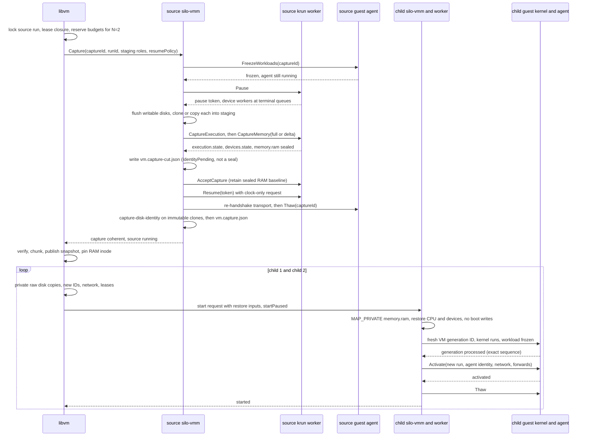

# 21. Snapshots with memory and forks of running machines

Date: 2026-10-25

Updated: 2026-11-16

## Status

Accepted

This ADR specifies the target architecture, not functionality already
delivered. The implementation stages and conformance gates below control when
each capability becomes available. It depends on
[ADR 0014](0014-layered-oci-image-storage.md) for storage identity,
publication and retention and extends
[ADR 0018](0018-silo-vmm-contract.md) with the live-command and restore
contract.

The owner decision of 2026-11-01 makes the combined implementation of this
ADR and ADR 0014 a **hard breaking release**. Every user must reinstall and
wipe all existing Silo state. No upgrade migrations, backfills, old-state
readers or compatibility bridges are provided. Initial schemas and callers
cut over directly; incompatible state is refused with a reinstall/wipe
diagnostic rather than automatically deleted. Current-format snapshot
validation, crash recovery and portability refusal remain mandatory.

Phase 22 replaces the development flat lower with ADR 0014's default
`linux-erofs-overlay-v1` OCI root on libkrun. Stopped layered snapshots retain
the exact fsmeta and ordered, occurrence-preserving pack/metadata graph; OCI
regeneration is only a digest-gated fallback, not a requirement for portable
restore. There are no old-profile readers or root-profile selectors.

The owner-approved privileged umoci v0.6.0 published-builder namespace gate
also matched actual readonly EROFS traversals without excluded fields.
Production-root boot/lifecycle and kernel-mutated flatten gates passed on
Linux x86_64 with stable 7.2.2 and longterm 6.18.48. Phase 24 separately records
Linux KVM x86_64 runtime evidence, including the mandatory btrfs and ext4
budget sweep. Original containerd differential evidence, including the historical
absolute-path Nix rejection, remains intact. The original Nix specimen is now a
positive control under the 2026-11-20 layer-root normalization decision, requiring
fresh evidence; see [ADR 0014's gate exception](0014-layered-oci-image-storage.md#filesystem-and-linux-gates).

The 2026-11-09 Phase 24 revision accepts the chunk-list stream identity,
the explicit record step after the cut, structural trust of local monitor
receipts, `constructed` → `durable` children with joined durability barriers,
the non-CoW copy and capture/incremental disk-sealing allowances, reflink
seeding of incremental RAM, and a Linux 6.6 kernel floor instead of exact
boot-tuple qualification. Measured budgets and retained failures are recorded
in the [performance tracker](../architecture/live-operation-performance.md),
backed by `.tmp/plan/evidence/phase-24/`.

The owner decision of 2026-11-10 removes build-specific live admission and
exact-build snapshot compatibility. Any pinned libkrun reference supplies its
native live operations subject to the existing host and machine checks.
Snapshots with memory record the live state format schema and guest architecture; restore
refuses those mismatches, not a different build.

The owner decisions of 2026-11-15 (Phase 30) measure start and live-operation
latency from command start until the guest agent is ready, not `Running`.
They require work independent of configured RAM and logical disk size and replace
explicit zero-byte overlays with format-level zero ranges. A non-durable
same-host fast fork was admitted on 2026-11-15, then deferred the same day after
stock-kernel design review. Durable fork is the only fork mode in this contract;
the alternative and its costs are recorded under Alternatives Considered.
Local snapshot publication now seeds the warm receipt, reversing the
2026-11-14 rule that the first durable restore independently scans RAM.
Silent local corruption between capture and restore is an accepted risk;
`silo snapshot verify REF` provides on-demand full authentication. Imported,
pulled and transported snapshots, export and handoff retain full byte
authentication. The budgets below retain the 4 GiB gates and add the owner's
30 GiB Arch cohort, both gated by `make perf`, not `make smoke`. These are
requirements, not a claim that the Phase 30 targets have been met.

The implemented publication path uses one owned sealed-stream capability for
RAM and writable disks and seeds their warm receipts in the snapshot publication
transaction. Existing same-identity streams avoid scanning only with a matching
`verified_object` fingerprint receipt. Explicit snapshot verification bypasses
warm, map and composition receipts; its stream-chunk and state-object diagnostics
are defined under On-demand verification below.

The Phase 30 wave-two amendment records persistent `IdentityPending` cuts and
post-continuation reflink disk identity completion, with exact native-pause
timing rather than charging post-resume work to interruption. It also records
the implemented sparse zero-run handling and the limited pagemap-backed full
capture optimization; other backing types and unavailable pagemap metadata
still require full reads, and swapped/huge-page cases are not separately qualified.

The Phase 30 wave-three amendment records fingerprint-bound graph and map
receipts, reusable canonical RAM maps, deduplication before clone creation, and
batched pool-directory barriers. Per-payload seal synchronization and the final
catalog checkpoint before snapshot acknowledgement remain required.

The 2026-11-16 Phase 30 amendment records implemented stage-1 disk write
tracking. Managed disks inherit accepted maps and hash only written chunks on
the eligible reflink lane. Freshly formatted disks have no baseline at create;
their first snapshot hashes written disk data once and seeds later captures in
the same run.
Every ended run invalidates its baseline; clean-stop sealing and deterministic
upper templates remain planned stage 2. Stream-map v1 now replaces flat-map
metadata; remaining runtime costs still require measured scaling qualification.

### Snapshot memory terminology (2026-11-18)

The image/snapshot split revises this ADR's vocabulary and commands. There is
one noun, **snapshot**; memory is a property of a snapshot, `none` or
`included`. "Checkpoint", "execution checkpoint", "live snapshot" and "stopped
snapshot" are retired as names for the artifact; the decision text below uses
"snapshot with memory" and "snapshot without memory". `silo fork --live` is
unchanged: "live" describes the operation.

- `silo snapshot create VM --memory` captures a running VM's RAM, CPU and
  device state with its disks (formerly `--live`). `--memory` on a stopped VM
  is refused. Without `--memory`, a stopped VM's disks are captured; a running
  VM is refused with "VM is running: stop it first, or use --memory".
- `silo snapshot list` reports MEMORY for each snapshot. Snapshots are
  referenced by local name or `sha256:` id, separately from images.
- `silo restore REF` is the only way to turn a snapshot into a VM;
  `silo create` and `silo run` refuse snapshots and point to it.
- `silo restore REF --without-memory` replaces `silo recover-disks`: a snapshot
  with memory restores as a stopped VM from its disks only. RAM is discarded
  and the disks may need journal recovery on boot.
- Snapshot push is not available in the CLI or gRPC until mandatory
  encryption and a design for secrets held in memory exist
  ([ADR 0014](0014-layered-oci-image-storage.md)). Pulling a snapshot through
  `silo restore REF` remains.
- Follow-up, not decided here: a disk-only snapshot of a running VM (pause,
  guest fsfreeze or crash-consistent capture, resume), which would remove the
  "VM is running" refusal.

### Live fork identity authority (2026-11-17)

Only **live forks** omit content identity. This decision supersedes any older
fork requirement below to hash, publish maps, inherit a source content root,
or wait for disk identity. Snapshots with and without memory keep their existing
content-identified capture, verify, restore and transport behavior.

A live child is launched from complete files Silo owns: immutable RAM and
execution/device state, with distinct private writable disk clones or sparse
copies. Exact file identity (device/inode, length, mode, mtime and ctime),
closed-writer completion, run/cut generation and held descriptors grant local
ownership authority. Neither RAM, disks, state nor the local record is content
hashed, and fork publishes no content map nodes or new pool objects. This
applies to raw and layered roots, data and external disks, reflink and copy
filesystems, borrowed pauses, and forks of forks.

This is not cryptographic authentication. Bit rot in internal owned fork files
is not detected until the child is snapshotted, when identity is established
for the resulting bytes, not retroactively verified against its fork cut.
Adversarial same-UID/root mutation is outside this trust boundary. A local cut
is never a snapshot: verify, export and snapshot-authority handoff refuse
it with "local fork cut is not an identified snapshot; snapshot the child first".
A missing identified snapshot receipt never selects owned-cut authority.
Normal stopped-machine handoff still seals and authenticates its storage.

A fork child starts with known bytes and typed unknown-after-fork content
identity. Its first snapshot hashes complete resulting RAM during the pause
(even if byte materialization is incremental), and complete resulting disk
identity after resume. Inspect and snapshot creation report this reason.
Later snapshots use the ordinary incremental identity path. There is no hidden
background hashing or optional fast mode.

Full RAM identity does not require reading every logical byte. With a complete
immutable byte baseline B and complete dirty coverage D, native capture reads
only 64 KiB identity units intersecting B's data extents or D. A bounded
`SEEK_DATA`/`SEEK_HOLE` walk supplies the extent proof, without reading baseline
payload on the reflink lane. All other units are zero by construction. Lost
coverage, baseline mismatch, unavailable/invalid extent metadata or the
65,536-extent bound retain the correct full-read path and report
`fullIdentityReadFallback` in memory statistics.

Full and incremental live reads also reuse the paused-cut pagemap proof for
owned private anonymous zero-origin Boot RAM. Pages neither present nor
swapped are recorded as zero without reading their bytes, including free-page
reports discarded with `MADV_DONTNEED`. A later write makes the page present;
no discard/write history is needed. File-backed/restored RAM, swapped pages,
explicit hugetlb mappings and unavailable metadata retain reads. Restored balloon
reclaim replaces file-private ranges with anonymous mappings, but these
replacement islands do not yet carry the domain's zero-origin proof.
`livePagesClassified` counts pages whose live bytes were inspected;
`identityZeroBytesFilled` counts only scratch zeros needed inside nonzero
hashed units. Known-zero spans never trigger RAM-sized scratch clearing.

The source retains its last identified RAM anchor and map independently of its
latest owned byte baseline, accumulating dirty pages across successful forks.
Fork updates only the byte baseline. Its next snapshot hashes the union of
changes since its last identified snapshot, not just since the last fork.
Disk forks leave the source's identified map and dirty history untouched;
frozen generations, if any, merge back rather than commit a new identity.
Source/child removal cannot retire independently retained descendant inputs
or the source's identified anchor. Capture/restore record v1 and the initial
catalog format are a breaking fresh-home change, with no compatibility reader.


## The Problem

[ADR 0014](0014-layered-oci-image-storage.md) gives Silo snapshots and forks of **stopped** machines: a machine's
private storage is captured at the stopped boundary, identified by content, and
restored by booting a new machine. That contract cannot express the operations
users now need:

1. Snapshot a **running** machine, including its memory, CPU and device
   state, so that it can later resume where it was instead of booting again.
2. Fork a running machine into N children that continue from the same instant,
   sharing unchanged memory, each with private writes.
3. Pause and resume a machine without creating a snapshot.
4. Store and pull such a snapshot through the same artifact format and
   retention model that [ADR 0014](0014-layered-oci-image-storage.md) defines for storage.

A snapshot with memory is a different artifact from one without. Its disk
state is only meaningful together with the memory image captured at the same
instant; its memory image contains the guest's entropy pool, open connections,
cached identities and secrets; and it executes only on a host whose hypervisor,
CPU and software can accept the saved execution state. A design that treats it
as "a snapshot plus a memory file" produces restores that look successful and
are not: a disk newer than its memory, a child that reuses its parent's random
state, a timer that never fires again after restore.

The constraints are Silo's existing ones. libkrun is the default backend on
Linux (KVM) and macOS (HVF); VZ is an explicit macOS selection. There is no
always-running host service ([ADR 0004](0004-daemonless-architecture.md)). `silo-vmm` never opens the database and
is driven through files, descriptors and one Unix socket ([ADR 0018](0018-silo-vmm-contract.md)). Guest
provisioning happens once per cold boot through the per-launch initramfs
([ADR 0009](0009-per-launch-guest-agent-initramfs-overlay.md)) and static network configuration ([ADR 0010](0010-static-guest-network-configuration.md)). Storage is
content-addressed with one stored disk encoding ([ADR 0014](0014-layered-oci-image-storage.md)).

Silo's pinned libkrun exposes no capture or restore surface and its pause is
asynchronous and macOS-only. A third-party runtime has implemented live
capture and fork in its own libkrun fork; that fork has diverged from the
upstream lineage Silo tracks and uses a different native API. The capability
therefore has to be specified against Silo's own boundaries and ported
deliberately onto Silo's fork, not adopted by changing a dependency revision.

## Terminology

| Term | Meaning |
| --- | --- |
| Pause | Every vCPU parked at an instruction boundary, every device worker stopped at a terminal queue position, every host memory writer drained. Reversible; produces no artifact. |
| Pause token | `(machineId, runId, pauseGeneration, owner)` identifying one established pause and who may resume it. A resume names the exact token. |
| Capture | One operation that produces a coherent cut of execution state, RAM and every included writable disk at one pause token. |
| Snapshot with memory | The immutable closure bound to producer-computed identities by a capture: RAM stream and layout, execution envelope, device state, sealed disks, boot and configuration provenance, compatibility profile. Local publication establishes restore trust; import, transport, export, handoff and explicit verification independently authenticate bytes. [ADR 0014](0014-layered-oci-image-storage.md) records it as a snapshot with memory `included`; a snapshot with memory `none` holds disks only. |
| Restore | Construction of a new machine generation whose first guest instruction continues from a snapshot with memory. |
| Fork | One durable capture-backed branch of a running source followed by N restores, with the source resumed under its recorded policy. |
| Activation | The barrier between a restored guest's first instruction and the moment its workload runs and its endpoints are reachable: fresh VM generation identity acknowledged, agent rebound, network applied, workload thawed. |
| Baseline | The retained RAM generation a VM's dirty tracking is measured against, enabling incremental capture. |
| Workload freezer | A cgroup freezer subtree containing every guest process except the agent and its control dependencies. |

## Representative Flow

A fork of a running machine into two children on the reflink lane, with the source resumed:



The same flow without the loop is `silo snapshot create --memory`. At admission, a capture of
a user-paused source resolves the default `resume-if-acquired` policy to
`preserve`, persists that policy in the plan and leaves the source paused.
Neither a snapshot with memory nor a live fork needs `--preserve` to borrow a user
pause. A user pause alone is `FreezeWorkloads` and `Pause`; its resume is
`Resume` followed by `Thaw`.

## Decision

Silo adds **pause, snapshots with memory, restore and fork of running machines on the
libkrun backend**, built from five commitments:

- **One quiescent cut.** A capture is valid only when every vCPU, device
  worker, host memory writer and writable block backend has been proven
  stopped at one pause token, and every artifact of the capture is bound to
  that token. `silo-vmm` records the facts it observed; it never infers them
  from an exit status or a returned RPC.
- **Raw disks, sealed by copy.** The writable disks of a captured machine are
  sealed by a qualified clone or copy of their paused view into immutable raw
  files. [ADR 0014](0014-layered-oci-image-storage.md)'s one-encoding rule stands: no qcow2 chain, no block
  service, no Silo-owned CoW container. Children receive private raw copies.
- **One immutable RAM file, privately mapped, for durable operation.** A
  snapshot's memory is one complete sparse RAM image with a separate layout
  record. Every durable restore maps it `MAP_PRIVATE` from a read-only descriptor, so
  children share clean pages through the page cache and own only the pages
  they write. Incremental captures publish complete sparse Merkle roots,
  never a replayed delta chain at restore.
- **Fail-closed activation.** A restored guest does not run its workload or
  expose an endpoint until the kernel has acknowledged a fresh VM generation
  identity, the agent has bound the new run, destination networking is
  applied and the workload freezer is thawed by the monitor. Any missing step
  leaves the child parked or killed, never partially live.
- **Same boundaries.** libvm owns allocation, database records, publication
  and retention. `silo-vmm` owns the pause, the cut and the staged evidence.
  The krun worker owns hypervisor state. The guest agent owns freezing,
  activation and identity rotation inside the guest. No component gains
  database access or a new long-running process.

The capability is admitted per lane: Linux KVM x86_64, Linux KVM arm64 with
GICv3, and macOS HVF arm64. Silo supports macOS 26 or newer
([ADR 0012](0012-cross-platform-runtime-and-sdk-packaging.md)). VZ machines retain
[ADR 0014](0014-layered-oci-image-storage.md)'s snapshots without memory only; every
backend reports what it supports before any live operation starts, and an
unsupported operation is refused up front, never partway (see Backend
Capabilities And Early Rejection). Snapshots with memory restore on the same
host class they were captured on; cross-host execution restore is a
separately admitted profile with its own compatibility contract.

### Core invariants

1. A capture binds execution state, device state, RAM and every included
   writable disk to one pause token. An artifact that cannot prove the
   binding is not a snapshot with memory.
2. Writable disks have immutable private clones or copies before memory is
   captured and before any source write is admitted. Reflink disk identities
   may complete after source continuation, but every identity is complete before
   the final seal or a child restore. Nothing replays, repairs or flattens a
   captured disk between the cut and the restore that loads its matching RAM.
3. A restored machine executes its first guest instruction only after memory,
   execution and device state are installed into a freshly constructed VM.
   The cold-boot path never runs; no initramfs extraction, no agent
   provisioning, no boot payload write reaches restored RAM.
4. A child is a new machine: new machine ID, run ID, monitor, worker,
   sockets, network identities and leases. Nothing host-bound crosses from
   the source: no descriptor, socket path, listener, session, forward, netd
   publication or secret authorization.
5. Guest hostname, boot ID, SSH host keys and filesystem UUIDs are preserved.
   During activation, a non-empty existing `/etc/machine-id` is replaced with
   the child's Silo machine ID and `/run/silo/generation` records its run ID.
   The VM generation protocol reseeds the kernel entropy pool before thaw;
   userspace RNG state and other cached identities are not sanitized. A
   snapshot with memory is privileged executable state and is treated as such.
6. Source continuation and capture success are separate outcomes. A sealed
   capture survives a source that fails to resume; a source that resumes does
   not validate a capture that failed to seal.
7. No fallback. A failed restore never becomes a cold boot, a failed child
   never becomes an unnamed omission from a fork result, and a storage-only
   recovery from a snapshot's disks is the explicit
   `silo restore REF --without-memory` operation.
8. A user-paused machine stays paused. Only the operation that acquired a
   pause resumes it.
9. No step of restore or fork may scale with configured RAM or logical
   (configured) disk size. Capture work scales with changed bytes; full capture
   work and pause scale with touched RAM, not never-touched configured pages.
10. Configured disk size has no effect on snapshot, fork or restore time: a
    30 GiB and a 500 GiB disk holding the same written data take the same time.
    On reflink filesystems the disk step is a constant-time clone regardless of
    written data. Without reflinks, the only permitted disk cost is copying
    bytes actually written to the upper, an accepted rare slow case. Sealing,
    identity and publication must not add logical-length scans or additional
    data passes to these operations.

### Scope and relationship to existing decisions

[ADR 0014](0014-layered-oci-image-storage.md) owns the storage side: the stream identity of RAM and sealed disks,
the snapshot `memory` property (`none` or `included`), the artifact media types, GC roots and leases for
RAM files and children, and the rule that live capture adds no disk encoding.
This ADR owns execution: pause, capture, restore, activation, compatibility
and the monitor contract. The two are written to be read together; where this
ADR names a storage rule, [ADR 0014](0014-layered-oci-image-storage.md) is the normative source.

[ADR 0018](0018-silo-vmm-contract.md)'s monitor contract gains a live-command surface on the existing
control socket, a restore object in the start request, a per-capture result
file and nonterminal states. Its terminal `vm.exit.json` and `storageShutdown`
evidence are unchanged.

[ADR 0009](0009-per-launch-guest-agent-initramfs-overlay.md)'s per-launch initramfs and [ADR 0010](0010-static-guest-network-configuration.md)'s static network provisioning
remain the cold-boot contracts. Restore does not rerun them; it applies one
bounded activation message to the agent already in memory. [ADR 0010](0010-static-guest-network-configuration.md)'s "not
continuous reconciliation" rule gains exactly that one exception.

[ADR 0015](0015-hybrid-vsock-host-surface.md) and [ADR 0016](0016-vsock-forwards-and-netd-publications.md) host surfaces are host resources and are never
captured. On restore, libvm reserves network identities with netd, the
destination monitor recreates the hybrid vsock surface and owns forward
policy, host listeners and tokens, the agent registers guest-side listeners,
and netd owns publications, which the guest requests again. Live streams are
dropped.

## Responsibilities

| Component | Owns | Never does |
| --- | --- | --- |
| libvm | Operation records, locks and leases; budgets and admission; the live capability vector and early rejection; staging roles; verification, chunking and publication of snapshots; child allocation; database reconciliation; N-way fork orchestration; identity completion from a retained cut after positive monitor/worker termination. | Touches hypervisor state; reads staged payloads with live writers; completes identities while a live monitor still owns capture; converts an unsupported live operation into another operation. |
| `silo-vmm` (monitor) | Host capability query without a machine; machine `live` vector in status; live commands on `vm.sock`; guest freeze and thaw; worker pause and capture commands; disk flush and clone/copy into named staging; `vm.capture-cut.json` and `vm.capture.json`; restore launch of a fresh worker; activation sequencing. | Opens the database; chooses output paths; declares success it did not observe. |
| krun worker | Pause linearization; device quiescence; execution, device and RAM capture and restore through the libkrun capture ABI; dirty tracking and baselines; VM generation device. | Opens files outside its named inputs; resumes without the exact token. |
| Guest init and agent | Workload freezer; `FreezeWorkloads`, `Activate` and `Thaw` RPCs; identity rotation after the VM generation acknowledgement; one-shot network reapplication. | Flushes or repairs filesystems as part of capture; runs the workload before `Thaw`. |
| Guest kernel (Silo build) | The VM generation driver that reseeds the kernel RNG and acknowledges the new identity; cgroup freezer. | Binds the device without acknowledging the exact sequence. |

## Pause

A pause has an **owner**, carried in the token. A pause established by the
public `Pause` command is owned by `user`. A pause established by a capture
is owned by that capture until source continuation: the capture either resumes
its exact token (`resume-if-acquired`) or transfers ownership to `user`
(`preserve`), possibly before disk identities and the final seal complete.
A borrowed user pause remains user-owned. A preserved `Paused` source is
resumable through public `Resume` only after the capture settles. A token is
consumed by the resume that names it; a later pause issues a new token.

`Pause` is a monitor operation on a `Running` machine for an exact run ID. It
proceeds in order:

1. The monitor fences new execution sessions, filesystem mutations and forward
   registrations.
2. The monitor sends `FreezeWorkloads(operationId)` to the agent. The agent
   freezes the workload cgroup and acknowledges with the set it froze. Every
   pause therefore produces a capture-eligible guest.
3. The monitor issues the worker pause. The worker returns a pause token only
   after every vCPU has stopped at an instruction boundary, every device
   worker has drained to a terminal queue position, every host memory writer
   has been drained and the balloon, console and vsock timers are disarmed.

The machine reports `Paused` only when step 3 has returned a token. If step 2
fails or times out, the monitor thaws what it froze and the machine stays
`Running` with the operation reported as failed; if that thaw also fails, the
machine transitions to `Error`, stays fenced and admits no lifecycle
transition but stop. If step 3 fails, the worker reports the actual state
and the machine stays fenced in `Pausing` with the operation failed. The
only exits from a failed `Pausing` are `CancelOperation` on that pause
operation and stop. Cancel unwinds in reverse order: the worker rolls back
its partial pause (unparks every parked vCPU, reopens device admission,
re-arms the timers it disarmed) and acknowledges; the monitor then sends
`Thaw` over the still-admitted control transport and waits for the thawed
set and readiness; only then it lifts the fences and reports `Running`. A
worker rollback failure or a failed thaw transitions the machine to `Error`,
fenced. A retry is a new `Pause` after a successful cancel. A partially
established pause is never a token.

Pause does not flush or seal disks. The agent's staleness deadlines are
suspended for the duration of a pause; operation deadlines are not.

`Resume` names the token. The worker reopens device admission, applies a
clock-only VM generation request so the guest corrects wall time without
treating itself as a clone, and resumes the vCPUs. The monitor re-handshakes
agent transport and sends `Thaw`; the agent acknowledges with the set it
thawed. After that exact successful acknowledgement, the monitor requests a
new identity-validated status within the fixed readiness deadline. A watch
report received before the acknowledgement (even one emitted by the thaw)
cannot satisfy this post-thaw freshness boundary. The full Ready prerequisites
still apply, and public readiness and admission stay fenced until `Running`.
The machine returns `Running` only when the thaw acknowledgement and readiness
are established. A stale or foreign token, or a `Resume` while a capture is in
progress, is rejected.

If the thaw acknowledgement is lost, the workload may have executed. The
monitor re-issues `FreezeWorkloads`, which is idempotent; on acknowledgement
it issues a new worker pause and reports `Paused` with the new token only
once that pause is established. If the freeze cannot be acknowledged within
its deadline, the machine transitions to `Error`, stays fenced and admits
no lifecycle transition but stop. The monitor never reports `Paused` on an unparked VM and never
reports `Running` on an unacknowledged thaw.

A user-paused machine stays `Paused` across monitor reconnects and manager
restarts. Loss of the manager does not resume it. Stop of a paused machine
finalizes without resuming. The pause token and owner are reported by the
monitor's status API and persisted by libvm with the machine record, so a
client that lost the response recovers them from either.

A missing current pause authority is a refusal, never permission to recover a
token from historical success. Manager diagnostics include the observed state,
live activity, last live error, machine/run identity and pending resume request
(or its lookup failure).

### Command and state matrix

| State | Admitted commands | Rejected commands |
| --- | --- | --- |
| `Running` | `Pause`, `Capture`, `GetOperation`, `ReleaseCapture`, stop; identity-pending exception below | `Resume`, `CancelOperation` except the exact identity-pending capture |
| `Pausing` | `GetOperation`, `CancelOperation` (the pause), stop | `Pause`, `Capture`, `Resume`, `ReleaseCapture` |
| `Paused` | `Resume`, `Capture` (borrows the pause; `resumePolicy` must be `preserve`), `GetOperation`, `ReleaseCapture`, stop; identity-pending exception below | `Pause`, `CancelOperation` except the exact identity-pending capture |
| `Capturing` | `GetOperation`, `CancelOperation` (the capture), stop | `Pause`, `Resume`, `Capture`, `ReleaseCapture` |
| `Restoring`, `Activating` | `GetOperation`, stop | everything else |
| `ActivationFailed` | `GetOperation`, `ReleaseCapture`, stop | everything else; a new restore is the retry |
| `Error` | `GetOperation`, `ReleaseCapture`, stop | everything else |

This table and the following phase-specific exception are the single source of
admission; the operation table below does not replace them.

While an `IdentityPending` capture's source is `Running`, new sessions are
admitted, but new `Pause`, `Resume` and `Capture` commands for that run remain
fenced until capture settles. Refusing `pause` while post-resume disk identity is
pending is an accepted limitation (owner, 2026-11-15), even though public state
is `Running`. A preserved source stays
`Paused` with the same lifecycle fence. `CancelOperation` is admitted from
`Running` or `Paused` only for that exact identity-pending capture, as decided by
the monitor journal; libvm routes such cancellation to the monitor rather than
rejecting it solely by public state. Other cancellation targets keep their
existing rejection.

Stop in `Capturing` cancels an unsealed capture and finalizes; after the seal
it preserves the sealed result and finalizes. Stop in `Paused` finalizes
without resuming.

## Capture

### Admission

Capture is admitted only when every attached device has a capture provider and
the guest profile is one Silo can activate. The initial supported
configuration is a Linux guest with the admitted Silo init and agent, an
overlay or opaque raw root, raw data disks, the managed Unix-datagram network
attachment, native vsock with Silo's mux, console, balloon and RNG. The
following reject capture before anything is frozen, with a typed error naming
the device: virtiofs shares (read-only included), the Rosetta share, TAP or
Unix-stream network attachments, any GPU, input or sound device, nested
virtualization state, confidential-compute memory, and any device without a
provider. Rejection is explicit; no device is detached or degraded to make a
capture possible.

Capture also requires that the machine is not mid-resize, that no other
capture, stop or relocation is in flight for the run, and that libvm has
reserved the staging space and descriptor budget and retained the result's leases.

### Guest profiles and contained image init

Two guest profiles admit live operations:

- `AgentPid1`: the Silo agent is PID 1.
- `ContainedInit` (`contained-init` in the boot report): the image's init is
  PID 1 inside a cgroup namespace rooted at `silo/workloads/image`. This is
  the default handoff for stock systemd, busybox and OpenRC images; no
  `init=` kernel override is needed.

A handoff without observed containment reports `InitChild` (`init-child`)
and refuses live operations with `guest-init-not-contained`. Other unsupported
profiles use `guest-profile-unsupported`. PID 1 ownership alone is not the
admission criterion.

Both admitted profiles use this cgroup v2 layout:

```text
/sys/fs/cgroup                 initial namespace, retained agent descriptors
└── silo                       every available controller delegated
    ├── control                agent threads only
    ├── activation             bounded activation hooks
    └── workloads              freezer switch, no direct processes
        ├── image              image init's namespace root and services
        └── exec               Silo exec, shell and SSH sessions
```

The split avoids cgroup v2's no-internal-process rule and systemd's
single-writer ownership of its own subtree. Every agent-spawned workload session
enters `exec`; root sessions also get a cgroup namespace rooted there. Non-root
sessions cannot unshare after their UID transition and cannot mount cgroupfs or
migrate tasks. There is no login-session integration with the image init (O3).

Before handing PID 1 to the image, the single-threaded handoff parent enters
`image`, unshares its cgroup namespace, detaches the old `/sys/fs/cgroup`
mount and mounts a fresh cgroup2 view. Silo mounts cgroup2 with
`nsdelegate,memory_recursiveprot`. A second cgroup2 mount from the initial
namespace can clear these options even when it returns `EBUSY` (spike F1), so
the agent does not remount it. Containment checks require `nsdelegate`.
Every available controller is delegated at the real root, `silo` and
`workloads`, including `cpuset` when offered; a fixed controller allowlist would
silently remove image resource controls. The parent reports setup status through
a close-on-exec pipe, closes inherited descriptors and execs the image init. Setup failure
still execs init so PID 1 does not exit, but cannot qualify `ContainedInit`.
The agent observes the distinct PID 1 namespace, image-rooted cgroup mount and
PID 1 membership before reporting containment. It stays in `control` and uses
retained cgroup and procfs descriptors after the image replaces mount views.

The agent has `oom_score_adj=-1000`, 16 MiB `memory.min` protection on `silo`
and `control`, `cpu.weight=1000` on `control`, and a workload `pids.max` that
leaves an agent reserve. Spawned commands reset their OOM adjustment to zero.
`ContainedInit` requires successful setup and fresh observation of these
protections, non-dumpability and memory/cpu/pids delegation; failure logs an error
and continues cold boot as `InitChild`, refusing live operations with
`guest-init-not-contained`.
These protections are not protection against deliberately hostile guest root.

After every workload freeze, before acknowledging it, the agent verifies the
real cgroup structure and walks userspace tasks and threads through retained
procfs descriptors. Only agent threads may occupy `control`; hooks may occupy
`activation` only during activation; all other live userspace belongs under
`workloads`. Unexpected groups must be empty. Descriptor-relative task reads
avoid mixing reused PIDs; vanished tasks are ignored and mounts hiding proc
entries fail closed. Activation checks containment on entry, after hook
cleanup before publishing `ActivatedFrozen`, and on a cached activation reply.
An escape refuses pause, snapshot or fork with `guest-containment-escaped`,
including PID, TID, command and cgroup diagnostics. The source is thawed and
keeps running. A child fails activation and never reaches `Running`.

#### Threat model and accepted residuals

The guarantee is that no image userspace runs in a child before kernel RNG
reseed, identity rotation, network replacement and `Thaw`, and no capture is
acknowledged while image userspace runs outside the frozen subtree. It applies
to images that do not use privileged interfaces to leave containment.
Deliberately malicious guest root is out of scope: it can use `setns`,
ptrace, hidden proc mounts or forged agent replies. The containment scan is a
tripwire for accidents and naive escapes, not an adversary detector. The host
still owns native pause authority, admission, network and vsock fences.
The guest kernel has no modules, `/dev/mem` or kexec and forces confidentiality
lockdown, but guest root retains privileged capabilities.

Owner decision O1 accepts kernel usermode helpers without changing the kernel
configuration or suppressing core dumps. Systemd can install a piped
`core_pattern`; coredump and request-key helpers can start in the real root
cgroup. During the restore window this requires an agent or activation-hook
failure. The activation containment check fails that child closed; a helper
present during capture makes capture refuse. These failures are retryable,
not permission to run an uncontained child. A crashing hook can also block on
frozen systemd-coredump until its deadline.

Owner decision D1 accepts that guest root's `kill -9 -1` can kill the child
agent even with its resource protections. The VM can remain running but
unmanageable; host `silo stop` still terminates it.

Owner decision D2 makes activation replace whatever an image network manager
placed on the managed interface. Entry validation checks link identity and
MAC, not the source's exact routes or addresses; strict post-apply validation
remains. Systemd-networkd may reacquire DHCP after thaw. This is a one-shot
activation operation, not continuous network reconciliation.

Owner decision D3 requires the agent to call `sync()` before the host's force
stop when the image owns PID 1, without calling a particular init system.
The attempt is bounded to ten seconds; failure or timeout is diagnostic and
cannot prove persistence. Even a completed sync does not turn force stop into
an orderly image-service shutdown or certify clean storage.


### Ordering

A capture runs in this order; each step completes before the next begins:

1. **Pause.** The capture establishes a pause it owns (the Pause steps
   above, including the workload freeze), or borrows an existing user pause.
   Because every pause freezes workloads first, a borrowed pause is already
   capture-eligible; a user-paused source is never resumed to prepare it. A
   capture that borrows a user pause must carry `resumePolicy: preserve`.
   The freeze is itself captured: a restored child's workload is frozen until
   the destination thaws it.
2. **Cut disks.** The worker completes outstanding block requests and flushes
   every writable backing file. The monitor creates one immutable private raw
   clone or copy per included writable disk using
   [ADR 0014](0014-layered-oci-image-storage.md)'s qualified copy hierarchy.
   On reflink filesystems this in-pause disk step is flush, clone and recording
   ownership facts only: no extent walk, map construction or hashing. Without
   reflinks the copy and inline hashing remain inside the pause. Staged files
   close without synchronization; snapshot publication or child durability
   barriers provide persistence. Read-only attachments (lower and boot assets)
   are recorded by identity, not copied. Any clone or copy failure fails the
   whole capture; no partial multi-disk snapshot is published.
   Before execution/device capture, while still paused, the monitor freezes
   each writable disk's dirty generation and binds its receipt to this exact
   cut and held backing. Writes after continuation enter a separate generation.
3. **Capture execution and devices.** The worker serializes transport, queue
   and device-specific state for every device, then the vCPU and VM
   execution envelope (registers, extended state, interrupt controller,
   timers, clocks). Execution capture precedes memory capture because
   interrupt-controller save can write guest RAM.
4. **Capture memory.** Full, or incremental against a valid baseline. The
   worker freezes host writers, harvests dirty coverage, and pipelines RAM reads
   through bounded 32 MiB packs to two hash/write workers (96 MiB pack scratch).
   Identity uses the fixed-depth sparse Merkle map with 64 KiB RAM units.
   RAM uses cut-bound pagemap metadata to skip known-zero pages; all other
   backing and metadata fallbacks read in full, as specified under Memory Model.
   Workers join before return, including on cancellation or failure.
   Changed-to-zero runs are explicit logical zeros, never baseline inheritance:
   omit them on a rebuilt sparse output, punch them on a reflink seed, and write
   zeros only when punching is unsupported. Zero chunks use format markers,
   without hashing or storing zero chunk objects.
5. **Record a pending cut.** If reflink disk identities remain, the monitor
   writes `vm.capture-cut.json` in phase `IdentityPending`, with the clone
   fingerprints, partial inventory and `disk_copies_sealed = false`, before
   accepting the sealed RAM baseline or continuing the source. This persistent
   process-crash recovery record is never a seal. It is not synchronized or
   power-loss durable.
6. **Accept RAM and continue once.** On the deferred-identity lane the worker
   accepts the sealed RAM baseline, then under `resume-if-acquired` resumes the
   exact capture token; the monitor re-handshakes the agent and sends `Thaw`.
   A borrowed user pause or explicit `--preserve` leaves the source paused with
   its workload frozen; an acquired preserved token transfers to `user`.
   Continuation is recorded and public `Running` admits sessions while the
   capture's lifecycle fence remains. If no identities were deferred, baseline
   acceptance and continuation remain after the final seal in step 8.
7. **Complete disk identities.** At stage `capture-disk-identity`, the monitor
   completes each immutable clone's map, checking retained fingerprints before
   and after. With valid managed baseline authority and a matching tracking
   receipt, it reads only dirty 8 MiB chunks and inherits clean entries, without
   discovering whole-file extents. Otherwise it fully hashes the clone and
   records the fallback reason. This is post-continuation seal latency, not
   pause time on a resumed source. Preserved sources remain paused by policy.
   Snapshot consumers still wait for complete identities. Live forks instead
   use the distinct owned-cut authority above and skip this identity phase.
   Freshly formatted disks have no
   baseline at create; their first snapshot hashes written disk data once and
   seeds later captures in the same run. After a restart the first capture must
   hash once again.
8. **Seal.** The worker computes nonzero RAM chunk digests during capture;
   non-reflink disk copies hash inline, and deferred clone identities come from
   step 7. Publication carries those identities without another payload pass.
   With every writer closed and every identity complete, the monitor writes
   `vm.capture.json` through private `.vm.capture.json.tmp`, links the final
   name without replacement and unlinks the temporary. The record remains
   version 1, with disk statistics and tracking receipts added to its evidence.
   If the monitor dies between link and unlink, libvm settles only that exact
   two-name inode under the publisher lock and checked capture lease before
   publication or local fork-cut retention. Both names must be private regular
   files in the same owned staging directory, with matching device/inode and
   exactly two links; foreign extra links are refused without removal. The
   monitor retries settlement once. Every settled control record must pass
   ordinary singleton validation.
   Only a settled coherent seal authorizes disk-generation `Commit` and
   installation of the candidate source maps. RAM acceptance in step 6 does
   not accept disk generations. Pre-seal failures and cancellation `Abort`
   frozen disk generations, merging their dirty coverage back into the active
   generation even when the source has already continued. Unresolved settlement
   leaves the source fenced; it never authorizes another cut with lost dirties.

The monitor synchronizes no staging files or records. Durability belongs to
libvm at named-snapshot publication and each fork child's barrier. A cut
survives a monitor or manager process crash when its retained bytes remain;
power loss before publication or child durability is not acknowledged capture
success, and recovery discards that interrupted capture. A capture is sealed
only when `vm.capture.json` has `captureOutcome: coherent` and all seven facts
true. A failed diagnostic record is not a seal. Final evidence and its complete
inventory never change afterwards.

The monitor records source continuation in `vm.capture-source.json`, atomically
without synchronization, with version, `machineId`, `runId`, `captureId`, pause
token and `sourceOutcome`: `resumed`, `preserved` or `resume-failed` with an
error. On the deferred lane this precedes the final seal; on the copy-only lane
it follows it. An unfinished live run uses `GetOperation` as authority; a missing
source record after the run ends means `unknown`. libvm never resumes because
the record is absent. Failure or cancellation after baseline acceptance retains
that baseline, and native `ReleaseCapture` reports `baseline_retained = true`;
continuation is never repeated and no later incremental dependency is removed.
If the monitor disappears between status and `GetOperation`, libvm reconciles
the exact run again. Transport failure alone never invents a terminal source
outcome or invalidates the sealed capture.

### Evidence

`vm.capture.json` (version 1) carries: schema version, `machineId`, `runId`,
`captureId`, the pause token, the original guest `freezeOperationId` and
`freezeEpoch`, the digest of the machine configuration and
attachment inventory at capture time, the RAM layout and geometry, the exact
inventory of staged output roles with sizes and SHA-256 digests, capture
timestamps, `captureOutcome` (`coherent` or `failed`), an error string or
null, and these booleans: `workloadsFrozen`, `vcpusPaused`, `devicesQuiesced`,
`hostWritersDrained`, `hostFlushCompleted`, `diskCopiesSealed`,
`memoryStateSealed`. Each boolean records a positively observed fact. All seven
must be true for a final coherent seal; false, missing or malformed facts refuse
that seal. The final record remains version 1. Stage 1 adds `diskStats` and
`diskTrackingReceipts`, separate from guest device state and RAM acceptance.

A coherent seal retains the original guest freeze reference for restore after
source deletion. An acquired pause uses the capture ID as `freezeOperationId`;
a borrowed user pause retains its original pause operation ID, not the new
capture ID. Restore authenticates this reference from the seal and does not
depend on the source's request file.

`vm.capture-cut.json` is a separate persistent recovery record, not an earlier
version of the seal. Its `IdentityPending` phase binds the same plan, pause and
RAM evidence, clone device/inode/length/mode/ctime fingerprints, and an inventory
omitting pending disk and map roles. `disk_copies_sealed` remains false until
identities complete. Recovery after positive monitor/worker termination completes
identities from those retained clones without any VM operation, validates the
complete inventory and writes the final seal last. It never reports a pending
cut as sealed. No power-loss durability is claimed for this staging record.

### Disk write tracking: stage 1 (2026-11-16)

The virtual block device records every 8 MiB identity chunk touched by writable
requests from constructor admission onwards. Writes, discard and write-zeroes
mark coverage before backend effects; a failed or partial request cannot lose
the attempted range. Reads and flushes do not clear coverage. A valid managed
baseline lets capture hash only those chunks from its immutable reflink cut
and reuse the accepted map for the rest. An empty dirty set reads no disk
payload. A dirty all-zero chunk becomes the existing explicit zero marker.
The resulting snapshot still describes a complete standalone disk, not a delta
requiring the source or predecessor snapshot.

`DiskTrackingSeed` binds role, attachment order, block ID, held device/inode,
exact length, chunk size, epoch and optional predecessor stream identity.
`DiskTrackingReceipt` additionally binds the capture and pause generation,
tracking generation and bounded coalesced dirty runs. A native receipt must
cover the exact writable attachment inventory. Malformed, foreign or cross-cut
receipts are refused, not treated as clean coverage. Exclusive Silo ownership
is required to reuse a predecessor; inode identity alone is not byte authority.
Legitimate tracked writes change ctime, so a live disk is not checked against
its old stopped fingerprint to infer cleanliness.

Freeze rotates the dirty set under the native pause. Post-cut writes accumulate
separately while clone identity completes. `DiskTrackingSettlement::Commit`
after the coherent seal advances the predecessor and clears only the frozen
set, preserving all post-cut writes. `Abort` after any pre-seal failure or
cancellation merges frozen coverage back into the active set. Disk settlement
is independent of early RAM acceptance and source continuation. A later pool
publication failure does not retroactively abort an accepted disk generation.

A managed writable disk with an accepted map has a catalog `DiskBaseline` with
its seed, storage and tracking generations, stopped fingerprint and a
machine-private `disk-baseline-<stream>.map` file. A disk without an authenticated
source map has no baseline record or map file until its first coherent capture.
Accepted map files outlive capture release and snapshot deletion and remain
until machine deletion. They are optional, deferred-write caches: launch checks
their bounded map identity and rejects missing or torn bytes without reading the
disk. Monitor-held maps and native coverage govern same-run reuse; persisted
maps are not permission to reuse a previous run's coverage.

| State or transition | Stage-1 authority |
| --- | --- |
| `Ready` | A producer or authenticated source map bound to the private backing and storage generation, before launch. |
| Launch to `Running { run_id, seeded }` | Every launch commits this state for its baselines before guest writes. Durable machines checkpoint the catalog; hidden `constructed` children defer this barrier to their later durable-child transition. `seeded: true` requires a matching `Ready` seed, stopped fingerprint and authenticated map cache; `false` retains provenance only and requires full cut hashing. |
| Coherent capture in the same run | Installs the accepted map and tracking generation as `Running { run_id, seeded: true }`, not `Ready`. |
| Any ended run to `Invalid` | Clean, forced, failed and recovered runs all invalidate baseline authority. A stale `Running` record is never a seed for another run. |

A restored child's map cache needs no file or directory synchronization during
construction. If power loss discards its launch admission, the child is still
`constructed` and must be reconciled before discovery or reuse. If its later
`durable` catalog transition survives, SQLite WAL ordering also preserves the
earlier `Running` marker. Process loss alone retains the committed WAL. A
surviving stale `Running` marker is never reusable launch authority.

Thus the first snapshot after a restart fully hashes each managed disk before
same-run incremental reuse can resume. Stage 2's clean-stop seal would preserve
the final accepted map for a later launch; it is planned, not implemented.
Freshly formatted disks have no baseline at create; their first snapshot hashes
written disk data once and seeds later captures in the same run. Unchanged
image-backed disks and identified snapshot-restored children inherit source maps
in deferred private caches, rebound to their own private inodes, without reading
or hashing the disk. Live-fork children do not inherit identity or source maps.
Launch authenticates identified caches before issuing a seed.
A stopped copy without authenticated map authority still needs a hash. The
deterministic upper template that avoids the first-snapshot hash is also planned
stage 2, not implemented; create must not end up slower.

Growth/resize, storage or attachment changes, boot-bundle changes, handoff source
reservation/fencing and destination ownership commit invalidate baseline
authority. Launch checks stopped fingerprints: host-side replacement, edits,
truncate or other mutation refuses the old seed and launches unseeded.
Read-only export does not invalidate an untouched source. `silo cp` uploads
through the running guest, so disk effects traverse the tracked virtual block
device rather than bypassing it as a stopped host editor.

Full hashing remains the recorded fallback for `missing-baseline`,
`invalid-receipt` coverage, `untracked`, `copy-lane` without reflinks and
`external` disks. Writable external disks remain capturable, but are not
exclusively Silo-owned: `tracking_eligible` is false, `baseline_map` is absent,
and their bytes are always fully hashed rather than inherited. Copy-lane disks
likewise retain inline full hashing in stage 1, even with a baseline.
`CaptureDiskStats` records `dirtyChunks`, `totalChunks`, `bytesHashed`,
`baselineReused` and `fullScanReason`; `bytesHashed` counts nonzero decoded
chunk bytes passed to SHA-256, not all bytes read. Invalid coverage reasons
include never armed, lost, overflow and suspected out-of-device mutation.

This stage removes recurring payload hashes only on the valid managed reflink
lane. Flat map cloning, serialization and identity computation still traverse
logical chunk entries, so it does not deliver the complete configured-size
invariant. The planned sparse authenticated map remains necessary. Tracking
receipts do not weaken independent pool dedup authentication, full capture
replay without producer authority, import, export, handoff or explicit verify.

### Incremental capture

Snapshots with memory and live forks default to `--capture-policy incremental`: reuse
the valid retained baseline, including the snapshot inherited by a restored
child, without requiring an opt-in. `--capture-policy full` explicitly forces
a full capture. The two existing values are sufficient: incremental is a
preference, not a requirement to reject otherwise valid captures. If the
exact backend/host report does not admit incremental capture, libvm resolves
the preference to full before reserving or journaling the capture. Normal
Capture/Fork capability admission still applies; unsupported live operations
do not become available through this fallback.

On an admitted incremental backend, a first capture of a booted VM selects
full with `no-baseline`, not `requested`. Invalidated baseline coverage,
changed topology or tokens, and dirty crossover keep their existing automatic
full fallbacks and reported reasons. Explicit full reports `requested`.
`--dirty-crossover-percent` accepts `1..=60`, defaulting to 60.

The worker tracks dirty pages after a capture is accepted: KVM slot dirty
logging on Linux, second-stage write protection with first-write faults on
HVF, and a separate host-writer bitmap for every VMM and device write on both.
An incremental capture requires the exact retained baseline token (tracker
identity, topology generation, memory generation); anything else forces a full
capture. Harvested dirties survive an abandoned attempt; a failed re-arm
invalidates the baseline and the next capture is full. The default crossover
to a full capture is 60 percent dirty coverage; the operation may lower it.

On CoW lanes, incremental RAM capture seeds a fresh private output by reflink
from the exact retained immutable baseline and overlays only dirty runs.
Changed-to-zero runs punch the private seeded output, never the baseline; on a
rebuilt sparse output they are omitted, and only unsupported punching falls
back to physically writing zeros. The resolved image and format-level zero
markers mean explicit zero, never inheritance. Zero chunks are neither hashed
nor stored as chunk objects.

The non-reflink lane still rebuilds from populated baseline extents and overlays
dirty runs; this is implemented behavior, not proof of changed-byte scaling on
every lane. No baseline copy is prepared before pause.
`CaptureMemoryStats.seedMethod` records `clone` or `rebuild`.
`zero_run_bytes_covered` counts successfully omitted, punched or written zero
runs, `zero_bytes_punched` counts deallocated bytes of the seeded output, and
`known_zero_bytes_skipped` counts live bytes not read under cut-bound pagemap
proof. `explicit_zero_bytes_written` counts only physically written zeros,
including zero bytes inside mixed overlay writes, not omitted or punched runs.
The serialized `CaptureMemoryStats` fields use camelCase.

A restored machine seeds its own baseline from the immutable RAM file it was
restored from and arms tracking before any restore-time write, so a
snapshot-restore-recapture cycle does not rescan unchanged memory. This
applies to durable restores as well as local forks.

## Memory Model

### Backing

A durable snapshot's memory is one complete sparse RAM file and one layout record.
The layout lists ordered, disjoint `(guestPhysicalAddress, length,
streamOffset)` regions, the memory topology and the native page granule.
Registered RAM is packed in guest-physical order; holes in the guest physical
map are described by the layout, not stored. Offsets and lengths are aligned
to the admitted native page size, which the worker queries rather than assumes.

Every durable restore opens the RAM file read-only and maps each region
`PROT_READ | PROT_WRITE, MAP_PRIVATE`. Clean pages are shared through the host
page cache between every child mapping the same inode; written pages are
private to the writer. The file is never mapped shared, never handed to a
child as a writable descriptor, and never modified in place. The source keeps
its existing mappings after capture; children share with one another and later
restores, not with the still-running source.

The worker never forks its own process to clone a VM; a child is always a
fresh hypervisor VM in a fresh process that installs saved state before its
first instruction.

### Full-capture read coverage

On Linux, full capture of private anonymous boot RAM reads only pages marked
present or swapped by `/proc/self/pagemap` under the held memory cut. Pages with
neither bit set have known-zero origin and are represented without reading live
RAM. This optimization requires an owned, private anonymous boot mapping and
readable, aligned pagemap metadata. Restored, file-backed, shared, unknown and
explicit huge-page mappings, and unavailable or unreadable pagemap metadata,
fall back to reading the complete range. The fallback is required for correctness;
the implementation does not claim untouched-page skipping for every backing.

Incremental discarded dirty pages are still classified by reading their bytes,
not skipped based on discard history. Swapped and huge-page cases have not been
separately qualified; their inclusion or fallback is not a qualification claim.

### Identity and chains

RAM uses [ADR 0014](0014-layered-oci-image-storage.md#stream-identity)'s binary
stream-map v1 with **64 KiB** decoded identity units. Its root authenticates
exact packed length and unit size, not a flat digest list or whole-file SHA.
All-zero units are absent; mixed units hash their exact bytes, including
interior zeros, and tails are never padded. The separately hashed layout maps
packed offsets to guest addresses.

Native capture writes `memory.changes` through an owned descriptor alongside
RAM and layout. Every file, including an empty update, has a 16-byte header:
`KRUNRAM\\0`, little-endian version u16=1, shift u8=16, coverage u8
(0 full, 1 incremental), and four reserved zero bytes. Each 56-byte record is
first index u64, count u64, kind u8 (0 zero, 1 data), seven reserved zero bytes
and a raw 32-byte digest. Data count is one; zero runs have positive counts
and a zero digest field. Records are sorted, disjoint and in bounds; adjacent
zero runs coalesce. Full coverage omits zeros under complete cut-bound authority;
incremental coverage records exactly affected units, never ambiguous clean nulls.

The worker sends a bounded receipt binding file length, digest, record count,
coverage and baseline, not records in control JSON. The monitor consumes the
stream and updates changed Merkle paths. Staging uses `memory.root`, disk
`disks/<name>.root`, and newly produced `map-nodes/<hex>` files. Inherited
nodes are not copied into each capture directory. Root ownership survives
acceptance and staging release.

Each snapshot with memory still has a complete immutable RAM file, reflink-seeded where
supported, with no restore replay chain. A small dirty page rehashes its 64 KiB
unit unless zero; the hypervisor's actual dirty granule is independent. Zero
overlays punch or zero seeded output rather than exposing predecessor bytes.
Disk, pack and lower identity stay **8 MiB**. Raw/zstd transport payloads also
stay **8 MiB** to bound object counts and registry work: transfer dedup remains
8 MiB, while capture identity and RAM corruption localization become 64 KiB.
Transport rebuilds smaller identities from decoded bytes, never payload SHA alone.

First publication of closed, owned, sealed producer RAM and writable disks uses
the same `SealedStreamPublication` capability in `storage/pool.rs`. Canonical
maps, geometry and unchanged held inode facts bind a successful reflink without
rereading the fresh local payload. A non-reflink copy authenticates inline.
Recovery and replay authenticate staged bytes again before publication; prior
clone provenance is not replay authority.

An independent existing same-identity pool stream is reused without a scan only
when a `verified_object` receipt matches its current device, inode, length, mode
and ctime fingerprint. Otherwise its bytes are fully authenticated against the
recorded map before dedup reuse. This decision occurs under the publication lock
before creating a clone: an existing stream never needs a throwaway clone.
New immutable pool payloads retain their seal `fsync`. Local capture batches
the object, stream, publication-lock and temporary pool-directory barriers once,
after all publication output and canonical-map cache objects exist but before
final fingerprint rechecks and the snapshot retention/receipt transaction.
This does not synchronize monitor/worker capture staging. Acknowledgement still
requires the committed snapshot catalog's checked durability checkpoint.

The snapshot publication transaction seeds warm receipts for both RAM and those
writable disks from the held publication capabilities. This binding is
producer/clone provenance, not independent read-back proof. First and repeated
local restores skip hashing those streams while the receipt matches. Silent
local corruption between capture and restore is not detected at restore under
this trust boundary; explicit verification, export and handoff authenticate
bytes independently.
The retained incremental budget uses a contiguous dirty workload; scattered
placement may still affect many units. `identityBytesHashed` counts actual
nonzero decoded bytes passed to SHA-256, not dirty coverage or zero reads.
Record native change-record counts separately. The format removes dense
identity/receipt work, not dirty-log harvesting, clone metadata or real copying.

Lazy restore through `userfaultfd` is not part of this contract. File-private
mapping already demand-pages local memory. Local snapshots trust the receipt
seeded at publication from their first restore; imported, pulled or transported
snapshots authenticate every byte before execution. Local forks trust owned
producer identity as described below.
A materialization from chunk storage is not presented as remote lazy restore.

### Remaining disk work

Stage-1 tracking and inherited sparse roots are present. Stage-2 clean-stop
sealing and a cached deterministic upper template remain separate work to
avoid restart and first-snapshot hashes without slowing create. All identity
changes land as one fresh-state format; old homes and artifacts are refused,
not converted.

### Accounting

**Amendment, 2026-11-11 (restore/capture resource model).** Restore, fork and
live capture do not reserve or admit host RAM. Restored and forked RAM uses
lazy `MAP_PRIVATE` mappings, aligned with Firecracker's `File` backend and
microsandbox's `PrivateMemoryBacking` restore model. Booted VMs were never
RAM-admitted either. Configured RAM is not resident RAM, and capturing a
restored VM must not charge its baseline a second time. RAM baseline, private
write, page-table/native-state and capture-scratch charges and their policy
flags are removed. Host memory pressure is handled by the host's ordinary
virtual-memory behavior, not a Silo RAM reservation ledger.

Private disk construction for both restore and fork reserves the allocated
bytes of each writable disk, not its logical capacity, plus state reserves
and the pinned boot-object copies. A live fork persists each writable
attachment's allocation sample with the capture reservation and reuses it
for every child, replay and boot-inventory refinement. Standalone restore
measures allocation from its held immutable copy sources. Reflinks and sparse
copies preserve disk holes; guest growth before the capture seal can still
fail the operation under the failure semantics below.

Capture admission reserves **future allocation**, not host memory and not a
second charge for already allocated staging. Let `R` be configured logical RAM,
`D_i` the allocated-block sample of writable disk `i`, `S = 64 MiB`,
`K = 16 MiB`, and `M` the conservative map allowance for RAM and every configured
attachment (including read-only attachments):

```text
T = R + sum(D_i) + S
U = sum(publication stream charge) + 2*S + 2*M
publication stream charge = K for a qualified required reflink, else its copy bound
copy bound = R for RAM, D_i for a writable disk
```

`T` belongs to the machine filesystem and `U` to the pool filesystem. They add
only when those devices coincide. A same-filesystem local fork still has `U=0`
because its cut is renamed. Admission and publication qualify real
staging/pool filesystem pairs with bounded 4 KiB anonymous files, not filesystem
names or full-payload trial clones. Publication qualifies its pair at most once,
only if an unpinned stream needs credit; the probe has no named staging or fsync.
Unavailable qualification is copy-priced. Disk-copy admission still uses the
sealed file's actual allocation. A clone-priced publication may not fall back
to copying if the actual file cannot be cloned, even on the qualified pair.
Already published, pinned and authenticated streams require no payload credit.
Publication retry replaces `T+U` with remaining `U`, never recharges staging.
Changing credit does not replace an identical lease/home anchor. Its directory
entry is still synchronized for interrupted-rename recovery, and changed anchors
and charge documents retain their existing durable atomic publication.
Explicit publication and reconciliation wait for an existing publisher to finish.
Maintenance-open recovery defers instead of waiting on capture, local-cut or
stream/object publication locks; forced discard also refuses a held publisher lock.

Disk staging deliberately retains `CaptureDiskCopy::Copy` and allocation-based
credit even when the monitor opportunistically clones. Its plan and accounting
therefore agree without changing the monitor contract. RAM staging retains `R`
once, even for sparse or incremental captures; lowering that bound requires a
new native estimate and is deferred. The existing plan minimum `R+S` is retained.
For a reflink-qualified 30 GiB guest, admission is about 30 GiB plus disk staging
and metadata/state/map allowances, not a second 30 GiB publication copy.

These are bounded-admission policy allowances, not filesystem reservations.
Unrelated writers, disk growth, quotas, delayed allocation and clone metadata
can still exhaust storage. ENOSPC fails capture or defers publication without
publishing an invalid snapshot; source continuation follows its recorded
policy. Neither filesystem-wide no-exhaustion nor guest ENOSPC immunity is promised.

Initial disk/descriptor admission precedes committing the capture operation,
resource reservation and dependency pins in one transaction. A refusal creates
no command, capture row, pins or staging. The ledger is published only after SQL
commits and must succeed before dispatch. A durable dispatch-attempt fence is
committed before sending. A definite first pre-send refusal records terminal
rejection and releases unused credit/pins; an uncertain send retains exact-identity
observation semantics. Observe, abandon, release and retire take no payload credit.
If the producer dies before the dispatch-attempt fence, exclusive capture-lease
ownership proves the prepared command was never sent. Recovery retires that exact
journal entry without replay or new payload admission, even if recording the
original local refusal had failed. A live preparer's shared lease prevents this
retirement from racing its first dispatch.

Explicit `rm --force` (including library and daemon removal) first terminates and
reaps the source. Published snapshots and relocated fork cuts are not discarded:
their independent pool/operation owners retain them after source removal.
libvm settles only their ended-source continuation and release. Under the
source's machine lock, nonblocking capture publisher ownership and exclusive
capture/launch leases, unpublished staging is checked for configured-path,
fork-child and unrelocated local-cut dependencies. A dependency on files still
below the source directory refuses removal with a typed diagnostic naming its
retaining machine; a lock miss never authorizes deletion. Unreferenced staging
can then be discarded without publication or identity completion. Plain removal
keeps ordinary publish-and-reconcile behavior.
A dead monitor with a live or uncertain worker is not a stopped source: forced
removal refuses before writing a stop transition or changing retained live-run
authority. Every holder must be proven terminal before capture discard.

Forced discard persists parent/staging inode identities and a `cleaning` fence in
the existing operation journal before quarantining bulk files. Deletion resumes
from that fence after interruption, refusing replaced directories. No fresh
evidence archive or capture-sized credit is needed before freeing bulk storage.
Minimal SQL/control writes can themselves fail at true exhaustion; failure
preserves ownership for retry.

Physical memory for a source and N children is approximately the source's
resident set plus the clean baseline pages any child touches once plus every
child's private written pages, plus page tables and VMM overhead. Per-process
RSS double-counts shared pages and is not the accounting unit. The default
maximum fan-out of one fork call remains 16. Whole-batch count, disk-peak and
descriptor admission happens before the source is frozen. The same-euid
cross-home ledger retains only disk and descriptor charges; compatibility and
closure authentication remain mandatory.

The same-euid cross-home restore ledger publishes only complete records:
private staging, file fsync, atomic rename, then directory fsync. SQL ownership
commits before initial publication or construction-peak reduction. Interrupted
updates therefore retain the complete conservative old charge or the complete
new charge; interrupted initial staging is never an authoritative inventory
entry. Under `admission.lock`, each home first atomically publishes a schema-1
`<state-db-device>-<state-db-inode>-home.json` anchor containing its canonical
absolute home path, `state.db` device/inode identity and the exact operation
lease device/inode identities and scopes for its charge documents. Opening a home
reconciles its entries from authoritative SQL and refreshes the anchor, including
after relocation. Before summing charges, every admission reclaims abandoned
staging and checks other homes' anchors: a prefix is live only if its anchor
parses with a supported schema and the recorded path's `state.db` still has
exactly the recorded device and inode. Missing or malformed anchors, deleted
homes, and replaced databases release all entries of that prefix at the next
admission by any home of the same user. The ledger directory is synced after
reclamation. An anchor proves home existence, not an active producer.

Admission probes the recorded operation leases exclusively without waiting.
A free producer lease removes its future disk peak and descriptor charge from
the sum without deleting its document or retiring SQL ownership: already-written
bytes are accounted for by filesystem free space. Inherited native launch leases
and detached workers still retain their own peaks after caller death. Fork
inventories distinguish capture writers and each bound child, so one live sibling
cannot retain dead siblings' peaks. Unknown lease ownership remains conservative;
malformed authoritative charges with live or unknown owners refuse admission.
Journal retirement and mapped-file retention still require their normal receipts
and holder/lease reconciliation, independently of budget accounting. Resumed
capture publishers re-admit peaks before writing. Generation handoff retains the
old consumer lease through SQL transfer and refreshes the anchor afterwards,
without holding `admission.lock` across the handoff.
The resource-only ledger is `/tmp/silo-resource-budget-<euid>` (`/private/tmp`
on macOS), a clean namespace cutover from older builds'
`silo-restore-budget-<euid>` directory. New builds never read old-namespace
documents, so old homes, including ones with old-build VMs still running, cannot
block admission in a fresh home. The old directory may be deleted once no
old-build Silo processes remain. No compatibility reader is provided.
Charge documents in the new namespace reject unknown fields. Malformed charges
with live or unknown lease owners refuse; orphan-prefix reclamation is unchanged.
Refusals identify the owning home and ledger directory with removal guidance.
Schema-1 anchors are a hard cutover; running older resource-ledger builds
concurrently against the same user's ledger is unsupported. Host tests enable
the dev-only `test-isolated-resource-budget` feature and use a ledger inside
each fixture home; cross-home tests explicitly share a temporary ledger. There
is no environment switch and production builds do not enable that feature.


### Reclaim

Silo's macOS free-page reclaim patch operates on live mappings. For restored
private mappings it is disabled until its contract is qualified: a discarded
page must read as zero afterwards, never as the baseline's old bytes. The
same requirement applies to balloon-driven discard on both hosts. Disabling an
optimization is never a reason to omit memory from a capture.

**Amendment, 2026-11-10 (Linux/KVM host reclaim).** Linux boot anonymous RAM,
including capture-tracked snapshot sources, reclaims guest-reported free ranges
with `MADV_DONTNEED`. Restored file-private RAM retains lazy private COW sharing
and reclaims by replacing only the reported range with fresh anonymous
read/write memory at the same address (`MAP_FIXED | MAP_PRIVATE |
MAP_ANONYMOUS | MAP_NORESERVE`). File-private RAM never receives
`MADV_DONTNEED`, which could resurrect snapshot bytes. Both discard paths
mark the range dirty through the host-writer memory domain before changing it;
marking failure prevents discard. Freed ranges read zero, snapshot RAM files
remain unchanged, and other VMs' mappings are unaffected.

Adjacent reports are coalesced. Anonymous replacement islands are bounded
against the host mapping limit with a fixed VMM reserve. At the bound, or on
`ENOMEM`, acknowledge without discarding and count `mapping_limit_skips`;
never fail the VM or fall back to file-private advice. Status also reports the
current `replaced_islands` count. These counters are process-local and are not
captured balloon device state. Reports are drained and quiesced before a
capture cut. Incremental capture reads and classifies discarded dirty pages,
then covers their explicit zero ranges by omission on sparse rebuilds, punching
seeded output or zero-write fallback when punching is unsupported, never baseline
inheritance. Full capture may omit zero pages as holes. Zero chunk objects are
never hashed or stored. Linux tracked and restored
RAM report effective reclaim with reason `none`. The macOS/HVF inhibition and
qualification contract above are unchanged.

## Restore

### Inputs

Before binding shape descriptors, libvm reconstructs any explicitly evicted
flat stream from retained chunks under the consumer's lease. Reconstruction
authenticates the chunks and complete stream identity; a missing or corrupt
chunk fails closed. Reconstructed flats remain re-evictable cache, protected
from eviction while the consumer's operation roots are live.

libvm verifies the snapshot closure's shape, trust policy and compatibility
profile before allocating anything for a child: every member is present with
its recorded length, role and lineage. A snapshot produced on this host is
trusted at publication: publication seeds the warm receipt, so neither its
first nor repeated local restore hashes RAM. Reuse requires the recorded inode,
length, mode `0400` and change time to match; a mismatch re-authenticates.

`verified_object.map_receipt` is a small versioned binding of stream/root,
exact length, chunk shift, admitted-root authority and the exact flat-inode
fingerprint. A local hit returns a root handle without decoding a vector or
statting every descendant. It never overrides a malformed snapshot or wrong
role/profile. Nodes are authenticated when accessed; later descendant bit rot
is detected on access and by explicit verification, not eagerly on every local
restore. Changed flat fingerprints force byte authentication.

Restore passes the binary root plus an operation-scoped node-store capability,
not a serialized complete map. Roots and shared edges retain descendants;
receipts are not retention roots or transported authority. Import, pull,
transport, export, handoff, explicit verification and capture replay without
the producer capability still authenticate bytes.

Child-copy admission transfers shared seed/publication root guards to admitted
operation-root pins before boot-operation admission or exclusive roots
coordination. Restore and fork pin each copied root before joining concurrent
authentication; the operation lease protects it through machine commit.

Imported, pulled or transported snapshots still authenticate every byte;
required byte authentication runs concurrently with private disk construction.
A failed authentication rolls the owned child allocation back and reports the
authentication error, never a construction error.

Silent local corruption between capture and restore is not detected at restore
under this trust boundary. The recovery tool is `silo snapshot verify REF`,
whose exact traversal and diagnostics are defined below. It rereads every RAM,
state and disk byte without warm, map or composition receipts. Export and handoff
also authenticate every byte without those receipts. Local forks use the
producer/owned-inode authority described below. libvm creates the child's machine
directory, private raw copies of every sealed disk, fresh network reservations
and sockets, the composite initramfs for provenance only, and the leases for
the RAM file, lower and boot assets. It passes the resolved restore inputs to
the monitor in the [ADR 0018](0018-silo-vmm-contract.md) start request: snapshot ID; the RAM file,
layout, execution and device-state objects as inherited read-only
descriptors; the private disk roles; the compatibility profile; the
activation configuration; and `startPaused: true`.

A restored child's private copies follow the fork rule: qualified reflinks
carry identity without rereading, required copies hash written bytes inline,
and complete children are recorded `constructed`, started on that record, and moved to
`durable` by background synchronization. Recovery adopts a pending barrier while
the exact monitor or run lease remains live; it deletes an incomplete child only
after ordinary liveness reconciliation proves that no live owner remains.
Ordinary discovery includes only `durable` children. If the restore manager dies
before background promotion commits, an ownerless `constructed` child stays
hidden until maintenance deletes it and releases its reserved name. A child
whose promotion already committed remains discoverable after failed activation
and reaping. Activation stage alone does not determine either persistence outcome.

Private disk copies are role-selected paths under the child's data directory;
the RAM file, layout, execution and device-state objects are leased content
objects passed as inherited read-only descriptors. An imported artifact never
supplies a path, and the monitor opens no path outside its named inputs.
Missing objects,
an unsupported execution ABI, an incompatible CPU or device profile, or a
required external resource without a destination binding reject before guest
execution. Nothing substitutes: not a current image tag, not a newer kernel,
not a cold boot.

### On-demand verification

`silo snapshot verify REF` uses `SnapshotStore::verify` to pin the selected
local snapshot once and authenticate every byte against recorded identities.
It ignores warm, map and composition receipts and producer capabilities, and
reads and checks recorded-zero chunks, including filesystem holes.

Verification visits RAM first, then state objects in layout, execution and
devices order, then the root disk, data disks in recorded order and remaining
dependencies. Shared streams and objects are checked once. It stops at the
first failure and exits nonzero. A RAM or disk mismatch names the stream,
chunk index and byte range. State objects have whole-object digests, not chunk
maps: their mismatch names the object role, digest and length, never an invented
chunk. Missing, truncated, writable or replaced members are structural failures.
An intact closure returns its snapshot identity, stream count and verified-byte
count.

### Construction

The monitor launches a fresh worker. The worker creates a new hypervisor VM
and proceeds in this order, all before the first guest instruction:

1. Installs the private RAM mappings and layout from the inherited
   descriptor.
2. Arms child-local dirty tracking against that baseline, so that every
   write made by the remaining steps is covered by a later incremental
   capture.
3. Restores the VM and vCPU execution envelope.
4. Restores each device's transport and queue state with the destination's
   host resources (new backend handles; the destination MAC as the only
   permitted device-visible override). The network backend and the vsock mux
   are created **fenced**: the network backend drops every frame in both
   directions, and the mux admits only the agent control service, until the
   monitor releases the fence in the activation sequence.

The normal build path, which can begin execution during construction, is not
used for restore. The worker then reports `restorePrepared` to the monitor and
waits.

A construction failure destroys the child's execution attempt and releases its
attachments after the worker is reaped. The snapshot remains available for a
retry under a new run ID.

### Activation

1. The worker installs a fresh VM generation request: a 128-bit identity from
   the host CSPRNG and a sequence number, delivered through the virtio VM
   generation device.
2. The worker resumes the vCPUs. The kernel and the agent run; the workload
   freezer captured in RAM keeps the workload stopped.
3. The guest driver reseeds the kernel RNG through `add_vmfork_randomness`
   and acknowledges the exact sequence and identity in device config space.
   The worker waits for that acknowledgement with a bounded deadline.
4. The monitor connects to the agent over the recreated vsock transport
   (through the fence's admitted control service) and sends `Activate`: the
   new machine and run identity, the destination network configuration and
   public SSH CA, the guest-side listeners for the machine-scoped forwards
   the monitor will open, and the selected activation hook if any. The agent
   rotates its runtime instance identity, drains inherited sessions, replaces
   the source SSH CA for both native SSH and OpenSSH, rotates an existing
   non-empty machine-id, and atomically replaces `/run/silo/generation`.
   It replaces the managed interface's network configuration (located by its
   stable index, not its replaced MAC), flushes neighbor caches, registers the
   named guest listeners and runs the hook. It acknowledges with its new identity.
5. The monitor, still fenced, binds every host listener for the
   machine-scoped forwards it authorized and the machine's public endpoints,
   without accepting a connection on any of them. A bind failure is an
   activation failure like any other.
6. The monitor sends `Thaw`. The agent thaws the workload freezer and
   acknowledges with the set it thawed.
7. The monitor releases the network and mux fences, begins accepting on the
   bound listeners, reports `started` on the syncpipe and enters `Running`.
   Fence release is the final step: nothing after it can fail activation,
   and nothing before it lets guest traffic in or out.

Every step fails closed. No acknowledgement, a mismatched run ID, a bind
failure or a failed hook leaves the workload frozen and the fences in place;
the monitor closes any listeners it bound, re-pauses the child, transitions
it to `ActivationFailed` and reports the failure, or kills and reaps it if
pause cannot be re-established. An `ActivationFailed` child admits no
lifecycle transition but stop (inspection and `ReleaseCapture` remain
admitted per the matrix); `Resume` rejects it; the retry is a new restore
under a new run ID. A lost
`Thaw` acknowledgement means the workload may have run while still fenced:
the monitor re-issues `FreezeWorkloads`, which is idempotent, then re-pauses
the worker, closes its listeners and transitions to `ActivationFailed` with
the fences still closed; if the freeze cannot be acknowledged, it kills and
reaps the child. A child never reaches `Running` with its activation
incomplete, and no guest traffic leaves or enters the child before the fence
is released.

Forward ownership follows [ADR 0016](0016-vsock-forwards-and-netd-publications.md): libvm reserves destination identities
with netd, the monitor owns forward policy, host listeners and tokens, and the
agent registers only the guest-side listeners that `Activate` names. netd
publications belong to netd and are requested again by the guest after thaw.

The existing periodic clock synchronization is not the restore barrier. The
worker restores the saved monotonic and boot-time elapsed time, the interrupt
controller and pending timer state in backend order, and applies one common
counter displacement across vCPUs; the agent steps wall time forward to the
host's sampled time during `Activate`. Timer progress after activation is a
conformance gate, not an assumption.

#### Guest identity reactions after thaw

Owner decision O2 rotates `/etc/machine-id` to the child's Silo machine ID,
formatted as 32 lowercase hexadecimal characters, only if the file exists and
is non-empty. Missing and empty files keep their image first-boot semantics.
Symlinks are rejected, not followed. If systemd has installed its transient
read-only bind mount over this file, the agent writes and syncs `/run/machine-id`
in place after verifying that it is the same inode as the visible
`/etc/machine-id`. All readers of the bind mount then see the child ID.
The normal `systemd-machine-id-commit.service` persists that value after thaw.
As on an ordinary first boot, a reboot before this commit may generate another
fresh ID; identity stability across reboot is guaranteed only after commit.
Rotation failures name `/etc/machine-id` and the underlying reason.
On every restore or fork activation, the agent atomically renames a new file
containing the child run ID into `/run/silo/generation`. It never creates this
file at cold boot. The source's identity and generation file are unchanged.

The agent does not restart image services. Images opt in with their own init's
file watch, for example a systemd `.path` unit with
`PathChanged=/run/silo/generation` that starts a oneshot service to restart
journald, networkd or applications with cached identity. The queued file event
is delivered after `Thaw`, including when the file is first created. See the
[user example](../../README.md#live-operations-with-stock-images).
Activation hooks run before `Thaw`, while the image init is frozen. They must
not invoke `systemctl` or otherwise depend on image services: such a call
blocks until the hook deadline and fails activation.

This separates hypervisor entropy handling from guest identity policy, as
VMGenID hypervisors do. VMware guest customization, Lambda SnapStart runtime
hooks and guest tooling for Cloud Hypervisor and Firecracker address
application identity separately; a kernel RNG reseed is not a universal
identity reset. The upstream vmgenid userspace uevent was reverted in 2024.
Userspace PRNGs, including OpenSSL daemon state, still duplicate ephemeral
keys, ticket keys and nonces until reseeded. Restart affected units after
thaw where necessary; neither admitted guest profile sanitizes that state.


### Native KVM timer precision limitation

Capture and restore preserve the original timer comparator, mask, pending and
in-service state, coherent execution records and common clock relationships.
Silo must not replace the comparator with `now + delay`, synthesize a wake,
duplicate or lose an interrupt, or weaken pause and activation isolation.
These state-preservation requirements do not promise absolute no-early
delivery by the native host's KVM TSC-deadline timer.

**KVM-TSC-DEADLINE-EARLY** tracks the owner-approved exception to that
absolute no-early precision requirement only. The native evidence directory
`target/phase09-evidence/timer-traced-01` in the libkrun production checkout
records 16/16 early source-only deliveries without intervening reconstruction,
with the full exact MSR/IRQ trace. This is evidence of a native host limitation,
not a passing absolute-precision gate or proof that restore gates passed.
No corruption or application failure was observed; possible application impact
is not ruled out.

The [upstream December 2023 discussion](https://lkml.rescloud.iu.edu/2312.2/06707.html)
describes how NTP-adjusted host hrtimers can diverge from guest TSC deadlines.
It is contextual discussion, not a filed matching bug, proof of the exact
cause on this host, or a fixed-version announcement. Review this limitation
on **2026-12-01** and on host kernel updates. There is no supported fixed-version
cutoff, custom host kernel requirement or host tuning prescription.

Qualification must retain the measured early-delivery observations separately
from success, and still require exact comparator/state preservation,
interrupt/EOI counts, clock relationships, source resume, fresh-process restore,
recapture, cleanup and isolation. Every other gate remains mandatory;
this exception alone does not complete Phase 9 or qualify a lane.

The host support policy remains [ADR 0012's host matrix](0012-cross-platform-runtime-and-sdk-packaging.md#supported-targets-and-compatibility):
GNU/Linux amd64 and arm64 with glibc 2.39 or newer. That policy specifies no
numeric Linux host-kernel floor or range. The Linux 6.6 overlay-profile floor
and `stable`, `longterm` and `longterm5` tracks in
[ADR 0014](0014-layered-oci-image-storage.md) concern the **guest** kernel,
not host support. Native capability and exact-profile admission remain required;
this timer exception changes neither kernel builds nor the support matrix.


## Fork

### Durable fork

Fork is one capture followed by N restores. libvm performs the capture, pins
the recorded RAM file and disk cut under a recoverable operation root, then
restores each child subject to the admitted resource budgets. A local fork uses
[ADR 0014](0014-layered-oci-image-storage.md)'s qualified clone and copy identity
rules with producer-computed chunk identities; it does not first publish a
durable snapshot. An operation root is required. libvm validates the cut's
receipt structurally (run and configuration correlation, roles, lengths,
chunk counts, token binding) and checks unchanged owned inode facts. Local fork
RAM restore trusts that producer identity and inode ownership without rehashing
RAM, including on the first restore. Qualified disk reflinks carry the cut's
identity without rereading; required copies authenticate written bytes inline.
Local forks do not promise independent detection of RAM
corruption that preserves those trusted facts. The cut is never published as a
snapshot; it exists only until every child is durable.

Each child's qualified private disk clone carries the cut's identity. A
non-reflink copy hashes written bytes inline and compares with that identity;
a mismatch fails that child. The child's construction is
recorded as `constructed`, not yet durable, as soon as its copies are
complete, and the child may start on that record. Its durability barrier
(file and directory synchronization) completes in the background and moves
the record to `durable`. After manager restart, recovery adopts pending barriers
for children with live monitors or retained run leases; it deletes an incomplete
child only after ordinary liveness reconciliation proves no live owner remains.
Fork and restore record `Running` before joining the barriers, but do not return
with barriers pending. A barrier failure reports `constructed` without stopping
a running child. Collection also waits for all source-baseline and child leases,
not just the last child's durability.

The result names every child and its outcome and the source's continuation
outcome. A capture failure before sealing fails the batch together. Cancellation
fences unsubmitted children, including an exact handoff cancelled before launch:
after ownership cleanup they report `cancelled`, not `failed`. Already-submitted
children settle normally. After sealing, one child's failure does not roll back
running siblings or recapture the source. Cancelling a fork never deletes a
running child's dependency root.

An observed child restore failure retains its original bounded diagnostic and
typed construction or activation phase in the fork journal before failed-start
cleanup may delete the child and its monitor records. Retained generation,
consumer or holder ownership keeps the child `recovery-pending`; positive
retirement resolves it to `failed` with that original evidence, not `abandoned`
or a generic cleanup diagnostic. A lost manager without retained failure
evidence remains uncertain and is never assigned an invented activation cause.

Children inherit the source's configuration, guest settings and backend
requirement. They inherit no session forwards, netd publications, published
ports, external mounts, secret authorizations or open host resources; those
are supplied per child through the activation configuration. A child's
captured-but-stale TCP connections receive errors inside the guest; the
destination netd does not deliver traffic for the source's addresses to the
child.

## Device And Identity Model

| Device (libkrun) | Treatment |
| --- | --- |
| Block (lower, upper, data) | Captured: queues, negotiated features, capacity, read-only flag, serial. Writable bytes sealed per Capture step 2. Recreated: backend handles. |
| Network (Unix datagram to netd) | Captured: queues, features, guest MAC. Recreated: destination datagram socket and netd reservation; destination MAC override permitted. TAP and Unix stream: rejected. |
| Vsock (native, Silo mux) | Captured: queues and transport state. Recreated: mux socket pair, listeners, reserved services. Active streams are reset; the agent and every exec session reconnect. |
| Console | Captured: queues and port state after RX/TX workers join. Recreated: PTY and logs. No output replay. |
| Balloon | Captured: configuration and queues; stats descriptor terminalized. Recreated: host timers. Discard semantics qualified before enabling on restored mappings. |
| RNG | Captured: queues. Recreated: host entropy source. Guest pool is reseeded by the VM generation protocol. |
| VM generation (new virtio device) | Captured: protocol state. A fresh request is installed on every restore; a clock-only request on every resume. |
| Interrupt controller, timers, legacy devices | Captured as part of the execution envelope. An unsupported topology rejects at admission. |
| virtiofs, Rosetta, GPU, input, sound, nested, TEE | Rejected at admission. |

The VM generation transport is an acknowledged virtio protocol (request and
acknowledgement in config space, a config-change interrupt) following an
existing reference implementation for libkrun guests, ported with its GPL
kernel driver into Silo's kernel build under Silo's own device identity.
The virtio device ID is `0x5347` (ASCII `SG`, "Silo generation"); it lies
far above the IDs the virtio specification assigns (1 through 50) and
collides with no registered type, and any further Silo-private virtio device
takes another `0x53xx` ("S") value. Private IDs above 63 are representable
only on the MMIO transport, which is the only transport libkrun uses.
Standard Linux `vmgenid` binds ACPI or device-tree transports that Silo's
kernels do not expose; it is not sufficient. The Silo kernel configuration
enables the virtio VM generation driver built in, `CONFIG_VMGENID`, and the
cgroup freezer, and the conformance gate checks the emitted configuration,
not the fragments.

| Identity | Policy on restore and fork |
| --- | --- |
| Silo machine, run, monitor, worker, sockets | New. |
| Agent instance identity | Rotated by the agent during `Activate`; the captured boot ID is provenance. |
| MAC, IP, routes, DNS | Fresh destination network reservation, applied by the agent during `Activate`. MACs are distinct; numeric IPs may repeat across separate private networks, each with its own netd instance and data socket (ADR 0010). |
| Machine-id | Existing, non-empty `/etc/machine-id` is rotated before thaw to the child's Silo machine ID (32 lowercase hex). Missing or empty files are left alone. Image-service caches require guest reactions. |
| `/run/silo/generation` | Atomically replaced before thaw on every restore/fork with the child run ID; absent at cold boot. Image file watchers react after thaw. |
| Hostname, filesystem UUIDs, partition GUIDs, SSH host keys | Preserved. An explicitly selected activation hook may change what it supports; there is no universal live generalizer. |
| Kernel entropy pool | Reseeded through the VM generation protocol before the workload runs. |
| Userspace RNG state, tokens, nonces, cached credentials | Duplicated. Disclosed in the snapshot description; not sanitized. |
| TCP connections, vsock streams, exec sessions, forwards, publications | Dropped. Recreated from configuration where configured. |
| Secrets in RAM or on disk | Captured. Destination access to new secrets requires explicit authorization. |

## Backend Capabilities And Early Rejection

Live operations exist only on the libkrun backend, and only on admitted
lanes. A machine whose selected backend is VZ never pauses, captures,
restores or forks under this ADR, and a runtime whose selected backend is VZ
never restores a snapshot with memory. Backend selection is the existing
rule: the runtime's explicit override (`SILO_VIRT_BACKEND`, the system
configuration's recorded backend) or, absent one, the host default (`krun` on
Linux and macOS). The exclusion is reported before operational admission or
mutation, never discovered halfway through an operation.

Every backend reports a **live capability vector**: `pause`, `capture`,
`restore`, `fork` and `incremental`, each `supported` or `unsupported` with
one typed reason. The reasons are closed: `backend-excluded` (VZ, mock
without a scenario grant), `host-os-below-floor` (a macOS host older than
Silo's floor, macOS 26),
`hypervisor-unavailable` (no `/dev/kvm`, no
Hypervisor.framework entitlement), `build-excluded` (the live ABI not compiled
in), `not-delivered` (the stage that admits this operation has not shipped in
this release) and, at machine level only, `device-profile-rejected` naming
the device (virtiofs, Rosetta, TAP, GPU, nested, TEE) or the guest profile.

A delivered operation is `supported` when the libkrun backend provides its
native primitive for this lane and the host passes its runtime checks.
The `native` diagnostic reports that primitive independently of host and
machine-profile refusals. Support does not depend on a build allowlist, a
source tree being clean, or a previous local test result. Positive mock
scenarios exercise transport, not native execution.

The informational `buildIdentity` is `v1:silo:<target>:<package-version>`, using
only Silo's Cargo environment. It is useful alongside binary digests in system
information and smoke evidence, but it does not participate in restore admission.
Builds do not inspect source checkouts, Git metadata or source fingerprints.

Capture receipts and snapshot compatibility profiles carry `liveStateSchema`
and `architecture`. The native capabilities API exports `LIVE_STATE_SCHEMA`
(`silo.live-state/1`); bump that summary whenever any component's state magic or
schema changes. Each encoder owns its magic and schema constant, and its decoder
checks both. Restore compatibility refuses only schema or guest-architecture
mismatches, with typed expected/found diagnostics, never a different build,
compiler, checkout, feature fingerprint or source revision. Existing checks of
captured hashes, topology, device inventories and host resource readiness remain
integrity and execution-safety checks, not producer identity policy.

Machine-less native host queries supply operation and host facts without creating
a VM. Unknown VM/GIC admission remains unknown, and neither API access nor optional
HVF symbol presence bypasses runtime host or effective-profile checks.

The native query's lane is authoritative, including build-feature and unknown
inventory exclusions. Because the current public schema requires an explicit
krun lane, native `Unsupported` produces a typed discovery refusal rather than a
lane reconstructed from backend/architecture or a misleading not-applicable report.

The vector has two sources with distinct scope:

| Source | Scope | How it is obtained |
| --- | --- | --- |
| `silo-vmm capabilities --backend <kind> [--scenario <path>] --json` | Host and selected backend: everything that can be known without a machine | A subprocess with no machine, no sockets and no data directory; the monitor evaluates the native primitive, lane, OS floor, hypervisor access, build features and delivered stages. libvm runs it with the same backend selection and mock scenario it would put in a start request, at runtime open, and caches the result keyed by `silo-vmm` executable identity, host boot, backend kind and scenario digest. |
| Monitor status API, `live` object | Machine: the host vector narrowed by the running machine's attached devices and guest profile | Reported for every run from startup; refreshed when a device is attached. |

libvm exposes the host vector as `Runtime::live_capabilities()` and the
machine vector on `Machine::inspect`. Both are typed values, not strings;
the CLI and `silod` render them and never re-derive support from the backend
name.

**Early rejection.** An explicit read-only observation phase may resolve the
machine and query its exact run status before operation admission. It may
coordinate catalog reads and issue `GetStatus`. Read-only protects logical
database contents and persisted machine/runtime state; ordinary SQLite-native
WAL/SHM coordination is allowed, so unchanged sidecar bytes/existence are not
required. The SQLx observation path retains read-only/query-only/no-create-main
semantics, a shared native catalog guard and its close barrier. It must not
initialize a writable Runtime, invoke application write recovery or migrations,
mutate logical records, or reserve operational resources.
libvm then consumes an opaque immutable observation fenced by machine, run,
monitor and topology identity. Capability validation is the first step of
`pause`, `capture`, `fork` and `restore`, before any **new** operational machine
lock, budget reservation, lease, workspace/child allocation, write transaction
or lifecycle command. Cold invocation is not claimed to perform zero read locks
or status RPCs. Existing Runtime ownership predating the operation is not new
admission. A future supported implementation must revalidate run/topology under
its operational lock; an observation is evidence, not permanent authorization.
An unsupported capability fails with `LiveOperationUnsupported` carrying the
operation, actual backend, lane, reason and typed device/profile subject where
applicable. Discovery/protocol/observation failures are separate typed errors,
not extra semantic unsupported reasons. Persisted machine/runtime state and
logical database contents are unchanged during the operation interval.
The CLI prints one line with the reason and the
supported alternative; for a VZ machine that is `silo stop` followed by
`silo snapshot create` without `--memory` ([ADR 0014](0014-layered-oci-image-storage.md)). `silod`
returns the same error as a precondition failure with the reason code, and
its status API carries the host vector so a remote client can decide before
it sends the request. `silo system info` and `silo info` print the vector.

Runtime admission is separate from this explicit read-only capability
observation. Every runtime open, including `RuntimeOpenMode::Observation`,
validates pending operation records and retires only those proven abandoned
through each operation's own lease; a live lease prevents retirement. It removes
disposable temporary workspaces and reconciles the restore budget without
immutable-pool or historical-lease scans, published-map authentication or
per-chunk queries. `Maintenance` adds store-wide orphan discovery,
transport-cache collection, historical lease-inventory validation and
constructed-child, capture and fork recovery.
Cold handoff capabilities, planning and status initialize an `Observation`
backend, transfer operations initialize `Maintenance`
(`app/cli/lib/daemon/control/handoff.rs`), and source observation reuses the
runtime's open store instead of reopening it (`runtime/libvm/src/handoff/source.rs`),
so planning never triggers store-wide recovery.

Pending-operation recovery remains on every open so that a later refused live
operation or planning command finds nothing left to recover and preserves the
catalog and state files byte-identically. Successful operations still defer
retirement of their own records to the next open, as before Phase 30. This does
not authorize recovery during the explicit read-only observation phase or
weaken its no-mutation requirement.

**No implicit fallback.** An unsupported live operation is never converted
into a different operation: libvm never stops a machine to snapshot it, never
downgrades a `--memory` snapshot request to one without memory, and never cold
boots in place of a restore. Snapshots without memory and their restore in
[ADR 0014](0014-layered-oci-image-storage.md) keep working unchanged on every
backend, VZ included; restoring a snapshot with memory from its sealed disks
only is the explicit `silo restore REF --without-memory` operation, requested
by name.

**Restore admission.** A snapshot's compatibility profile names its lane.
libvm compares it with the host vector before allocation; a VZ-selected
runtime, a lane mismatch or a `restore: unsupported` vector rejects with the
same typed error and leaves the artifact untouched.

The mock backend of [ADR 0018](0018-silo-vmm-contract.md) reports the vector
its scenario declares, so libvm, CLI and `silod` rejection paths are tested
without a hypervisor.

## Monitor Contract

### Live commands

Live commands travel over the existing [ADR 0008](0008-vmm-host-and-guest-grpc-api.md) control socket (`vm.sock`),
authenticated by peer UID, as additions to `VmMonitorService`. Bulk data never
crosses gRPC; the worker writes RAM directly into the named staging file.

Every command carries the same envelope: `machineId`, `runId` and
`requestId`. The request ID is chosen by libvm and persisted with the machine
record before the command is sent; repeating a request ID with identical
inputs returns the earlier result, repeating it with different inputs is a
conflict. `Pause` and `Capture` create an **operation** whose ID is the
request ID (`captureId` is the operation ID of a `Capture`). `Resume`,
`GetOperation`, `CancelOperation` and `ReleaseCapture` additionally name the
target `operationId`; they do not create operations and are idempotent. A
command for another run is rejected.

Every operation has one status: `in-progress`, `succeeded` or `failed` with
a typed error. A succeeded `Pause` carries its token and owner; a succeeded
`Capture` carries the capture ID and the fact that `vm.capture.json` is
sealed (`succeeded` and sealed are the same event for a capture). The status
is kept for the life of the run and survives reconnects, so a client that
lost any response reads the same answer from `GetOperation`.

| Operation | Request beyond the envelope | Result |
| --- | --- | --- |
| `Pause` | none | operation receipt; on success the pause token (owner `user`), observed state and capture eligibility |
| `Resume` | target operation (the pause or capture that owns the token), pause token | `Running` after clock, transport and thaw barriers; stale or foreign tokens rejected; rejected while a capture is in progress |
| `Capture` | expected configuration digest, staging roles, policy (`full` or `incremental`), `resumePolicy` (`resume-if-acquired` or `preserve`) | operation receipt; the sealed result is read from `vm.capture.json`, the source outcome from `vm.capture-source.json` |
| `GetOperation` | target operation | the operation status and result above, the pause token and owner if any, and the actual machine state |
| `CancelOperation` | target operation | Existing pause rollback and pre-seal capture cancellation; an exact `IdentityPending` capture may also be cancelled in `Running` or `Paused` through monitor-journal authority. Already accepted baseline bytes remain retained; source continuation runs at most once. An admitted sealed or terminal target returns its unchanged result without effect. Other targets keep the command/state matrix rejection. |
| `ReleaseCapture` | target operation | Release capture-result ownership after publication or abandonment, idempotently; an accepted baseline remains retained and is reported with `baseline_retained = true`. |

A command on a machine whose `live` vector marks the operation unsupported
is rejected with the same typed reason the vector reports; libvm has
already refused such a request before sending it. A client that lost a
response recovers through `GetOperation`; libvm persists every request ID,
pause token and owner with the machine record, so a manager restart
reconciles from the record and the monitor's status rather than from memory.

There is no `ForkN` monitor command. libvm owns child allocation and
launches each child through the normal start path with restore inputs.

Between the monitor and the worker, a dedicated bounded lifecycle socket pair
carries length-prefixed commands and results correlated by run ID and token,
with descriptor passing for staging outputs and the RAM backing. The existing
one-way event FIFO, the EOF-terminated configuration FIFO and the vsock mux
are not reused for lifecycle commands.

### Files

Under the machine data directory, mode 0700, private files 0600:

```text
captures/<capture-id>/
  request.json            # libvm-resolved plan, immutable after submit
  memory.ram              # complete sparse RAM image
  memory-layout.json      # guest-physical geometry of memory.ram
  execution.state         # versioned native VM and vCPU envelope
  devices.state           # device and transport inventory and payloads
  disks/<role>.raw        # sealed raw captures of writable attachments
  vm.capture-cut.json     # persistent IdentityPending cut, never a seal
  vm.capture.json         # the monitor's atomic result and evidence
  vm.capture-source.json  # source continuation outcome
```

These are staging and evidence, not a second catalog. libvm registers the
operation and hands its lease to the monitor before submit; the monitor writes
only here and closes every writer before publishing the result; libvm computes
stream identities, publishes content objects and commits the snapshot or
child retention in one database transaction. Staging is collectable only after
reconciliation and after every mapping lease on `memory.ram` is released.

### States and reconciliation

The machine lifecycle gains `Pausing`, `Paused`, `Capturing`, `Restoring`,
`Activating` and `ActivationFailed`. Readiness is false in every state but
`Running`. Stop is serialized with capture: before the seal it cancels the
capture and finalizes; after the seal it preserves the sealed result and
terminates the source. A monitor or worker death never produces positive
evidence by itself. Before a cut or seal exists there is no recoverable capture.
An `IdentityPending` cut permits libvm, after positive monitor/worker termination,
to complete identities from retained clones without operating a VM and only then
write the final seal. A crash after the seal permits ordinary publication from
the sealed files; no pending cut is reported sealed early.

libvm reconciles `vm.capture.json` by validating run and configuration
correlation and structural consistency of the inventory (roles, exact lengths,
root identity profiles and authenticated changed paths) and committing.
Owned reflink RAM and writable-disk publication use
producer identity and unchanged inode facts, not a staged payload reread. Copy
publication hashes inline; recovery/replay authenticate bytes. The publication
transaction seeds warm receipts for RAM and those disks, including for their
first restore. Imported, pulled or transported snapshots, export and handoff
independently authenticate bytes. libvm does not infer capture success from process exit, from
a file's existence or from an RPC that returned before the seal.

### ADR 0018 additions

[ADR 0018](0018-silo-vmm-contract.md) is amended to add: the
`silo-vmm capabilities` subcommand and the `live` object in the status API;
the six `VmMonitorService` operations above with their common envelope; a
capability-gated `restore` object in the start request (snapshot ID, RAM
file and layout as inherited descriptors, execution and device state as
inherited descriptors, private disk roles under the data directory,
compatibility profile, activation configuration, `startPaused`); the
`restorePrepared` worker report, with `started` keeping its existing meaning
and emitted only after activation and thaw; the `captures/` staging
contract, the seal definition and the two result files; the nonterminal
states; and the rule that stop and manager loss never implicitly resume a
user pause.

## Compatibility And Portability

A snapshot with memory pins what its execution needs. Restore admits it only when the
destination matches:

| Pinned | Admission |
| --- | --- |
| Guest ISA and hypervisor kind | Exact. KVM state never restores into HVF or VZ. OCI userspace architecture is irrelevant; the pin is the executing kernel's architecture. |
| Live state format | Exact `liveStateSchema` and component magic/schema versions. Native or Silo build identity, source revision and compiler settings are not compatibility pins. |
| CPU contract | x86_64: effective CPUID, MSR inventory, TSC frequency (or qualified scaling), XSAVE component set. arm64: register list, feature inventory, counter frequency, GIC model. Expanded XSAVE, SVE/SME and nested state reject until qualified. |
| Clocks and controllers | Saved TSC rate or counter and Mach timebase; HVF requires an equal timebase and a compatible GIC state format. |
| Topology | vCPU count, RAM regions and granule, device IDs, order, MMIO windows, IRQs, negotiated features, queue sizes and capacities. Only the destination network binding and MAC may differ. |
| Guest assets | Exact running kernel, initramfs provenance, agent binary and configuration schema, VM generation driver. A restore cannot upgrade any of them. |
| Storage | Exact sealed disk identities, lower closure, root profile and geometry; required external resources with destination bindings. |

The initial target is the same host class: same hypervisor and CPU contract,
with the compatible state formats above, in a fresh process after the source
and its directory may be gone. A different Silo or libkrun build alone is not a
refusal. Same-architecture restore on another host remains a separate execution
portability profile.
Execution relocation through [ADR 0014](0014-layered-oci-image-storage.md)'s handoff protocol is a separately
admitted mode that preserves the captured boot bundle and keeps the source
fenced until ownership commits; it never uses fork auto-resume.

Publication retains the whole execution closure even when only the local host
can run it. An artifact can be valid, inspectable and transferable while its
execution is incompatible with the destination; the destination reports the
incompatibility and preserves the artifact. Disk-only recovery from a
snapshot with memory is an explicit `silo restore REF --without-memory --name <CHILD>`
operation that discards RAM and boots a new machine from private copies of the
sealed disks with stop outcome `unknown`; the disks may need journal recovery.
It is never offered as a fallback for a failed restore.

The HVF lane needs the Hypervisor.framework GIC state APIs, which macOS 15
introduced. Silo's macOS floor is 26, so every supported host has them. A
host below the floor reports `host-os-below-floor` and retains ordinary boot
and snapshots without memory. A missing API resolves to a typed refusal,
never fabricated support.

## Security And Trust

A snapshot with memory is executable state with the authority of the machine that
produced it. Restoring one requires at least the authorization required to run
its image. Its native-state parsers are host attack surface: the worker
validates sizes, topology, schema and bounds before any hypervisor call.
Imported, pulled or transported snapshots, export and handoff independently
verify every byte against chunk and state identities. Locally produced
snapshots trust publication-seeded warm receipts from their first restore;
local forks trust producer/owned-inode authority without RAM rereads. Silent
local corruption between capture and restore is not detected at restore.
`silo snapshot verify REF` independently authenticates every RAM, state and
disk byte. Stream failures identify the chunk and byte range; state failures
identify the whole object's role, digest and length. Structural failures are
reported separately, as defined under On-demand verification. Hashing is integrity, not
authenticity; publisher trust and signatures apply to the OCI index under
[ADR 0014](0014-layered-oci-image-storage.md)'s trust policy.

Staging, cache and published RAM objects are protected like process memory:
0700 directories, 0600 files, included in retention accounting, never world
readable. A snapshot with memory holds every secret and deleted-data remnant
in RAM and on disk. Snapshot push is therefore not available until mandatory
encryption and a design for secrets held in memory exist
([ADR 0014](0014-layered-oci-image-storage.md)). Encryption of artifacts at
rest is a separate feature.

A restored child gains no host access that its configuration does not grant.
RAM may contain old paths and handles; they are not capabilities. Destination
netd rejects traffic for the source's addresses; forwards and publications
require destination authorization; secrets require destination authorization.

Against resource exhaustion, libvm bounds N, reserves future disk allocation and
descriptor demand per the accounting rules, and refuses before freeze when it cannot
admit the batch. There is no fixed concurrent-restore count limit. The source's
immutable RAM file
and sealed disks are held by content leases and read-only descriptors for the
lifetime of every mapping; publication never modifies a same-digest object in
place. Hostile same-UID writes to a mapped baseline remain outside the trusted
cache assumption, as in [ADR 0014](0014-layered-oci-image-storage.md).

## Failure Semantics And Diagnostics

| Failure | Behavior |
| --- | --- |
| Device without provider, unsupported guest, pre-freeze budget exceeded | Typed refusal before freeze; machine unchanged. Disk/descriptor refusal leaves no capture operation, command, pins or staging. |
| Capacity lost after journaling but before first send | Terminal local dispatch refusal, no monitor request and no replay. An earlier uncertain send retains exact-identity observation instead. |
| Workload freeze incomplete or timed out | Thaw what was frozen, report the frozen set, operation failed, machine stays `Running`. If that thaw fails, machine transitions to `Error`, stays fenced and admits no lifecycle transition but stop. |
| Worker pause cannot be established | Machine stays fenced in `Pausing` with the operation failed; `GetOperation` reports the partial state; `CancelOperation` returns it to `Running` (or `Error`), stop finalizes; a retry is a new `Pause`. Never reported as `Paused`. |
| Disk clone or copy fails, `ENOSPC` | Whole capture fails; only unneeded staging is removed after ownership reconciliation; source continues under its policy. |
| Execution or memory capture fails | Capture fails; harvested dirties preserved for retry; baseline invalidated if re-arm failed; source resumes under its policy. |
| Disk identity fails or capture is cancelled after RAM acceptance | Capture fails, but accepted RAM baseline remains retained (`ReleaseCapture` reports `baseline_retained = true`); no second resume and no removal of later incremental dependencies. |
| Seal written, source resume fails | Capture is valid and publishable; source reports its failure separately; the user decides. |
| Monitor or worker dies before any cut or seal | No capture; libvm removes unneeded staging after ownership reconciliation. |
| Monitor/worker dies in `IdentityPending` | After positive termination, libvm completes identities from retained clones without VM operations and writes the seal last; the pending cut is never reported sealed early. |
| Monitor dies after seal | libvm completes publication from sealed files; source generation ends per [ADR 0018](0018-silo-vmm-contract.md). |
| Sealed capture cannot admit remaining publication writes | Publication deferred with staging retained; no invalid snapshot is retained. Runtime maintenance open and unrelated commands continue. Retry only re-admits remaining writes, or explicit forced removal discards an unreferenced local cut after source termination. |
| Restore construction fails | Child attempt destroyed; snapshot untouched; retry with a new run. |
| Activation incomplete | Workload stays frozen and fences stay closed; child re-paused into `ActivationFailed`, or killed and reaped if pause fails; never `Running`; retry is a new restore. |
| Fork: child k fails after seal | Children 1..k-1 keep running; result names k's failure; source outcome independent. |
| Compatibility mismatch on restore | Typed diagnostic naming the mismatched pin; artifact preserved; no cold boot. |
| Live operation on VZ, an unqualified lane or a rejected device profile | `LiveOperationUnsupported` before the lock, lease or allocation; machine and database unchanged; the alternative is named. |

Diagnostics distinguish pre-freeze admission, dispatch refusal, staging failure
and publication deferred, naming the filesystem and required/available byte
components (RAM staging, disk staging, publication, reserves and other outstanding
reservations) at disk-admission gates, plus restore and activation failures.
`silo machine inspect` shows
the current nonterminal state, the pending operation and, for a paused
machine, who paused it.

## Resource Limits And Budgets

| Boundary | Initial bound |
| --- | --- |
| RAM per captured machine | [ADR 0014](0014-layered-oci-image-storage.md)'s per-stream limits apply; 1 TiB logical. |
| Writable disk geometry | 1 TiB per disk, unchanged. |
| Aggregate captured logical streams | 4 TiB across RAM and writable disks, unchanged. Read-only inputs are retained by identity. |
| Capture JSON control record | `1 MiB + MAX_RAM_MAP_BYTES + 16 MiB`; stage 1 adds the bounded disk-receipt allowance `MAX_DISK_TRACKING_BYTES`. |
| Children per fork call | 16 by default; higher with an explicit flag, still within budget. |
| Capture staging | Before freeze: `T = R + sum(D_i) + S`; publication `U = sum(K for each qualified required clone, otherwise its stream copy bound) + 2*S + 2*M`. RAM copy bound is `R`; writable-disk copy bound is its allocation sample. Disk staging keeps the Copy plan and allocation charge; RAM staging stays logical once. Assign `T` and `U` by device; same-filesystem local-fork rename has `U=0`. A sealed publisher replaces staging credit with remaining publication credit only. See Accounting for qualification, replay and ENOSPC limits. |
| Restore/fork child disk construction | Per child: allocated bytes of every writable disk + state reserves + pinned boot-object copies. Live forks use the allocation sample retained by capture planning; standalone restores measure their held immutable source files. |
| Activation deadlines | VM generation acknowledgement 5 s; agent `Activate` 30 s; both configurable. |

Live-operation and start latency is measured from command start until the guest
agent is ready, not until `Running` or application readiness. Capture additionally
records total command time and the source's workload interruption separately;
the pause budget never substitutes for total latency. A fork's readiness clock
ends only when every requested child agent is ready. Exec measures a complete
command round trip.

The pause interval is exactly pause established to pause released. Workload
unavailability and pause-to-seal latency are separate diagnostics. Deferred
post-resume disk identity completion is seal latency, not pause time, and earns
no pause allowance.

A measured median at or below its target passes. A median above its target by
at most 10 percent is accepted and reported as **within tolerance**; a median
beyond that grace fails. This rule applies to the retained budgets and the
Phase 30 targets below.

The existing 4 GiB fixture budgets remain gates on the three reference hosts
named in [ADR 0014](0014-layered-oci-image-storage.md)'s qualification matrix
(Linux x86_64 on ext4 without reflinks, Linux x86_64 on XFS with reflinks,
Apple-silicon macOS on APFS). Cold and warm cache are recorded separately as the
median of five runs with minimum and maximum reported, applying the grace rule
above. Full capture of a 4 GiB machine with a 1 GiB nonzero upper on
APFS or reflink-capable Linux has a 5 s pause gate; incremental capture of one
contiguous 410 MiB dirty region in a 4 GiB guest (10 percent rounded to whole
MiB) has a 1 s pause gate. Restore to agent ready has a
2 s gate; a fork of four children to all agents ready has a 10 s gate.

On Linux without reflinks these retained fixture budgets include the
**non-CoW copy allowance**: the allocated bytes actually written to each
private upper copy (one for capture, incremental capture or restore, one per
child for fork) at the host's measured sequential copy rate. Capture and
incremental samples retain the historical **disk-sealing allowance** calculation,
sealed upper allocated bytes at the measured sequential SHA-256 rate, only when
that identity work is inside the measured pause. Deferred post-resume sealing
has `includedInInterval = false` and zero pause allowance. Restore and
fork-to-agent-ready never receive a disk-sealing allowance. On 2026-11-09,
Btrfs disk sealing alone measured 1.1–1.2 s for the fixture's 2 GiB logical upper
with 1 GiB payload despite a successful reflink. Raw interruption, both
allowances and gated excess remain separately reported with measured rates.
These retained allowances do not authorize a violation of the Phase 30
constant-time reflink or written-byte-only disk rules. Cold-cache restore is
recorded on every lane and budgeted on reflink-capable lanes. Raw clone and copy
remain the disk representation; these measurements do not reopen qcow2 uppers.

The owner-approved Phase 30 cohort (2026-11-15) is an idle Arch guest with
30 GiB RAM, 10 vCPUs and a 100 GiB configured disk, using default image init.
Its command-start-to-agent-ready targets are additional gates, not replacements
for the 4 GiB fixture:

| Operation | Phase 30 target |
| --- | --- |
| Start | Under 1 s |
| Create | Under 1 s |
| `run -- /bin/true` | Under 2 s |
| Exec round trip | 0.1 s |
| Restore of a local snapshot, first or repeated | 0.5 s |
| First durable fork | 2 s |
| Later durable fork | 1.25 s |
| Full snapshot | Under 3 s |
| Incremental snapshot | 1.5 s total, with a 1 s pause |

Image init as PID 1 stays the default. Every new performance figure must record
both default image init and agent-as-PID-1 (`--kernel-arg init=`), with the mode
explicitly labeled. The default-init cohort determines the targets above;
historical measurements keep their original mode and clock labels.

The standalone project `perf/`, run with `make perf`, gates these budgets and
the retained storage budgets from ADR 0014. `make smoke` does not run performance
budgets. The suite reuses the smoke setup and runs serially, reporting Silo
versus the checked-in targets as pass/fail and Silo versus msb on a roughly
equal setup as informational. It records both init modes, cold/warm conditions
and history for the retained 4 GiB fixture, 2/8/30 GiB Alpine 2-vCPU cohorts,
and this Arch cohort. An unavailable msb run is skipped with a reason.
The [performance tracker](../architecture/live-operation-performance.md) records
the baseline and measured results through wave three. Fork and incremental
snapshot targets are not yet established after stage-1 disk tracking; new
measurements and the planned map-format change remain required.

## libkrun Fork Commit Series

Silo pins its own libkrun fork (`vandycknick/libkrun`) at `065326aa` in the root
`Cargo.toml`, directly from Git without a local path patch. That pin includes
Linux tracked/restored balloon reclaim (`1742283d`), pipelined RAM capture
(`662b359c`), per-chunk disk write tracking (`05b9b4b4`) and RAM capture
without content identity (`452813a9`). `Cargo.toml` is the authority for the
current dependency.

The table records the original live-state implementation series on historical
baseline `11dbc786`, which already included Silo's macOS balloon reclaim,
owned vsock mux, immutable Rosetta data and streamed external initramfs. It is
not the current revision or a restriction on later amendments: in particular,
the Linux reclaim amendment supersedes the restored-RAM inhibition in original
commits 8 and 9. Each original commit was designed as one bounded feature in
the fork's `subsystem: summary` style, preserving truthful native capability
bits. Upstream rebases remain separate from feature changes and are never
mixed into these commits. WHP, nested virtualization and TEE paths are
omitted throughout.

| # | Commit | Scope | Out of scope |
| --- | --- | --- | --- |
| 1 | `krun: report native live-state capabilities for the host` | A query with no VM: lane (KVM x86_64, KVM arm64 GICv3, HVF arm64), hypervisor access, OS floor, build features. Returns every native bit `unsupported` with its reason until the commit that delivers it flips it; the HVF GIC symbol check is added by commit 2. | Product admission (stages, gate records), which is `silo-vmm`'s. |
| 2 | `hvf: resolve GIC state symbols optionally and report admission` | Weak resolution of the macOS 15 GIC state symbols; absence reports `host-os-below-floor` through commit 1 and never fabricates support. Lands before any consumer of those symbols. | macOS 14 emulation of the API. |
| 3 | `devices: add quiescence and state providers to the virtio transport` | Queue, descriptor and interrupt state capture and restore in the MMIO transport; the terminal-queue-position drain used by pause; an explicit provider trait with `supports_quiesce` false by default; pause and capture refused when any attached device lacks a provider. | Per-device providers. |
| 4 | `vmm: complete synchronous pause and resume on KVM and HVF` | Park every vCPU at an instruction boundary, drive every device worker to the terminal queue position of commit 3, drain host writers; a pause generation token; resume by exact token; rollback of a partial pause; Linux KVM support where the baseline returns `FeatureDisabled`. Native `pause` stays `unsupported` until commit 6 supplies a provider for every admitted device. | Any state serialization. |
| 5 | `vmm: serialize and restore execution state` | Versioned, bounded codec for the execution envelope: x86_64 vCPU, MSR, FPU/XSAVE, LAPIC, IRQ chip, PIT and clock state; arm64 core and system registers, GICv3 distributor, redistributor and CPU interface, virtual timer offset; HVF arm64 through the symbols of commit 2. Construction-time restore into a fresh VM before the first instruction, including the timer-restore ordering fixes the reference implementation found necessary on HVF. | Device and memory state. |
| 6 | `devices: capture and restore block, net, vsock, balloon, rng and console` | A provider per admitted device on commit 3's trait: explicit raw block flush and reopen; fenced network reconstruction; native vsock mux quiescence and host-session drop (extends `vsock: add an owned native control-channel mux`); balloon, rng and console state. Flips native `pause`. | virtiofs, Rosetta, GPU, TAP and Unix-stream providers (rejected by commit 3's default). |
| 7 | `vmm: add a host-writer memory domain and dirty tracking` | Every host writer into guest RAM goes through one access domain so dirty maps are complete; KVM slot dirty logging on Linux; second-stage write protection with first-write faults on HVF; harvest, re-arm and baseline invalidation. | RAM image I/O. |
| 8 | `vmm: write and load sparse RAM images with a layout record` | Full and delta RAM capture into a named descriptor with a layout record; explicit zero ranges with format-level markers, not stored zero bytes; `MAP_PRIVATE` guest memory over an inherited read-only RAM descriptor; inherited baseline ledger without an initial scan. Restored private mappings are created with host reclaim disabled from this commit on, so no revision ever reclaims a restored mapping. | Chunk identity and publication (libvm). |
| 9 | `balloon: report reclaim qualification for restored private mappings` | Reclaim stays disabled for restored `MAP_PRIVATE` mappings; qualification is reported as `not-run` for such VMs and the discard-reads-zero contract is written as the test that would re-enable it (extends `balloon: reclaim reported guest RAM on macOS`). | Re-enabling reclaim. |
| 10 | `devices: add the acknowledged virtio VM generation device` | Device ID `0x5347`; request carries sequence, 128-bit identity and flags; processed-sequence acknowledgement; clock-only requests that keep identity. The guest driver lives in Silo's kernel tree, not in this commit. | ACPI or device-tree `vmgenid`. |
| 11 | `krun: expose pause, capture and restore on the native API` | `VmmBuilder` restore inputs (RAM descriptor, layout, execution and device state, start paused, fenced network and vsock); `VmmHandle` pause, resume, capture execution, capture memory, dirty baseline control; the ABI `silo-vmm`'s worker consumes. Flips native `capture`, `restore`, `incremental` and `fork` (`fork` is the conjunction of `capture`, `restore` and the private RAM mapping of commit 8; it has no primitive of its own). | Any Silo-side protocol. |

The series is the delivery unit of stage 2 below and lands only after the
stage 1 spike. The spike runs on a scratch branch of the fork that is never
merged; the series is written from what the spike proved, with the spike's
measurements as its acceptance evidence. A commit that cannot be bounded as
above is split, not widened.

## Compatibility And Implementation Stages

1. **Spike: Linux KVM pause, full capture, fresh-process restore.** On a
   scratch branch of Silo's fork, prototype the completed pause and
   quiescence barrier, full execution, device and RAM capture and
   construction-time restore for the devices a minimal guest attaches. One
   fixed-RAM guest, one raw disk, a counter loop with timer wakeups and
   numbered disk writes. Prove continuation, not reboot. Then the same on
   macOS HVF. Then two children from one RAM file with measured physical
   sharing. The spike is not an admitted capability: it has no activation,
   no agent protocol and no published artifact, and it reports measured
   pause, copy and restore values that feed the budgets.
2. **libkrun capture ABI on Silo's fork.** Land the eleven-commit series
   above in order, each with its tests, carrying Silo's four existing patches
   unchanged beneath it. Omit WHP and nested support. Stage 2 is complete
   when commit 11 reports every **native** bit of the lane as `supported`
   and the per-backend tests pass on all three lanes. The public vector
   still reports every operation `not-delivered`.
3. **Guest protocol.** VM generation driver in the Silo kernel; workload
   freezer in init; `FreezeWorkloads`, `Activate`, `Thaw` in the agent;
   one-shot network reapplication; identity rotation.
4. **Monitor and manager.** Live commands, lifecycle socket pair, staging
   and result files, nonterminal states, start-request restore object,
   reconciliation and database records, [ADR 0014](0014-layered-oci-image-storage.md) storage amendments
   delivered (sealed raw captures, RAM stream identity, GC roots, leases).
   User pause and resume are admitted at the end of this stage.
5. **Snapshot with memory, restore and local fork.** Capture with activation,
   restore, N-way fork with budgets, crash matrix. `Running` children are
   admitted only here.
6. **Incremental capture, publication and transfer.** Baselines and
   deltas, chunk maps, OCI VM artifact media types for execution closures,
   registry pull through `silo restore REF` (snapshot push deferred, see
   Security And Trust), `silo restore REF --without-memory`.
7. **Later profiles.** Same-architecture other-host restore, execution
   relocation, virtiofs and Rosetta providers, nested state, VZ.

Stages ship independently. Pause and resume may ship before capture; local
capture and fork before publication. The public capability vector flips one
operation per stage: `pause` at the end of stage 4, `capture`, `restore` and
`fork` at the end of stage 5, `incremental` at the end of stage 6, and each
when its native primitive and host checks permit it; until delivery the bit
reports `not-delivered`. A machine is `Paused`, a capture is `coherent`,
a child is `Running` and an artifact is published only when the corresponding
runtime contract has been satisfied.

## Conformance Requirements

Conformance tests cover each implemented lane (KVM x86_64, KVM arm64 GICv3,
HVF arm64 on macOS 26 or later); their results do not grant runtime support.

- **Pause linearization.** A busy multi-vCPU guest with active block, network,
  console and vsock traffic: the token arrives only after every vCPU has
  stopped, every consumed descriptor has terminalized and every host writer
  has drained. A stale or foreign token resumes nothing. Injected partial
  pause and drain failures leave a fenced, correctly reported state.
- **Matched cut.** The guest writes numbered records to disk and counters in
  memory while block completions race the pause. Every restore observes a
  disk and memory combination that one coherent cut permits; never newer disk
  with older memory. Dirty ext4 journals, unsynced guest cache and multiple
  writable disks are included; nothing replays before memory restore.
- **Raw isolation.** On APFS, reflink-capable Linux and non-reflink Linux: the
  source and N children modify the same disk offsets independently and the
  sealed captures do not change. The copy path records pause and copy bytes
  and its `ENOSPC` behavior. A writable hardlink input rejects.
- **Execution completeness.** Multi-vCPU register, SIMD and extended-state
  workloads, a parked CPU, pending interrupts and timer sleeps continue after
  restore and keep making progress well past the agent handshake; repeated
  pause, restore and recapture cycles pass.
- **Dirty coverage.** CPU writes, block DMA, vsock and console writes,
  balloon reports, changed-to-zero pages and repeated same-page writes all
  survive incremental capture. Faulting any harvest, re-arm or publication
  step loses no dirties; invalid coverage falls back to full.
- **Baseline inheritance.** Restore a snapshot with memory, change a known page set,
  recapture: unchanged chunks are reused without scanning or copying live RAM
  in full. Stale or wrong-topology tokens reject.
- **Physical sharing.** N fresh children map one immutable RAM inode: clean
  reads do not scale unique physical memory as N independent copies; private
  writes do. Source exit and GC do not invalidate mappings. Measured as Linux
  PSS and private-dirty and macOS physical footprint under memory pressure. A
  failure here blocks the shared-memory fork claim, not merely a benchmark.
- **Reclaim and discard.** Nonzero baseline, guest discard or reclaim, then
  write, read and recapture: baseline bytes never resurface. Silo's macOS
  reclaim is exercised against restored mappings and stays disabled until it
  passes.
- **Activation.** A workload that continuously draws randomness, generates
  UUIDs and emits packets exposes nothing before the exact fresh-generation
  acknowledgement and the destination activation. Missing, wrong or delayed
  acknowledgements fail closed. Image PID 1 and agent PID 1 freezer coverage,
  run-ID change, copied boot ID and an absent driver are each tested.
- **Fence.** With the restored kernel already running and a captured
  in-flight TCP stream, a captured UDP sender and a listening guest service:
  no frame leaves or enters the child through the network backend, and no
  vsock connection other than the agent control service is accepted, until
  the monitor releases the fence after `Thaw`. Guest-initiated host access
  through forwards and publications is likewise refused before release.
- **Pause ownership.** A user pause cannot be resumed by a capture operation,
  a capture that borrowed it cannot carry `resume-if-acquired`, `Resume`
  during `Capturing` or while an identity-pending capture owns admission is
  rejected. During post-resume identity work, sessions succeed but a new user
  pause is refused; only cancellation of the exact pending capture is admitted
  from `Running` or `Paused`. Pre-seal cancellation continues the source at most
  once and preserves any accepted baseline; post-seal cancellation preserves the
  sealed result.
- **Network and sessions.** Child MAC, IP and netd reservations agree; queued
  source packets and source addresses do not escape; old TCP, vsock, exec
  sessions and session forwards are not resurrected; machine forwards rebind
  with new tokens; destination port conflicts fail without taking source
  listeners.
- **Unsupported topology.** virtiofs, Rosetta, Unix stream, GPU, nested and
  unqualified devices reject before freeze with the device named. No silent
  drop, no `EIO` stand-in, no reduced-fidelity capture.
- **Crash and lifecycle.** Kill the manager, monitor and worker separately at
  each sync, result and database boundary, and race stop, cancel and resume.
  The result is a recoverable coherent closure or no usable capture; source
  and child failures are explicit; a user pause never auto-resumes.
- **Retention.** Delete the source and every snapshot name while children
  run; move `SILO_HOME` while stopped; restore and recapture with original
  paths gone. The full RAM, disk and boot closure survives GC.
- **Artifact and bounds.** Imported, pulled and transported snapshots with a
  corrupt chunk, state or layout object reject before the first instruction.
  Overlapping or out-of-range regions, oversized state and incompatible ABI
  reject on every restore. Local publication seeds first-restore trust without
  hashing RAM; warm-receipt invalidation and local-fork inode ownership have
  separate trust-boundary checks. `silo snapshot verify REF` detects corrupt
  RAM and disk chunks with stream identity, index and byte range, and corrupt
  state objects with role, whole-object digest and length. Missing, truncated,
  writable or replaced members are structural failures. Recorded-zero chunks
  are read and checked without warm or composition receipts. Verification exits
  nonzero on failure and succeeds on an intact closure. Export and handoff authenticate
  every byte. Pull through an admitted registry, delete source OCI objects,
  run registry GC and restore the exact closure.
- **Portability refusal.** Wrong architecture, hypervisor, CPU feature,
  XSAVE set, timebase, GIC format, host build or kernel identity fails
  preflight with the pin named; disk-only recovery remains available as the
  distinct operation; no implicit reboot.
- **Early rejection.** On a VZ-backed machine, a macOS host below the floor, a lane
  without a gate record, and a libkrun machine with a rejected device: `silo
  pause`, `silo snapshot create --memory`, `silo fork` and execution restore fail with
  `LiveOperationUnsupported` and the typed reason before any lock, lease,
  budget reservation, child allocation or monitor command; the machine state,
  run ID and database are byte-identical before and after; `silo system
  info`, `silo info` and the `silod` status API already reported the
  unsupported bit. A snapshot without memory of the same machine, once stopped, succeeds
  unchanged. Exercised through the mock backend's declared vector and on a
  macOS host with VZ selected.
- **Budgets.** Command start to agent ready, full and incremental pause,
  source-unavailable time, seal latency, N-child time to all agents ready,
  bytes scanned, hashed and written, disk-copy bytes, descriptor counts,
  unique physical RAM and peak staging are recorded against the budgets above
  under cold and warm cache and both init modes by `make perf`. Equal written
  data on 30 GiB and 500 GiB disks must yield equal snapshot, fork and restore
  times within measurement noise; reflink disk steps are constant-time, while
  non-reflink evidence attributes copy time only to written upper bytes.

## Consequences

### Benefits

- A running machine becomes a first-class snapshot with memory: resume where it was,
  fork it N ways, store it, all through the identity, retention and
  artifact model [ADR 0014](0014-layered-oci-image-storage.md) already defines.
- Children share clean memory through the host page cache without a page
  server, a daemon or a privileged kernel feature, on both libkrun hosts.
- The monitor boundary, the one-encoding storage rule and the daemonless
  model survive intact; the new surface is six commands, one socket pair,
  one staging directory and two result files.
- Fail-closed activation makes the cloned-VM hazards (entropy, identity,
  stale connections) explicit obligations with tests, not folklore.

### Tradeoffs

- The libkrun capture ABI is a sustained patch stack of roughly eighteen
  thousand source lines against upstream, carried on Silo's fork, plus a
  kernel driver and guest protocol. This is hypervisor ownership, not a
  dependency bump.
- Capture pauses the machine; there is no pre-copy or live migration. On
  Linux hosts without reflinks the pause includes copying the bytes actually
  written to the upper, not its configured capacity.
- Each durable child costs a private raw clone or copy of every writable disk
  and, on non-CoW hosts, the written bytes to make it. Memory sharing is
  between children, not the still-running source.
- Local publication trust removes the first-restore RAM scan but deliberately
  does not detect silent local corruption between capture and restore.
  Operators use `silo snapshot verify REF` for on-demand full authentication.
- Execution portability requires the same state schema and guest architecture.
  Native decoders still validate payloads and host execution prerequisites.
  Snapshots with memory that cannot run stay inspectable and restorable with
  `silo restore REF --without-memory`.
- macOS hosts older than macOS 26 never gain the capability.
- Snapshots with memory carry secrets and the guest's duplicated userspace state;
  users must treat them as credentials.

## Alternatives Considered

### Fast same-host fork (deferred 2026-11-15)

A non-durable same-host fork without a RAM file was considered to avoid RAM
materialization and share source and child pages. It was admitted on
2026-11-15 and deferred the same day after stock-kernel design review.

A private mapping of a mutable memfd is not a snapshot. Sealed memfd generations
cannot be chained without copying. An implementable userfaultfd write-protect
design copies on first touch rather than sharing pages, has a cut cost that
grows with populated RAM, and adds a pager process whose failure takes the fork
family down. The owner deferred that complexity. This alternative and its
former 0.5 s target are not part of the contract; durable fork is the only fork
mode.

### Adopt a third-party libkrun fork that already captures

One runtime's libkrun fork implements pause, capture, restore, private RAM
backing, dirty tracking and the VM generation device for its own purposes. It
is 133 commits ahead of and more than 400 behind the upstream lineage Silo
pins, with a different native API (`Vm`/`VmControl` versus Silo's
`VmmBuilder`/`VmmHandle`), and it carries none of Silo's four patches. Its
device providers do not cover Silo's native vsock mux, and its activation
protocol is its own agent's. Adopting it would replace the dependency and the
adapter wholesale and tie Silo's upstream cadence to another product's.
Porting the capture layer onto Silo's fork, as the commit series in this ADR
defines, keeps one lineage and one API.

### Wait for upstream libkrun

Upstream has an asynchronous macOS-only pause and no capture surface. Small
primitives can be upstreamed in parallel; the capability cannot wait on
acceptance.

### qcow2 upper generations

Sealing a head and binding a new one makes capture and fan-out cheap on every
filesystem and at least one runtime ships it. It also introduces a persistent
backing chain, head-rotation journaling, chain compaction, a second decoder
and a second identity path, all of which [ADR 0014](0014-layered-oci-image-storage.md) rejected for its
one-encoding rule. The VZ objection does not apply to libkrun-only uppers; the
remaining objection, fewer persistent states, does. Raw clone and copy is
chosen; the budgets section names the measurement that would reopen this.

### Silo-owned chunk-level copy-on-write generations

A sparse raw file plus a bitmap keyed by the 8 MiB stream chunk would reuse
identities but changes hole semantics from zero to inherit, makes the file not
a raw disk, and needs a new in-process block layer with its own read-modify-
write, flush and crash semantics. A 4 KiB first write would materialize 8 MiB.
This is a qcow2 replacement with fewer tools.

### Block copy-on-write service

Fine-grained sharing and lazy fetch at the cost of a serving process, a
liveness boundary and live write durability contracts. Not needed for a
correct local capture; rejected with [ADR 0014](0014-layered-oci-image-storage.md)'s reasoning.

### userfaultfd lazy restore

Firecracker's documented path copies pages into anonymous memory and shares
nothing physically; CodeSandbox's variant is a custom pager. Both add a
liveness-critical process and neither exists on HVF. File-private mapping
already demand-pages local files and shares clean pages. Deferred.

### Fork the VMM process

`fork(2)` of a process holding KVM or HVF handles is unsupported for
continuing the child VM. A fresh VM per child is the only portable mechanism.

### Standard ACPI VM generation ID

Linux `vmgenid` binds ACPI or device-tree transports. Silo's kernels run with
ACPI disabled on both architectures, and neither transport carries an
acknowledgement. The acknowledged virtio protocol is adopted instead.

### Snapshots with memory on VZ

Apple's `saveMachineStateTo` exists on Apple silicon from macOS 14, produces a
host-bound encrypted file, offers no memory sharing between restores and
rejects configurations Silo attaches today (entropy and console devices were
reported unsupported by other implementers). VZ keeps snapshots without memory; a VZ
execution profile would be a separate ADR.

## Accepted Limitations

- No pre-copy, post-copy or live migration; capture pauses the machine.
- No application-consistent snapshots; the guest's dirty cache and open
  transactions are captured as they are.
- No sanitization of userspace secrets, tokens or RNG state.
- No cross-hypervisor, cross-architecture or, initially, cross-host
  execution restore.
- No capture of virtiofs, Rosetta, GPU, nested or confidential guests.
- No capture of VZ machines.
- macOS 26 or later for the live capability on Apple silicon.

## What This Does Not Decide

- Storage identity, publication, artifact format, GC and leases for
  snapshots: [ADR 0014](0014-layered-oci-image-storage.md).
- Execution relocation to another host through the handoff protocol: a later
  profile under this ADR after same-host admission. Live migration with
  pre-copy or post-copy of a running machine is excluded, not deferred.
- An application-level quiesce or pre-snapshot hook API beyond the single
  activation hook named here.
- Snapshot encryption at rest and key management.
- Encrypted snapshot push and a policy for secrets held in memory (follow-up).
- A disk-only snapshot of a running VM (follow-up).
- A scheduler or fleet-level fork fan-out across hosts.
- A VZ profile for snapshots with memory.

## Implementation References

- `virt/vmm/src/krun/engine.rs`: device construction and the build path
  that restore replaces.
- `virt/vmm/src/krun/worker/`: worker descriptors and wire protocol the
  lifecycle socket pair extends.
- `virt/vmm/src/services.rs`, `specs/protocol/proto/vm_monitor.proto`:
  `VmMonitorService`.
- `runtime/libvm/src/machine/lifecycle.rs`, `runtime/libvm/src/machine/root_disk.rs`:
  lifecycle and the qualified clone/copy hierarchy.
- `guest/agent/src/`, `guest/init/src/init.rs`: agent RPCs and init.
- `resources/kernels/configs/`: kernel configuration fragments.
- `Cargo.toml`: the libkrun fork pin the series builds on.

## External References

- [KVM API: vCPU and VM state, dirty logging](https://docs.kernel.org/virt/kvm/api.html)
- [KVM VGICv3 device state](https://docs.kernel.org/virt/kvm/devices/arm-vgic-v3.html)
- [Apple Hypervisor: `hv_vm_protect`](https://developer.apple.com/documentation/hypervisor/hv_vm_protect(_:_:_:))
- [Apple Hypervisor: GIC state](https://developer.apple.com/documentation/hypervisor/hv_gic_set_state(_:_:))
- [Apple Virtualization: `saveMachineStateTo`](https://developer.apple.com/documentation/virtualization/vzvirtualmachine/savemachinestateto(url:completionhandler:))
- [Firecracker snapshot support](https://github.com/firecracker-microvm/firecracker/blob/main/docs/snapshotting/snapshot-support.md)
- [Firecracker: randomness for clones](https://github.com/firecracker-microvm/firecracker/blob/main/docs/snapshotting/random-for-clones.md)
- [Firecracker: page faults on snapshot resume](https://github.com/firecracker-microvm/firecracker/blob/main/docs/snapshotting/handling-page-faults-on-snapshot-resume.md)
- [Cloud Hypervisor snapshot and restore](https://github.com/cloud-hypervisor/cloud-hypervisor/blob/main/docs/snapshot_restore.md)
- [Linux `vmgenid` driver](https://github.com/torvalds/linux/blob/v6.10/drivers/virt/vmgenid.c)
- [Reference implementation: acknowledged virtio VM generation guest driver (GPL kernel patch)](https://github.com/superradcompany/libkrunfw/blob/70ff1e821a7b513adb391aef6ad538f6ce148c17/patches/0034-virtio-add-microsandbox-vm-generation-driver.patch)
- [Reference implementation: libkrun completed pause, execution envelope and dirty tracking](https://github.com/superradcompany/libkrun/pull/121)
- [Reference implementation: libkrun private memory backing and construction restore](https://github.com/superradcompany/libkrun/pull/126)
- [libkrun upstream pause/resume](https://github.com/libkrun/libkrun/commit/8b202e6)
