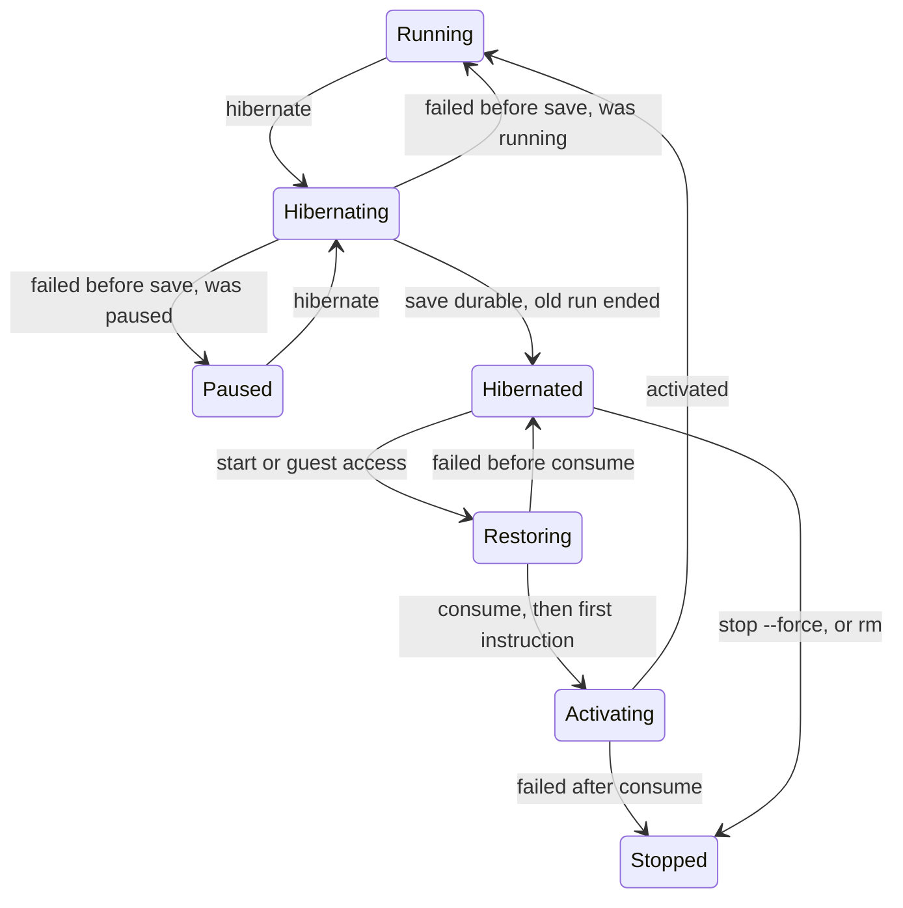

# 23. Hibernate and wake of the same machine

Date: 2026-11-21

Updated: 2026-11-26

## Status

Accepted

This ADR is implemented on the `feat/adr-14` branch. The conformance section
lists what has and has not been qualified. It
builds on [ADR 0021](0021-live-snapshots-and-forks.md) for capture, restore
construction and activation, on
[ADR 0014](0014-layered-oci-image-storage.md) for storage ownership, and on
[ADR 0018](0018-silo-vmm-contract.md) for the monitor contract.

The 2026-11-26 revision delivers hibernate and wake on krun with HVF on
macOS arm64. That lane reports native pause, capture, restore, fork and
incremental support under ADR 0021. The macOS 26 floor and machine
admission checks still apply; macOS 27 is unqualified. VZ is unchanged
and refuses hibernation and live operations.

## The Problem

A running machine holds host memory and a set of host processes for as long as
it runs. The only way to release them today is `silo stop`, which shuts the
guest down and discards everything in its memory. The next `silo start` cold
boots, and the user restarts whatever was running.

Silo can already save a running machine's memory, CPU and device state and
start a machine from such a save. ADR 0021 uses that for snapshots, restores
and forks. All three produce a **new** machine: a new id, copied disks and a
clone identity. None of them lets the **same** machine release its processes
and later continue where it stopped.

`silo pause` is not a substitute. A paused machine keeps its processes and all
of its memory.

This ADR decides how one machine is saved to disk, released, and later resumed
as itself, and which commands resume it.

## Terminology

**Hibernate** saves a machine's memory and execution state to disk and ends its
host processes. The machine is then **hibernated**.

**Wake** starts a hibernated machine from its saved state. It is the same
machine: same id, name, addresses, guest identity and disks.

**Saved state** is the set of files written by hibernate: guest memory, memory
layout, CPU state and device state. It does not include disks.

**Discard** deletes the saved state without running it. The machine becomes
stopped and its next start is a cold boot.

**Pause** and **resume** keep their ADR 0021 meaning: the guest is frozen in
memory and its processes stay.

## Representative Flow

```text
$ silo hibernate dev
   ✓ Hibernated   dev

$ silo list
ID        NAME  STATE       CPUS  MEMORY  DISK
912322ce  dev   hibernated  2     8G      20GiB

$ silo exec dev -- make test
... output of make test, running in the session state the guest had before ...

$ silo hibernate dev
$ silo start dev          # wakes
$ silo hibernate dev
$ silo stop dev           # wakes, shuts the guest down cleanly, ends stopped
```

## Decision

Silo adds a `hibernate` command and a durable `hibernated` machine state.
`silo start` wakes a hibernated machine. `exec`, `shell`, `cp` and opening a
forward wake it first and then proceed. No daemon is required.

Hibernate reuses the ADR 0021 capture pipeline up to and including the memory
write, but leaves the machine's disks in place instead of copying them. Wake
reuses the ADR 0021 restore construction and activation, with the machine's own
disks attached and its identity preserved.

### Core Invariants

1. **Same machine.** Wake keeps the machine id, name, MAC address, guest IP,
   hostname, `/etc/machine-id`, filesystem identifiers and SSH host keys. Only
   the run id changes.
2. **The disks are the disk half of the save.** Between the pause that precedes
   the memory write and the moment the woken guest runs again, nothing writes
   to any writable disk of the machine.
3. **Single use.** Saved state is used at most once. Silo durably marks it
   consumed before the woken guest executes its first instruction.
4. **No silent cold boot.** If saved state exists and cannot be used, wake
   refuses. Silo never substitutes a cold boot for a wake.
5. **Durable before release.** The saved state and its record are durable on
   disk before the old VM processes are ended. A hibernated machine survives a
   host reboot.
6. **Connections are not preserved.** Existing exec, shell and forward
   sessions, and TCP connections through the host, end at hibernate. Clients
   reconnect after wake.

## States And Commands

Two machine states are added. Wake reuses the existing `restoring` and
`activating` states; "waking" is progress text, not a state.

| State | Meaning |
|---|---|
| `hibernating` | The capture is in progress. The old run still exists. A failure before the save is durable returns the machine to `running` or `paused`. |
| `hibernated` | Saved state exists and is unused. No VM processes belong to the machine. |



Command behaviour by state:

| Command | Running | Paused | Hibernated | Stopped |
|---|---|---|---|---|
| `hibernate` | Save and release | Save and release; wakes as running | Refused | Refused |
| `start` | As today | As today | Wake | Cold boot |
| `exec`, `shell`, attach, `cp`, guest file operations, opening a forward | As today | As today | Wake, then proceed | Refused as today |
| `stop` | As today | As today | Wake, then normal clean shutdown | As today |
| `stop --force` | As today | As today | Discard | As today |
| `restart` | As today | As today | Wake, clean shutdown, cold boot | Cold boot |
| `rm` | As today | As today | Discard and remove | Remove |
| `snapshot`, `fork` | As today | As today | Refused: start it first | As today |
| `set` and any change to disks, memory, CPUs, kernel, boot assets, network or forwards | As today | As today | Refused: stop it first | As today |
| raw export, handoff | As today | As today | Refused: stop it first | As today |
| `pause`, `resume` | As today | As today | Refused: start it first | As today |
| `list`, `info`, `logs`, listing forwards | Observe | Observe | Observe; never wake | Observe |

Temporary `silo run` machines cannot be hibernated.

`silo list` shows the state `hibernated`. `silo info` additionally reports
when the machine was hibernated, the allocated size of the saved state, and
how the memory file was written: incrementally or in full, with the bytes
written. The last item is the evidence the performance suite uses.

## Hibernate

`libvm` owns admission, durable records and the old run's retirement. The
monitor owns the capture. The native worker writes memory and device state.

1. **Admit.** Under the machine lifecycle lock `libvm` requires a persistent
   machine that is running or paused, with no other operation in flight and
   with the capture capabilities ADR 0021 requires, including a cooperating
   guest agent. It records a hibernation row in phase `saving` and publishes
   `hibernating`.
2. **Quiesce.** The monitor closes and drains its host gate, freezes guest
   workloads through the agent (or validates the user's existing pause),
   pauses the VM natively and flushes every writable disk. This is the ADR
   0021 sequence, unchanged.
3. **Check space.** The monitor estimates how much guest memory is populated
   from the worker process's resident and swapped memory, as reported by the
   kernel. The estimate includes the worker's own overhead, so it errs high.
   `libvm` compares it, plus a fixed allowance for state files, against free
   space on the machine's filesystem. If there is not enough, the guest is
   resumed and hibernate fails. The estimate only avoids starting a write
   that cannot finish; the rollback on a full disk in step 4 is the guard.
   Silo keeps no space reservation for hibernate.
4. **Write.** The worker writes CPU state, device state and a complete sparse
   memory file into `<machine-data>/hibernation/<save-id>/`. When the run has
   a byte baseline, the memory file is written incrementally against it, as
   for an ADR 0021 local fork. No content hashes are computed. No disk is
   copied, cloned or hashed.
5. **Bind the disks.** For every writable disk `libvm` records its role, its
   path, and the inode number, size, mode, modification time and change time
   read from the descriptor the VM holds.
6. **Make durable.** Saved files are made read-only and synced, along with the
   writable disks and the containing directories. `libvm` commits the
   hibernation row to phase `available` and the machine state `hibernated` in
   one transaction and completes a catalog checkpoint.
7. **Release.** Only then does the monitor kill and reap the worker. There is
   no guest shutdown, no resume and no thaw. Per-run listeners and the
   machine's netd attachment end. `libvm` retires the old launch without
   deleting the saved state.

If the disk fills while writing, or any step before 6 fails, the existing ADR
0021 rollback resumes the guest (or leaves it paused if the user had paused
it), deletes the partial files and reports the failure. The machine keeps
running.

### Saved State Location And Record

Saved files live under the machine's own data directory, not in the
content-addressed pool. They are private to the machine and are not a
snapshot: they cannot be listed, exported, restored into another machine or
published.

One catalog row per machine, `machine_hibernation`, is the authority:

| Field | Purpose |
|---|---|
| save id, machine id, ended run id | Identity of the save and the run it came from |
| phase | `saving`, `available`, `waking`, `discarding` |
| launch configuration and effective network settings | What wake must reconstruct |
| saved file facts | Path, inode, size, mode, times of each saved file |
| writable disk facts | Path, inode, size, mode, times of each writable disk |
| timestamps and allocated size | Reporting |

The row, not the presence of files, decides whether a machine is hibernated.
Deleting saved files by hand leaves the machine hibernated and unwakeable until
it is stopped with `--force`.

## Wake

1. **Claim.** Under the machine lifecycle lock `libvm` moves the row to phase
   `waking`, allocates a new run id and publishes `restoring`. Concurrent
   callers that find a wake in progress wait for that wake instead of starting
   another.
2. **Validate.** `libvm` reopens every saved file and every writable disk and
   compares path, inode, size, mode, modification time and change time with
   the row. It then runs the existing ADR 0021 compatibility checks: state
   schema, architecture, CPU features, device configuration.
3. **Construct.** A new monitor and worker build the VM from the saved state
   with the machine's own disks attached in place and guest memory mapped
   privately from the saved memory file, so pages load on demand. The VM is
   held before its first instruction.
4. **Consume.** `libvm` durably marks the saved state consumed, binds the
   memory file to the new run and publishes `activating`. The monitor releases
   the VM only after it receives this authorization.
5. **Activate as the same machine.** The guest receives a new generation,
   which reseeds the kernel random number generator and corrects the wall
   clock. The agent reconnects over a fresh control channel, drops inherited
   sessions, reapplies the saved network configuration and resumes workloads.
   The monitor recreates configured forwards and publications.

Step 5 differs from ADR 0021 clone activation in exactly these points: it does
not rewrite `/etc/machine-id`, does not replace SSH trust, does not run a
restore hook and does not run the machine's startup command again.

The saved memory file stays mapped for the life of the woken run and serves as
its byte baseline, so the next hibernate is incremental. It is deleted when
that run ends or when a later hibernate replaces it.

### Why Consume Comes Before The First Instruction

The guest agent writes to the guest filesystem during activation. Once any
guest instruction has run, the disks may no longer match the saved memory, and
running the saved memory a second time against them would corrupt the guest.
Consuming first makes the rule simple: a failure before consume leaves the
machine hibernated and wake can be retried; a failure after consume ends the
new run without guest shutdown and leaves the machine stopped, as after a
crash. The next `silo start` cold boots.

### Disk And File Check

The check compares path, inode number, size, mode, modification time and change
time. It deliberately ignores the device number. On Btrfs the device number of
a subvolume is assigned at mount time and differs across reboots, so comparing
it would refuse an untouched machine after a reboot. The change time is set by
the kernel on every content or metadata change and cannot be set by a user, so
a modified, replaced or copied-back file is always detected.

This comparison is specific to the hibernation row. The existing
`SourceFingerprint`, which includes the device number, is unchanged and is
still what the worker uses for the files it has open.

## Wake From Access Commands

`libvm` exposes one entry point, "ensure this machine is running for guest
access", used by exec, shell, serial attach, guest file operations and opening
a forward, in the CLI, the daemon and the lobby alike. For a running machine it
behaves as the existing readiness check. For a hibernated machine it starts or
joins the wake and returns once the agent of the new run is ready. For every
other state it refuses as today; it never cold boots a stopped machine and
never resumes a paused one.

The machine lifecycle lock serializes wake against `stop`, `rm` and
`hibernate`. Any number of concurrent access commands produce one wake. A
command that wakes the machine prints nothing extra when the wake finishes
within half a second. Past that, on a terminal, it shows a spinner on standard
error with the current step (`Waking NAME`, then `Waiting for agent NAME`),
which clears itself before the command's own output. Command output, JSON
output and copied file contents are unaffected either way. `silo start` on a
hibernated machine prints the line `Waking NAME`.

A command issued before a hibernate is never replayed after the wake.

The lobby authorizes the requested guest action before it calls this entry
point. An unauthorized request does not wake a machine.

## Stopping A Hibernated Machine

`silo stop` wakes the machine and then runs the normal stop: the monitor asks
the guest to shut down and Silo waits for the VM to exit, within the existing
timeout. Nothing the guest held in memory is lost, and no new guest protocol is
needed. If the saved state cannot be used, `silo stop` discards it instead, so
stop always ends with the machine stopped, and reports that the guest could
not be shut down cleanly.

`silo stop --force` discards the saved state without waking. Everything the
guest had not written to disk is lost and the next boot replays filesystem
journals, as after a power cut. `--force` has the same meaning as on a running
machine: do not ask the guest.

Discard first commits phase `discarding` and a checkpoint, then deletes the
files, then sets the machine `stopped`. A crash between those steps cannot
leave a row that claims usable saved state whose files are gone.

## Protecting The Disks While Hibernated

A hibernated machine has no processes, but its disks are not ordinary stopped
storage: they hold filesystem state that only makes sense together with the
saved memory. Every operation that could write to or replace a writable disk,
change launch configuration, or cold boot the machine checks for the
hibernation row and refuses while it exists. The check lives in the shared
stopped-storage admission in `libvm` and in the cold-start path, so a new
stopped-machine operation is covered by default.

Operations refused: cold start, `set` and all configuration changes,
stopped snapshot, stopped fork, live snapshot and live fork, raw export, and
handoff (before its automatic stop). `stop`, `restart` and `rm` are the only
operations that end the hibernated state other than wake.

## Failure Semantics And Diagnostics

| Failure | Result |
|---|---|
| Any failure before the save is durable, including a full disk | Guest resumed (or left paused), partial files removed, machine keeps running. |
| Manager or host crash after the save is durable, before the old processes exit | Machine is hibernated. Recovery kills and reaps the exact old run, identified by the row, before any wake. |
| Host reboot while hibernated | Machine stays hibernated. Nothing starts automatically. |
| Saved files missing, changed or damaged; disks changed; incompatible Silo, kernel or CPU | Wake refuses. Machine stays hibernated. |
| Failure while constructing the VM, before consume | New processes reaped. Machine stays hibernated. Wake can be retried. |
| Failure after consume | New run ended without guest shutdown. Machine is stopped. Saved state is gone. |
| Crash during discard | Discard completes on the next lifecycle operation. |

User-facing messages say what happened and what to do:

| Situation | Message |
|---|---|
| Hibernate succeeds | `Hibernated NAME` |
| Capture unavailable on a home without a catalog | The host's typed `capture` refusal, without initializing the home. |
| VZ backend | `capture unsupported: backend-excluded (backend=vz, lane=not-applicable)` with guidance to use krun. |
| Not running or paused | ``machine `NAME` is not running; start it with `silo start NAME` `` |
| Already hibernated | ``machine `NAME` is already hibernated; wake it with `silo start NAME` `` |
| Temporary machine | ``machine `NAME` is a temporary `silo run` machine and cannot be hibernated`` |
| Not enough disk space | ``not enough disk space to hibernate `NAME`: SIZE needed, SIZE free`` |
| A command wakes a machine | nothing within half a second; then a spinner, `Waking NAME` and `Waiting for agent NAME`, cleared when done |
| `silo start` on a hibernated machine | `Waking NAME` |
| Snapshot or fork refused | ``machine `NAME` is hibernated; start it with `silo start NAME` first`` |
| Configuration change, export or handoff refused | ``machine `NAME` is hibernated; run `silo stop NAME` first`` |
| Saved state unusable | ``cannot wake `NAME`: its saved state cannot be used (REASON); run `silo stop NAME` to discard it, then `silo start NAME` `` |
| Wake failed after consume | ``could not wake `NAME`; its saved state is gone and the machine is stopped; run `silo start NAME` to boot it`` |

REASON is one of: files are missing, files were changed, disks were changed,
not compatible with this system.

## Compatibility

Wake applies the ADR 0021 restore compatibility checks before consume. Saved
state is not tied to an exact Silo build. A host kernel, firmware or Silo
update between hibernate and wake can cause a refusal; the machine stays
hibernated and the user discards.

On HVF, preflight checks destination compatibility facts without starting
a VM. Installation of the opaque GIC state can still fail during real
wake construction, before consume. On macOS the native RAM path has no
RAM clone or hole punching, so writing a save can take longer and allocate
more space than the optimized Linux path.

The guest agent embedded in a machine's boot assets must support same-machine
activation. Hibernate refuses a machine whose agent does not, because the
agent cannot be replaced while the machine sleeps.

The hibernation row records the machine's SSH signing key, which Silo keeps
in the host secret store and the guest trusts. Wake refuses, before consume,
when that key is missing from the secret store or has been replaced there,
because the woken guest would keep trusting a key the host can no longer
sign with. The reason reported is "not compatible with this system".

The daemon gains a `HibernateMachine` call. `StartMachine` wakes. New state
values are appended to the existing wire enums.

## Security And Trust

Saved state contains all guest memory, including secrets and keys. It is
stored with the same ownership and permissions as the machine's disks and is
deleted on discard, on machine removal and when the woken run ends.

Saved state is not content-hashed. Silo detects missing, truncated, replaced
and modified files through the kernel's change time. It does not detect silent
corruption that leaves file metadata untouched. This is the same trust level
as ADR 0021 local forks, and the same as Firecracker, which states that
snapshot files are trusted by the host.

Every wake reseeds the guest kernel's random number generator through the
generation device. Userspace generators that do not listen for the generation
change keep their state; because saved state is single use, that state is
never run twice.

## Conformance Requirements

Measured with `make perf` on the Arch 30 GiB cohort, idle guest. The measured
column is the median of three samples in image mode, from three runs on
2026-11-21 at commit `83fe25a8` on a Btrfs host:

| Action | Boundary | Target | Measured |
|---|---|---|---|
| `hibernate` | Command start to old processes gone | 2.0 s | 0.85 to 0.90 s |
| `wake` | `silo start` to agent ready | 0.75 s | 0.30 s |
| `exec` on a hibernated machine | Command start to first guest output | 0.85 s | 0.36 to 0.37 s |
| `hibernate` after a wake | As above, with a small controlled change | 1.5 s, and evidence of incremental memory reuse | 0.57 to 0.58 s, incremental |
| `stop` on a hibernated machine | Command start to stopped | Reported, no target yet | 0.73 s |
| `wake` with a cold host page cache | `silo start` to agent ready | Reported, no target yet | 0.45 to 0.48 s |

Hibernate must not read or copy disk contents in proportion to disk size, and
neither hibernate nor wake may hash or eagerly read memory in proportion to
configured RAM.

Real-VM scenarios that must pass before the status becomes Implemented:

1. A process, its in-memory state and its PID survive hibernate and wake; the
   startup command does not run again.
2. Machine id, name, MAC, IP, hostname, `/etc/machine-id` and SSH host keys are
   identical before and after, for an image whose machine-id differs from the
   Silo id.
3. After a sleep of several minutes the guest wall clock matches the host.
4. Hibernate from a paused machine wakes as running.
5. `silo stop` on a hibernated machine ends stopped with a file written before
   hibernate present after the next boot. `silo stop --force` discards.
6. Every refused operation in "Protecting The Disks" refuses and leaves disks
   and configuration byte-identical.
7. Deleting, truncating or replacing each saved file, and modifying each
   writable disk, makes wake refuse without booting.
8. Killing the manager, monitor and worker at each row of the failure table
   yields the stated result; unrelated processes with a reused PID are not
   killed.
9. Filling the disk during the memory write leaves the machine running.
10. Twenty concurrent `exec`, `cp` and `shell` commands on a hibernated machine
    produce one wake and all succeed against the same run.
11. A hibernated machine survives a host reboot and wakes afterwards, on Btrfs
    and on ext4.
12. Old exec, shell and forward sessions end at hibernate; configured forwards
    accept new connections after wake.

Qualification state on 2026-11-21, `make smoke` hibernate area on a Btrfs
host (40 passed, 1 skipped):

| Scenario | State |
|---|---|
| 1, 2, 4, 5, 7, 10, 12 | Pass on real VMs. |
| 3 | Passes with a short sleep; a sleep of several minutes has not been run. |
| 6 | Passes on real VMs for every operation except handoff, whose refusal is covered by a host test only. |
| 8 | Manager killed during the memory write and monitor or worker killed before consume pass on real VMs. The windows after the durable commit, after consume and during discard, and PID reuse, are covered by host tests only. |
| 9 | Not run on real VMs: the suite has no small filesystem without root. The rollback is covered by host tests. |
| 11 | Not run. The check ignores the device number by construction; a real reboot on Btrfs and on ext4 remains a manual check. |

## Consequences

### Benefits

- A machine releases its host memory and processes and continues later where
  it stopped, in well under a second on an idle guest if the targets hold.
- Hibernate costs no disk copy and no hashing, so its time follows the memory
  the guest actually uses.
- No daemon is needed. Access commands wake a machine on demand.
- The capture engine, memory writer, restore construction and activation of
  ADR 0021 are reused. No libkrun fork change is planned.

### Tradeoffs

- A wake that fails after the consume point loses the saved state. The window
  is the activation sequence, a fraction of a second.
- Hibernate requires the guest agent, as snapshots do.
- A hibernated machine that serves a network port is unreachable until a CLI
  command wakes it.
- `silo stop` on a hibernated machine takes a wake plus a shutdown, about one
  to two seconds, instead of being immediate.
- The first snapshot after a wake hashes all populated memory, because the
  saved memory file has no content identity.
- New states touch every layer that names machine states: store, monitor
  protocol, daemon protocol, CLI.

## Alternatives Considered

### Snapshot, stop, then restore

The existing commands can approximate this: snapshot with memory, remove the
machine, restore under the same name. The result is a different machine with
copied disks and a rotated guest identity, the snapshot costs a disk clone and
a full hash, and three commands must succeed in order. It does not give access
commands anything to wake.

### Guest-driven hibernation

The guest kernel can suspend itself to its own disk, as cloud providers do for
their hibernate feature. It needs guest kernel support, a swap area at least
as large as memory in use, and guest cooperation for every image. It writes
memory through the guest's block layer, which is slower than the host writing
a sparse file, and resuming repeats part of a boot. Silo already controls the
VM from the host and has the capture engine.

### Discard on plain `silo stop`

Deleting the saved state without waking is immediate, and is what libvirt does
(`managedsave-remove`). It loses whatever the guest had not written to disk.
Limiting that loss needs a new "sync without shutting down" guest call before
every hibernate, and still cannot cover writes made after the sync. Waking
first uses only existing operations and loses nothing. Discard remains
available as `--force`.

### Content-hash the saved state

Hashing memory and disks at hibernate and verifying at wake would detect
silent corruption. It requires reading all populated memory and all disk
contents on every wake, which removes on-demand loading and makes wake time
proportional to machine size.

### Reserve disk space for configured memory

The ADR 0021 capture admission reserves the machine's configured memory
size. For hibernate that would refuse a lightly used 30 GiB machine on a host
with 10 GiB free although the save needs a few hundred MiB. A free-space check
against populated memory after the pause, plus rollback if the disk fills,
gives the same safety for the guest without the reservation.

### Keep connections alive

A host process could hold each connection open while the machine sleeps and
wake it when data arrives. That is a per-machine always-on proxy, and it
cannot answer application-level heartbeats or extend remote timeouts. It is
the same component that wake on network traffic needs and belongs with that
work.

## Accepted Limitations

- Existing connections and sessions do not survive hibernate.
- Incoming network traffic does not wake a machine.
- Hibernate is not available without the guest agent.
- Silent corruption of saved state that preserves file metadata is not
  detected.
- `snapshot` and `fork` of a hibernated machine require waking it first.
- Guest monotonic time does not advance while hibernated; wall-clock time is
  corrected at wake.

## What This Does Not Decide

- An idle policy that hibernates machines automatically. Research and a first
  suggestion exist; the requirement is not settled.
- Wake on network traffic, which needs a process that outlives the VM to own
  listening sockets. This requires its own ADR.
- Rolling a machine back in place to an earlier snapshot.
- Hibernate for machines without a guest agent.

## Implementation References

- Capture pipeline: `virt/vmm/src/live/capture.rs`
- Restore construction and activation: `virt/vmm/src/restore/activation.rs`,
  `virt/vmm/src/krun/worker/restore.rs`
- Guest activation: `guest/agent/src/lifecycle.rs`,
  `guest/agent/src/activation_identity.rs`
- Lifecycle and stopped-storage admission: `runtime/libvm/src/machine/lifecycle.rs`,
  `runtime/libvm/src/machine/stopped.rs`, `runtime/libvm/src/runtime/core.rs`
- Launch retirement and memory baseline roots:
  `runtime/libvm/src/store/operation_store.rs`,
  `runtime/libvm/src/store/map_store.rs`
- Access guards: `runtime/libvm/src/machine/session.rs`,
  `runtime/libvm/src/machine/streams.rs`,
  `runtime/libvm/src/machine/forward.rs`, `app/cli/lib/api/streams.rs`
- Machine states: `runtime/libvm/src/store/models/machine.rs`,
  `specs/vm-spec/src/lifecycle.rs`

## External References

- Firecracker snapshot support, trust model and on-demand memory loading:
  <https://github.com/firecracker-microvm/firecracker/blob/main/docs/snapshotting/snapshot-support.md>
- libvirt managed save (`managedsave`, `managedsave-remove`,
  `start --force-boot`): <https://libvirt.org/manpages/virsh.html>
- TCP specification, connection state and keepalive:
  <https://www.rfc-editor.org/rfc/rfc9293.html>
